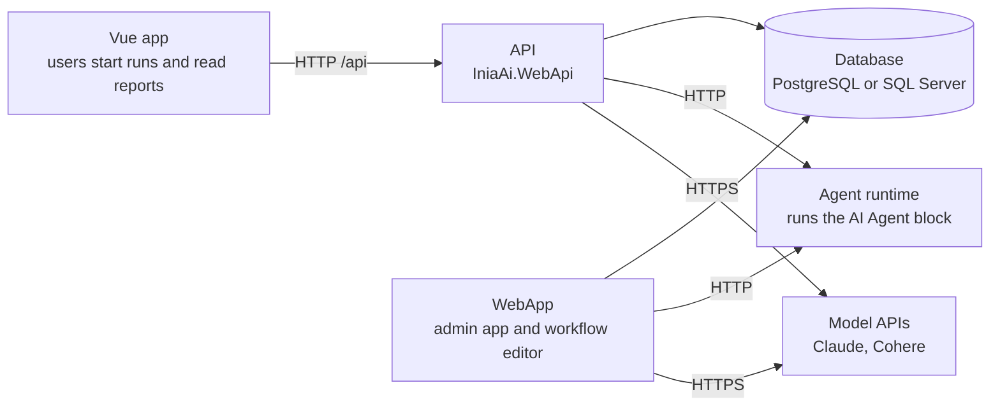
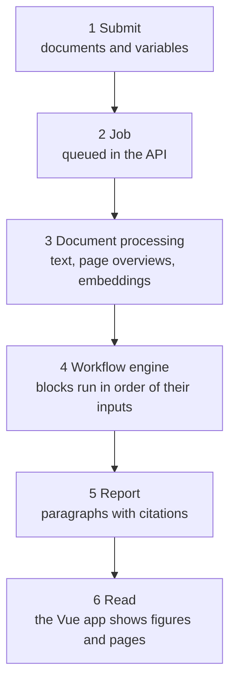

# Architecture

This page describes the open build: its parts, its projects and layers, and the path of a run from
the upload of a document to a report with cited figures. [The open build and the full
edition](editions.md) says what the full edition adds.

## The parts

- **The API** (`IniaAi.WebApi`) serves the Vue app and any other system over REST. It also runs the
  workflows: each API process runs a queue of jobs.
- **The WebApp** (`IniaAi.WebApp`) is the admin app: users, organizations, settings, and the
  workflow editor. It is a Blazor Server app. It reaches the database through the same application
  layer as the API, not through the API, and it runs the jobs it starts itself.
- **The Vue app** is the app for users. It sits in `web/` and calls only the
  API.
- **The agent runtime** runs the AI Agent block in a sandbox. It sits in `agent-runtime/`.
  The platform sends it a run over HTTP and reads the result back (`platform/IniaAi.Infrastructure/Services/AgentRuntimeClient.cs`).
- **The database** holds the data of every organization: one schema for workflows and settings
  (Core), and one for runs, documents and reports (UserData). Both apps migrate it on start.

## Projects and layers

Each project references only the projects in the rows above it, and `IniaAi.FileFormats` also the PDF reader process, `IniaAi.FileFormats.PdfiumWorker`.

| Project | What it holds |
|---|---|
| `IniaAi.Common` | Helpers and enums that every project uses. It references no other project. |
| `IniaAi.Configuration` | The settings classes, and how a host reads its settings. |
| `IniaAi.Domain` | The entities: workflows, sections, blocks and their settings, documents and pages, runs and reports. Also the block type catalog (`platform/IniaAi.Domain/Entities/Workflows/Blocks/BlockTypeCatalog.cs`). |
| `IniaAi.Common.Interfaces` | Interfaces that cross the layers. |
| `IniaAi.AiConnection` | The connections to the models: Claude through the Anthropic API, Amazon Bedrock or Azure AI Foundry, and Cohere embeddings. |
| `IniaAi.FileFormats` | Reading and writing documents: PDF, Word, Excel, images and Markdown. A separate process, `IniaAi.FileFormats.PdfiumWorker`, reads PDF files with PDFium in a sandbox. |
| `IniaAi.Core` | The workflow engine: the block strategies, page retrieval, citations, and the seam for block types from other projects. |
| `IniaAi.WebApi.Contracts` | The request and response types of the API. |
| `IniaAi.Application` | The commands and queries that the apps send, each with its handler (`platform/IniaAi.Application/Common/Dispatching/`). |
| `IniaAi.Services` | Document processing, the job queue and the background services. |
| `IniaAi.Infrastructure` | Persistence with Entity Framework Core, sign-in, email, file storage and the agent runtime client. |
| `IniaAi.Migrations.PostgreSql`, `IniaAi.Migrations.Mssql` | The database migrations for each database server. |
| `IniaAi.WebApi`, `IniaAi.WebApp` | The two hosts. |
| `IniaAi.Samples.WordCount` | A block type in its own project: the example of [Add a block type](add-a-block.md). |

The test projects end in `.Tests`, `.UnitTests`, `.IntegrationTests` or `.ContractTests`.
`IniaAi.Testing` and the projects whose names start with it hold what the tests share.

## A run, from upload to report

1. **Submit.** The Vue app sends the documents and the run's variables to
   `POST api/v1/workflow-executions/submit`. `WorkflowExecutionOrchestrator`
   (`platform/IniaAi.Application/Commands/WorkflowExecutions/Shared/WorkflowExecutionOrchestrator.cs`) checks
   the required variables and document classes, stores the files, and creates the run.
2. **Job.** `JobsService` (`platform/IniaAi.Services/Jobs/JobsService.cs`) queues the run and runs up to
   `PlatformSettings:IniaAi:MaxConcurrentJobs` jobs at once. `JobExecutor` runs each one.
3. **Document processing.** `DocumentProcessingService`
   (`platform/IniaAi.Services/Documents/DocumentProcessingService.cs`) splits each document into pages and
   reads their text. A page with no text layer goes to a model, which reads its image
   (`platform/IniaAi.Core/Services/OcrTranscriptionService.cs`). A model writes a short overview of each
   page, and Cohere embeds the overview when the install has a Cohere key.
4. **Workflow engine.** `WorkflowHandler` (`platform/IniaAi.Core/Workflows/WorkflowHandler.cs`) runs the
   blocks. A block starts when the blocks whose outputs it uses have finished, and up to
   `PlatformSettings:MaxBlockParallelism` blocks run at once. Each block type has a strategy in
   `platform/IniaAi.Core/Workflows/Strategies/`. An AI Query block picks the pages it reads with its filter
   rule (`platform/IniaAi.Core/Rag/RagService.cs`), and sends them with its prompt to a model.
5. **Report.** The answer of each output block becomes a paragraph of the report. When the block's
   setting **Get Citations From Model** is on, the Claude model returns citations, and each figure
   in the paragraph links to the document and page that state it
   (`platform/IniaAi.Core/Workflows/Annotations/CitationSources.cs`).
6. **Read.** The Vue app reads the report from `GET api/v1/workflow-reports/{id}/elements` and the
   image of a cited page from `GET api/v1/pages/{pageId}/image`
   (`platform/IniaAi.WebApi/Controllers/v1/WorkflowReportsController.cs`,
   `platform/IniaAi.WebApi/Controllers/v1/PagesController.cs`).

## Organizations

One install serves many organizations from one database. Each request to the API names its
organization, and each query of the application layer filters by it. [Security](security.md) says how
the API checks that a user may act in an organization.
