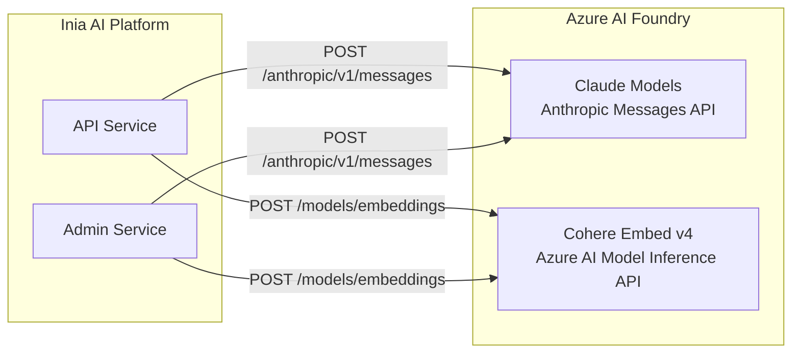

# Azure AI Foundry Integration

**On this page:** Architecture · Deployment Modes · Configuration · Azure Resource Requirements · The agent path in Azure mode · Quick Links

The Inia AI platform supports deployment on Microsoft Azure using [Azure AI Foundry](https://ai.azure.com/) for LLM and embeddings inference. This enables customers who require Azure-hosted AI services to run the full platform within their Azure environment.

> [!NOTE]
> **Deployment Model**
>
> Inia AI is deployed on-premise or in the customer's cloud. This documentation covers the platform-level Azure integration (code, configuration), not the infrastructure it runs on.


## Architecture

Azure AI Foundry provides hosted access to Anthropic Claude models and Cohere embedding models through Azure's infrastructure. The platform connects to two Azure endpoints:



### API Endpoints

| Service | Azure Endpoint | API Format |
|---------|---------------|------------|
| **Claude (LLM)** | `https://{resource}.services.ai.azure.com/anthropic/v1/messages` | Native Anthropic Messages API |
| **Cohere (Embeddings)** | `https://{resource}.services.ai.azure.com/models/embeddings?api-version=2024-05-01-preview` | Azure AI Model Inference API |

> [!WARNING]
> **Cohere API Format**
>
> Azure does **not** expose the Cohere native route (`/cohere/v1/embed` returns 404). The platform uses the Azure AI Model Inference API (`/models/embeddings`) which has a different request/response format from the Cohere native API. This is handled transparently by `AzureCohereEmbeddingsConnector`.

### Authentication Options

| Method | Header | Use Case |
|--------|--------|----------|
| **API Key** | Claude: `X-Api-Key: {key}` (`AnthropicChatConnector`); Cohere: `api-key: {key}` (`AzureCohereEmbeddingsConnector`) | Simple deployments, trials |
| **Entra ID (OAuth)** | `Authorization: Bearer {token}` on both | Production, managed identity, no key rotation |

Entra ID authentication uses the `Azure.Identity` SDK (`DefaultAzureCredential` in `DefaultAzureTokenProvider`) with scope `https://cognitiveservices.azure.com/.default`. Microsoft's current Claude guide names the scope `https://ai.azure.com/.default` instead ([Deploy and use Claude models in Microsoft Foundry](https://learn.microsoft.com/azure/ai-foundry/foundry-models/how-to/use-foundry-models-claude)); the platform still requests the Cognitive Services scope. The calling identity needs the RBAC role **Cognitive Services User** on the Foundry resource; deploying models needs **Contributor** or **Owner** on the resource group.

`AzureCohereEmbeddingsConnector` fails at construction with `Azure Foundry Cohere API URL not set.`, `Azure Foundry CohereDeploymentName not set. …` or `Azure Foundry Cohere API key not set.` when a key is missing; `AnthropicChatConnector` fails with `Azure Foundry Anthropic API URL not set.` or `Azure Foundry Anthropic API key not set.`.

## Deployment Modes

The platform supports multiple hosting environments, selected at deploy time via environment variables:

| Mode | Env Var | LLM Provider | Embeddings Provider |
|------|---------|--------------|-------------------|
| **Azure** | `FORCE_AZURE_MODE=true` | Azure AI Foundry (Claude) | Azure AI Foundry (Cohere) |
| **AWS** | `FORCE_AWS_MODE=true`, or neither set on an EC2 host | AWS Bedrock (Claude) | AWS Bedrock (Cohere) |
| **Direct API** | Neither set off EC2, or `FORCE_AWS_MODE=false` | Anthropic API | Cohere API |

The EC2 detection lives in `CloudHost.IsAws`; [Deployment model drives provider selection](providers.md#deployment-model-drives-provider-selection) has the full precedence.

> [!NOTE]
> **Priority Order**
>
> When multiple mode flags are set, the DI wiring uses this priority: Gateway > Azure > AWS > Default.

## Configuration

Azure mode requires two configuration sections:

1. **`AzureFoundry`** — Azure-specific plumbing (URLs, API keys, auth method, deployment name)
2. **`Anthropic`** / **`Cohere`** — Model selection, temperatures, max tokens, retries (shared across all deployment modes)

This separation is intentional: model behavior settings are the same regardless of hosting environment. Only the transport layer (URLs, auth) changes per environment. See [Platform Integration](azure-platform-integration.md) for details.

### Minimal `appsettings.json` for Azure Mode

```json
{
  "PlatformSettings": {
    "Anthropic": {
      "AdvancedModel": "PublicSonnet5",
      "BasicModel": "Haiku4_5"
    },
    "AzureFoundry": {
      "AnthropicApiUrl": "https://{resource}.services.ai.azure.com/anthropic/v1/messages",
      "AnthropicApiKey": "{azure-api-key}",
      "UseEntraId": false,
      "CohereApiUrl": "https://{resource}.services.ai.azure.com/models/embeddings?api-version=2024-05-01-preview",
      "CohereApiKey": "{azure-cohere-key}",
      "CohereDeploymentName": "cohere-embed-v4"
    }
  }
}
```

For direct API fallback (when `FORCE_AZURE_MODE=false`), also include:

```json
{
  "PlatformSettings": {
    "Anthropic": {
      "ApiKey": "{direct-anthropic-key}"
    },
    "Cohere": {
      "ApiKey": "{direct-cohere-key}"
    }
  }
}
```

## Azure Resource Requirements

### Models to Deploy

| Model | Deployment Name | Endpoint |
|-------|----------------|----------|
| **Claude Sonnet 4.6** | `claude-sonnet-4-6` | `/anthropic/v1/messages` |
| **Claude Haiku 4.5** | `claude-haiku-4-5` | `/anthropic/v1/messages` |
| **Cohere Embed v4** | Customer-chosen (e.g. `cohere-embed-v4`) | `/models/embeddings` |

The Claude deployment names above are examples; a customer stack chooses its own (`claude-sonnet-5`, `claude-opus-4-8`, and so on). A deployment name is an identity the operator picks, not a model id — see [The agent path in Azure mode](#the-agent-path-in-azure-mode) for what follows from that.

> [!WARNING]
> **Azure Subscription Type**
>
> Claude quota is set per subscription and shared across regions. Microsoft's default limits ([Claude model quotas and rate limits](https://learn.microsoft.com/azure/foundry/foundry-models/concepts/claude-models-quotas-limits)): Enterprise and MCA-E subscriptions get 10,000 requests per minute for most models; pay-as-you-go subscriptions get 40 requests and 40,000 uncached input tokens per minute for the current models (80 and 80,000 for Sonnet 4.6 and Haiku 4.5, and 0 for Fable 5); free-trial subscriptions get 0. More quota is a request through Microsoft's quota form, approved case by case.

## The agent path in Azure mode

An `Agent` block stores a **provider-neutral model id** (`claude-sonnet-5-5`), the same on every stack. When a run starts, the platform resolves it to the allowlist's form of that model: the Foundry deployment name on an Azure stack, the Bedrock inference-profile id on AWS. A workflow therefore moves between an AWS and an Azure stack without editing its agent blocks. Azure mode is the same switch the AiQuery path already reads (`FORCE_AZURE_MODE=true`, [Deployment Modes](#deployment-modes)); there is no second switch and no agent-specific Azure setting.

### Configuration keys the platform reads

Nothing beyond the `PlatformSettings:AgentRuntime:*` section documented in the [Application Configuration reference](../../operations/application-configuration.md#agentruntime). The one key whose **value shape** changes with the mode is the allowlist:

| Key | Value shape in Azure mode | Example |
|-----|---------------------------|---------|
| `PlatformSettings:AgentRuntime:AllowedModels` | A list of Foundry deployment names — the names the Claude deployments were given in the Foundry resource — mirroring the agent runtime's `ANTHROPIC_ALLOWED_MODELS` byte for byte. The stack renders one list into both places, so the editor dropdown and the runtime's refusal agree by construction. | `["claude-sonnet-5", "claude-haiku-4-5"]` (as `AllowedModels:0`, `AllowedModels:1` config keys, or the Key Vault secret `shared--PlatformSettings--AgentRuntime--AllowedModels--0` and so on) |

The shape is checked at startup, in `AddAgentRuntimeClient` (`BindAllowedModelsToProvider` in `InfrastructureServiceRegistration.cs`), with the same fail-closed posture as a missing auth token: when the runtime is enabled, an allowlist entry that is a Bedrock inference-profile id (anything carrying `anthropic.`, `-v1:` or `-v2:`, per `ModelIdNormalizer.IsBedrockFormat`) refuses startup, and the reverse — a plain deployment name in the allowlist of an AWS-mode deployment — refuses startup too. The refusal reads `PlatformSettings:AgentRuntime:AllowedModels mirrors the runtime's allowlist, and this deployment runs its model calls through azure-foundry: 'us.anthropic.claude-sonnet-5' is an AWS Bedrock inference-profile id, not an Azure AI Foundry deployment name (expected the name the deployment was given, like 'claude-sonnet-5').` A direct-API deployment declares no provider (`ModelProviders.ForDeployment` returns null) and accepts any shape; the runtime's own allowlist is then the only rule.

### What the platform does with the names

- **Save and submit gates** (`AgentBlockGuard`): the block's model must be a form of a model in `AllowedModels`. Any provider's id of an allowed model passes: a Bedrock id such as `us.anthropic.claude-sonnet-5-5` is the same model as a Foundry deployment named `claude-sonnet-5-5`, so it saves and submits on a Foundry stack. Forms are matched through `ModelIdNormalizer.Normalize`, which drops the region and provider prefixes and the `-v1:0` suffix; a dated id (`claude-haiku-4-5-20251001`) does not match an undated name (`claude-haiku-4-5`), and a deployment not named after its model (`sonnet-prod`) matches only its own name, so a template that stores it is not portable. A model with no form in the list is refused with "not in the allowed model list (…)", which lists the neutral ids, at save time and at submit time, before any execution row exists, so a template saved against an older list cannot spend upstream blocks only to die at the runtime's `400`. The submit refusal carries the error code `WorkflowExecution.AgentModelNotAllowed` (`WorkflowExecution.AgentRuntimeDisabled` stays the code for a disabled runtime).
- **Stored id** (`AgentBlockModelNormalizer`, called from `WorkflowSavePipeline`): every author save (the editor, the template API) rewrites an agent-family block's model to the neutral id when the allowlist has a form of it, after the save gates and the version check pass, so ids stored earlier are normalised on the next author save. That save mints a new version even when nothing else changed. System saves that stamp their own narrative (shared-component fan-out, prompt migrations) leave model ids as they are. A block inside a shared-component link keeps its stored id, because a rewrite would make the link read as a local edit; it still runs, because the run resolves any form.
- **Tier** (`AgentModelTiers`): a block that stores no model runs its tier's model instead, the deployment's `AgentRuntime:AdvancedModel` or `AgentRuntime:BasicModel` unless the organization overrides it ([AgentRuntime](../../operations/application-configuration.md#agentruntime)). The tier model is a provider-neutral id too and resolves the same way, so the defaults (`claude-opus-5-5`, `claude-sonnet-5-5`) need no per-stack setting.
- **Run** (`AgentRunBlockSupport.RuntimeModelOf`): the start request and the spend record carry the allowlist's form of the block's model (its own, else its tier's), so the runtime receives an id it allows and the run is priced under the deployment's provider. When the allowlist holds several forms of one model, the first listed wins.
- **Provider attribution** (`ModelIdNormalizer`, `ModelProviders`): the allowlist's names are registered at startup as `azure-foundry` deployments, so `GetProvider("claude-sonnet-5")` answers `azure-foundry` on an Azure stack and `anthropic-api` everywhere else — a deployment name cannot be parsed from the string, only recognised. The Bedrock and Anthropic parses are unchanged. The table is provider-keyed so a gateway's ids can join later as a registration, not a parser branch.
- **Editor**: the Agent block's **Specific model** dropdown lists the allowlist's models once each, by their neutral ids, beside a tier toggle labelled with the model the tier resolves to, labelling a Foundry deployment by its configured name (`claude-sonnet-5 (Azure AI Foundry)`) rather than by the catalogue description of the same string. The AI Query block's dropdown is the catalogue, not the allowlist: it offers each current model once, under its plain `claude-*` name, and every stack resolves that name to its own id when the block runs ([Block model choice resolves per stack](providers.md#block-model-choice-resolves-per-stack)). On Azure the resolved id is the plain name, so it reaches the right deployment only on a stack that names each deployment after its model.

### Pricing rows

`ModelPricing` rows are keyed by `(Provider, ModelId)`. The `azure-foundry` rows of the Claude models are keyed on the **deployment name**, and the embeddings row on the **model name** (`ModelPricingSeedingService`). The seeded Claude set, each carrying the same list rates as the Bedrock row for the same model (the Bedrock rows add a 1.1 multiplier for a regional endpoint; the Foundry rows have none):

| Deployment name | Alias | Model priced as |
|-----------------|-------|-----------------|
| `claude-opus-5-5` | — | Claude Opus 5.5 ($4 / $20 per MTok list price, cache reads $0.20) |
| `claude-opus-5` | — | Claude Opus 5 |
| `claude-opus-4-8` | — | Claude Opus 4.8 |
| `claude-sonnet-5-5` | — | Claude Sonnet 5.5 ($2 / $10 per MTok list price; cache reads $0.10, not Sonnet 5's $0.20) |
| `claude-sonnet-5` | — | Claude Sonnet 5 ($2 / $10 per MTok list price) |
| `claude-sonnet-4-6` | — | Claude Sonnet 4.6 |
| `claude-haiku-5-5` | — | Claude Haiku 5.5 ($0.10 / $0.50 per MTok for prompts up to 100,000 tokens; the row carries a long-prompt tier, so a single request with a longer prompt is priced at $0.50 / $2.50) |
| `claude-haiku-4-5-20251001` | `claude-haiku-4-5` | Claude Haiku 4.5 (either name resolves to the row) |

The embeddings row is `embed-v4.0`, Cohere Embed 4 at $0.12 per million input tokens, the Global Standard price that the Azure stack deploys. It is keyed on the model name whatever the deployment is called: `AzureCohereEmbeddingsConnector` sends the deployment name (`cohere-embed-v4` on the Azure stack) only in the request, and its usage records carry the configured model in its Cohere API form.

Two consequences, both deliberate:

- **A Claude deployment name that does not identify the model it serves needs its own row.** The row is keyed on the configured name, so a deployment called `claude-sonnet-5` is priced as Sonnet 5 whatever it actually serves. If a stack names a deployment after a different model, add a `ModelPricing` row for that exact name under provider `azure-foundry` through the model-pricing API — and prefer naming the deployment after the model it serves, because the seeder re-applies the seeded price for every seeded `(provider, name)` pair on each start.
- **No row is seeded for a model that has no list price in the seed.** Such a deployment records usage with no cost until an operator adds its row.

These rows also price agent runs. `AgentRunBilling` prices a run's tokens from the trace pack, model by model and request by request, against the rows of the configured model's provider — `azure-foundry` on an Azure stack, because the configured model is a registered deployment name. The runtime's own cost figure is billed only for what no row covers (a model with no row, or a run without a trace pack), on a spend record with provider `agent-runtime` — see [Agent Runtime Integration](../services/infrastructure/agent-runtime-integration.md).

### Marketplace Terms

- **Anthropic**: Claude is a partner model sold through Azure Marketplace; the first deployment asks you to read and accept the Marketplace terms (Microsoft's Claude guide, step "Agree and Proceed")
- **Cohere Embed v4**: `embed-v-4-0` is a model sold directly by Azure ([Foundry Models sold by Azure](https://learn.microsoft.com/azure/foundry/foundry-models/concepts/models-sold-directly-by-azure)), so no Marketplace subscription is needed

### Regions

- **Claude models**: Global Standard deployments in East US 2 and Sweden Central; some models also offer Data Zone Standard (US). Microsoft's [region availability by deployment type](https://learn.microsoft.com/azure/foundry/foundry-models/concepts/models-from-partners#region-availability-by-deployment-type) is the current list
- **Cohere Embed v4**: see the same Microsoft page for the regions of `embed-v-4-0`

## Quick Links

| Document | Description |
|----------|-------------|
| [Platform Integration](azure-platform-integration.md) | Code architecture, DI wiring, connectors, Entra ID auth |

