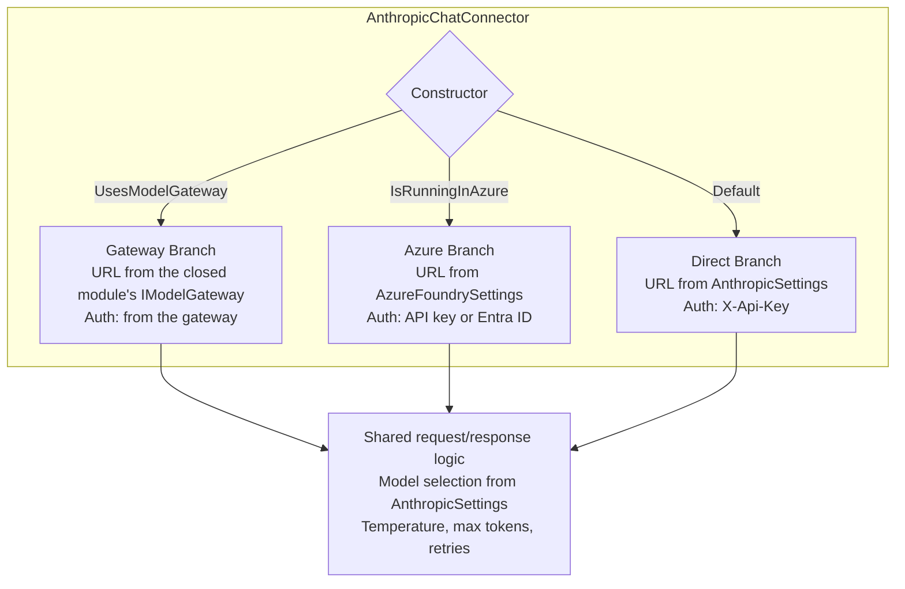

# Azure Platform Integration

**On this page:** Connector Architecture · DI Wiring · Configuration Reference · Entra ID Authentication · Startup Validation · Fallback to Direct API

How the Inia AI platform code integrates with Azure AI Foundry. Covers the connector architecture, DI wiring, configuration, and authentication.

> [!NOTE]
> **Code Location**
>
> All Azure integration code lives in the `platform` repository:
> - Connectors: `IniaAi.AiConnection/`
> - Configuration: `IniaAi.Configuration/`
> - DI wiring: `IniaAi.WebApi/` and `IniaAi.WebApp/`

## Connector Architecture

### Anthropic (Claude) — Native Messages API

Azure AI Foundry exposes the Anthropic Messages API at `/anthropic/v1/messages` with an identical request/response format to the direct Anthropic API. `AnthropicChatConnector` serves three backends: a model gateway, Azure AI Foundry and the direct Anthropic API. Only the URL, version header and authentication differ. Native AWS Bedrock is a different connector, `AwsBedrockChatProvider` ([AI providers & connectors](providers.md#awsbedrockchatprovider-native-aws-bedrock)).



Key points:
- The Azure branch changes `_apiUrl`, the auth header and the error parsing (`TryParseAzureApimError`)
- Model selection (`AdvancedModel`, `BasicModel`), temperatures, max tokens, and retry logic all come from `AnthropicSettings` — shared across all modes
- The API version header (`anthropic-version`, from `Anthropic.ApiVersion`) is sent on Azure and the direct API, not on a model gateway
- The connector reads the rate limit headers (`anthropic-ratelimit-input-tokens-*`) only when all three are present (`TryGetValues`), so a response without them leaves the local limiter in charge
- The `model` field carries the Foundry deployment name, so the resolved model id must match a deployment ([Block model choice resolves per stack](providers.md#block-model-choice-resolves-per-stack))

### Cohere (Embeddings) — Azure AI Model Inference API

Azure does **not** expose the Cohere native route (`/cohere/v1/embed` returns 404). Instead, it uses the Azure AI Model Inference API, which has a different format:

| Aspect | Cohere Native | Azure AI Model Inference |
|--------|--------------|------------------------|
| **Endpoint** | `/cohere/v1/embed` | `/models/embeddings?api-version=2024-05-01-preview` |
| **Input field** | `texts: string[]` | `input: string[]` |
| **Model field** | `model: "embed-v4.0"` (the `Cohere.EmbeddingsModel` id) | `model: "<deployment-name>"` |
| **Dimensions** | `output_dimension: int` | `dimensions: int` |
| **Response** | `embeddings.float: double[][]` | `data[].embedding: double[]` |
| **Tokens** | `meta.billed_units.input_tokens` | `usage.prompt_tokens` |

The `AzureCohereEmbeddingsConnector` handles this translation. It uses `EmbeddingsRequest` / `EmbeddingsResponse` models from `platform/IniaAi.AiConnection/Azure/ApiModel/`.

The `CohereDeploymentName` in `AzureFoundrySettings` is required — this is the customer-chosen Azure deployment name (e.g. `"cohere-embed-v4"`), not the Cohere model ID.

### Error Handling

`ReadErrorText` in `AnthropicChatConnector` turns an error response from Azure into error text. It reads two formats:

**Anthropic native format** (from the model):
```json
{
  "type": "error",
  "error": { "type": "overloaded_error", "message": "Overloaded" }
}
```

**Azure APIM format** (from the gateway):
```json
{
  "statusCode": 401,
  "message": "Access denied due to invalid subscription key."
}
```

API Management can also send `{"error": {"code": "401", "message": "..."}}`. A body that names an error type is read in the Anthropic format, as `Overloaded: Overloaded`. `TryParseAzureApimError` reads a body that names none, as `Azure APIM (401): Access denied due to invalid subscription key.`. The connector returns the text as an error message, so the application does not crash.

## DI Wiring

Azure mode is activated by the `FORCE_AZURE_MODE=true` environment variable. The static property `PlatformSettings.IsRunningInAzure` returns `CloudHost.IsAzure`:

```csharp
public bool IsAzure => _readVariable(FORCE_AZURE_MODE) == TRUE;
```

Only the exact string `"true"` returns true. `"false"`, absent, or any other value falls through to the next mode check. An Azure-mode process is never AWS mode by detection: `CloudHost.IsAws` skips the EC2 lookup when Azure mode is on, unless `FORCE_AWS_MODE=true` names AWS explicitly.

### Registration Priority

`CloudHost.ModeFor` decides the mode once, in this order, and every registration switches on the result, `PlatformSettings.DeploymentMode`:

1. **Gateway** — `platformSettings.UsesModelGateway`
2. **Azure** — `PlatformSettings.IsRunningInAzure`
3. **AWS** — `PlatformSettings.IsRunningInAws`
4. **Default** — Direct API (Anthropic + Cohere)

### Files with Azure DI Branch

| File | What it registers |
|------|-------------------|
| `InfrastructureServiceRegistration.cs` (`AddModelConnectors`, called by both hosts) | `AnthropicChatConnector` (Azure URL + auth), `AzureCohereEmbeddingsConnector` and the `IAzureTokenProvider` |
| `EmbeddingsConnectorFactory.cs` | `AzureCohereEmbeddingsConnector` (the factory refuses the gateway mode) |
| `TestChatConnectorFactory.cs` (`IniaAi.Testing.DependencyInjection`) | The test host's real `AnthropicChatConnector` with the Azure token provider |

## Configuration Reference

### `AzureFoundrySettings`

Located in `platform/IniaAi.Configuration/LLMProviders/AzureFoundrySettings.cs`. Contains **only** Azure-specific transport settings — no model behavior settings.

| Property | Type | Required | Description |
|----------|------|----------|-------------|
| `AnthropicApiUrl` | `string?` | Yes | Azure endpoint for Claude (`https://{resource}.services.ai.azure.com/anthropic/v1/messages`) |
| `AnthropicApiKey` | `string?` | When `UseEntraId=false` | Azure API key for Claude |
| `UseEntraId` | `bool` | No (default: `false`) | Use Entra ID (OAuth) instead of API key |
| `CohereApiUrl` | `string?` | Yes | Azure endpoint for embeddings (`https://{resource}.services.ai.azure.com/models/embeddings?api-version=2024-05-01-preview`) |
| `CohereApiKey` | `string?` | When `UseEntraId=false` | Azure API key for Cohere |
| `CohereDeploymentName` | `string?` | Yes | Azure deployment name for the Cohere model (e.g. `"cohere-embed-v4"`) |

### Why No Model Settings in `AzureFoundrySettings`?

The `AnthropicChatConnector` and `AzureCohereEmbeddingsConnector` read model selection, temperatures, max tokens, retry counts, etc. from the existing `AnthropicSettings` and `CohereSettings` classes. These are shared across all deployment modes (Direct, AWS, Azure).

Duplicating them into `AzureFoundrySettings` would mean:
- Two places to configure the same thing
- `IsRunningInAzure` checks in every connector method to pick the right source
- No actual benefit — customers use the same models and parameters regardless of hosting

### Model Enum Values

Model selection uses the `AiModel` enum (`platform/IniaAi.Configuration/Enums/Anthropic/AiModel.cs`); Azure mode uses the plain `claude-*` entries. The full table of names and model ids lives on [AI providers & connectors](providers.md#direct-anthropic--azure-foundry-models-plain-claude--names). On Foundry the id the connector sends is matched against deployment names, so `Haiku4_5` (`claude-haiku-4-5-20251001`) reaches a deployment only when one carries that exact name. `AdvancedModelIdOverride` / `BasicModelIdOverride` send a deployment name that is not an enum value.

## Entra ID Authentication

For production deployments, customers can use Microsoft Entra ID instead of API keys. This eliminates key rotation and enables managed identity.

### How It Works

1. The `UseEntraId` flag in `AzureFoundrySettings` switches the auth mode
2. An `IAzureTokenProvider` acquires OAuth tokens with scope `https://cognitiveservices.azure.com/.default`
3. Tokens are passed as `Authorization: Bearer {token}` headers
4. The `Azure.Identity` SDK caches the token and refreshes it about 5 minutes before it expires (the doc comment on `DefaultAzureTokenProvider`)

### Implementation

```
IAzureTokenProvider (interface)
    └── DefaultAzureTokenProvider (uses DefaultAzureCredential)
```

`DefaultAzureCredential` tries credential types in order: Environment variables, Workload Identity, Managed Identity, Azure CLI, etc. For production, customers can narrow this to `ManagedIdentityCredential` for deterministic behavior.

### Required RBAC Role

The identity must have the **Cognitive Services User** role on the Azure AI Foundry resource. Microsoft's troubleshooting table answers a `403 Forbidden` on an Entra ID call with that role ([Deploy and use Claude models in Microsoft Foundry](https://learn.microsoft.com/azure/ai-foundry/foundry-models/how-to/use-foundry-models-claude#troubleshooting)).

> [!CAUTION]
> **Common Mistake**
>
> "Cognitive Services **OpenAI** User" is the Azure OpenAI role, not the Foundry one. "Owner" and "Contributor" let you deploy models but are management-plane roles. Assign "Cognitive Services User" for inference.

### NuGet Dependency

The `Azure.Identity` version is centrally managed in `Directory.Packages.props`:

```xml
<PackageVersion Include="Azure.Identity" Version="1.21.0" />
```

## Startup Validation

When `FORCE_AZURE_MODE=true`, the connector constructors check that the required settings are present. A missing (null) value makes the constructor throw `InvalidOperationException` when the singleton is first resolved, so the first model call or embedding fails, not the configuration load.

Required fields and the exact messages:

| Setting | Message |
|---------|---------|
| `AzureFoundry.AnthropicApiUrl` | `Azure Foundry Anthropic API URL not set.` |
| `AzureFoundry.AnthropicApiKey` (unless `UseEntraId=true`) | `Azure Foundry Anthropic API key not set.` |
| `Anthropic.ApiVersion` | `Anthropic API version not set.` |
| `AzureFoundry.CohereApiUrl` | `Azure Foundry Cohere API URL not set.` |
| `AzureFoundry.CohereDeploymentName` | `Azure Foundry CohereDeploymentName not set. …` |
| `AzureFoundry.CohereApiKey` (unless `UseEntraId=true`) | `Azure Foundry Cohere API key not set.` |

> [!TIP]
> The constructors validate that config values are **present**, not that the remote endpoints are **reachable**. The application starts successfully even if Azure has 0 quota for a model — errors are returned gracefully at request time, not at startup.

## Fallback to Direct API

When `FORCE_AZURE_MODE` is set to `"false"` or is absent, the platform falls through to the AWS check (`FORCE_AWS_MODE`, then EC2 detection) and, off AWS, to the default DI branch, which uses:

- `AnthropicSettings.ApiUrl` (default: `https://api.anthropic.com/v1/messages`) + `AnthropicSettings.ApiKey`
- `CohereSettings.EmbeddingsApiUrl` (default: `https://api.cohere.com/v2/embed`) + `CohereSettings.ApiKey`

For deployments that need Azure as primary with direct API as fallback, include both `AzureFoundry` and direct API keys in the config. Toggle between modes by changing the `FORCE_AZURE_MODE` environment variable — no config file changes needed.
