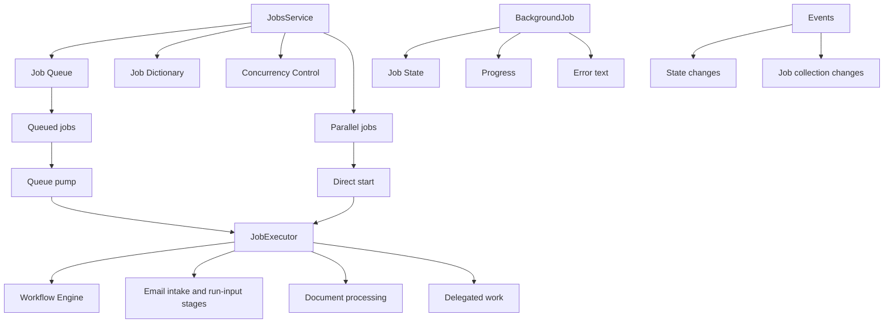
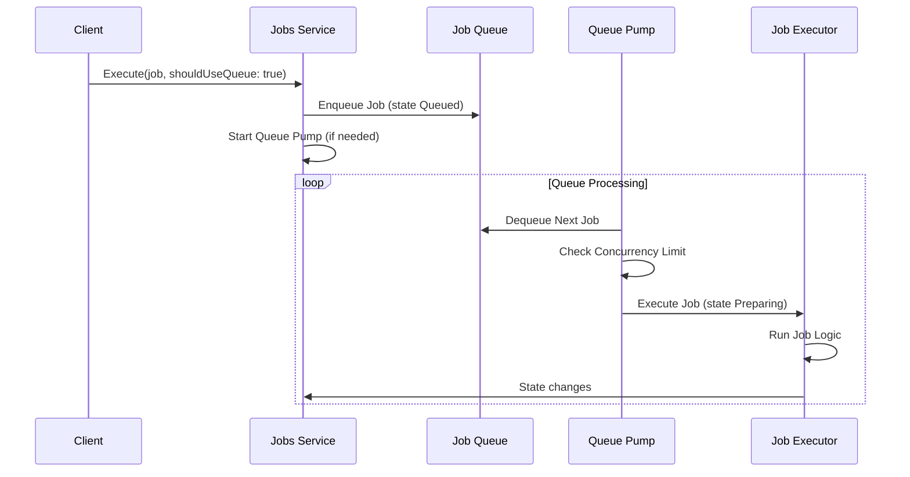
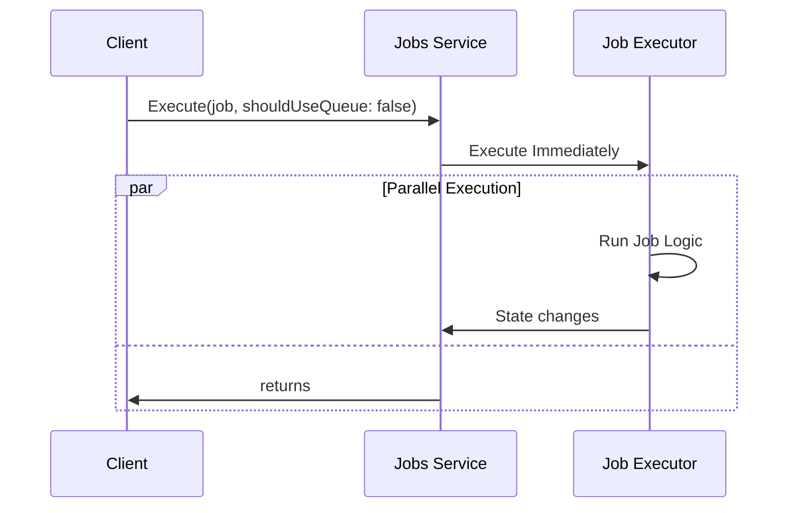
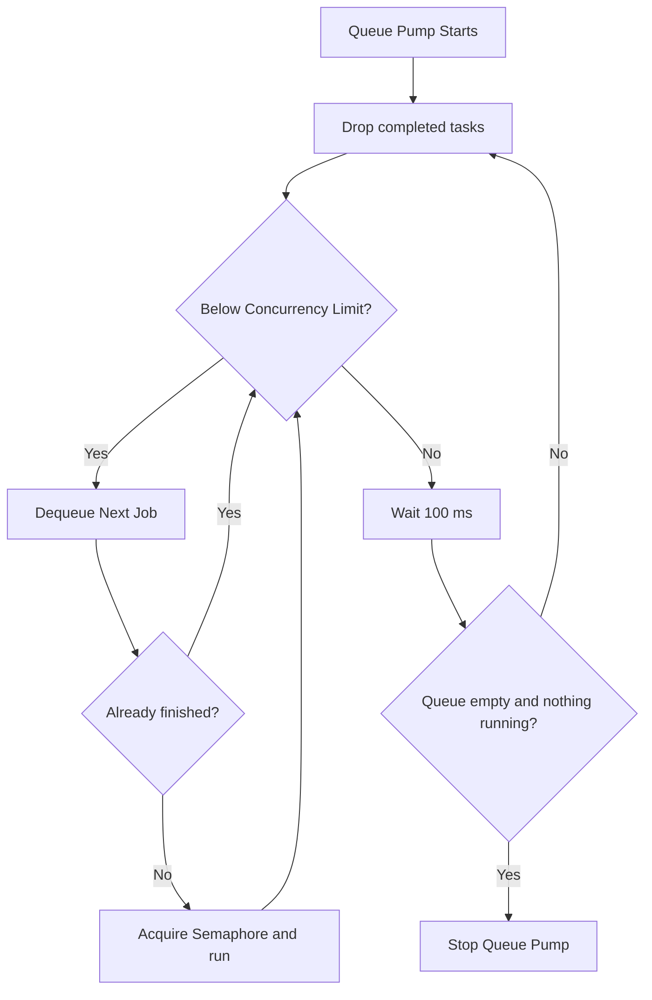
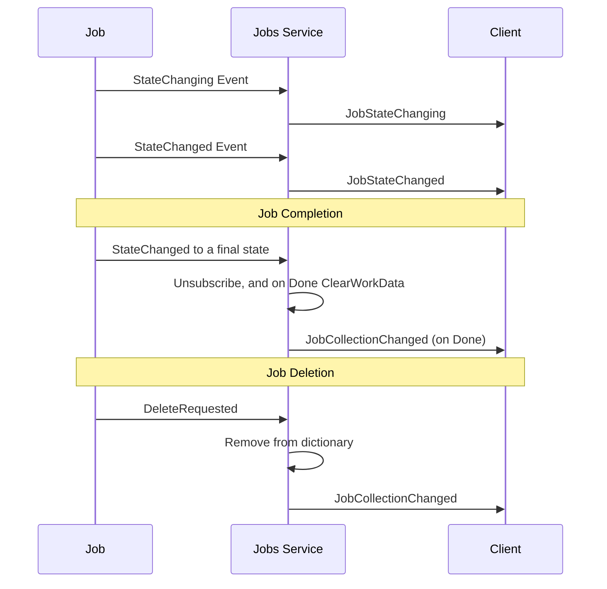

# Background Jobs Service

**On this page:** Overview · Architecture Components · Core Components · Job Execution Patterns · Concurrency Control · Job Types and Implementations · Event-Driven Architecture · Thread Safety and Synchronization · Tenant Isolation · Error Handling and Recovery · Job Cancellation · Progress Tracking · Configuration and Scalability · Operational Troubleshooting · Related pages

The Background Jobs Service runs the platform's long work off the request thread: every workflow execution and every [editor agent](../../features/editor-agent.md) conversation turn. It lives in each host process (the API and the admin app) and keeps its jobs in memory.

## Overview

`JobsService` takes a job, runs it on a background task through `JobExecutor`, and tracks its state, progress and error in an in-process dictionary. Three producers start jobs:

| Producer | Job | Path |
|----------|-----|------|
| `WorkflowExecutionOrchestrator` (report runs started through the API) | `Job` | queue (`shouldUseQueue: true`) |
| `CreateReportCard` (the admin app's workflow editor) | `Job` | queue |
| `AgentConversationTurns` (an editor agent conversation turn) | `DelegatedJob` | parallel (`shouldUseQueue: false`) |


There is no distributed queue and no persistent job store; see [Operational Troubleshooting](#operational-troubleshooting) for what that means on a restart.

## Architecture Components



## Core Components

### JobsService

**Location**: `platform/IniaAi.Services/Jobs/JobsService.cs`, registered as a singleton in both hosts (`ApplicationServicesConfiguration` in the API, `ServicesConfigurator` in the admin app). `JobExecutor` is transient.

```csharp
public class JobsService : IJobsService, IDisposable
{
    private readonly Dictionary<string, BackgroundJob> _jobs = [];
    private readonly Queue<Job> _jobQueue = new();
    private readonly SemaphoreSlim _concurrencyLimitSemaphore;

    // Sized from PlatformSettings:IniaAi:MaxConcurrentJobs
    private readonly PlatformSettings _platformSettings;
}
```

**Key Responsibilities:**
- Job creation (`CreateOrganizationJob`, `CreateUserJob`) and lifecycle tracking
- The queue pump, bounded by `MaxConcurrentJobs`
- Cancellation by job id, and the shutdown drain (`CancelAllQueuedJobs`)
- Service-wide state-change events for the admin app's job list
- Job lookup by id, by user and by organization

### BackgroundJob Base Class

`BackgroundJob` (`platform/IniaAi.Domain/Business/BackgroundJobs/BackgroundJob.cs`) is the abstract base of every job:

```csharp
public abstract class BackgroundJob
{
    public string Id { get; } = Guid.NewGuid().ToString();
    public string? UserId { get; private set; }
    public string OrganizationId { get; private set; }
    public abstract BackgroundJobType Type { get; }
    public virtual bool ListedAsReport => true;
    public JobState State { get; private set; }
    public string? Error { get; private set; }
    public DateTime CreatedAt { get; } = DateTime.UtcNow;
    public DateTime? CompletedAt { get; private set; }
    public double Progress { get; private set; }
    public string Description { get; protected set; } = string.Empty;
}
```

**Job States** (`platform/IniaAi.Domain/Business/Jobs/Enums/JobState.cs`):
- `None` - Initial state
- `Queued` - Job waiting in queue
- `Preparing` - Job being prepared for execution
- `Anonymizing` - Confidential documents being anonymised before processing
- `Processing` - Job actively executing
- `Error` - Job failed with error
- `Cancelled` - Job cancelled by user or system
- `Done` - Job completed successfully

`Cancelled`, `Done` and `Error` are final (`IsFinished`): a state change on a finished job throws `Cannot modify job state, as job is already in a final state.`, which is why `JobExecutor` checks `IsFinished` before every transition.

`Anonymizing` is an active state: `Job.IsBusy` is true for `Preparing`, `Anonymizing`, and `Processing`. When a confidential job runs, `JobExecutor` transitions it to `Anonymizing` and rewrites its documents via the anonymiser (building a per-job `AnonymisationMap`) before moving on to `Processing`. The anonymiser is paid: the paid build registers it with `AddAnonymisation()`. The open build registers none, so no job of the open build reaches `Anonymizing`: the API refuses a confidential run before it starts, and `JobExecutor` fails a confidential job that starts another way with `This build does not anonymise documents, so it cannot run a confidential job.`

## Job Execution Patterns

`JobsService.Execute(job, shouldUseQueue)` adds the job to the dictionary, subscribes to its events, and takes one of two paths.

### 1. Queue-Based Execution

Workflow executions take this path. The job is set to `Queued`; the first enqueue starts a pump task that dequeues jobs while fewer than `MaxConcurrentJobs` are running, sets each to `Preparing`, and hands it to `JobExecutor`. The pump stops when the queue is empty and nothing runs, and the next enqueue starts it again. A pump that crashes logs `Queue pump crashed; clearing the processing flag so a later enqueue can restart it`.



### 2. Parallel Execution

Editor agent turns (`DelegatedJob`) take this path: `JobsService` hands the job straight to `JobExecutor`, which starts it on a long-running task. The parallel path does **not** pass through the concurrency semaphore, so these jobs do not count against `MaxConcurrentJobs`.



### What JobExecutor does with a workflow job

`JobExecutor.Execute` clones the job's workflow, stamps the job's organization on it, and runs `ExecuteAsync` on a long-running task in a service scope of its own:

1. Resolve the keyed `IWorkflowHandler` for the workflow type (falling back to the generic one) and create the run's root output.
2. `None` → `Preparing`; in `Preparing`, set the workflow state to `ProcessingDocuments` and anonymise a confidential job (`Anonymizing`).
3. `Processing`: run the email-intake stage (`EmailIntakeJobStage`), load the run's documents and pass them through the run-input stage (`IRunInputStage`), process them (`DocumentProcessingService`), load their pages into the workflow, record each page the model refused to read in the execution log, then execute the workflow.
4. Set the workflow state to `Draft` and the job to `Done`.

A rerun (`Job.IsRerun`) runs inside `RerunWrites.Scope`, so it saves no change to live data.

## Concurrency Control

### Semaphore-Based Limiting

```csharp
private readonly SemaphoreSlim _concurrencyLimitSemaphore;

// Configurable limit from platform settings
_concurrencyLimitSemaphore = new SemaphoreSlim(
    _platformSettings.IniaAi.MaxConcurrentJobs,
    _platformSettings.IniaAi.MaxConcurrentJobs);
```

The pump also counts its own running tasks against `MaxConcurrentJobs`, so the limit holds twice over for queued jobs and not at all for parallel ones.

### Queue Processing Algorithm



## Job Types and Implementations

`BackgroundJobType` holds `None` (0), `WorkflowExecution` (2) and `Delegated` (3). A `DelegatedJob` is in-process work that is not a workflow run, today an [editor agent](../../features/editor-agent.md) conversation turn: `JobExecutor` runs its `Work` delegate in a scope of its own on a background task with the job's cancellation token, then removes it from the job list. It rides the same in-memory job service as workflow runs, so it is cancellable by job id and `JobQueueShutdownService` cancels and waits for it at shutdown; `ListedAsReport` is false for it. A failed delegated job logs `Delegated job {JobId} failed: {Description}`. (A `PdfGenerationJob` type existed until the document-generation feature was removed — do not reintroduce it from old examples.)

### Workflow Execution Jobs

`Job` (`platform/IniaAi.Domain/Business/Jobs/Job.cs`) is a `partial class` that carries the workflow-execution context. Its constructor takes a `workflowTypeId` but does not keep it; the workflow type comes from `Job.Workflow.WorkflowTypeId` when the job runs.

```csharp
public partial class Job : BackgroundJob
{
    public override BackgroundJobType Type => BackgroundJobType.WorkflowExecution;

    public string? CounterpartyId { get; set; }
    public List<string>? PeerCompanyIds { get; set; }
    public string Name { get; set; } = string.Empty;
    public string? Output { get; set; }
    public string? WorkflowExecutionId { get; set; }
    public List<string> DocumentInfos { get; set; } = [];
    public Dictionary<string, string> Inputs { get; set; } = [];
    public Dictionary<string, object> InputsObject { get; set; } = [];
    public ConcurrentDictionary<string, string> AnonymisationMap { get; private set; } = [];
    public List<string> AiAnswers { get; set; } = [];
    public bool IsConfidential { get; set; } = false;
    public bool InputIsVouchedFor { get; set; }
    public Dictionary<string, string> AnonymisedFrom { get; } = [];
    public Workflow? Workflow { get; set; }
    public IReadOnlyList<ReplayOutput>? ReplayOutputs { get; set; }
    public ReplayUncoveredBlockPolicy ReplayUncoveredBlockPolicy { get; set; }
    public bool IsRerun { get; set; }

    public Job(string organizationId, string? workflowTypeId) : base(organizationId) { }
}
```

- `InputIsVouchedFor` — the sender answers for the run's documents (a workflow engineer starting a report from the editor); the run-input stage leaves them as sent.
- `AnonymisedFrom` — the original document of each anonymised copy, so a later stage names the document the caller sent.
- `ReplayOutputs` / `ReplayUncoveredBlockPolicy` — captured block outputs a rerun replays, and what to do with a freeze-eligible block they do not cover.
- `IsRerun` — the run is a rerun and writes no live data.

When a job reaches `Done`, `JobsService` calls `job.ClearWorkData()`, which drops the heavy execution context (`Workflow`, `Output`, `AnonymisationMap`, `DocumentInfos`, `Inputs`, `InputsObject`, `AiAnswers`). The job itself stays in the dictionary until it is deleted; a delegated job deletes itself when its work returns.

## Event-Driven Architecture

### Job Events

Events live on two levels. Each `BackgroundJob` raises its own lifecycle events; `JobsService` subscribes to those and re-publishes service-wide notifications that the admin app's job list consumes.

```csharp
// On BackgroundJob (per-job)
public event EventHandler<JobStateChangeEventArgs>? StateChanged;
public event EventHandler<JobStateChangeEventArgs>? StateChanging;
public event EventHandler? DeleteRequested;

// On JobsService (service-wide)
public event EventHandler<JobStateChangeEventArgs>? JobStateChanged;
public event EventHandler<JobStateChangeEventArgs>? JobStateChanging;
public event EventHandler? JobCollectionChanged;
```

Only `SetState(nextState)` and `Cancel()` raise `StateChanging` and `StateChanged`. The two-argument `SetState(state, error)` and `UpdateProgress` change the job without an event.

### Event Flow



Deleting a job that is still running throws `It's not possible to delete running jobs.`

## Thread Safety and Synchronization

### Locking Strategy

The service uses multiple semaphores for different operations:

```csharp
private readonly SemaphoreSlim _queueLock = new(1, 1);        // Queue operations
private readonly SemaphoreSlim _jobsLock = new(1, 1);        // Job dictionary access
private readonly SemaphoreSlim _concurrencyLimitSemaphore;   // Execution concurrency
private readonly ConcurrentDictionary<string, CancellationTokenSource> _cancellationTokens = new(); // Job cancellation
```

### Lock Hierarchy

1. **Queue Lock**: Protects job queue operations — enqueue, dequeue, the pump start/stop flag, and the shutdown drain all use this one lock
2. **Jobs Lock**: Protects job dictionary access (add/remove/lookup)
3. **Concurrency Semaphore**: Controls maximum concurrent queued-job execution
4. **Cancellation Tokens**: A lock-free concurrent map of per-job sources. The execution path that created a source is its only disposer; `CancelJob` only signals it

The pump starts with `ExecutionContext.SuppressFlow()`, so it does not carry the first caller's ambient state (such as a rerun's `RerunWrites` flag) into the jobs it starts later.

## Tenant Isolation

Every job carries the organization it was created for, and the lookups filter by it. Isolation of the data a job touches comes from the workflow engine and the repositories, not from `JobsService`.

### Organization-Scoped Jobs

```csharp
public Job CreateOrganizationJob(string organizationId, string? workflowTypeId)
{
    var job = new Job(organizationId, workflowTypeId);
    return job;
}

public IEnumerable<BackgroundJob> GetOrganizationJobs(string organizationId)
{
    return _jobs.Values.Where(j => j.OrganizationId == organizationId).ToList();
}
```

### User-Scoped Jobs

```csharp
public Job CreateUserJob(User user, string? workflowTypeId)
{
    Job job = CreateOrganizationJob(user.OrganizationId, workflowTypeId);
    job.SetUserId(user.Id);
    return job;
}

public IEnumerable<BackgroundJob> GetUserJobs(string userId)
{
    return _jobs.Values.Where(j => j.UserId == userId).ToList();
}
```

## Error Handling and Recovery

### What a failed workflow job does

`JobExecutor.HandleJobError` is the one failure path for a workflow job:

1. It logs `Error processing job: {Message}` with the exception.
2. It sets the job to `Error` (unless the job already finished, for example cancelled mid-failure) and stores the message in `Job.Error`.
3. It marks the workflow execution row `Failed` through `MarkExecutionAsFailedIfActiveAsync`, in a fresh scope, with the failure kind and detail when the exception classifies itself (`IWorkflowExecutionFailure`). The fresh scope matters: the error may have poisoned the job's own unit of work.
4. For a password-protected document (`DocumentPasswordProtectedException`) it also appends a document-intake entry to the execution log.

A job whose execution row reached a terminal state under another writer is **fenced** (`WorkflowExecutionFencedException`): `JobExecutor` logs `Job {JobId} was fenced; stopping without further writes.` and cancels the job without writing the `Error` state, because the other writer already published the outcome.

## Job Cancellation

### Cancellation Support

`CancelJob` cancels the in-memory job first — including a job that is still waiting in the queue — and then signals the job's `CancellationTokenSource` if one is registered. The queue pump skips jobs that were cancelled before it picked them up (`Skipping queued job {JobId}: it finished before it was picked up`). Ownership of the source is one-way: the execution path that created it is the only code that disposes it, so a cancel that lands after the job finished is a safe no-op (the `ObjectDisposedException` is swallowed), and a repeated cancel is harmless.

When the token fires during a workflow run, `JobExecutor` logs `Job {JobId} was cancelled during workflow execution` (or `Job {JobId} was cancelled` outside the workflow step) and marks the execution row `Cancelled` through `MarkExecutionAsCancelledIfActiveAsync`. The callers of `CancelJob` are the workflow-execution state update (a user cancelling a run), deleting a report, and deleting a regression run.

### Graceful Shutdown

`JobQueueShutdownService` (`platform/IniaAi.Services/Jobs/JobQueueShutdownService.cs`) is registered as a hosted service in both hosts and runs when the host stops — including the admin **Restart Application** button, which stops the application the same way.

1. `IJobsService.CancelAllQueuedJobs()` closes the queue, dequeues every waiting job under the queue lock, cancels each one, and returns them.
2. Every running job that is not a report run (`ListedAsReport` false — the delegated editor agent turns) is cancelled, and the stop waits for each to leave the job list, up to the host's shutdown timeout, so its work can settle its own records. A timeout logs `Shutdown timed out while {Count} delegated job(s) were still settling`.
3. Each drained job's workflow execution row is marked `Cancelled` through the guarded terminal-state path (`MarkExecutionAsCancelledIfActiveAsync`). A drained job without an execution row (document processing) has nothing to mark.

Because the queue is closed, a job enqueued after the drain — a late producer such as an in-flight request — is cancelled on arrival instead of running (`Job {JobId} arrived after the shutdown drain; cancelled without running (execution: {WorkflowExecutionId})`). Workflow jobs the pump already picked up are not drained — they die with the process. The drain observes the host's shutdown timeout: if it expires mid-drain, marking stops with the warning `Shutdown timed out mid-drain: {MarkedCount} execution(s) marked Cancelled; execution {WorkflowExecutionId} and any after it stay Queued`.

## Progress Tracking

```csharp
public void UpdateProgress(double progress)
{
    Progress = Math.Clamp(progress, 0, 100);
}
```

`UpdateProgress` raises no event; a reader polls the job's `Progress` (the [Background Jobs API](../../reference/api/background-jobs.md) returns it). Workflow progress is tracked on the workflow execution row, not on the job.

## Configuration and Scalability

### Platform Settings

```csharp
public class PlatformSettings
{
    public IniaAiSettings IniaAi { get; set; }
}

public class IniaAiSettings
{
    public int MaxConcurrentJobs { get; set; } = 6;
}
```

How to choose the value is on [Job concurrency](../../operations/application-configuration.md#job-concurrency).

### Block-Level Concurrency Cap

`MaxConcurrentJobs` bounds how many queued jobs run at once. Within a single workflow execution, a second, independent cap bounds how many **blocks** run in parallel: `IBlockConcurrencyCap` (`platform/IniaAi.Core/Workflows/Scheduling/IBlockConcurrencyCap.cs`) is registered scoped, so each workflow run gets its own `SemaphoreSlim` sized from `PlatformSettings.MaxBlockParallelism` (default `4`). Host-wide block concurrency is therefore roughly `MaxBlockParallelism × MaxConcurrentJobs`. The `LevelScheduler` reads the cap when its scope is created (runtime changes require a restart); setting `MaxBlockParallelism = 1` reproduces the legacy sequential engine — the rollback kill switch.

### Scalability Considerations

1. **Per-Instance State**: `JobsService` keeps jobs in an in-process `Dictionary<string, BackgroundJob>` and queue — job state is local to each instance and is **not** shared across instances. There is no distributed queue or shared store, so jobs do not transparently migrate or load-balance across a multi-instance deployment; scale by partitioning work, not by expecting cross-instance job visibility.
2. **Resource Management**: `MaxConcurrentJobs` bounds the queued jobs; the parallel path is unbounded.
3. **Memory**: a `Done` job drops its work data but stays in the dictionary until it is deleted (the admin app's job card deletes one on request) or the process restarts.

## Operational Troubleshooting

Background jobs run **in-process and in-memory**. There is no distributed queue and no persistent job store, which shapes how you inspect a stuck job and what survives a restart.

> [!CAUTION]
> **Restarting the app kills every in-flight job**
>
> `JobsService` keeps all jobs in a plain in-process `Dictionary<string, BackgroundJob>` and an in-memory `Queue<Job>`. Nothing is persisted, and the service does not reload or resume jobs when the process comes back up. Restarting, redeploying, or crashing the app therefore **loses every `Preparing`, `Anonymizing`, and `Processing` job permanently**. They do not resume and are not retried; the work must be re-submitted. `Queued` jobs get one grace on a **graceful** stop (a deploy or the admin restart): the shutdown drain cancels them and marks their workflow execution rows `Cancelled`, so they end in a visible terminal state instead of a stranded `Queued` row — but their work is not resumed either. A hard crash (out-of-memory kill, power loss) skips the drain and strands everything.

What does clean up after a lost job:

- **Workflow execution rows.** The stuck-execution janitor (`StuckWorkflowExecutionJanitor`) fails every execution still active past `MaxLifetimeHours` (default 12 hours) with the failure kind `LifetimeExceeded` and logs `Janitor failed stuck execution {ExecutionId} ({State} since {ActiveSince})`. Its settings are on [WorkflowExecutionJanitor](../../operations/application-configuration.md#workflowexecutionjanitor).
- **Runs of a process that stopped, within minutes.** Where host-loss recovery is on, every process that runs jobs writes its `HostBoots` row on its first heartbeat and heartbeats it every 30 seconds (`HostBootHeartbeatService`), and each execution row records, when it is created, the process start that holds its job. The API's `HostLossSweepService` fails, at startup and every minute, each active run whose process was last seen more than 2 minutes ago, with the failure kind `HostLost`, and logs `Host-loss sweep failed execution {ExecutionId} ({State}): its host {HostBootId} on {Machine} was last seen at {LastSeenAt:O}`. It leaves to the janitor a run of its own process, a run with no recorded process, a run whose process never wrote its row, and a run of a process not seen for longer than `MaxLifetimeHours`. It is off by default; the setting is on [WorkflowExecutionJanitor](../../operations/application-configuration.md#workflowexecutionjanitor).
- **Editor agent turns.** At startup the admin app's `AgentConversationHostService` settles the turns this host had in flight as `Cancelled`, then starts the turns waiting behind them ([Agent Runtime Integration](../services/infrastructure/agent-runtime-integration.md)).

### Inspecting a stuck or `Processing` job

A job that appears stuck is almost always sitting in an active state (`Preparing`, `Anonymizing`, or `Processing` — the three states for which `Job.IsBusy` is true) with no further progress. To investigate:

1. **Find the job's current state.** Use the [Background Jobs API](../../reference/api/background-jobs.md) to list jobs for the organization and read each job's `State`, `Progress`, `CreatedAt`, and `Error`. A job whose state is still `Processing` long after `CreatedAt` is a candidate stall.
2. **Locate the job in the logs by its id.** Every job carries a GUID `Id`; grep the application log for that id to follow its lifecycle. A failure is logged as `Error processing job: {Message}` with the exception, and the job is moved to the `Error` state with the message attached.
3. **Check whether it is queued behind the concurrency limit.** Only `MaxConcurrentJobs` queued jobs execute at once; additional jobs sit in `Queued`. A "stuck" job that is actually `Queued` is waiting for a slot, not stalled — confirm the state before acting.

### What a stall looks like in the logs

- The job's id appears in `Queueing job {JobId} for sequential execution`, `Started processing queued job {JobId} (Active: {ActiveJobs}/{MaxJobs})` and `JobExecutor: Starting workflow execution for JobId '{JobId}' …`, then **goes quiet** — no `Completed queued job {JobId}` line — while the process keeps running. The most common causes are a long-running model call, a slow document download, or an external dependency (OCR, embeddings, an agent run) that has not returned.
- A genuine failure does **not** look like a stall: it ends with `Error processing job: {Message}` and a transition to `Error`. If you see that line, the job finished (unsuccessfully) and will not retry on its own.
- After a **graceful** restart, jobs that were still queued get explicit shutdown lines: `Cancelled queued job {JobId}` per job, `Shutdown drained {Count} queued job(s); marking their executions Cancelled`, then `Marked workflow execution {ExecutionId} as Cancelled via isolated scope` for each row the guarded update actually flipped (an already-terminal execution produces no marked line; a shutdown timeout mid-drain logs `Shutdown timed out mid-drain: …` instead and leaves the rest `Queued`). Ids of jobs that were already executing simply **stop appearing** with no terminal line, because their in-memory state was discarded. After a crash, every id stops appearing — the drain never ran.

### Finding a job in the production logs

Every job's GUID `Id` (the `id` field returned by `GET /api/v1/jobs`) is the grep key that ties the API view to the logs.


## Related pages

- [Background Jobs API](../../reference/api/background-jobs.md) — endpoints to create, list, and inspect jobs.
- [Workflow engine](../workflow-engine/index.md) — what a `WorkflowExecution` job actually runs once dequeued.


