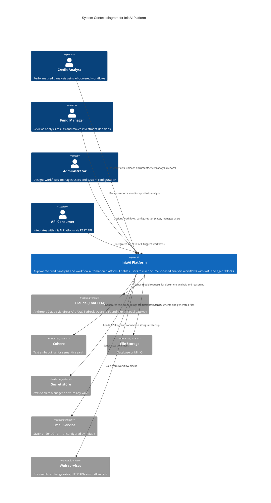
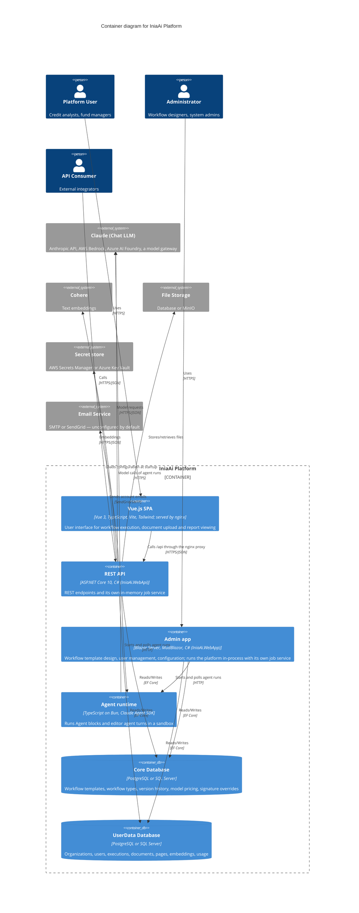

# System Context & Containers

**On this page:** System context · Container diagram · Container Descriptions · Communication Patterns · External System Integration · Related Documentation

C4 views of the platform: first the **system context** (who uses it, which external systems it touches), then the **container diagram** (the applications and data stores inside it). Each container section names its technology and links to the page that owns the details.

## System context

The platform is deployed on-premises or in each customer's own cloud rather than offered as a hosted SaaS; tenancy is enforced at the application layer by organization scoping (there is no database row-level security). Chat runs on Anthropic Claude; embeddings are Cohere — see [AI providers & connectors](../ai-integration/providers.md) for backend selection, and [Data Flows & Subprocessors](../../compliance/data-flows-and-subprocessors.md) for what content reaches each external system.

## Container diagram

The admin app reaches the same external systems as the API; the diagram draws those lines once, from the API.

## Container Descriptions

### Vue.js SPA

**Technology**: Vue 3, TypeScript, Vite, Pinia, Vue Router, Tailwind CSS, Reka UI, Apache ECharts, TanStack Query over Axios (the `frontend` repository).

**Purpose**: the platform user's interface — workflow execution, document upload and management, workflow input forms, report viewing, live execution status.

**Deployment**: the `web` image, built from the frontend repository's own `Dockerfile`, serves the built SPA from nginx, which proxies `/api/` to the API container (`docker/nginx.conf` in that repository). How the SPA is built is on [Frontend architecture](../frontend/index.md).

### REST API

**Technology**: ASP.NET Core 10 (`IniaAi.WebApi`), Swagger/OpenAPI, the in-house request dispatcher (`ISender`).

**Purpose**: every external call into the platform: authentication, workflow templates, executions, documents, users, and usage.

- All controllers are version-routed under `api/v{version}` (`api/v1` today). The full list is the [API reference](../../reference/api/index.md); there is no `WorkflowsController` or `OrganizationsController` — templates are reached via `workflow-templates` and executions via `workflow-executions`.
- Controller → `ISender` → Application layer handler, with validation in the dispatcher ([Command handlers](../services/application/command-handlers.md)).
- JWT bearer authentication ([User management](../../features/user-management/index.md), [Authorization](../../features/user-management/authorization.md)); a fixed-window rate limiter guards sign-in.
- Runs workflow executions in its own in-memory [Background Jobs](../background-jobs/index.md) service.

### Admin app

**Technology**: Blazor Server (interactive server render mode), MudBlazor, C# (`IniaAi.WebApp`).

**Purpose**: the administrative interface — workflow template design and editing, block configuration, workflow types, users and organizations, system settings.

The admin app does **not** call the REST API. It wires the same application, core and infrastructure services in its own process (`ServicesConfigurator`), dispatches commands and queries in-process, and runs report jobs started from the editor in its own job service. Sign-in is ASP.NET Core Identity with cookies.

### Agent runtime

**Technology**: TypeScript on Bun, the Claude Agent SDK (the `agent-runtime` repository), a container of its own.

**Purpose**: runs `Agent` blocks and editor agent conversation turns in a sandbox under spend, turn and deadline fuses. Both .NET hosts reach it over HTTP at `PlatformSettings:AgentRuntime:BaseUrl`; the contract is on [Agent Runtime Integration](../services/infrastructure/agent-runtime-integration.md).

### Application, core and infrastructure layers

These are libraries, not containers: both .NET hosts load them. The layer rules are on [Clean Architecture](../clean-architecture/index.md), and the service catalogue on [Services](../services/index.md).

- **Application** (`IniaAi.Application`): command and query handlers, validators, projections to DTOs.
- **Core** (`IniaAi.Core`, `IniaAi.Services`): the [workflow engine](../workflow-engine/index.md) and its block strategies, [RAG](../rag/index.md), [document processing](../document-processing/index.md), [OCR](../ocr/index.md).
- **Infrastructure** (`IniaAi.Infrastructure`, `IniaAi.AiConnection`): EF Core persistence, file storage, email, the agent-runtime client, the model connectors.

The workflow engine has 18 block types (`BlockTypes`): `AiQuery`, `Agent`, `Verification`, `SimpleRag`, `BuildTopicsForAllDocuments`, `IntelligentSearch`, `WebApiCall`, `ExchangeRate`, `PeerFinancials`, `LoopStart`, `LoopEnd`, `SwitchCase`, `Merge`, `MergeJson`, `CalculateNumber`, `DynamicChart`, `Json2Xlsx` and `StringManipulation`. `Json2Xlsx`, `PeerFinancials` and `Verification` run only in the paid build: a build without their module keeps such a block as saved, and a run fails it. What each does is on the [block reference](../../guides/blocks/block-reference.md).

### Data stores

- **Core Database** — workflow templates and authoring configuration (schema `Core`): templates, sections and blocks, workflow types and categories, version history, organization access to types, document categories, model pricing, signature overrides. Provider per context via `PlatformSettings:CoreDbProvider`. Tables: [Core database](../../reference/database/core-database.md).
- **UserData Database** — organization-scoped user and execution data (schema `UserData`): organizations and memberships, executed workflow copies, executions and their logs, block responses, documents, pages and embeddings, counterparties, file metadata, usage records. Provider per context via `PlatformSettings:UserDataDbProvider`. Tables: [UserData database](../../reference/database/user-data-database.md).
- **File storage** — the `Database` or `MinIO` provider, chosen by `FileStorage:DefaultProvider` (default `Database`); an S3 provider is implemented but not registered, so `S3` falls back to `Database`: [File Storage](../file-storage/index.md).

## Communication Patterns

- **Browser → SPA → API**: HTTPS and JSON through the nginx proxy, JWT bearer tokens; the SPA polls for execution progress.
- **Admin browser → admin app**: a Blazor Server circuit (SignalR) to the admin app; everything behind it runs in that process.
- **Host → background work**: each host queues long work into its own in-memory job service and returns at once; a client polls the execution. Job state is per process and is lost on restart ([Background Jobs](../background-jobs/index.md)).
- **Host → agent runtime**: HTTP start, poll and cancel of agent runs.
- **Host → databases**: EF Core, with migrations for each provider (`IniaAi.Migrations.PostgreSql`, `IniaAi.Migrations.Mssql`).

## External System Integration

- **Claude** — behind `IChatConnector`: the direct Anthropic API, AWS Bedrock, Azure AI Foundry or a model gateway that a closed module supplies, one per deployment. Token-window rate limiting, retries, prompt caching and thinking mode are on [AI providers & connectors](../ai-integration/providers.md). The connectors send whole requests and read whole responses; they do not stream.
- **Cohere** — behind `IEmbeddingsConnector`, through the same backend as chat ([Embeddings provider](../ai-integration/providers.md#embeddings-provider-cohere)). There is no OpenAI integration.
- **Secret store** — at startup `ConfigurationBuilderExtensions.SetupConfigurationAsync` loads secrets from AWS Secrets Manager on AWS or Azure Key Vault on Azure into the configuration ([Cloud-mode configuration sources](../../operations/application-configuration.md#cloud-mode-configuration-sources)).
- **Email** — SMTP (`SmtpEmailSender`) or SendGrid (`SendGridEmailSender`); both ship unconfigured, so no email leaves a default deployment. What the platform sends is on [Email Services](../services/infrastructure/email-services.md).
- **Web services** — the `IntelligentSearch` block calls Exa, the `ExchangeRate` block an exchange-rate API, and the `WebApiCall` block any HTTP API the deployment's outbound rules allow ([block reference](../../guides/blocks/block-reference.md)).

## Related Documentation

- [Clean Architecture](../clean-architecture/index.md) - Layer responsibilities
- [Workflow Engine](../workflow-engine/index.md) - Workflow execution details
- [Multi-Tenant Architecture](../multi-tenant/index.md) - Tenant isolation
- [Background Jobs](../background-jobs/index.md) - Job processing details
