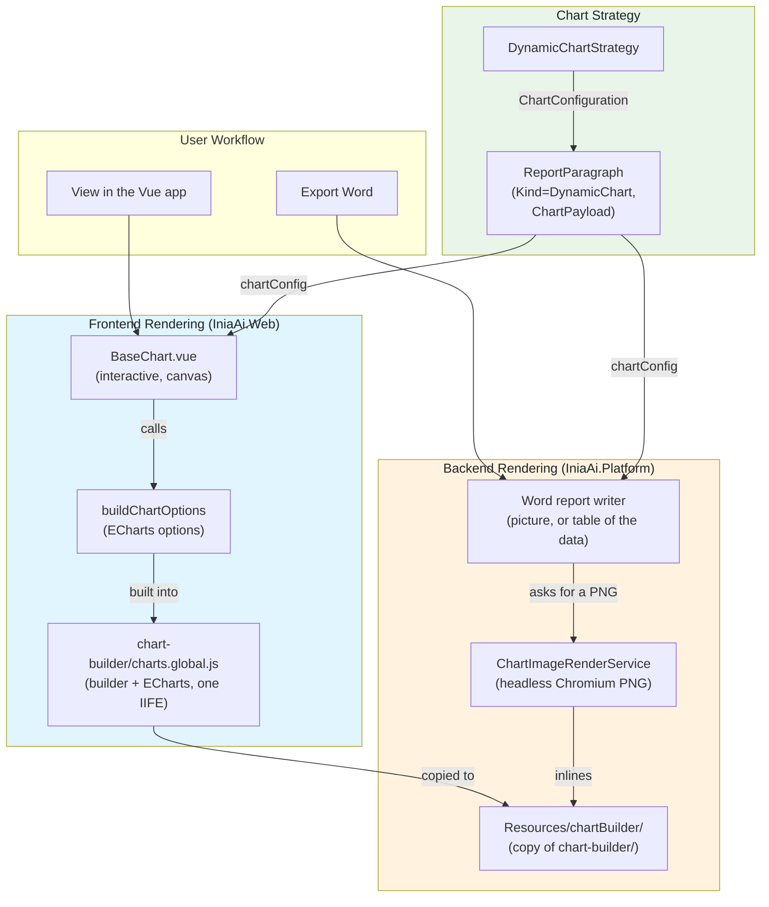
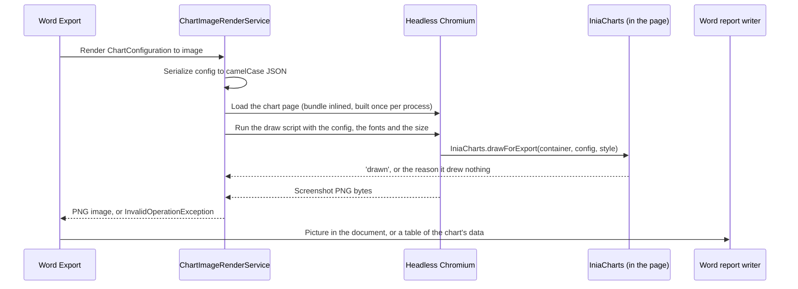

# Chart Rendering Architecture

**On this page:** Architecture Overview · Components · Supported Chart Types · Color Schemes · Configuration · Backend Rendering Pipeline · The Chart Bundle · App-Export Parity · ChromeDriver Pool · Data Source Format · Data Filters · Maintenance · Debugging · Architecture Decisions

The IniaAi platform draws a Dynamic Chart block's chart twice: as an interactive Apache ECharts chart in the Vue app, and as a PNG for the Word export, which headless Chromium draws. Both paths run the **same** options builder, `buildChartOptions`, so the app and the exported document show the same chart. ECharts is licensed under the Apache License 2.0, so both public trees can ship it ([Why ECharts?](#why-echarts)).

## Architecture Overview



## Components

### Chart Strategy (Block Execution)

The `DynamicChartStrategy` processes chart blocks during workflow execution, transforming JSON data into a `ChartConfiguration` chart spec.

| Component | File | Responsibility |
|-----------|------|----------------|
| `DynamicChartStrategy` | `platform/IniaAi.Core/Workflows/Strategies/DynamicChartStrategy.cs` | Block execution, data parsing, chart config generation |
| `DynamicChartProperties` | `platform/IniaAi.Domain/Entities/Workflows/Blocks/Properties/DynamicChartProperties.cs` | Strongly-typed block properties |
| `ChartConfiguration` | `platform/IniaAi.Domain/Entities/WorkflowExecutions/ChartConfiguration.cs` | Chart spec produced by the strategy and serialized into the report tree |

The strategy reads each templated field from `DynamicChartPropertiesExecutionState`, where `{Block.answer}`-style placeholders are already resolved, and falls back to the template value; `ShowLegend`, `ShowGridLines` and `EnableAnimations` come from the template only. It serializes the `ChartConfiguration` as the block's `RawResponse`, and `WorkflowOutputBuilder` turns that JSON into the report leaf below.

The block fails with `Failed to generate dynamic chart: <reason>`, where the reason is one of `Data source JSON is required for dynamic chart generation`, `X-axis field is required for dynamic chart generation`, `Y-axis field is required for dynamic chart generation`, `Invalid JSON in data source: …`, `Data source must be a JSON object or array` or `Error applying data filters: …`.

### How Chart Output Is Persisted

Chart output is **not** a standalone execution entity. It rides inside the executed-workflow **report tree** — `WorkflowReport` → `ReportSection` → `ReportParagraph` (namespace `IniaAi.Domain.Entities.WorkflowExecutions`, persisted only in `UserDataDbContext`, schema `UserData`).

A chart is a single leaf: a `ReportParagraph` with `Kind == ReportParagraphKind.DynamicChart`, carrying its chart spec in `ReportParagraph.ChartPayload` (a `ChartOutput?` payload serialized as `jsonb` / `nvarchar(max)`). The `ChartOutput` holds the title as `Name`, the data points as `ChartData`, and the whole `ChartConfiguration` as `ChartConfig`; the paragraph's `Content` reads `Chart: <title>`. The stored chart has no field that names a chart library, so the move to ECharts needed no data migration.

Tabular output uses the same leaf shape: a `ReportParagraph` with `Kind == ReportParagraphKind.Table`, carrying its data in `ReportParagraph.TablePayload` (a `TableOutput?` payload). `ReportParagraphKind` also covers plain text (`Paragraph`) and `Divider`; the per-leaf shape is a discriminator on the single `ReportParagraph` type, not a class per kind.

### Frontend Rendering (Vue)

The Vue app's code sits apart from the platform's: in the open repository it is `web/`, beside `platform/`. For the full picture of that app's charts, see [Frontend (Vue SPA) — Charting](../frontend/charts.md).


| Component | File (in the Vue app) | Responsibility |
|-----------|------|----------------|
| ECharts registration | `src/lib/echarts.ts` | Registers what the app and the export both draw with: the line, bar, pie and scatter charts, the grid, legend and title, and the canvas renderer. A component registers what only it uses: `BaseChart` the tooltip and the toolbox. Exports the `ChartOptions` type and `PAPER`, the white of a chart on paper |
| Options builder | `src/api/dynamicChart/buildChartOptions.ts` | Shapes a `ChartConfiguration` into ECharts options (the canonical pipeline) |
| Chart component | `src/components/organisms/Charts/BaseChart.vue` | Draws one chart, follows the theme, resizes with its element, and adds the tooltip and **Save as image**, which only the app shows |
| Chart renderer | `src/components/organisms/DynamicChart/DynamicChartRenderer.vue` | A report's Dynamic Chart block |
| Config schemas | `src/api/dynamicChart/schema.ts` | Chart configuration schemas; color schemes in `src/api/dynamicChart/colorSchemes.ts` |
| Trend chart | `src/components/organisms/Charts/TrendLineChart.vue` | The token-usage page's two trend charts, built with the same builder |
| Export entry | `src/api/dynamicChart/chartExport.ts` | `exportOptions` and `drawForExport`, the Word export's side of the bundle |


### Backend Rendering (Chromium)

The Word export draws each chart as a PNG in headless Chromium, with the bundle the Vue app builds (see [The Chart Bundle](#the-chart-bundle)). There is no C# options builder.

The API host (`ApplicationServicesConfiguration`) and the admin app (`ServicesConfigurator`) both register `IChartImageSessions` and `ExportService` through `AddReportExport()` (`platform/IniaAi.Services/Export/ReportExportServices.cs`). The admin app has no Word export of its own: it registers `ExportService` and the render service so that its startup check can build the export command's handler. `ExportService` requires the render service, and no setting turns it off. The platform has no PDF export of a report.

| Component | File | Responsibility |
|-----------|------|----------------|
| Chart bundle | `platform/IniaAi.Services/Resources/chartBuilder/charts.global.js` | The frontend's bundle, embedded and inlined; draws a `ChartConfiguration` with `IniaCharts.drawForExport` |
| Render service | `platform/IniaAi.Services/Export/ChartImageRenderService.cs` | Selenium/Chromium rendering pipeline |
| Open Word report | `platform/IniaAi.FileFormats/Word/OpenXml/OpenXmlReport.cs` (open build) | Puts the chart PNG in the Word document, or a table of the chart's data when no PNG comes back |
| Settings | `platform/IniaAi.Configuration/Platform/ChartRenderingSettings.cs` | Rendering configuration |


## Supported Chart Types

`chartTypeIsSupported` accepts the types below, in any letter case. For any other `type`, the report page shows **Unsupported Chart Type** and the Word export puts in a table of the chart's data.

| Type | Key | Notes |
|------|-----|-------|
| Line | `line` | A block's type when it names none |
| Area | `area` | The line layout with every series filled |
| Bar | `bar` | Horizontal bars, the first category at the top |
| Column | `column` | Vertical bars |
| Pie | `pie` | |
| Donut | `donut` | A pie whose hole is 60% of its diameter |
| Scatter | `scatter` | |
| Bubble | `bubble` | An ECharts scatter whose points are sized by area, between 20 and 80 pixels across |

> [!WARNING]
> **Not drawn**
>
> `treemap`, `heatmap`, and `gauge` are not supported types: the report page shows **Unsupported Chart Type** for them, and the Word export a table.

Stacking applies to bar and column charts. `normal` puts every series on one stack. ECharts has no percent stacking, so for `percent` the builder turns each value into its share of its category and draws the axis from 0% to 100%; the tooltip still shows the value itself.

The strategy stores each row of `data` as `x`, `y` and `series`, with every field of the source row in `rawData`. The builder reads a source field from the row itself, else from its `rawData`: a bubble's `size`, `aum`, `fund`, `name` or `label`, a point's or slice's `color` and `name`. A row belongs to the series named by its value of `options.seriesGroupField`, else by its `series`, which the strategy resolves from that field.

## Color Schemes

Four color schemes are available: `default`, `professional`, `vibrant`, `earth`.

### Canonical Palette (buildChartOptions)

The shared builder owns the palette that drives both the app and the export:

```js
default      => ["#3B82F6", "#10B981", "#F59E0B", "#8B5CF6", "#EC4899", "#06B6D4"]
professional => ["#1e40af", "#059669", "#d97706", "#7c3aed", "#be185d", "#0891b2"]
vibrant      => ["#ef4444", "#22c55e", "#f59e0b", "#a855f7", "#ec4899", "#06b6d4"]
earth        => ["#78716c", "#a3a3a3", "#d6d3d1", "#525252", "#737373", "#a8a29e"]
```

For series-based charts (line / area / bar / column) the builder honors an explicit `series[].color` when one is present and only falls back to the palette otherwise. Pie slices and scatter points take the palette by index (scatter by group) unless the data item carries its own `color`. Bubble charts ignore the palette: each bubble is coloured by the quadrant of its x and y values, and sized from the item's `size`, else its `aum` in millions, else 50, under the subtitle `Bubble size: Assets Under Management (millions)`. Bubbles of one size are drawn at the middle of the size range.

### Strategy Colors (DynamicChartStrategy)

`DynamicChartStrategy.GetColorFromScheme` stamps a per-series `Color` onto the persisted `ChartConfiguration` (the `ChartPayload` of the chart's `ReportParagraph`) using its own palette:

```csharp
"default"      => ["#3b82f6", "#ef4444", "#10b981", "#f59e0b", "#8b5cf6", "#06b6d4"]
"professional" => ["#1f2937", "#374151", "#6b7280", "#9ca3af", "#d1d5db", "#f3f4f6"]
"vibrant"      => ["#ff6b6b", "#4ecdc4", "#45b7d1", "#96ceb4", "#feca57", "#ff9ff3"]
"earth"        => ["#8b4513", "#a0522d", "#cd853f", "#daa520", "#b8860b", "#d2b48c"]
```

Because the builder respects an explicit `series[].color`, these strategy colors are what actually appear on series-based charts; the builder's canonical palette governs pie and scatter, and bubble uses its quadrant colours. Several of these colours are dark greys made for a white page, which is why the Vue app draws a report chart on white in the dark theme too ([Frontend charts](../frontend/charts.md)).

## Configuration

### ChartRenderingSettings

Configured via `appsettings.json` under `PlatformSettings:ChartRendering`:

```csharp
public class ChartRenderingSettings
{
    public int RenderTimeoutMs { get; set; } = 10000;
    public string? TempDirectory { get; set; }
    public bool DebugPreserveTempFiles { get; set; } = false;
}
```

A deployment that still sets a key the class no longer has (`HighchartsModules`, `UseHighchartsRendering`, `DefaultChartWidth`, `DefaultChartHeight`, `PostRenderDelayMs`) starts as before: settings binding ignores it ([Application configuration](../../operations/application-configuration.md)).

### Example Configuration

```json
{
  "PlatformSettings": {
    "ChartRendering": {
      "RenderTimeoutMs": 10000
    }
  }
}
```

### DynamicChartProperties

Block-level properties for chart configuration:

These are the **template** values; `{block1}`-style placeholders are resolved at execution time into `DynamicChartPropertiesExecutionState`. Most fields are non-nullable and carry defaults (only the data-binding fields are nullable).

| Property | Type | Default | Description |
|----------|------|---------|-------------|
| `DataSourceJson` | `string?` | — | JSON data source (supports `{block1}` placeholders) |
| `ChartType` | `string` | `"line"` | Chart type: line, area, bar, column, pie, donut, scatter, bubble; the report page refuses any other value, and the Word export puts in a table |
| `XAxisField` | `string?` | — | JSON property name for X-axis |
| `YAxisField` | `string?` | — | JSON property name for Y-axis |
| `SeriesGroupField` | `string?` | — | Field for grouping data into multiple series |
| `ChartTitle` | `string` | `"Dynamic Chart"` | Display title |
| `XAxisLabel` | `string` | `"X Axis"` | Custom X-axis label |
| `YAxisLabel` | `string` | `"Y Axis"` | Custom Y-axis label |
| `ColorScheme` | `string` | `"default"` | Color scheme: default, professional, vibrant, earth |
| `ChartHeight` | `string` | `"400"` | CSS length (e.g. `"400"`, `"500px"`) |
| `ChartWidth` | `string` | `"100%"` | CSS length (e.g. `"100%"`, `"800px"`) |
| `DataFilters` | `string` | `"[]"` | JSON array of filter conditions |
| `ShowLegend` | `bool` | `true` | Show/hide legend |
| `ShowGridLines` | `bool` | `true` | Show/hide grid lines |
| `EnableAnimations` | `bool` | `true` | Enable/disable animations |
| `Stacking` | `string` | `"none"` | Stacking mode: none, normal, percent (bar/column only) |

## Backend Rendering Pipeline

The backend renders charts as PNG images for Word document export:



`ChartImageRenderService` builds the chart page once per process: the bundle and an empty container, as a base64 `data:` URI. Each export opens one chart session (`IChartImageSessions.Open`), and one Chrome draws all the export's charts: it starts for the first chart and quits when the export's file is written. A chart that fails for another reason than the page's refusal quits that Chrome, and the next chart starts a new one. For each chart, Chrome loads the page again, and the service runs a script with `ExecuteAsyncScript`, passing the configuration, the export fonts and the picture's size as arguments, with `RenderTimeoutMs` as the script timeout. `drawForExport` draws with `exportOptions`: no animation, a white background, and the export fonts (Calibri, then Segoe UI, Helvetica and Arial; 15 px titles, 12 px axis titles, 11 px labels). It settles when ECharts reports the drawing finished. A chart of an unsupported type is refused with `The app draws no chart of this type.`, a chart with no row and no series point with `The chart has no data to draw.`, and any script error in the page is reported too. The service then logs the warning `The chart page drew no chart: <reason>` and throws an `InvalidOperationException` that reads `The chart page could not draw the chart: <reason>`. A failure of Chrome itself is logged as an error and thrown as `Failed to render chart to image. See inner exception for details.`

### Image Sizing for Word

The open build's `OpenXmlReport` makes a chart as wide as its column, pie and donut charts square, and other types 60% as tall as they are wide. It converts points to pixels at 96 DPI (multiply points by 96/72).


### The Table Fallback

Both Word writers put a chart in as a table of its data (`ChartDataTable`: a caption, a row per category, a column per series) when the render service throws, and when the writer has no render service. An empty chart becomes its caption and the line `No data available`. The writer logs `Chart image rendering failed; the chart goes in as a table of its data`. Neither writer draws a native Word chart. The Markdown export always writes that table and draws no chart ([Markdown export](../../reference/api/reports.md#markdown-export-md)).

## The Chart Bundle

The Word export cannot import the Vue app's modules, so the frontend builds the export's side once more, as one plain script. `vite.config.chart-builder.ts` bundles `src/api/dynamicChart/chartExport.global.ts`, with `buildChartOptions` and the ECharts code it uses, into a minified IIFE that defines the global `IniaCharts`:

```
chart-builder/
  charts.global.js   # IniaCharts.drawForExport, with ECharts inside; opens with a notice naming ECharts and zrender
  LICENSE-echarts    # Apache License 2.0
  NOTICE-echarts
  LICENSE-d3         # the d3 code ECharts embeds (BSD-3-Clause)
  LICENSE-zrender    # zrender, ECharts' renderer (BSD-3-Clause)
```

The bundle carries only what both the app and the export draw with (`src/lib/echarts.ts`): the tooltip, the toolbox and the mark line, which only the app uses, stay out of it. The app's own production build writes the same four notice files to `dist/third-party/`. The build writes the notice files from `node_modules`, replaces `process.env.NODE_ENV` with `production` (ECharts reads it, and the export page has no `process`), and empties the folder first. `npm run verify:chart-builder` rebuilds it and fails when the committed folder differs.

The platform keeps a copy of the whole folder in `platform/IniaAi.Services/Resources/chartBuilder/`, beside a `README.md` that explains the copy. `IniaAi.Services.csproj` embeds `charts.global.js` and copies the four notice files to the build output, so they ship with the binaries. `ChartImageRenderService` loads it once into a `Lazy<string>` and inlines it into the render page as a `<script>` block, with no network request, and throws `Embedded resource 'IniaAi.Services.Resources.chartBuilder.charts.global.js' not found. Copy chart-builder/ of the frontend repo (npm run build:chart-builder) to Resources/chartBuilder/.` when it is missing.


## App-Export Parity

Parity is structural, not maintained by hand: the app and the Word export run the **same** `buildChartOptions`, so the behaviors below are defined once and shared.

| Feature | Behavior (shared) |
|---------|-------------------|
| Color Schemes | 4 schemes (`default`, `professional`, `vibrant`, `earth`) in the builder palette |
| Per-Slice Colors | `colorScheme[index % length]`, with explicit `series[].color` honored when set |
| Default Names | Pie slices without a name: `"Category 1"`, `"Category 2"`, etc. |
| Legend Auto-Hide | Line, area, bar, column and scatter: hidden for single-series charts and when `ShowLegend` is off; pie always shows its legend |
| Pie Labels | `name: 12.3%` beside each slice; on a chart narrower than 500 pixels the labels give way to the legend |
| Donut Hole | 60% of the diameter |
| Stacking Modes | None, Normal, Percent |
| Smart Decimals | Two decimals for ratio, coverage, margin and rate charts, or when a value has a fraction; bar and column tooltips show whole numbers |

What differs is the frame: the app adds the **Save as image** button and the tooltip, and the export draws with no animation on white with the export fonts.

## ChromeDriver Pool

Chart export and the email-link PDF download (`PdfDownloadClient`) share one pool of Chromium instances managed by `ChromeDriverPool`:

- **Max concurrent drivers**: 3 (`ChromeDriverPoolProvider`, one pool per process)
- **Semaphore-based concurrency control**
- **Hardened Chrome**: `--headless=new`, with the same-origin policy on and no bot-evasion code. A chart renders from a `data:` URI with no network: the driver's proxy refuses every request
- **User and sandbox**: Chrome runs as the image's `app` user when the app runs as root, and with its sandbox wherever the container allows it; where it does not, the chart still renders, without the sandbox
- **Fallback**: a chart that Chrome cannot render becomes a table of its data ([The Table Fallback](#the-table-fallback))
- **Timeouts**: 5 minutes per driver command (`COMMAND_TIMEOUT_MINUTES`) and 1 minute per page load (`PageLoadTimeout`)
- **Lifecycle**: a driver is quit, and its proxy disposed, when it is released; the next acquire starts a fresh Chrome. A Word export holds one driver for all its charts, so ten charts draw in about 4 seconds instead of about 10

## Data Source Format

### Simple Time Series

```json
[
  {"month": "Jan", "revenue": 150000},
  {"month": "Feb", "revenue": 165000},
  {"month": "Mar", "revenue": 142000}
]
```

Config: `XAxisField: "month"`, `YAxisField: "revenue"`

### Multi-Series Data

```json
[
  {"quarter": "Q1", "sales": 500000, "region": "North"},
  {"quarter": "Q1", "sales": 450000, "region": "South"},
  {"quarter": "Q2", "sales": 620000, "region": "North"},
  {"quarter": "Q2", "sales": 580000, "region": "South"}
]
```

Config: `SeriesGroupField: "region"`

### Nested Data

```json
[
  {"date": "2023-01-01", "financial": {"revenue": {"amount": 150000}}}
]
```

Config: `YAxisField: "financial.revenue.amount"` (uses JSON path via `JObject.SelectToken`)

## Data Filters

Filters are specified as a JSON array and applied before chart generation:

```json
[
  {"field": "year", "operation": "greater", "value": "2022"},
  {"field": "category", "operation": "contains", "value": "Tech"}
]
```

| Operation | Description |
|-----------|-------------|
| `equals` | Exact string match |
| `contains` | Substring search |
| `greater` | Numeric greater than |
| `less` | Numeric less than |
| `not_empty` | Field has a value |

## Maintenance

### Updating ECharts

ECharts lives in the frontend only; the platform receives it inside the bundle.

1. In the Vue app (`web/` in the open repository), run `npm install echarts@<version> --legacy-peer-deps`.
2. Run `npm test`. `buildChartOptions.render.test.ts` draws every stored type through ECharts' server-side SVG renderer, and `chartBundle.test.ts` loads the bundle in an empty page.
3. Run `npm run build:chart-builder` and commit `chart-builder/`. The header and the notice files follow the new version.
4. Copy `chart-builder/` over `platform/IniaAi.Services/Resources/chartBuilder/` in the platform, and keep its `README.md`.


### Changing the Chart Builder

Whenever `buildChartOptions.ts`, `chartExport.ts` or anything they import changes, rebuild and re-copy the bundle the same way (steps 3 and 4 above), so the Word export stays the same as the app:

```bash
# In the Vue app (web/ in the open repository)
npm run build:chart-builder        # → chart-builder/
npm run verify:chart-builder       # fails if the committed bundle is out of date

# Copy into the platform, keeping its README.md
cp chart-builder/* ../platform/IniaAi.Services/Resources/chartBuilder/
```

### Adding a Chart Type

1. Register the ECharts chart and the components it needs in `src/lib/echarts.ts`, and add them to the `ChartOptions` type there.
2. Add a `buildXOptions(config)` branch to `buildChartOptions` and its case to the `switch`, with unit tests and a case in `buildChartOptions.render.test.ts`.
3. Add the type to `CHART_TYPES` in `src/api/dynamicChart/chartTypes.ts`, which the schema and `chartTypeIsSupported` read, and to the **Chart Type** list of the editor (`platform/IniaAi.WebApp/Components/WorkflowEditor/Components/Blocks/DynamicChartBlock.razor`). The strategy passes any type through.
4. Rebuild and re-copy the bundle.

## Debugging

### Common Issues

| Issue | Cause | Fix |
|-------|-------|-----|
| A chart appears as a table in a Word export; log `Chart image rendering failed; the chart goes in as a table of its data` | The page could not draw the chart, or Chromium failed | The fallback is by design; the logged exception names the cause. `The chart page could not draw the chart: The chart has no data to draw.` means the chart is empty |
| `The chart page could not draw the chart: Cannot read properties of undefined (reading 'drawForExport')` | The bundle threw while it loaded, so `IniaCharts` was never set | Run `npm test` in the frontend (`chartBundle.test.ts` loads the bundle), rebuild it, and re-copy it |
| `Cannot start the driver service` | Corporate proxy (Zscaler) intercepts `localhost` connections from Selenium's health check | Set `NO_PROXY=localhost,127.0.0.1` in the deployment environment |
| `Embedded resource 'IniaAi.Services.Resources.chartBuilder.charts.global.js' not found. …` | Chart bundle missing | Copy `chart-builder/` of the frontend repo to `Resources/chartBuilder/` |
| Charts look different in Word and in the app | Stale copy of the bundle (app rebuilt, platform copy not) | Re-copy `chart-builder/` |
| `Chart rendering timed out. The chart may contain invalid configuration.` | The page never reported a result within `RenderTimeoutMs` | Preserve the page with `DebugPreserveTempFiles`, open it in a browser and read its console |
| `Chart container not found. The chart may have failed to initialize.` | The page never created `#chart-container` | Preserve the HTML with `DebugPreserveTempFiles` and open it |

### Debug HTML Output

When `DebugPreserveTempFiles` is `true`, the service saves `chart_debug.html` for each chart in the temp directory for inspection. The temp directory location is controlled by `TempDirectory` (defaults to system temp if not set). The saved page holds the bundle and a script with the chart's configuration, so it draws the chart when you open it in a browser.

### Verify the Embedded Bundle

Check that the bundle is embedded in the compiled assembly:

```bash
strings artifacts/bin/IniaAi.Services/debug/IniaAi.Services.dll | grep "chartBuilder"
```

Expected: `IniaAi.Services.Resources.chartBuilder.charts.global.js`, and no other chart resource. `ChartBuilderResourceTests` asserts both.

## Architecture Decisions

### Why ECharts?

Highcharts is proprietary software from Highsoft, and a public tree cannot redistribute it. Apache ECharts is licensed under the Apache License 2.0 and its renderer, zrender, under BSD-3-Clause, so both builds can ship it with its notices. It replaced Highcharts in both builds, so the paid build and the open build draw the same charts.

### Why One Bundle?

Before ECharts, the platform embedded the Highcharts library files and a separate copy of the options builder, and a version bump had to move three things together. The bundle now carries ECharts inside it, so the platform copies one folder.

### Why Chromium Instead of Server-Side Libraries?

Selenium/Chromium draws the export with the same code and the same renderer as the app, and reuses the ChromeDriver infrastructure of the PDF downloads. The tradeoff is slower rendering, mitigated by the driver pool. Both builds draw charts this way: the paid build's native Aspose.Words charts are gone, so a chart that cannot be drawn becomes a table in both builds.

### Why Inline Embedded JS?

The Highcharts CDN once rate-limited automated rendering, and local static files still needed HTTP requests that corporate proxies (Zscaler) intercepted. Inlining the bundle from an embedded resource makes the page self-contained: chart rendering makes no network request, and the WebApi serves no static files.
