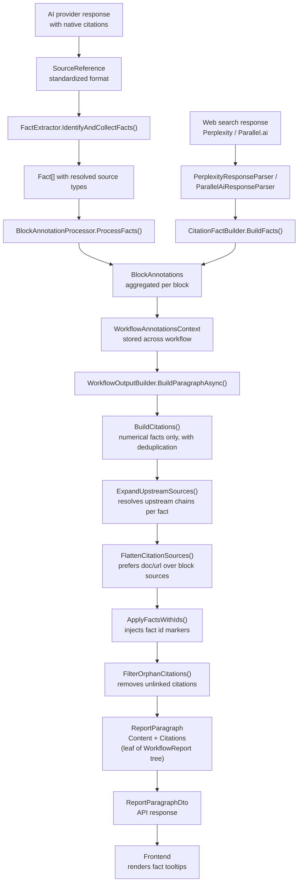

# Citations Architecture

**On this page:** Design Overview · Which Blocks Are Citation Sources · Source Types · Data Flow Pipeline · Key Components · Source Expansion & Quantity-Aware Matching · Source Flattening · Block Citations Lead to Pages and Links · Figures a Block Produced · Citations in a Data Output · Citation Traces · Numerical Fact Extraction · Word Boundary Matching · Output Format · Multi-Hop Citation Example · Frontend Rendering · Testing

The citations system tracks the provenance of AI-generated content by annotating text with references to source documents, web URLs, or previous workflow blocks, and preserves these references through the entire workflow execution.

Citations enter the pipeline from two kinds of source. The first is **AI-provider-native citations**: when a model generates text from provided context (document RAG, Anthropic-native citations), it cites specific pieces of that context. The second is **web-search responses**: when a [Web API Call block](web-search-citations.md) calls Perplexity or Parallel.ai, the platform extracts the answer's web sources. Both paths converge on the same `BlockAnnotations` → citation pipeline described below.

## Design Overview

Citations are stored as a structured `Citations` property on `ReportParagraph` (the leaf of the executed report tree `WorkflowReport` -> `ReportSection` -> `ReportParagraph`), not embedded as XML in content. The content contains simple `<fact id="cX">cited text</fact>` markers that link to the citations array.

Only **numerical facts** (values extracted by the `NumericalDataExtractor`) produce inline `<fact>` markers in the rendered content. Broad (non-numerical) facts are kept in the citations array for reference but are not linked to content.

## Which Blocks Are Citation Sources

Only a block whose output can reach a report paragraph or a [data output](#citations-in-a-data-output) is a citation source. `CitationSources.Of` works this out: it starts at the output-source and data-output blocks and follows the content placeholders back, that is, the placeholders in a block's properties, its output title and its text inputs. A placeholder in a RAG setting only chooses which pages a block reads, so it does not count. Every block of a loop section is a source as well, with the blocks it reads: a loop renames its copies when it runs, and the blocks after it read them through the loop's own tags, which no placeholder names. An execution builds the map once, because it runs a frozen copy of its template. The editor builds it for every run, because its author edits the template between runs.

A block the walk never reaches does no citation work. A document reader makes no page facts, an AI block asks the model for no citations and processes none, and the handler builds no inherited facts, producer citations or trace for it. A verification gate, a loader that only a gate reads, and a page-reference list are such blocks. The handler decides this once per block and hands the strategies a flag (`BlockExecutionContext.IsCitationSource`). Such a block still passes on the confidence scores and sources it inherited, which the run log shows. A block is matched by its replacement tag, and a block the walk never saw counts as a source. A workflow with neither an output-source nor a data-output block keeps every block a source.

Authors set nothing. The editor's earlier *Exclude from citation sources* checkbox is gone, and its column is dropped from both schemas. *Get Citations From Model* stays an author setting, and only a citation source acts on it.

## Source Types

Three types of sources can be attached to a citation. All inherit from `BaseSource`, which provides a `CitedText` property (the exact quoted text) and an abstract `SourceKey` used for deduplication.

| Type | File | Key Properties | SourceKey |
|------|------|----------------|-----------|
| `DocumentSource` | `platform/IniaAi.Domain/Entities/Citations/Sources/DocumentSource.cs` | `DocumentId`, `PageId`, `PageNumber`, `FilePageNumber`, `DocumentName` | `doc:{PageId}`, or `doc:{DocumentId}:{DocumentName}:{CitedText}` when the source has no page id |
| `UrlSource` | `platform/IniaAi.Domain/Entities/Citations/Sources/UrlSource.cs` | `Url` | `url:{Url}` |
| `BlockSource` | `platform/IniaAi.Domain/Entities/Citations/Sources/BlockSource.cs` | `BlockId`, `BlockTitle`, `UpstreamSources`, `MatchingSources` | `block:{BlockId}` |

### BlockSource with Upstream Sources

`BlockSource` has an `UpstreamSources` property (`List<BaseSource>`) that stores the full provenance chain. When a block cites another block's output, the system traces back to find the original document/URL sources and stores them in `UpstreamSources`.

```json
{
  "type": "Block",
  "blockId": "block-a-id",
  "blockTitle": "analysis_block",
  "citedText": "cats are cute",
  "upstreamSources": [
    {
      "type": "Document",
      "pageId": "page-1-id",
      "pageNumber": 1,
      "documentName": "file1.pdf",
      "citedText": "Cats are cute animals."
    }
  ]
}
```

### Citation Entity

The `Citation` class (`platform/IniaAi.Domain/Entities/Citations/Citation.cs`) links a citation ID to its sources:

```csharp
public class Citation
{
    public string Id { get; set; }           // Links to <fact id="..."> in content
    public List<BaseSource> Sources { get; set; }
    public bool IsNumerical { get; set; }    // Whether this citation is for a numerical fact
}
```

## Data Flow Pipeline



## Key Components

### Processing Pipeline

| Component | File | Responsibility |
|-----------|------|----------------|
| `FactExtractor` | `platform/IniaAi.Core/Workflows/Annotations/FactExtractor.cs` | Converts `SourceReferences` to `Fact` objects with resolved source types. Extracts numerical sub-facts from broad citations. |
| `CitationFactBuilder` | `platform/IniaAi.Core/Workflows/Annotations/CitationFactBuilder.cs` | Shared `Fact`-building pipeline for web-search citations (Perplexity `[N]` marker runs and Parallel.ai `basis[].field` paths) into `UrlSource`-backed facts, grounding each numerical value to its supporting URL. See [Web Search Citations](web-search-citations.md) for the full ingestion path. |
| `SourceExtractor` | `platform/IniaAi.Core/Workflows/Annotations/SourceExtractor.cs` | Extracts raw `<source>` references from a model response. |
| `NumericalGrounding` / `DateEquivalence` / `ConfidenceScoreExtractor` | `platform/IniaAi.Core/Workflows/Annotations/` | Helpers for grounding numerical claims to sources (literal, multiplier-stripped, quantity-equivalent, or the same calendar date in another form) and extracting per-citation confidence scores. |
| `BlockAnnotationProcessor` | `platform/IniaAi.Core/Workflows/Annotations/BlockAnnotationProcessor.cs` | Processes facts, expands block source chains, applies fact markers to content, flattens citation sources. Uses the quantity-aware `Quantities` subsystem for matching, and `DateEquivalence` for date-valued facts. |
| `WorkflowOutputBuilder` | `platform/IniaAi.Core/Workflows/Outputs/WorkflowOutputBuilder.cs` | Builds `ReportParagraph` leaves with structured citations. Orchestrates citation building, fact application, and orphan filtering. |

### Domain Entities

| Component | File | Responsibility |
|-----------|------|----------------|
| `BaseSource` | `platform/IniaAi.Domain/Entities/Citations/Sources/BaseSource.cs` | Abstract base with `Type`, `CitedText`, and `SourceKey` |
| `DocumentSource` | `platform/IniaAi.Domain/Entities/Citations/Sources/DocumentSource.cs` | Document page references |
| `UrlSource` | `platform/IniaAi.Domain/Entities/Citations/Sources/UrlSource.cs` | Web URL references |
| `BlockSource` | `platform/IniaAi.Domain/Entities/Citations/Sources/BlockSource.cs` | Block output references with `UpstreamSources` |
| `Citation` | `platform/IniaAi.Domain/Entities/Citations/Citation.cs` | Citation entity with Id, Sources, and IsNumerical flag |
| `BaseSourceSystemTextJsonConverter` | `platform/IniaAi.Infrastructure/Persistence/Serialization/Citations/BaseSourceSystemTextJsonConverter.cs` | `System.Text.Json` converter for polymorphic source types (used for EF Core storage; wired up in `CitationsJsonDefaults`) |

## Source Expansion & Quantity-Aware Matching

When Block B references Block A's output using <code>{{block_a.answer}}</code>, and Block B's AI response cites this content, the system must trace back to original document sources. `ExpandUpstreamSources()` performs this resolution, once for each cited fact.

Matching is **quantity-aware**: numerical claims are normalized into typed `Quantity` values (number + unit) by the `Quantities` subsystem (`platform/IniaAi.Core/Workflows/Annotations/Quantities/`) so that re-synthesized figures still resolve to their source even when the AI rewrote the surface form. `QuantityMatcher.FindBestMatch()` returns the best `QuantityMatch` ranked by a three-level confidence tier (`MatchTier`, lower is higher confidence; a higher tier never displaces a claim a lower tier already made on the same span):

### Tier 1 -- `LiteralSubstring`

A literal substring of the claim's surface form is found in the candidate text. Zero ambiguity (resolved by callers, not by `QuantityMatcher` itself).

```
BlockSource.CitedText = "cats are cute animals in the study"
Fact.Value = "cats are cute"
--> Match! (cited text contains fact value)
```

### Tier 2 -- `TypedQuantity`

Both sides are typed (non-`Plain`) and share a `Kind`, and the values match within that kind's tolerance. Where the two subtypes are also the same, the values compare directly — this handles near-rounding re-synthesis like `$184 billion` matching a `CitedText` containing `$183,990 million` (both Currency USD, within the configured tolerance — see `QuantityMatcher.ToleranceByKind`). Where the subtypes differ, the pair converts only when the two subtypes share a conversion dimension — described under [Converting across units](#converting-across-units-of-one-dimension) below — and never matches otherwise. Two different kinds never match, which is what rejects cross-kind collisions such as `$300B` vs `300B Kelvin`.

### Tier 3 -- `PlainWildcard`

At least one side is a bare number with no unit. Values match within wildcard tolerance, ignoring kind. Used to recover matches when an AI rewriter dropped the unit symbol from a numerical claim.

### Converting Across Units of One Dimension

A Tier 2 pair whose subtypes differ — `1.2 Mt` against `1.2 million tonnes`, `1.25%` against `125 bps`, `12 months` against `1 year` — is converted at comparison time through `UnitConversionTable`, then compared under the kind's ordinary tolerance.

**The dimension decides, not the kind.** `UnitKind` is a display category: percent and mg/dL both sit in `Concentration`, and nothing sensible converts one into the other. Two subtypes convert only when their `UnitConversionEntry.Dimension` strings are equal, so pairs that share a physical dimension convert and the rest stay apart. Two consequences are worth knowing, because both split a single `UnitKind` across dimensions:

- Duration splits across dimensions the way CLDR splits it: calendar durations (`year`, `quarter`, `month`, `decade`, `century`) share one, clock durations (`week`, `day`, `hour`, `minute`, `second` and below) share another. So `12 months` equals `1 year`, while `90 days` never matches `3 months` — that conversion needs calendar context the extractor does not have.
- Consumption's two spellings land on reciprocal dimensions: `mile-per-gallon` measures distance per volume, `liter-per-100-kilometer` volume per distance. They are deliberately left unconverted rather than inverted.

**A subtype missing from the table never matches.** There is no fallback to a factor of one, so an unrecognized unit can never be compared on a silently wrong scale. The bare degree sign (`temperature-generic`) is the everyday case — it has no defined conversion; `mass-dalton` and `mass-solar-mass` are excluded because their conversion rationals exceed `System.Decimal`'s range. All three are named in the resource's `_meta.excluded`.

**A unit CLDR would equate with a different claim keeps a dimension of its own.** Six subtypes carry a `distinct:` dimension so they keep same-subtype matching but never cross-convert, recorded with their reasons in `_meta.semantically_distinct`: Beaufort (CLDR marks its conversion `special=` — the scale is non-linear, so a linear factor would fabricate `8 Bft` ≡ `8 m/s`), percentage points and karat (a change in a rate, and a purity scale, are different claims than a percent level — CLDR's portion dimension would make `5 pp` match `5%` and `18 karat` match `75%`), lumen (CLDR's algebra drops the steradian and would equate luminous flux with candela's luminous intensity), dot (CLDR aliases print dots onto screen pixels), and kWh/100km (dimensionally a force, which would make `1 kWh/100km` match `36 N`).

**Conversion cross-multiplies, never divides.** Factors are stored as exact integer rationals, and each side is multiplied by the other's denominator. This is what keeps a zero-tolerance kind exact: a month is a twelfth of a year, a non-terminating division, and `12 months` has to equal `1 year` outright rather than to sixteen digits. Zero-tolerance pairs cross-multiply in `decimal` — in double `1.1 × 12` is `13.200000000000001`, so `1.1 years` would fail against `13.2 months` — falling back to double only when a value leaves the decimal range, where exactness at that magnitude is moot. Affine pairs (Celsius and Fahrenheit carry an offset as well as a factor) cross-multiply the whole affine transform: both sides are scaled by one positive product of denominators, which keeps the arithmetic exact — `32 °F` equals `0 °C` outright — and keeps the relative tolerance reading on the compared unit's own scale, where it means what it says; on the Kelvin scale the ~273 offset would widen `Temperature`'s 1% band into ±2.7 degrees absolute.

**Currency subunits are ordinary entries.** `USD-cent` and `USD` share one dimension and carry their ISO family as structured data (`currency: "USD"` in the resource), so `50 cents` matches `$0.50`. Only USD carries a subunit pair; every other currency has no entry at all, so two different currencies never convert — no exchange rate belongs in a deterministic matcher.

**Conversion happens at comparison time, not at extraction.** `Quantity.BaseValue` stays the as-written magnitude (`Value` × `Multiplier`) in the unit the document used, and is deliberately never canonicalized. Tier 3 depends on that: a bare number in text has to compare against the figure as the text wrote it, so canonical values must never leak into the wildcard tier. Ranking distance is the one place the canonical scale is used — `QuantityMatcher.RankingDelta` measures typed pairs on it, for `FindBestMatch` and for `BlockAnnotationProcessor`'s closest-candidate selection alike, so that an exactly-equal converted candidate does not look a thousand times farther from the needle than a same-subtype one. An exact tie prefers the span written in the extraction's own subtype: in "emissions of 1200 kt, i.e. 1.2 Mt in total", a claim of `1.2 Mt` highlights the `1.2 Mt` span, not the converted restatement.

### Where the Conversion Data Comes From

`Resources/unit_conversions.json` is **generated, not hand-maintained**. `Resources/generate_unit_conversions.py` is committed beside it and builds it from CLDR's supplemental conversion data — the `convertUnit` and `unitConstants` entries in `common/supplemental/units.xml` — pinned by the script's `CLDR_TAG` to **`release-48-2`**, which the resource repeats in its `_meta`. Output is deterministic for a given tag.

Entries are keyed by the same subtype ids `UnitDictionary` and `SupplementalLexicon` emit, so the conversion table and the unit lexicon cannot drift apart. Refreshing the data means re-running the script against a new tag and committing its output — never editing the JSON by hand.

### Scoped Matching

When a `factValue` parameter is provided (which it is during `BuildCitations`), it is parsed into a scope `Quantity` (`UnitExtractor.TryExtractSingle`) and an additional constraint applies: upstream facts must be **related** to the citation's fact value (one contains the other, their quantities are equivalent, or they name the same calendar date). This prevents over-broad matching when `CitedText` is a full paragraph containing multiple unrelated values. When several candidates remain, `SelectClosestByQuantity` keeps the closest match to the scope quantity.

```csharp
public static BlockSource ExpandUpstreamSources(
    BlockSource blockSource,
    WorkflowAnnotationsContext context,
    string? factValue = null)
```

The algorithm:
1. Copies the block source, with an empty `UpstreamSources` list of its own
2. Prevents circular references using a `HashSet<string>` of visited block IDs
3. Looks up the referenced block's annotations from context
4. Extracts quantities from the cited text and applies tiered, quantity-scoped matching
5. Deduplicates sources by `SourceKey`
6. Replaces each nested `BlockSource` among them with its own expanded copy

Expansion only reads the run's annotation graph and returns the copy, which the citation keeps. The block source a fact holds is the same object for every number its excerpt states, because `CreateNumericalFacts` gives each numerical sub-fact its parent's source objects. A list written into that object for one number would reach the citation of another: a total computed in one block and restated downstream in the same sentence as the figures it adds up would lose its block citation to the pages of those figures, pages that never state the total. Because expansion writes nothing into the graph, its result does not depend on which block builds first.

### Dates

A date-valued fact (`May 2011`, `2011-05-01`, `2011-05`, `1 May 2011`) carries no `Quantity`: `UnitExtractor` never joins a number to a date separator, and a month name is not a unit. The quantity tiers therefore never see a date, and a model that restates `2011-05-01` as `May 2011` would lose the source at every gate below. `DateEquivalence` (`platform/IniaAi.Core/Workflows/Annotations/DateEquivalence.cs`, built on `DateNormalization` in `platform/IniaAi.Core/Workflows/Annotations/Dates/`) supplies the date form of equivalence at each of them:

- **Cited-text gate.** `CitedTextMentionsFact` and its Tier 2 mirror `FactValueMentionsCitedText` accept a cited text that states the fact's date in another form.
- **Relatedness.** `AreRelatedFacts` treats two non-quantitied values that name the same calendar date as the same fact, before the substring fallback that broad facts use.
- **Cross-block propagation.** `BlockAnnotations.AddReferencedFacts` inherits an upstream date fact when the downstream response states the date in any form, the same way it inherits a quantity-equivalent figure.
- **Marker injection.** `ApplyFactsWithIds` runs a date pass after the quantity fallback: an unmatched date fact wraps every date span in the response that states its date in another form, as the quantity tier does.

The precision rule is the same at every gate. A month-year claim is stated by any date in that month. A full date is stated only by a full date on the same day; a response that names only the month never inherits, matches, or wraps a claim to a specific day. An all-numeric date whose ordering is ambiguous (`09/03/2013`) keeps both readings, so either grounds. The rule is deliberately coarse about two different events in one month: `May 2011` and `2011-05-15` are related, because the month-year claim is a claim about that month.


### Inheriting Facts From Earlier Blocks

A block inherits the facts of the blocks it references when its own output restates their value (`BlockAnnotationProcessor.InheritReferencedFacts`, then `BlockAnnotations.AddReferencedFacts`). Four rules keep an inherited fact on the figure it was cited for:

- **A bare number is never inherited.** `712` matches `Page 712 of the report` as readily as the figure it came from.
- **A bare year is inherited only where its source speaks of the same thing.** The words near the year in this block's output (`ClaimContext.NEAR_CHARS` each side) must share one with the words near it in one of the fact's sources. The window is narrow because a whole page cited as one excerpt states a year in many places. A `2025` cited from an advertising forecast no longer marks `the Employment Rights Act 2025`.
- **The literal match keeps the sign.** A numerical fact is found in the output as its own number token, never inside a longer one, and never right after a hyphen-minus that negates it (`NumericalGrounding.MatchesWithItsSign`): `5.27%` is not restated by `-5.27%`. A dash after a letter or digit joins a word, a range or a date (`FY-2025`, `13-14%`), so it does not count. The check applies only to a value `NumericalDataExtractor` writes with its minus — a currency amount, a percentage, a multiple — because a plain number such as `1,250` is extracted without the minus it was written with, and so is a figure behind the true minus sign U+2212; checking those would strip a block's own figure of its marker. A figure whose direction a sentence gives in words keeps that word as a fact: splitting "Operating cash flow declined 42.38%" makes a `42.38%` fact that is compared by magnitude, as a claim with a sign word is, so a later `-42.38%` inherits it.
- **One meaning per value.** Facts from different blocks that share a value but cite different pages or links can mean different things: `£1.2m` of overdraft on one page, `£1.2m` of revenue on another. `OneMeaningPerValue` keeps the one whose sources' words around the value share the most with this block's words around it, each place a source states the value scored on its own so a long excerpt does not win by holding more words. Facts with the same sources are one candidate. When two or more pages or links tie, it keeps none of them and records the value in `BlockAnnotations.UndecidedFacts`; the figure stays unmarked, and [Figures a Block Produced](#figures-a-block-produced) cites no block for it either, because each would lead back to one of those pages. Two exceptions keep a fact on a tie: tied facts that share a page or link are one meaning, because that page states the value for all of them, and a fact that cites only blocks is kept in place of the tied pages. When at most one page or link competes, the facts that cite only blocks compete on the same words, because a block's sentence has a meaning too: `4.7%` of the shares in one block and a `4.7%` fall in commissioning in another. A tie among them keeps the first of the tied facts. A block that restates the value only in another form (`£1.2 million` for `£1.2m`) gives no words to compare, so the first fact is kept.

## Source Flattening

After building citations, `FlattenCitationSources()` simplifies the source list for each citation:

1. **Rule 2**: If any `DocumentSource` or `UrlSource` exists directly in `Citation.Sources`, keep only those -- drop block sources
2. **Rule 3**: If only `BlockSource` entries exist, recursively pull up all `DocumentSource`/`UrlSource` from the upstream tree that expansion built for this citation's fact. For a numerical citation, a pulled-up page or link stays only when its excerpt states the figure: as written, in another form, or for a page as a statement cell read at the scale its header prints. An upstream block can cite a page for a whole sentence whose figure that page never prints, and that page must not reach the figure. A page that states only a rounding of the figure (`42.4%` for `42.38%`) stays only when its words around that value share one with the paragraph's words around the figure: the FY24 like-for-like margin of `42.4%` is not an interim revenue fall of `42.38%`
3. **Rule 4**: If no document/URL sources found anywhere, keep block sources as fallback

## Block Citations Lead to Pages and Links

A citation that rule 4 leaves with only block sources has no traced page or link for its fact: the scoped expansion found none, usually because the downstream block restated or derived the figure in a form no upstream fact matches. The reader still needs the sources behind that block, so `WorkflowOutputBuilder.BuildParagraphAsync` attaches them in two parts:

- **The block's list.** A `BlockCitedSourcesCollector`, one per paragraph, walks the run's annotation graph from the cited block and returns every `DocumentSource` and `UrlSource` that the block's facts, or the facts of any block they cite, carry: the block's own sources first, then upstream, each block visited once. `CitedSourcesOf(blockId)` answers one block and keeps the answer for the rest of the paragraph. The collector, like expansion, only reads the graph and never writes into it. `ListsReachedBy(citations)` returns one list per block the paragraph's block-only citations reach, down their whole `UpstreamSources` chain, and the paragraph stores them in `ReportParagraph.CitedSourcesByBlock` (`BlockCitedSources { BlockId, Sources }`), one entry per page or link with its excerpt cut to `MAX_CITED_TEXT_LENGTH` from the start. It is stored once per block rather than inside each citation, because many citations can point to one block and a research chain can carry dozens of links.
- **The matches.** `BlockAnnotationProcessor.MarkMatchingSources`, the rule-4 step after `FlattenCitationSources`, sets, on each block source a citation keeps, `MatchingSources` to every item of that list whose excerpt states the citation's fact under the grounding rules (`NumericalGrounding.TextContainsValue`: literal, multiplier-stripped, quantity-equivalent, or the same date), each excerpted around the fact or around the form that states it (`NumericalGrounding.LocateValue`). Every excerpt of a link is tested, not only the first, because a research provider returns several per page. The block sources a citation keeps are its own copies from expansion, so marking them leaves the graph unchanged.

The list holds cited sources only. The pages a RAG strategy sends to a model are not recorded anywhere, so a page the model read but never cited does not appear. The list is built with the report, from annotations that live only in memory during the run, so a report built before these lists existed has none; the frontend then keeps its one-line block citation. How the popup and the chain panel present the list is on [Source Chain, Citations & Tracer (UI)](../frontend/source-chain-and-citations.md).

## Figures a Block Produced

A converted amount, a ratio, a growth rate or a basis-point change is printed on no page. Grounding drops it: `CreateNumericalFacts` attaches a numerical sub-fact only to a source whose text states it, so `$55.1m` in a USD conversion block that cites the sterling text `£41.5m` keeps no source and no fact. A later block can only inherit facts that exist, so without another step every block downstream — the draft, the write-up, the report paragraph — restates the figure with nothing behind it, and the report shows it unmarked.

`ProducingBlockCitations.CiteProducingBlocks` is that step. `WorkflowHandler.ProcessAnnotations` runs it on every block after `SplitNumericalFacts`. For each figure in the block's output that has no fact of its own, it looks for the input block whose output states the figure, and cites that block:

- **Dressed figures only.** A currency amount, a percentage, a multiple (`0.96x`) or a date to the month. A bare number, a bare year and a period label such as `FY2025` say nothing on their own. A figure inside an HTML tag (`width="100%"`) is markup, not a claim.
- **The figure as written.** The input's output must state it as its own token with its sign, or as an equivalent typed quantity (`$55.1 million` for `$55.1m`) or the same date in another form (`FigureFinder`). A bare number with the same digits never counts — `Note 12` does not state `12%` — and nor does a multiplier-stripped or partial match: `55.1` inside `55.1%` is another figure. Each input's quantities and dates are read once for every figure looked up in it.
- **Only inputs the block reads in its content.** An input named only in a RAG setting, such as a list of page numbers, chose the pages and states nothing, so it is never cited this way (`CitationSources.ReadInContent`).
- **The meaning the claim has.** When several inputs state the same value, the ones whose words around it share the most with the claim's are cited. An input that states only a rounding of the figure (`13.59%` for `13.6%`) must also share at least one word with the claim, or a figure about one thing is cited to a sentence about another. A value the block already found on two pages with different meanings, without saying which it means, is not cited this way at all.
- **Only a figure with no fact of its own.** A figure the block already holds as a fact keeps that fact. The fact must be the same figure: the same amount within floating-point noise, of the same kind, or the same date (`IsSameFigure`). `$55.1 million` is `$55.1m`, and a fact of `-42.38%` is the figure "fell 42.38%". A rounded value is another figure, so a `42.4%` fact does not stop `42.38%` from being cited to the block that worked it out. A figure written with a minus states its sign, so `-$3.3mn` is not a `$3.3mn` fact; a figure written without one is compared by magnitude, because its sign may sit in its words.
- **The sentence that states it.** The block source's excerpt is the sentence in the input's output that holds the figure (`TextPassage.SentenceAround`), cut to `MAX_CITED_TEXT_LENGTH` around it. A full stop after a single letter (`L.P.`, `John F. Smith`) or a common abbreviation (`Inc.`, `Dr.`, `approx.`) does not end that sentence; one after a figure's unit (`$5m.`) does. Its title is the block's output title, else its name (`RequestContentSequenceHelper.CitationTitleOf`), as when a model cites the block.

The new fact is this block's own, so later blocks inherit it like any other. The report paragraph therefore cites the first block in the chain that produced the figure — the USD conversion block, not the draft that repeated it. Rule 4 of [Source Flattening](#source-flattening) keeps that block source, its `MatchingSources` stay empty because no page states the figure, and the paragraph's `CitedSourcesByBlock` lists the pages and links the block's chain cited as the reader's *Drawn from* list. A figure is never pointed straight at a page that does not print it. A figure no input block states — one this block computed itself — stays unmarked.


## Citations in a Data Output

A data output is the JSON of a block marked **Send as data**, which a run returns beside its report ([Get Report Data Outputs](../../reference/api/reports.md#get-report-data-outputs)). Its citations come from the same facts and the same matching as a report paragraph's, but the JSON itself is never marked: a `<fact>` marker inside JSON breaks it.

`WorkflowOutputBuilder.BuildDataOutput` builds the citations once from the block's facts, with the whole JSON as the context, as `BuildCitations` does for a paragraph. It prepares the fact markers once (`BlockAnnotationProcessor.FactMarkers.Prepare`, the first half of `ApplyFactsWithIds`), then walks the JSON and applies them to each text and number value on its own, skipping a value with no digit. Each marker that pass places becomes a `DataOutputCitation` with the value's JSON Pointer as `Path` and the marked figure as `Value`, so `"limit": 250000` in the JSON is cited by a fact written `250,000` in a document through the quantity-aware tiers. One value can carry several citations, and one citation can back values on several paths. The markers are then dropped; the stored JSON is the block's own text.

The block's JSON is its `BlockResponse.JsonResponse`, or its raw response when it has none. An AI Query block must use Output format validation JSON or JSON in Tag. A block whose result is not JSON fails, with a message that names the block and the data output; a block that failed or was skipped has no data output.

A model asked for citations sometimes writes them as `<cite index="...">` marks in its answer text instead of returning them as citations. `AiQueryStrategy.StripCiteMarks` removes them from every AI Query answer as it arrives, with `CiteTags.Strip`, before the output format is checked, so neither a report paragraph nor a data output receives them. In a plain JSON answer the marks come with a cost the strip cannot undo: a local run on 2026-10-29 returned `"cash": "<cite index=\"1-3\">96410</cite>"`, a number written as text, and no citations. With **JSON in Tag** the same model cited in the text around the tag and returned clean numbers with their citations, so an AI Query data output that gets citations from the model uses JSON in Tag; the editor's data output panel says so.


## Citation Traces

Every block that is a citation source keeps a citation trace: the facts it carried when it finished, and every figure or source a citation step turned down, with a fixed reason. A figure that reaches the report unmarked or wrongly linked can then be explained after the run, without a debugger. Recording is always on.

The block's `BlockAnnotations` holds a `CitationTraceRecorder`. Each decision point writes to it:

| Step | What it records |
|------|-----------------|
| `CreateNumericalFacts` | Each figure split out of a cited passage, with the passage it came from; each figure dropped because no source of the passage states it (`NoSourceStatesValue`) |
| `VerifyNumericalFactSources` | Each source removed because the page or link text does not state the figure (`SourceDoesNotStateValue`) |
| `AddReferencedFacts` | An earlier block's bare number (`BareNumberNotInherited`) or bare year whose source speaks of other things (`YearContextDiffers`), only when this block's output states the value |
| `OneMeaningPerValue` | The same value on two pages: the loser (`OtherMeaningChosen`), every candidate when the claim did not say which (`SameValueDifferentMeanings`), or the tied pages when a fact that cites only blocks was kept instead (`TiedPagesKeptBlockFact`) |
| `ExpandSourcesFromReferencedFact` | The earlier facts whose pages and links a fact gained because it cites their block |
| `CiteProducingBlocks` | Each figure cited to its producer, with the words its claim shares with the producer's sentence; each figure no input states (`NoProducerStatesFigure`) or left undecided (`UndecidedMeaning`) |
| `ApplyFactsWithIds` | Each citation's marker (`Literal`, `Quantity` or `Date`); each occurrence skipped inside an HTML tag, on a list number, or after a minus sign the fact does not carry |
| `BuildCitations`, `FilterOrphanCitations` | How each citation's sources were settled (`Direct`, `FromUpstream`, `BlockFallback`, as `FlattenCitationSources` returns it), its sources and matching pages; each citation dropped because no occurrence got a marker (`NoMarkerPlaced`) |

`WorkflowHandler.ProcessAnnotations` writes the trace when the block's annotations are done, and `BuildBlockOutputAsync` writes it again with the report paragraph's decisions. The per-block writer stores it in `BlockCitationTraces`, one row per block ([UserData reference](../../reference/database/user-data-database.md#blockcitationtraces)).

The trace stays small by pointing rather than copying:

- **Inherited facts name their origin.** Facts are inherited by object, so a run-wide registry (`FactOrigins`) knows which block wrote each fact. An inherited fact records that block and the fact's index, not its sources. Each source is written once, by the block that cited it.
- **Pages are named by span.** A page source records its page id and where its excerpt sits in the page text. Only an excerpt the page does not hold, and every link or block excerpt, is copied, cut to 400 characters. A passage used as a fact value is cut to 160 characters, with its full length.

A downloaded executed workflow carries each block's trace (`Block.CitationTrace`) and, once per run, the text of every page the traces point at (`Workflow.CitationTracePages`), so the trace reads the same away from the database that recorded it. Both download paths share `ExecutedWorkflowExport`. A run made before traces existed has none. **Download to file** in the editor carries them too: after a block run in the editor, the file holds the text of the pages that run's traces cite, taken from the pages the run loaded. A block that builds no report paragraph has no `report` in its trace.

### Reading a trace in the workflow editor

Each executed block that is a citation source has a **Citation trace** panel under its results, beside the *Agent run trace* panel. It shows on a run uploaded into the editor from a downloaded `.workflow` file and on a block run in the editor. The panel is closed by default and reads the trace only when opened.

- **Counts.** The facts the block carried, by how each came (cited by the block, taken from a sentence it cited, carried from an earlier block, cited to the block that worked it out), the citations its report paragraph marked, and the figures turned down.
- **Follow a figure.** A figure typed as the report writes it lists every block of the run whose trace states it, in run order, with what each block did with it. A block name opens that block.
- **Facts, Turned down, Report.** One tab each: every fact with its sources, every refusal with its reason in plain words, and every marker of the report paragraph with the sources it kept and how it was placed.
- **Pages.** A page source opens the page with the cited span highlighted. An uploaded run takes the text from `Workflow.CitationTracePages`; a block run in the editor takes it from the pages the run loaded.
- **A run with no trace at all** shows "No citation trace" on its executed blocks: it was made before traces were recorded, or the block reaches no report paragraph. In a traced run, a block without a trace took no part in citations and shows no panel.

Traces name other blocks by the ids they had in the run. An uploaded run applied to the editor gets new block ids, so `Workflow.CarryRunTracesTo` records the mapping in `Workflow.TracedBlockIds`. The panel's reading of a run lives in `CitationTraceRun` (`platform/IniaAi.WebApp/Components/WorkflowEditor/Common/`), the component in `CitationTraceInteraction.razor`.

## Numerical Fact Extraction

The `FactExtractor` creates both broad and numerical sub-facts from AI citations:

1. A broad fact captures the full cited text (e.g., "Revenue grew to $183,866 million, up 94.6%")
2. `NumericalDataExtractor.Extract()` identifies numerical values within the text
3. Each numerical value becomes a separate `Fact` with `IsNumerical = true`
4. Only numerical facts produce `<fact id="cX">` markers in content
5. Numerical sub-facts inherit sources from the parent -- with fallback logic for multiplier suffixes and currency equivalence

An ISO year-month (`2024-07`) is one date figure, never the year `2024` and the number `07`. A scale header is not a figure: the zeros of `£'000`, `$000s` or `US$ 000` name the unit of the column below and are skipped by both `NumericalDataExtractor` and `UnitExtractor`. `ScaleHeader` (`Quantities/ScaleHeader.cs`) owns the header pattern for them and for `StatementScale`. Without it, `£'000` became the figure `£0`, and a `£0` in a report cited the payables page that printed the header.

**A table cell takes the scale its page prints.** Statements print bare cells under a column header: `2,506` under `£'000` is `£2,506,000`. `StatementScale.Of` reads a page's scale header (`£'000`, `£000`, `£k`, `£m`, `$m`, `$bn`, `US$m`, `GBP'000`, `CHF'000`, `£ thousands`, and the same for the common ISO currency codes) and turns it into a unit through `StatedUnits.WithStatedUnit`; a page that prints two different scales has none. Only an amount cell takes the scale: a number written in thousands groups (`2,506`, `2,000`), so a note reference, a headcount or a year on the same page stays a bare number. `PageIndex` reads each page's scale and quantities once per grounding pass. Grounding uses the scale twice. A numerical sub-fact that no other step grounds keeps a page source when a cell in the source's excerpt, read at the page's scale, is exactly the figure (step 4 of `CreateNumericalFacts`, and the page-text check in `VerifyNumericalFactSources`), so `£2.506m` cites the balance-sheet row. An amount cell becomes a fact whose `Quantity` is the scaled amount when every page the fact cites prints the same scale, so a later block that writes `£2.506m` inherits the cell's page. Such a fact (`Fact.IsTableCellAtPageScale`) is found downstream only as that amount, never by its digits: `2,506 employees` neither inherits it nor gets its marker, and marker injection skips the literal pass for it. The figure must equal the cell at that scale: `£2.5m` is a rounding of `2,506`, which no page prints, and stays with its block.


**Each text is read once.** `UnitExtractor.Extract` remembers the quantities of every text of 64 or more characters for as long as the text lives, keyed by the string instance: a page, a block's answer or an excerpt is read by many figures and facts across the run. A shorter text, such as a fact's own value, costs less to read than to remember. `NumericalGrounding.MatchesOnNumberBoundaries` finds a value as its own number token by scanning for it in place, with the same boundaries the word-boundary pattern writes, instead of building a regular expression per value.

A block splits and verifies only its own facts. A fact it inherits from an earlier block (`BlockAnnotations.AddReferencedFacts`) is that block's own object, already split and verified there, so `SplitNumericalFacts` passes it through unchanged. Other blocks read that object while this block runs, and it keeps the sources the earlier block gave it.

A quote that starts or ends at a page boundary carries the `<pageN(name)-text>` marker that `PageFormatting.FormatPageText` wraps around each page in the request, and for a web page the `Source URL:` line after it. `PageFormatting.RemovePageMarkers` strips both before the quote becomes a `DocumentSource` or `UrlSource` excerpt, so a reader never sees them. Reports built before that removal keep the marker in their stored excerpts.

## Word Boundary Matching

The fact injection system uses word boundary matching to prevent partial matches when applying `<fact>` markers.

The `WrapWithWordBoundaries()` method adds regex guards:

- `\b` word boundary at start/end for alphanumeric characters
- `(?<!\d[-/.])` negative lookbehind -- prevents matching numbers after date separators or decimal points
- `(?![-/%]|\.\d)` negative lookahead -- prevents matching numbers before percentages, date separators, or decimal continuations

| Fact Value | Input Text | Should Match? | Result |
|------------|-----------|---------------|--------|
| `5.1%` | `95.1%` | No | Correctly skipped |
| `100` | `100%` | No | Correctly skipped |
| `15` | `2024-01-15` | No | Correctly skipped |
| `3` | `3.5x` | No | Correctly skipped |
| `cats are cute` | `cats are cute` | Yes | Correctly matched |

**The quantity tier holds the same boundary, at its source.** `UnitExtractor` does not emit a number joined to another by a date or range separator, so `2024-01-15` and `5-10` yield no quantities at all, and a fact claiming `15` cannot be grounded through kind-aware equivalence by a page that only prints the date. Without that rule the literal tier would refuse the fragment and the quantity tier would readmit it. Comma and period groupings never reach the test — the number pattern consumes `1,204,750` and `5.3` whole.

**A figure's sign is part of the figure.** The lexicon reads accounting parentheses and a real minus sign (`−`, U+2212) as negative, decided only by the characters dressing the number, so `(2,431)` grounds a fact of `(2,431)` and never one of `2,431`. A parenthesis the lexicon merely stepped over while pairing a unit still counts, so `$(1,234)` and `(1,234) USD` read alike. This is the same reading the agent runtime's citation matcher applies when it keeps `()` and `-` inside a figure token rather than stripping them as edge punctuation — a quote must not be able to drop or invent a sign.

**A sign written as a word.** `negative 5.27%`, `a loss of $0.8mn`, `an outflow of $1.7m`, `declined 42.38%`, `down by 5%` and `reduced by $1.7m` carry their sign in a word, not in the digits. `UnitExtractor` marks such a quantity `SignStatedInWords` when one of those words ends right where the figure starts, and `QuantityMatcher.Equivalent` then compares magnitudes, so the figure matches its signed source (`-5.27%`, `(620)`) as well as an unsigned one. The cue never turns a positive figure negative on its own: `declined to 5.27%` names the level reached, not a fall, and a figure with no cue keeps its strict sign. Marker injection skips a literal match right after a negating minus, so a fact of `5.27%` never wraps the `5.27%` inside `-5.27%`.

### HTML Tag Guard

Block output is HTML, so a `<fact>` marker must never be emitted inside an existing tag (which would corrupt the markup). Before applying markers, `ComputeHtmlTagRegions()` locates every tag (open, close, or self-closing) via `HtmlTagRegex()` — which treats quoted attribute values as atomic, so a `>` inside an attribute (e.g. `<div title="x > 5">`) does not end the tag early. Any candidate match that overlaps a tag region is skipped (`OverlapsAnyRegion`); body-text occurrences still wrap. Quantities and date spans falling inside a tag region are likewise dropped so neither fallback pass wraps inside a tag or attribute.

**A figure restated another way is marked wherever it appears.** When no literal match places a fact's marker, the quantity pass finds the figure in another form (`£1.2 million` for `£1.2m`) and wraps every occurrence of that form, not only the first, because a paragraph that states a figure twice states it with one meaning. Occurrences inside a tag, on a list number, or already wrapped stay as they are.

A list item's number is guarded the same way. `10.` or `12)` at the start of a line numbers the list and states no figure, so `ComputeListItemNumberRegions` adds it to the regions no marker may wrap. Without it a fact of `10`, cited for "more than 10% of revenue", marked the tenth client question.

## Output Format

### Content Markup

Numerical facts are marked in HTML content with ID-based tags:

```html
<p>Revenue grew to <fact id="c0">$183,866 million</fact>, up <fact id="c1">94.6%</fact>.</p>
```

### API Response Structure

```json
{
  "content": "<p>Revenue grew to <fact id=\"c0\">$183,866 million</fact>.</p>",
  "citations": [
    {
      "id": "c0",
      "sources": [
        {
          "type": "Document",
          "citedText": "$183,866 million in revenue",
          "pageId": "abc123",
          "pageNumber": 1,
          "documentName": "annual-report.pdf"
        }
      ],
      "isNumerical": true
    }
  ],
  "citedSourcesByBlock": []
}
```

A block-only citation carries its block source with `matchingSources`, and the paragraph's `citedSourcesByBlock` carries the block's list:

```json
{
  "citations": [
    {
      "id": "c0",
      "sources": [
        {
          "type": "Block",
          "citedText": "Excess of assets under management over net asset value: $6,162,000",
          "blockId": "block-1",
          "blockTitle": "Fund facts",
          "upstreamSources": [],
          "matchingSources": []
        }
      ],
      "isNumerical": true
    }
  ],
  "citedSourcesByBlock": [
    {
      "blockId": "block-1",
      "sources": [
        { "type": "Document", "citedText": "Net asset value as at 31 December 2025 $89,997,355", "pageId": "page-1", "pageNumber": 1, "documentName": "factsheet.pdf" },
        { "type": "Document", "citedText": "Principals", "pageId": "page-2", "pageNumber": 2, "documentName": "factsheet.pdf" }
      ]
    }
  ]
}
```

## Multi-Hop Citation Example

### Block 1: `financial_analysis`

- **Input**: annual-report.pdf page 1
- **AI Output**: "Revenue was $183,866 million, growth of 94.6%"
- **Facts**: Broad fact + numerical sub-facts `$183,866 million` and `94.6%`
- **Citations**: Each numerical fact gets a `DocumentSource` pointing to page 1

### Block 2: `executive_summary`

- **Input**: <code>{{financial_analysis.answer}}</code> (references Block 1)
- **AI Output**: "Revenue reached $183,866 million"
- **Initial citation**: `BlockSource` pointing to Block 1
- **After expansion**: `ExpandUpstreamSources` traces back using quantity-aware tiered matching, scoped by fact value
- **After flattening**: `FlattenCitationSources` pulls up the `DocumentSource` from Block 1's upstream tree

## Frontend Rendering

The Vue app renders the `<fact>` markers, the fact tooltips, the page preview and the source-chain panel from the `citations` and `citedSourcesByBlock` of each paragraph. How it does so, component by component, is on [Source Chain, Citations & Tracer (UI)](../frontend/source-chain-and-citations.md).

## Testing

Unit tests cover:

| Test Suite | File | Coverage |
|------------|------|----------|
| `BlockAnnotationProcessorTests` | `platform/IniaAi.Core.Tests/Workflows/Annotations/BlockAnnotationProcessorTests.cs` | Source expansion, word boundaries, fact application, currency equivalence |
| `WorkflowOutputBuilderTests` | `platform/IniaAi.Core.Tests/Workflows/Outputs/WorkflowOutputBuilderTests.cs` | Citation building, deduplication, orphan filtering, flattening |
| Quantity matching suites (`QuantityMatcherTests`, `QuantityTests`, `UnitExtractorTests`, `UnitDictionaryTests`, `UnitConversionTableTests`) | `platform/IniaAi.Core.Tests/Workflows/Annotations/Quantities/` | Tiered quantity matching, unit parsing, tolerance, equivalence, and cross-subtype conversion |
| `BlockCitedSourcesTests` | `platform/IniaAi.Core.Tests/Workflows/Outputs/BlockCitedSourcesTests.cs` | Block lists, match marking, the shared graph left unchanged |
| `ProducingBlockCitationsTests` | `platform/IniaAi.Core.Tests/Workflows/Annotations/ProducingBlockCitationsTests.cs` | A figure with no fact cites the input block that states it; excluded blocks, bare numbers and period labels never; the chain from a page through a conversion block to the paragraph |
| `RestatedFigureCitationTests` | `platform/IniaAi.Core.Tests/Workflows/Annotations/RestatedFigureCitationTests.cs` | List numbers, bare years, one meaning per value, sign words, statement scale |
| `CitationTraceRecorderTests` | `platform/IniaAi.Core.Tests/Workflows/Annotations/CitationTraceRecorderTests.cs` | What each citation step records in the trace, page spans, inherited origins, the report's decisions |
| `CitationTraceExportTests` | `platform/IniaAi.Domain.Tests/Serialization/CitationTraceExportTests.cs` | The trace and the cited pages' text in a downloaded workflow, and back |
| `CitationTraceRunTests`, `CitationTraceInteractionTests` | `platform/IniaAi.WebApp.Tests/Components/WorkflowEditor/` | The editor panel: counts, each fact's source through its origin, reasons in plain words, the report's markers, Follow a figure in run order, block ids after an upload, the page opened at its span, and when the panel shows |

### Citation regression test

`CitationRegressionTests` (`platform/IniaAi.Core.Tests/CitationTraces/`) runs a made-up fund review through the real `WorkflowHandler`: one block cites a document page, one cites a page that carries a web address in another date form, and a summary cites both blocks. A second chain reads a sterling annual report: a block lists its figures, one of them read from a balance-sheet cell printed in `£'000`; a conversion block restates them in dollars; and a draft with model citations off repeats the dollar figures. The model's answers, citations included, were recorded once from a live run into `citation-regression-answers.json` and replay through a substituted `IChatConnector`, so the test makes no model call and runs on every pull request. It reads the stored report paragraphs back and compares their citations with `citation-regression-expected.json`: each paragraph's text with its fact markers, each marker's sources and excerpts, each block list and any matches. It also checks, whatever the expected file says, that every marker has a source and that each path is present: a page, a link, a date in another form, a citation through two steps to a page and to a link, a block citation with its list, a value the earlier block restated without citing, which keeps its block citation and marks the page that states it, a figure in millions that cites the page printing its cell in thousands, and dollar figures that cite the conversion block that produced them, with the sterling pages in that block's list. It reads each block's stored citation trace too: the conversion block's trace shows the dollar figures dropped there, and the draft's trace shows them cited to the conversion block and marked.

- **A change that is meant to alter citations**: run the test with `INIA_UPDATE_CITATION_REGRESSION=1`, which rewrites the expected file, and review that file's diff in the pull request.
- **A change to the workflow's prompts, or to the request the engine sends a model**: each recorded answer keeps a fingerprint of the request it answered (the system prompt and every request item's kind, title and text), so the replay then fails and names the step whose request changed, rather than letting a recorded citation point at other material. Record the answers again by running `RecordModelAnswersAsync` with `INIA_RECORD_CITATION_REGRESSION=1`; it calls the model live, skips without that variable and never runs in CI. Review both files' diffs.

