# Web Search Citations (Perplexity & Parallel.ai)

**On this page:** Where it fits · Trigger: URL-based detection · Routing · Perplexity parsing · Parallel.ai parsing · Shared back-half: `CitationFactBuilder` · Gotchas · Testing · Related pages

A **Web API Call** block is a generic HTTP block, but when it calls one of two recognised web-search providers — **Perplexity** or **Parallel.ai** — the platform automatically extracts the answer's sources and turns them into citations, with no extra configuration on the block.

This page documents the **ingestion front-half**: how a raw provider response is detected, parsed, and converted into `Fact` objects. Those facts then flow through the shared citation pipeline (broad facts, grounded numerical sub-facts, `<fact id="cX">` markers, source flattening) described in [Citations Architecture](index.md). The two providers differ only in this front-half; the back-half is identical to every other citation source.

## Where it fits

```mermaid
flowchart TD
    A[Web API Call block<br/>HTTP response] --> B{URL detection<br/>host + path}
    B -->|api.perplexity.ai<br/>/chat/completions| C[PerplexityResponseParser]
    B -->|api.parallel.ai<br/>/v1/tasks/runs/&#123;id&#125;/result| D[ParallelAiResponseParser]
    B -->|no match| E[Plain raw response<br/>no citations]
    C --> F["CitationFactBuilder.BuildFacts()<br/>(claim, sources) pairs"]
    D --> F
    F --> G["context.BlockAnnotations.AddFacts()"]
    G --> H[Shared citation pipeline<br/>see Citations Architecture]
    H --> I["ReportParagraph<br/>Content + Citations"]
```



The web-search path and the AI-provider-native path (Anthropic citations, document RAG) converge at `CitationFactBuilder` / `BlockAnnotations`. From there on they are indistinguishable.

## Trigger: URL-based detection

Detection is **purely by request URL** — never by inspecting the response shape. `WebApiCallStrategy` (`platform/IniaAi.Core/Workflows/Strategies/WebApiCallStrategy.cs`) checks the **final** response URL after the request completes. For a polling block this is the poll-completion URL (`PollCompletionUrl`), not the status URL — which is why Parallel.ai matches the `/result` endpoint rather than the task-runs status endpoint.

| Provider | Host | Path | Helper |
|----------|------|------|--------|
| Perplexity | `api.perplexity.ai` | `/chat/completions` (trailing-slash and case tolerant) | `IsPerplexityChatCompletionsUrl` |
| Parallel.ai | `api.parallel.ai` | matches `^/v1/tasks/runs/[^/]+/result/?$` | `IsParallelAiTaskResultUrl` |

A match alone is not enough — the matching parser's `TryParse` must also succeed. If the URL matches but the body has no extractable citations, the strategy logs a warning and falls back to a plain raw-response block (no facts).

## Routing

On a successful parse, `WebApiCallStrategy` builds the `BlockResponse` and pushes the extracted facts onto the block annotations:

```csharp
if (isPerplexity && PerplexityResponseParser.TryParse(response, out var perplexityParsed))
{
    block.BlockResponse = new BlockResponse(block)
    {
        RawResponse  = perplexityParsed.CleanedBody,
        JsonResponse = response,
    };
    if (context.IsCitationSource)
    {
        context.BlockAnnotations.AddFacts(perplexityParsed.Facts);
    }
}
else if (isParallelAi && ParallelAiResponseParser.TryParse(response, out var parallelAiParsed))
{
    // same shape, AddFacts(parallelAiParsed.Facts)
}
```

The facts are added only when the block is a citation source (`BlockExecutionContext.IsCitationSource`, see [Which Blocks Are Citation Sources](index.md#which-blocks-are-citation-sources)); a block whose output reaches no report paragraph still gets the cleaned body.

**Key invariant:** citations live on `context.BlockAnnotations.Facts`, **not** on `BlockResponse`. `BlockResponse` only ever holds `RawResponse` (the text shown downstream) and `JsonResponse` (the untouched original body). The integration tests assert exactly this.

## Perplexity parsing

`platform/IniaAi.Core/Workflows/Strategies/Perplexity/PerplexityResponseParser.cs`

The Perplexity Chat Completions body carries the answer text with inline `[N]` markers plus a top-level `search_results` array:

```json
{
  "choices": [{ "message": { "content": "AES is listed on the NYSE[1][2]. Revenue was $12.3 billion[3]." } }],
  "search_results": [
    { "title": "Who Owns AES", "url": "https://example.com/aes", "snippet": "The ownership structure of the AES Corporation…" }
  ]
}
```

| Step | Behaviour |
|------|-----------|
| Read answer | `choices[0].message.content`; returns `false` if blank |
| Read sources | top-level `search_results[]` → `PerplexitySearchResult` (`title`, `url`, `snippet`, `date`); returns `false` if empty |
| Pair claim → sources | split content on marker runs `(?:\[\d+\])+`; the text since the previous run is the claim; each index `N` selects `search_results[N-1]` → `UrlSource { Url, CitedText = snippet }`; the text after the last run names no result, so it is read as an answer with no markers is |
| Answer with no markers | each sentence (`TextPassage.Sentences`) is a claim; its sources are the `search_results` whose snippet states one of its dressed figures as written (`FigureFinder`: the token with its sign, a typed equivalent or the same date — never a bare number with the same digits), or one of its bare years with the same words near it; a sentence no snippet supports yields nothing (`EnumerateUnmarkedClaims`) |
| Out-of-range / blank | indices `≤ 0` or `> count`, and blank-URL entries, are skipped |
| Clean body | strip the `[N]` markers from the content, collapse runs of spaces, re-serialise the whole JSON → `CleanedBody` |

The top-level `citations` URL list is **not** used — sources come from `search_results`. When the answer carries `[N]` markers they are the only claim→source link. `sonar-pro` often answers with no markers at all; the answer still came from its search results, so the parser picks each sentence's snippets by its figures instead, and the shared builder then keeps, for each figure, only those snippets that state it. Without markers every result competes, so the pick is strict: a snippet that shares only digits (`12 staff` for `12%`) or a year (`the 2024 Olympics` for `revenue in 2024`) sources nothing. A figure no chosen snippet states stays unsourced. `title` and `date` are deserialised but discarded.

Because the markers are stripped, **`RawResponse` differs from `JsonResponse`** for Perplexity (the original markers are preserved only in `JsonResponse`).

## Parallel.ai parsing

`platform/IniaAi.Core/Workflows/Strategies/ParallelAi/ParallelAiResponseParser.cs`

The Parallel.ai Task API result has no inline markers. Instead, an `output.basis[]` array grounds each answer field to its citations:

```json
{
  "output": {
    "content": { "materiality_assessment_summary": "AES is a leading energy company…" },
    "basis": [
      {
        "field": "materiality_assessment_summary",
        "citations": [
          { "title": "10-K", "url": "https://example.com/10k.pdf", "excerpts": ["AES is the leading all-of-the-above energy company…"] }
        ]
      }
    ]
  }
}
```

| Step | Behaviour |
|------|-----------|
| Require structure | `output`, `output.content`, and a non-empty `output.basis` array; returns `false` otherwise |
| Recover claim | resolve each `basis[].field` dotted path into `output.content` (`ResolvePath`); only a **string leaf** is accepted as a claim |
| Build sources | flatten `basis[].citations[]`: read `citation.url`, emit **one `UrlSource` per `excerpt`** (`CitedText = excerpt`), or one with empty cited text if `excerpts` is missing |
| Empty result | returns `false` if no `basis` entry produced a fact |

`citation.title` is not read. `CleanedBody` is the **original body unchanged**, so for Parallel.ai `RawResponse == JsonResponse`.

`ResolvePath` splits the field on `.`; on an array a segment must be an in-range non-negative integer index, on an object it is a property key (so numeric-looking keys resolve as keys, not indices).

## Shared back-half: `CitationFactBuilder`

`platform/IniaAi.Core/Workflows/Annotations/CitationFactBuilder.cs`

Both parsers hand a stream of `(claim, sources)` pairs to `CitationFactBuilder.BuildFacts` — its only two callers. For each pair:

1. Emit **one broad `Fact`** (`IsNumerical = false`) carrying every source.
2. Run `NumericalDataExtractor.Extract` over the claim. Each numeric value becomes a **numerical sub-`Fact`** (`IsNumerical = true`) **only if** at least one parent source's `CitedText` grounds it, via a three-step fallback in `GroundSourcesForValue`:
   - literal substring,
   - multiplier-stripped substring (`FactExtractor.StripMultiplierSuffix`),
   - an equivalent form (`NumericalGrounding.StatesEquivalentValue`): kind-aware quantity equivalence (`QuantityMatcher.ContainsEquivalent`), or the same calendar date written another way (`DateEquivalence.TextStatesDate`).

A provider writes dates in prose while the excerpt it cites keeps the source's own form: Parallel.ai states a promotion as `May 2011` where the LinkedIn excerpt reads `end date: 2011-05-01`. The date step grounds a month-year claim with any date in that month, and a full date only with a full date on the same day; a source that names only the month never grounds a claim to a specific day.


Ungrounded numbers are dropped (the broad fact still retains them via its own source list). `Fact.AddSource` folds same-URL sources into one and rewrites the survivor's cited text to a placeholder; it does so on a copy it owns, never on the caller's instance. Parallel.ai returns several excerpts per URL, so a write-through would erase the first excerpt of each URL before any value could be grounded against it. Setting `IsNumerical = true` auto-populates `Fact.Quantity` (`UnitExtractor.TryExtractSingle`) for later kind-aware matching.

From here the facts follow the standard pipeline in [Citations Architecture](index.md): `BuildCitations` keeps only the **citable numerical facts**, `ApplyFactsWithIds` injects `<fact id="cX">` markers into the (marker-stripped) content, and `FilterOrphanCitations` drops numerical citations whose marker never landed. **Broad facts produce no inline markers** — only numerical values become user-visible, clickable citations.

## Gotchas

- **Detection is host+path only.** A Perplexity-compatible proxy on a different host gets no citation extraction. A real provider URL whose body lacks the expected shape falls back to a raw response with the warning `URL {url} matches Perplexity but response did not contain extractable citations; falling back to raw response` (or `… matches Parallel.ai task result but response did not contain extractable citations; falling back to raw response`).
- **Only grounded numbers become clickable citations.** A claim with sources but no numerical value, or a number not present in any source snippet/excerpt in any recognised form, yields a `Fact` but no `<fact>` marker. A date the provider paraphrased from a record it did not excerpt (a "KYB record" formation date with no excerpt) stays ungrounded on purpose.
- **`RawResponse` vs `JsonResponse`** diverge for Perplexity (markers stripped from the former) but are identical for Parallel.ai.
- **Parallel.ai is detected on the `/result` URL**, reached via the block's poll-until-condition mode — see the [Web API Call block reference](../../guides/blocks/block-reference.md#web-api-call).

## Testing

| Suite | File | Coverage |
|-------|------|----------|
| `PerplexityResponseParserTests` | `platform/IniaAi.Core.Tests/Workflows/Strategies/Perplexity/` | marker splitting, index resolution, marker stripping, answers with no markers grounded against snippets, malformed input |
| `ParallelAiResponseParserTests` | `platform/IniaAi.Core.Tests/Workflows/Strategies/ParallelAi/` | `basis[].field` resolution, excerpt flattening, missing-structure handling |
| `WebApiCallStrategyPerplexityTests` / `WebApiCallStrategyParallelAiTests` | `platform/IniaAi.Core.Tests/Workflows/Strategies/` | URL detection, routing, `BlockResponse` shape, fallback on wrong host/path |
| `PerplexityCitationTraceTests` / `ParallelAiCitationTraceTests` / `ParallelAiDateChainTraceTests` | `platform/IniaAi.Core.Tests/CitationTraces/` | end-to-end replay of fictional responses, shaped like production ones, through the full pipeline; the date chain replays a Parallel.ai answer whose prose dates cite excerpts in another date form |

The trace tests replay fictional responses in the providers' real shapes from `platform/IniaAi.Core.Tests/CitationTraces/Fixtures/` (`perplexity-ownership-response.json`, `parallelai-deep-search-response.json`, `parallelai-date-chain.json`) and are the living, always-current spec for this path — prefer reading them over trusting this page when the two disagree.

## Related pages

- [Citations Architecture](index.md) — the shared back-half pipeline these facts feed into
- [Web API Call block reference](../../guides/blocks/block-reference.md#web-api-call) — block configuration, including poll-until-condition mode
- [Automatic Citations from Web Search](../../guides/blocks/web-search-citations.md) — the prompt-engineer-facing guide
