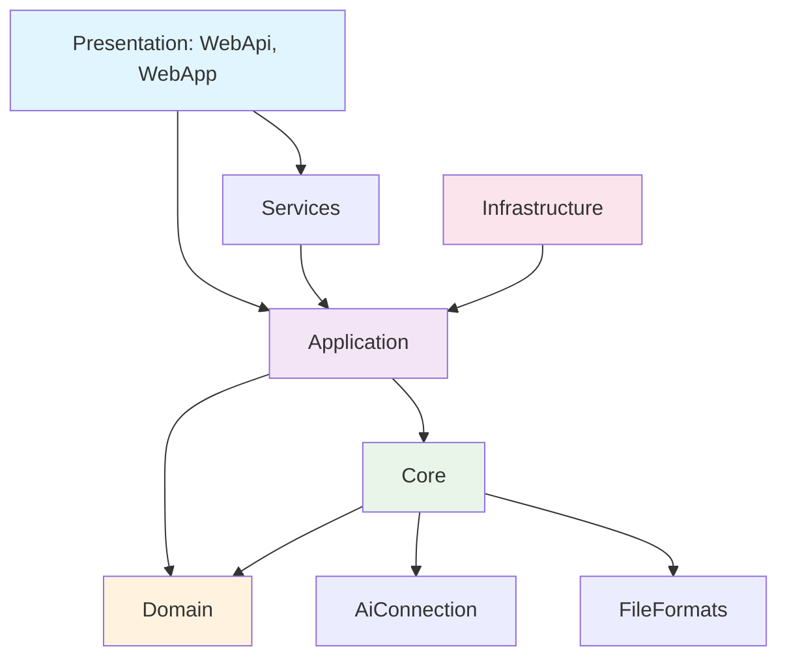

# Clean Architecture Overview

**On this page:** Architecture Principles · Layer Overview · Layer Responsibilities · Dependency Flow · CQRS Implementation · Repository Pattern · Dependency Injection Configuration · Cross-Cutting Concerns · Testing Strategy · Related pages

The IniaAi Platform separates its code into layers with dependencies that point inward, toward the domain. This page names each layer's project, what lives in it, and the real references between the projects.

## Architecture Principles

1. **Separation of Concerns**: Each layer has a specific responsibility
2. **Dependency Inversion**: Dependencies point inward toward business logic
3. **Independence**: Business logic is independent of frameworks, UI, and databases
4. **Testability**: Each layer can be tested with real instances of the layers below it

## Layer Overview



## Layer Responsibilities

### 1. Domain Layer (`IniaAi.Domain`)

The innermost layer: entities, enums, specifications and the persistence interfaces. It references only `IniaAi.Common`.

**Responsibilities:**
- Entities of both databases (`Entities/`), grouped by subject
- Specifications (`Specifications/`) — Ardalis specification classes every repository query uses
- Repository and unit-of-work interfaces (`Persistence/`)
- Domain rules that need no service: signature, replay and rerun types

**Top-level folders:** `Abstractions`, `Business`, `Common`, `Constants`, `Core`, `DocumentAnalysis`, `Entities`, `Enums`, `Extensions`, `Graph`, `JsonSchemas`, `OutputFormat`, `Persistence`, `Proposals`, `Replay`, `Reruns`, `Serialization`, `Signatures`, `Specifications`, `StoredKeys`, `Tools`.

### 2. Application Layer (`IniaAi.Application`)

Use cases as commands and queries, and the services that orchestrate them. It references `IniaAi.Domain`, `IniaAi.Core`, `IniaAi.Common.Interfaces` and `IniaAi.WebApi.Contracts`.

**Responsibilities:**
- Commands (`Commands/`) and queries (`Queries/`), each in a folder with its request, handler and validator
- The in-house request dispatcher (`Common/Dispatching`: `ISender`, `IRequest<T>`, `IRequestHandler<,>`, `ValidatingDispatcher`)
- FluentValidation validators
- Application service interfaces (`Common/Interfaces`, such as `IJobsService` and `IRequestContext`) and subject folders (`Auditing`, `DocumentAnalysis`, `Documents`, `Queues`, `Workflows`)
- Projections and mappers from entities to the DTOs of `IniaAi.WebApi.Contracts`

### 3. Core Layer (`IniaAi.Core`)

The business engine. It references `IniaAi.Domain`, `IniaAi.AiConnection`, `IniaAi.FileFormats`, `IniaAi.Common` and `IniaAi.Common.Interfaces`.

**Responsibilities:**
- The [workflow engine](../workflow-engine/index.md) and its block strategies (`Workflows/`)
- [RAG](../rag/index.md) (`Rag/`) and web search (`AugmentedSearch/`)
- Document handling and [OCR](../ocr/index.md) (`Documents/`, `Services/`)

**Top-level folders:** `AugmentedSearch`, `Common`, `Documents`, `Dto`, `Rag`, `Services`, `Utils`, `Workflows`.

### 4. Infrastructure Layer (`IniaAi.Infrastructure`)

The implementations of the persistence and outside-world interfaces. It references `IniaAi.Application` (and through it the inner layers).

**Responsibilities:**
- EF Core persistence (`Persistence/`): the two `DbContext`s, the repository wrappers, units of work, seeding and startup migration
- File storage providers (`Storage/`)
- Outgoing mail (`Email/`)
- Multi-tenant plumbing (`MultiTenant/`), GitHub, stored keys
- Service implementations that touch infrastructure (`Services/`): the agent-runtime client, model pricing seeding, retention jobs

**Top-level folders:** `Email`, `GitHub`, `MultiTenant`, `Persistence`, `Services`, `Storage`, `StoredKeys`, `Utilities`.

### 5. Presentation Layer (`IniaAi.WebApi`, `IniaAi.WebApp`)

The two hosts. `IniaAi.WebApi` is the REST API (controllers, middleware, and Swagger in development); `IniaAi.WebApp` is the Blazor Server admin app. Each wires every layer in its own process — the admin app does not call the REST API ([System Context & Containers](../c4-model/container.md)).


### Additional Projects

| Project | Purpose |
|---------|---------|
| `IniaAi.Services` | Host-shared services that need Application and Core: the [background jobs](../background-jobs/index.md), document processing, export, email intake, file download, usage, queues |
| `IniaAi.Common` | Shared utilities, helpers, and extension methods used across the solution; references nothing |
| `IniaAi.Common.Interfaces` | Interfaces shared by Core and Application, such as `ITokenUsageService`, the agent-runtime contracts and the persistence base context |
| `IniaAi.Configuration` | `PlatformSettings` and the other settings classes, and configuration loading (`ConfigurationBuilderExtensions`) |
| `IniaAi.AiConnection` | The chat and embeddings connectors, rate limiting and retries ([AI providers & connectors](../ai-integration/providers.md)) |
| `IniaAi.FileFormats` | Document formats: PDF extraction, file inspection, Excel, Word and email interfaces and the open implementations |
| `IniaAi.FileFormats.PdfiumWorker` | The process that runs PDFium for the open PDF implementation, one per open document; it references no project of ours |
| `IniaAi.WebApi.Contracts` | API DTOs, requests, responses and enums; references nothing |
| `IniaAi.Migrations.PostgreSql`, `IniaAi.Migrations.Mssql` | EF Core migrations per database provider |
| `IniaAi.Testing`, `IniaAi.Testing.DependencyInjection` | Test fixtures and the test service provider (real instances, in-memory databases) |
| `IniaAi.Testing.Documents` | PDF and Office fixtures, written by hand or with ClosedXML and Open XML SDK, and the file formats each test registers, kept apart so a test project that needs no document library does not carry one |

## Dependency Flow

### Dependency Rules

1. **Inner layers never depend on outer layers**: `IniaAi.Domain` references only `IniaAi.Common`.
2. **Interfaces are defined in inner layers**: the repository and unit-of-work interfaces in `IniaAi.Domain`, service interfaces in `platform/IniaAi.Application/Common/Interfaces` and `IniaAi.Common.Interfaces`.
3. **Implementations are in outer layers**: `IniaAi.Infrastructure` and `IniaAi.Services`.
4. **Application depends on Core**, not the other way round: handlers call the engine, and Core reaches application concerns only through interfaces.

## CQRS Implementation

The Application layer splits writes (commands) from reads (queries). Every request goes through `ISender`, the in-house dispatcher; there is no MediatR. A controller sends the request and maps the `ErrorOr<T>` result to an HTTP response.

### Commands (Write Operations)

A real command, `CreateDocumentCategory` (`platform/IniaAi.Application/Commands/DocumentCategories/CreateDocumentCategory/`):

```csharp
public record CreateDocumentCategoryCommand(
    string OrganizationId,
    string UserId,
    string Name,
    int? DisplayOrder) : IRequest<ErrorOr<DocumentCategoryDto>>;

public class CreateDocumentCategoryCommandHandler
    : IRequestHandler<CreateDocumentCategoryCommand, ErrorOr<DocumentCategoryDto>>
{
    private readonly ICoreUnitOfWork _coreUnitOfWork;

    public async Task<ErrorOr<DocumentCategoryDto>> Handle(
        CreateDocumentCategoryCommand request,
        CancellationToken cancellationToken)
    {
        var category = DocumentCategory.Create(request.Name, request.UserId, request.DisplayOrder ?? 0);

        DocumentCategory? existing = await _coreUnitOfWork.Repository<DocumentCategory>()
            .GetFirstOrDefaultAsync(new DocumentCategoryByIdSpec(category.Id), cancellationToken);
        if (existing is not null)
        {
            return Error.Conflict("DocumentCategory.AlreadyExists", $"Document category with name '{request.Name}' already exists");
        }

        await _coreUnitOfWork.Repository<DocumentCategory>().AddAsync(category);
        _ = await _coreUnitOfWork.CompleteAsync(cancellationToken);

        return DocumentCategoryDtoMapper.ToDto(category);
    }
}
```

The folder also holds `CreateDocumentCategoryCommandValidator`, which the dispatcher runs before the handler.

### Queries (Read Operations)

A query has the same shape under `Queries/` — for example `ListDocumentCategoriesQuery`, its handler and its validator in `platform/IniaAi.Application/Queries/DocumentCategories/ListDocumentCategories/`. That handler reads the entities through a specification (`DocumentCategoriesSpec`) and maps them to DTOs; a query over a wide entity projects instead, through a specification with a selector (`ISpecification<T, TResult>`), so it loads only the columns the DTO needs. How the handlers are organised is on [Command handlers](../services/application/command-handlers.md) and [Query handlers](../services/application/query-handlers.md).

## Repository Pattern

There is one generic repository per database, not one repository class per entity. `IRepository<T>` (`platform/IniaAi.Domain/Persistence/UserData/Repositories/IRepository.cs`) takes Ardalis specifications:

```csharp
public interface IRepository<T>
{
    Task<T?> GetByIdAsync(object id, CancellationToken cancellationToken = default);
    Task<T?> GetFirstOrDefaultAsync(ISpecification<T> specification, CancellationToken cancellationToken = default);
    Task<IEnumerable<T>> FindAsync(ISpecification<T> specification, CancellationToken cancellationToken = default);
    Task<IList<T>> GetAllAsync(ISpecification<T> specification, CancellationToken cancellationToken = default);
    Task AddAsync(T entity);
    // … more reads, removes and set operations
}
```

`ArdaliaRepositoryWrapper<T, TContext>` (`platform/IniaAi.Infrastructure/Persistence/Abstractions/`) implements it over `Ardalis.Specification.EntityFrameworkCore.RepositoryBase<T>`; `CoreRepositoryWrapper<T>` and `UserDataRepositoryWrapper<T>` bind it to each database. A handler reaches a repository through its database's unit of work — `ICoreUnitOfWork` or `IUserDataUnitOfWork` — calls `Repository<T>()`, and saves with `CompleteAsync`. The unit of work also exposes a few named repositories with extra methods (`Workflows`, `Documents`, `WorkflowExecutions`, …). [Database Services](../services/infrastructure/database-services.md) has the details.

## Dependency Injection Configuration

Each layer exposes registration extensions, and each host calls them:

- `AddApplication` (`platform/IniaAi.Application/DependencyInjection.cs`) registers the dispatcher (`AddRequestDispatching`), every FluentValidation validator in the assembly, and the application services.
- `AddInfrastructure` (`platform/IniaAi.Infrastructure/InfrastructureServiceRegistration.cs`) registers persistence, storage and the infrastructure services; `AddOutgoingMail` and `AddAgentRuntimeClient` register mail and the agent runtime client.
- The API host adds the rest in `ApplicationServicesConfiguration` (`AddTransientServices`, `AddScopedServices`, `AddSingletonServices`), the admin app in `ServicesConfigurator`. Core services, connectors and the job service are registered there.

There is no `AddCoreServices` method: Core has no registration extension of its own. Which services each host registers, and with which lifetime, is on [Dependency injection](../services/dependency-injection.md) and [Service registration](../services/service-registration.md).

## Cross-Cutting Concerns

### Validation Pipeline

The in-house dispatcher validates before it calls a handler. For every request whose response is `ErrorOr<T>`, it runs the request's validator first. [Validation Services](../services/application/validation-services.md) describes the step.

A failure comes back as `Error.Validation` values, not as an exception, and the handler does not run. The dispatcher has no other pipeline steps: logging and monitoring live in the handlers and services themselves.

## Testing Strategy

Tests use **real instances and fixtures** (see [C# Code Standards](../../getting-started/csharp-code-standards.md) and [Testing](../../getting-started/testing.md)):

- **Unit and handler tests** (`IniaAi.*.Tests`, `IniaAi.Application.UnitTests`, `IniaAi.WebApi.UnitTests`) build a real service provider from `IniaAi.Testing.DependencyInjection`. `TestDatabaseServices` backs both contexts with the EF Core in-memory provider, or the user-data context with in-memory SQLite when a test needs relational behaviour (set-based deletes and updates, foreign keys).
- **Mocks**: NSubstitute is the mocking library, and the house rule keeps it at an external boundary; `IChatConnector` is by far its most common target. Some older tests also substitute units of work and repositories. Moq is listed in `Directory.Packages.props` but no test uses it.
- **Integration tests** (`IniaAi.WebApi.IntegrationTests`) host the API in-process through `CustomWebApplicationFactory`, a `WebApplicationFactory<Program>` that runs with `ASPNETCORE_ENVIRONMENT=Tests` and generated secrets.

## Related pages

- [Services Layer](../services/index.md) — concrete service implementations organized by layer.
- [Workflow Engine](../workflow-engine/index.md) — the block-based execution engine that lives in the Core layer.
- [Solution layout](../../getting-started/solution-layout.md) — every project of the solution and where to start reading.
- [C# Code Standards](../../getting-started/csharp-code-standards.md) — the house testing rules.
- [Glossary](../../reference/glossary.md) — definitions for the core domain terms used across these layers.
