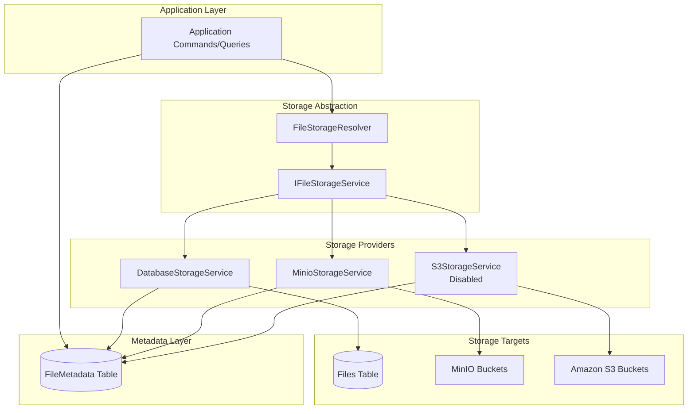

# File Storage Architecture

**On this page:** Overview · Storage Providers · Fixed Bucket Mode (On-Premise) · Multi-Tenant Architecture · Database Schema · Service Interfaces · Service Registration · Storage Categories · Migration Strategy · Performance Considerations · Security · Future Enhancements · Known Issues · Related Documentation

The IniaAi Platform implements a flexible, multi-tenant file storage system with support for multiple storage providers. This architecture allows organizations to choose their preferred storage backend while maintaining consistent API interfaces and data isolation.

## Overview

The file storage system uses a **Strategy Pattern** with provider abstraction, enabling seamless switching between different storage backends:



## Storage Providers

### 1. Database Storage (Legacy)

**Status**: Active (Legacy)
**Best For**: Small files, existing tenants, development environments

**Implementation**: `DatabaseStorageService`

**How It Works**:
- Files stored as `byte[]` in the `Files` table
- Metadata stored in `FileMetadata` table
- `FileMetadata.ExternalStoragePath` contains the `File.Id` for lookup
- `FileMetadata.StorageProvider` = `StorageProvider.Database` (enum value 1)

**Advantages**:
- Simple setup, no external dependencies
- ACID transactions for file operations
- Backup/restore with database backups

**Limitations**:
- Performance degrades with large files
- Database bloat from binary data
- Scalability concerns for high-volume file storage
- Expensive to query metadata when loading file bytes

**Usage**:
```csharp
// Upload
var path = await storageService.UploadAsync(
    organizationId: "org-123",
    category: StorageCategories.Documents,
    key: fileId,
    content: fileStream,
    contentType: "application/pdf"
);

// Download
var stream = await storageService.DownloadAsync(
    organizationId: "org-123",
    category: StorageCategories.Documents,
    key: fileId
);
```

---

### 2. MinIO Storage (Active)

**Status**: Production-Ready
**Best For**: Self-hosted deployments, S3-compatible workflows, cost-effective scaling

**Implementation**: `MinioStorageService`

**How It Works**:
- Files stored in MinIO buckets with naming: `{organizationId}-{category}`
- Metadata stored in `FileMetadata` table
- `FileMetadata.ExternalStoragePath` contains the object key/path in MinIO
- `FileMetadata.StorageProvider` = `StorageProvider.MinIO` (enum value 3)
- Automatic bucket creation on first upload
- Upload verification via ETag validation

**Bucket Naming**:
```
Organization ID: "Contoso-Corp"
Category: "Documents"
Bucket Name: "contoso-corp-documents"

Organization ID: "Acme.Inc"
Category: "Reports"
Bucket Name: "acme-inc-reports"
```

Both parts are lower-cased, and `_` and `.` become `-` (`Normalize` in `MinioStorageService`).

**Category Mappings** (optional, `FileStorage:StorageBuckets` in `appsettings.json`): a category with an entry uses the mapped name as its bucket suffix, and every other category uses its own name. The categories are the [storage categories](#storage-categories):
```json
{
  "FileStorage": {
    "StorageBuckets": {
      "documents": "docs",
      "json2xlsx-templates": "templates"
    }
  }
}
```

**Advantages**:
- S3-compatible API for easy migration
- Organization-level bucket isolation
- Self-hosted control and data sovereignty
- High performance for large files
- Metadata queries don't load file bytes

**Limitations**:
- Requires MinIO server infrastructure
- Additional operational complexity
- Network dependency for file access

**Configuration**:
```json
{
  "FileStorage": {
    "DefaultProvider": "Minio",
    "MinIO": {
      "Endpoint": "localhost:9000",
      "AccessKey": "minioadmin",
      "SecretKey": "minioadmin",
      "UseSSL": false,
      "Region": null,
      "BucketName": null
    }
  }
}
```

See [Fixed Bucket Mode (On-Premise)](#fixed-bucket-mode-on-premise) for the `BucketName` option.

**Usage**:
```csharp
// Upload creates bucket if needed
var path = await storageService.UploadAsync(
    organizationId: "contoso-corp",
    category: StorageCategories.Documents,
    key: "report-2024.pdf",
    content: fileStream,
    contentType: "application/pdf"
);
// Result: File stored in "contoso-corp-documents" bucket

// Download retrieves from organization-specific bucket
var stream = await storageService.DownloadAsync(
    organizationId: "contoso-corp",
    category: StorageCategories.Documents,
    key: "report-2024.pdf"
);
```

---

### 3. Amazon S3 Storage (Implemented, Disabled)

**Status**: Implemented but not registered: the keyed registration of `S3StorageService` is commented out in `AddInfrastructure` and in the admin app's `ServicesConfigurator`. A deployment that sets `DefaultProvider` (or a tenant override) to `S3` gets the Database provider: the resolver logs `Failed to resolve storage provider 'S3': …` and falls back ([Fallback Strategy](#fallback-strategy)).

**Implementation**: `S3StorageService` (`platform/IniaAi.Infrastructure/Storage/`)

**What the class does**:
- One bucket per organization and category, with an `org-` prefix (e.g., `org-contoso-corp-docs`), created on first upload (`EnsureBucketExistsAsync`)
- Reads its category mappings from a top-level `StorageBuckets` section, not from `FileStorage:StorageBuckets`
- Reports a missing object as `FileNotFoundException`, as the other providers do
- Server-side encryption, lifecycle policies and CloudFront are not configured by the platform

> [!WARNING]
> S3 bucket naming uses an `org-` prefix (e.g., `org-contoso-corp-docs`), unlike MinIO which uses no prefix (e.g., `contoso-corp-docs`). This is intentional to avoid S3 bucket naming conflicts.

**Configuration**:
```json
{
  "FileStorage": {
    "DefaultProvider": "S3",
    "S3": {
      "Region": "us-east-1",
      "AccessKeyId": null,
      "SecretAccessKey": null,
      "ServiceUrl": null
    }
  }
}
```

---

## Fixed Bucket Mode (On-Premise)

For on-premise / single-tenant deployments where the customer manages their own infrastructure, MinIO can be configured to use a single pre-created bucket instead of the default per-tenant bucket pattern.

### When to Use

- **On-premise deployments** where the customer's infrastructure team provisions and manages storage
- **Single-tenant instances** where multi-tenancy is not required
- **Environments with restricted bucket creation** where the application cannot create buckets at runtime (e.g., locked-down MinIO/S3-compatible storage with IAM policies that deny `s3:CreateBucket`)

### Configuration

Set the `BucketName` property in `MinIO` settings:

```json
{
  "FileStorage": {
    "DefaultProvider": "Minio",
    "MinIO": {
      "Endpoint": "minio.customer.local:9000",
      "AccessKey": "...",
      "SecretKey": "...",
      "UseSSL": true,
      "BucketName": "inia-platform-files"
    }
  }
}
```

When `BucketName` is set, `ResolveBucketName()` returns this fixed value for all operations, bypassing the `{orgId}-{category}` naming convention. The bucket must already exist — the application will still auto-create it if missing, but on-premise environments typically pre-provision buckets.

### Risks and Limitations

> [!CAUTION]
> **Not for shared multi-tenant deployments**
>
> When `BucketName` is set, **per-organization bucket isolation is disabled**. All tenants' files are stored in the same bucket, with only the object key (path) distinguishing them. This is acceptable for single-tenant on-premise deployments where the customer is the sole tenant and is responsible for their own data protection.
>
> **Do not enable this in shared multi-tenant environments.** Misconfiguration could lead to data co-mingling across organizations.

- Category-based bucket separation (`documents`, `json2xlsx-templates`) is also collapsed into the single bucket
- The `StorageBuckets` category mapping configuration is ignored when a fixed bucket is set
- Object keys remain unchanged, so files from different categories coexist in the same bucket namespace

### Deployment Responsibility

In on-premise mode, the customer is responsible for:
- **Bucket provisioning**: Creating the bucket before application deployment
- **Access control**: Configuring MinIO/S3 IAM policies for the bucket
- **Backup and disaster recovery**: Ensuring bucket data is backed up
- **Data protection**: All regulatory and compliance obligations for stored data

---

## Multi-Tenant Architecture

### Organization-Based Isolation

Each organization's files are isolated through:

1. **Bucket/Table Scoping**:
   - MinIO/S3: Separate buckets per organization
   - Database: `OrganizationId` foreign key on `Files` and `FileMetadata`

2. **Category-Based Segregation**:
   - Documents, reports, embeddings stored in separate buckets/namespaces
   - Configurable category-to-bucket mappings

3. **Metadata-First Design**:
   - All file metadata stored in `FileMetadata` table
   - Fast queries without loading binary data
   - Storage provider tracked per file

### Storage Provider Selection

**Current Implementation** (via `appsettings.json`): `FileStorageManager.GetProviderForTenant` reads `FileStorage:TenantOverrides` for the organization id and falls back to `DefaultProvider`. A provider name other than `Minio`/`MinIO`, `S3` or `Database` maps to `Database`.
```json
{
  "FileStorage": {
    "DefaultProvider": "Minio",
    "TenantOverrides": {
      "org-legacy-client": "Database"
    }
  }
}
```

**Planned Implementation** (database-driven):
- Add `StorageProvider` property to `Organization` entity
- UI for administrators to configure storage per organization
- Migration process for existing files
- Automatic provider resolution based on organization settings

### Fallback Strategy

The `FileStorageResolver` implements automatic fallback. A provider that is not registered — `S3` always, `Minio` when `FileStorage:MinIO:Endpoint` is empty — resolves to the Database provider with the warning `Failed to resolve storage provider '{Name}': …`. A file whose `FileMetadata` says MinIO is then read from the Database provider and fails, so keep MinIO configured on every host while any row points at it. Simplified:

```csharp
public IFileStorageService Resolve(string providerName)
{
    try
    {
        return _serviceProvider.GetRequiredKeyedService<IFileStorageService>(providerName);
    }
    catch (InvalidOperationException)
    {
        // Fallback to Database if requested provider unavailable
        return _serviceProvider.GetRequiredKeyedService<IFileStorageService>("Database");
    }
}
```

---

## Database Schema

Both the `FileMetadata` and `Files` tables live in the **`UserDataDbContext`** (`DbSet<FileMetadata>`, `DbSet<File>`) under the **`UserData`** schema. Every column, with types and indexes, is on the [UserData database reference](../../reference/database/user-data-database.md); this section names what the storage layer relies on.

### FileMetadata Table

**Purpose**: One row per stored file, for all storage providers: `OrganizationId` (foreign key to `Organizations`), `DocumentId`, `Name` (up to 450 characters, without the extension), `Extension` (up to 10), `SizeBytes`, `StorageProvider` (`NotDefined` 0, `Database` 1, `S3` 2, `MinIO` 3), `ExternalStoragePath` (up to 36 characters), and the soft-delete and audit columns.

**Key Fields**:
- `StorageProvider`: Enum indicating which provider stores the file
- `ExternalStoragePath`:
  - Database: Contains `File.Id` to lookup blob data
  - MinIO/S3: Contains object key/path in bucket
- `Name` + `Extension`: Separated for easier querying
- `SizeBytes`: File size for quota management

### Files Table (Legacy)

**Purpose**: Stores file binary data for Database storage provider: `Id`, `Bytes` (`bytea` on PostgreSQL), and the columns `File` marks "to be removed in future version" (`OrganizationId`, `DocumentId`, `Name`, `Extension`, `SizeBytes`), plus the soft-delete and audit columns.

**Usage**:
- Only used when `FileMetadata.StorageProvider = Database`
- `FileMetadata.ExternalStoragePath` references `Files.Id`
- Performance degrades with large blobs

---

## Service Interfaces

### IFileStorageService

**Purpose**: Abstraction for all storage providers

```csharp
public interface IFileStorageService
{
    Task<string> UploadAsync(
        string organizationId,
        string category,
        string key,
        Stream content,
        string contentType
    );

    Task<Stream> DownloadAsync(
        string organizationId,
        string category,
        string key
    );

    Task DeleteAsync(
        string organizationId,
        string category,
        string key
    );
}
```

### IFileStorageResolver

**Purpose**: Resolves storage provider by name or enum

```csharp
public interface IFileStorageResolver
{
    IFileStorageService Resolve(string providerName);
    IFileStorageService Resolve(StorageProvider provider);
}
```

**Usage**:
```csharp
// Resolve by name
var storage = _resolver.Resolve("Minio");

// Resolve by enum
var storage = _resolver.Resolve(StorageProvider.MinIO);

// Resolve from FileMetadata
var storage = _resolver.Resolve(fileMetadata.StorageProvider);
```

---

## Service Registration

**File**: `platform/IniaAi.Infrastructure/InfrastructureServiceRegistration.cs`

```csharp
// Configure MinIO client
var minioSettings = configuration.GetSection("FileStorage:MinIO").Get<MinioStorageSettings>();
if (minioSettings != null && !string.IsNullOrEmpty(minioSettings.Endpoint))
{
    services.AddSingleton<IMinioClient>(sp =>
    {
        // MinIO client expects endpoint without protocol prefix
        var endpoint = minioSettings.Endpoint;
        if (endpoint.StartsWith("http://"))
            endpoint = endpoint.Substring(7);
        else if (endpoint.StartsWith("https://"))
            endpoint = endpoint.Substring(8);

        // Bypass system proxy — MinIO is always internal infrastructure.
        // .NET doesn't support CIDR notation in NO_PROXY (see Known Issues).
        var httpClient = new HttpClient(new HttpClientHandler { UseProxy = false });

        var client = new MinioClient()
            .WithEndpoint(endpoint)
            .WithCredentials(minioSettings.AccessKey, minioSettings.SecretKey)
            .WithHttpClient(httpClient);

        if (minioSettings.UseSSL)
            client = client.WithSSL();
        if (!string.IsNullOrEmpty(minioSettings.Region))
            client = client.WithRegion(minioSettings.Region);

        return client.Build();
    });
}

// Register storage services with keyed services
services.AddKeyedSingleton<IFileStorageService, DatabaseStorageService>("Database");

if (minioSettings != null && !string.IsNullOrEmpty(minioSettings.Endpoint))
    services.AddKeyedSingleton<IFileStorageService, MinioStorageService>("Minio");

// Register resolver and manager
services.AddSingleton<IFileStorageResolver, FileStorageResolver>();
services.AddSingleton<IFileStorageManager, FileStorageManager>();
```

---

## Storage Categories

File categories determine the bucket suffix in MinIO/S3. All well-known categories are defined as constants in `StorageCategories` (`platform/IniaAi.Configuration/Storage/FileStorageSettings.cs`):

```csharp
public static class StorageCategories
{
    public const string Documents = "documents";                       // User-uploaded and processed documents
    public const string Json2XlsxTemplates = "json2xlsx-templates";    // Json2Xlsx block templates (Excel or Word)
    public const string AgentSessionBundles = "agent-session-bundles"; // Session bundles of finished agent runs
}
```

Where a session bundle is stored, and why, is on [Agent Runtime Integration](../services/infrastructure/agent-runtime-integration.md).

All code that stores or retrieves files **must** use these constants instead of string literals. This prevents category mismatches between upload and download paths (which would result in "bucket not found" errors).

---

## Migration Strategy

### Database to MinIO Migration

**Implementation**: `FileStorageMigrationService` (`platform/IniaAi.Infrastructure/Services/FileStorageMigrationService.cs`)

The migration runs as a `BackgroundService` that is registered on startup **only when `FileStorage.DefaultProvider` equals `"MinIO"`** (case-insensitive; the gate lives in `platform/IniaAi.WebApi/DependencyInjection.cs`, `AddPresentation`). Any other provider value — including `Database` — means the service is never registered.

**How to trigger**:
1. Set `FileStorage.DefaultProvider` to `"Minio"` in `appsettings.json`
2. Restart the application — the migration service starts automatically
3. Monitor logs for progress

**How it works**:
1. Queries `FileMetadata` where `StorageProvider == Database`, one file at a time (oldest first)
2. Loads the file bytes from the `Files` table via `ExternalStoragePath`
3. Uploads to MinIO via `FileStorageManager.StoreFileAsync` using the `StorageCategories.Documents` category
4. Updates `FileMetadata.StorageProvider` to `MinIO` and `ExternalStoragePath` to the new key
5. Original bytes remain in the `Files` table (dual mode) — the system continues to work during migration
6. 100ms delay between files to avoid overwhelming the system
7. Progress logged every 10 files

**Registration** (`platform/IniaAi.WebApi/DependencyInjection.cs`):
```csharp
if (fileStorageSection?.DefaultProvider.Equals("MinIO", StringComparison.OrdinalIgnoreCase) == true)
{
    services.AddHostedService<FileStorageMigrationService>();
}
```

> [!WARNING]
> The `DefaultProvider` comparison is case-insensitive. Both `"Minio"` and `"MinIO"` will trigger the migration.

**Log output example**:
```
[INF] Starting file storage migration service - Database -> Minio
[INF] Starting migration scan for files with StorageProvider = Database
[INF] Migration progress: 10 processed | 10 migrated | 0 skipped | 0 errors | Avg: 0.15s/file
[INF] File storage migration completed! Total: 12 | Migrated: 12 | Skipped: 0 | Errors: 0 | Success Rate: 100.0% | Duration: 00:00:01.93
[INF] File storage migration service completed successfully
```

**After migration**:
- All `FileMetadata` records point to MinIO (`StorageProvider = 3`)
- Files are accessible through the normal download paths
- Original database blobs are untouched (can be cleaned up later if desired)

---

## Performance Considerations

### Metadata-First Architecture

**Problem**: Loading file bytes when only metadata needed

**Solution**:
- Separate `FileMetadata` and `Files` tables
- Query metadata without loading binary data
- Lazy-load bytes only when required

**Example**:
```csharp
// Fast: Query metadata only
var files = await _unitOfWork.FileMetadata
    .GetByOrganizationAsync(organizationId);
// Returns: Name, Extension, SizeBytes, CreatedAt (no binary data)

// Slow: Load bytes for specific file
var fileMetadata = files.First();
var storage = _resolver.Resolve(fileMetadata.StorageProvider);
var stream = await storage.DownloadAsync(
    organizationId,
    category,
    key: fileMetadata.ExternalStoragePath
);
```

### Content Type Detection

**Implementation**: The `FileMetadata.ContentType` property serves the type of the document the file belongs to, which the intake gate detected from the bytes ([file content inspection](../document-processing/file-content-inspector.md#where-it-runs)). Only a file whose document is not loaded falls back to the type its extension names (`Utils.DetermineMediaTypeFromExtension`):

```csharp
public string ContentType
{
    get
    {
        return (Document?.MediaType ?? Utils.DetermineMediaTypeFromExtension(Extension)).ToContentType();
    }
}
```

### Upload Verification

**MinIO Implementation**:
```csharp
// 1. Upload file
await _minioClient.PutObjectAsync(putObjectArgs);

// 2. Verify upload by checking ETag
var objectStat = await _minioClient.StatObjectAsync(statObjectArgs);
if (string.IsNullOrEmpty(objectStat.ETag))
{
    throw new InvalidOperationException("Upload verification failed - no ETag found");
}
```

---

## Security

### Data Isolation

- **MinIO/S3**: Separate buckets per organization, unless a [fixed bucket](#fixed-bucket-mode-on-premise) is set
- **Database**: the `OrganizationId` column on each row; the application filters by it. There is no database row-level security ([Multi-Tenant data isolation](../multi-tenant/data-isolation.md))
- **API**: Organization context enforced in all file operations

### Access Control

- Files accessible only through authenticated API
- Organization membership verified before file access
- No direct bucket/table access from frontend

### Secrets Management

- The MinIO access key and secret key are configuration values (`FileStorage:MinIO:AccessKey`, `SecretKey`). On AWS and Azure the platform loads them, with the other secrets, from AWS Secrets Manager or Azure Key Vault into the configuration at startup ([Cloud-mode configuration sources](../../operations/application-configuration.md#cloud-mode-configuration-sources)); they are read once, when the MinIO client is built.

---

## Future Enhancements

### Planned Features

1. **Organization-Level Storage Selection**
   - Add `StorageProvider` to `Organization` entity
   - UI for administrators to configure storage
   - Per-organization storage quotas

2. **Amazon S3 Provider Enablement**
   - Enable existing `S3StorageService` in DI registration
   - End-to-end testing with AWS S3
   - CloudFront integration for CDN

3. **Storage Blob Cleanup**
   - After migration is confirmed successful, clean up `Files` table blobs (currently kept in dual mode)

A soft-deleted file's blob is not orphaned for good: `SoftDeleteCleanupService` hard-deletes soft-deleted rows past the retention window and then deletes each file from its provider, after the database transaction commits. A blob it fails to delete is logged (`SoftDeleteCleanup: Org {OrgId} — Failed to delete file …`) and left behind ([Soft-Delete Cleanup](../../operations/soft-delete-cleanup.md)).

4. **File Versioning**
   - Track file version history
   - Restore previous versions
   - Version-aware storage paths

5. **Storage Analytics**
   - Per-organization storage usage metrics
   - Cost analysis and reporting
   - Storage provider performance monitoring

6. **Automatic Tiering**
   - Move old files to cheaper storage (S3 Glacier)
   - Lifecycle policies based on access patterns
   - Automatic cleanup of deleted files

---

## Known Issues

### .NET HttpClient ignores CIDR notation in NO_PROXY

**Affected environments**: Corporate/on-prem deployments with HTTP proxy (e.g., Zscaler)

**Symptoms**: MinIO health check returns `502 Bad Gateway` from the proxy server. MinIO operations fail with DNS errors. `curl` from the same container works fine.

**Root cause**: .NET's `HttpClient` does not support CIDR notation (e.g., `10.0.0.0/8`) in the `NO_PROXY` environment variable. It only performs literal string matching against hostnames. When MinIO is configured with a direct IP address (e.g., `http://<minio-internal-ip>:9000`), .NET cannot match it against the CIDR range and incorrectly routes the request through the corporate proxy.

Tools like `curl` (v7.86.0+) support CIDR in `NO_PROXY`, which is why they work while .NET doesn't.

**Fix**: Both the MinIO SDK client and the health check `HttpClient` are configured with `UseProxy = false`. Since MinIO is always internal infrastructure, proxy is never needed for these connections. This is a no-op in environments without a proxy.

**Diagnosis steps**:

1. Check proxy environment variables inside the container:
   ```bash
   kubectl exec -it <pod-name> -n <namespace> -- env | grep -i proxy
   ```

2. Test direct connectivity with curl:
   ```bash
   kubectl exec -it <pod-name> -n <namespace> -- curl -v http://<minio-endpoint>/minio/health/ready
   ```

3. If curl returns `200 OK` but the app health check fails, the issue is confirmed as the .NET proxy bypass bug.

**References**:
- [dotnet/runtime HttpEnvironmentProxy source](https://github.com/dotnet/runtime/blob/main/src/libraries/System.Net.Http/src/System/Net/Http/SocketsHttpHandler/HttpEnvironmentProxy.cs) — string-only matching, no CIDR support
- [HttpClient.DefaultProxy docs](https://learn.microsoft.com/en-us/dotnet/api/system.net.http.httpclient.defaultproxy) — confirms NO_PROXY only supports hostnames


---

## Related Documentation

- [C4 Container Diagram](../c4-model/container.md) - File storage in system architecture
- [Multi-Tenant Architecture](../multi-tenant/index.md) - Tenant isolation patterns
