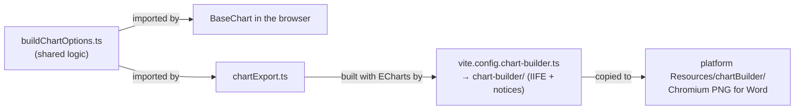

# Charting (ECharts & the chart bundle)

**On this page:** ECharts registration · buildChartOptions: the single source of truth · BaseChart · The chart bundle · verify:chart-builder CI guard · The platform's copy · Rendering flow in the app · Data source: the report paragraph

The IniaAi.Web frontend draws charts with [Apache ECharts](https://echarts.apache.org/) (Apache-2.0) through one Vue component, `BaseChart`, and a single shared option builder. The same option-building logic is bundled a second way, with ECharts inside, so the platform's Word export draws the same chart in headless Chromium.

For the backend PNG/Word render side (Selenium/Chromium, the embedded bundle, the table fallback), see [Chart Rendering](../chart-rendering/index.md).

## ECharts registration

`src/lib/echarts.ts` registers, through `echarts/core`, the parts of ECharts that both the app and the Word export draw with: the line, bar, pie and scatter charts; the grid, legend and title components; and the canvas renderer. A component registers what only it uses — `BaseChart` the tooltip and the toolbox — so the export's bundle does not carry them. The module exports `init`, the `ChartOptions` type, the options all these parts accept, and `PAPER`, the white of a chart on paper. `src/register.ts` registers every organism globally, and the report element draws charts, so ECharts loads with the main bundle on every page. The main build puts `echarts` and `zrender` in the `vendor-charts` chunk (`vite.config.ts`), and writes their licence and notice files to `dist/third-party/`.

ECharts is pinned at `^6.1.0` in `package.json`. It reaches the platform only inside the chart bundle, so a version bump needs no other change there than a new copy of the bundle — see [The chart bundle](#the-chart-bundle).

## buildChartOptions: the single source of truth

All chart configuration for a workflow block is produced by one function, `buildChartOptions(config: ChartConfig): ChartOptions`, in `src/api/dynamicChart/buildChartOptions.ts`. It takes a backend-shaped `ChartConfig` (validated elsewhere by a Zod schema) and returns ECharts options. `TrendLineChart` (`src/components/organisms/Charts/`), the trend on the token usage analytics screen, builds a `ChartConfig` from its props and uses the same function.


The function dispatches on `config.type` (lower-cased):

| `config.type` | Builder | Notes |
|---|---|---|
| `bar`, `column` | `buildBarOptions` | `bar` → horizontal bars with the first category at the top, `column` → vertical; supports stacking, `percent` computed in the builder |
| `pie`, `donut` | `buildPieOptions` | `donut` has a hole 60% of the diameter; below 500 pixels wide the slice labels give way to the legend |
| `scatter` | `buildScatterOptions` | optional series grouping |
| `bubble` | `buildBubbleOptions` | an ECharts scatter sized by area from x/y/size, with quadrant colouring |
| `area` | `buildLineOptions(config, true)` | each series filled at `AREA_FILL_OPACITY`; axes, tooltip and legend as for `line`; no stacking (the editor offers stacking for bar and column only) |
| `line` | `buildLineOptions(config, false)` | also the switch's default branch; no caller passes a type `chartTypeIsSupported` refuses |

The builder also centralizes presentation logic shared by both render paths: color-scheme selection (`getColorScheme`), currency/unit axis labels, smart decimal-place inference (`smartDecimalPlaces` — e.g. 2 decimals for ratios/margins/rates), and multi-series grouping. The platform stores each row as `x`, `y` and `series`, with the source row's fields in `rawData`, so `field()` reads a source field from the row, else from its `rawData`. A row's group is its value of `options.seriesGroupField`, else the `series` the strategy resolved from it. `chartTypeIsSupported`, `chartHasData` and `chartHeight` answer the questions a renderer asks first; the report page and the export refuse the same types. Keeping this in one place is what makes the in-browser chart and the exported PNG match.

The tooltip formatters write HTML, so they escape every name that comes from the data with `escapeHtml` (`src/lib/escapeHtml.ts`). A label drawn on the canvas needs no escaping.

> [!TIP]
> **Adding a new chart type**
>
> Register the ECharts chart in `src/lib/echarts.ts`, write a `buildXOptions(config)` builder, add a `case` to the switch in `buildChartOptions`, and add the type to `CHART_TYPES` in `chartTypes.ts`, which the schema and `chartTypeIsSupported` read. Add a case to `buildChartOptions.render.test.ts`, which draws each type through ECharts' server-side SVG renderer. Then rebuild and copy the bundle — see the sections below.

## BaseChart

`src/components/organisms/Charts/BaseChart.vue` draws one chart. It takes the `options`, a `height` in pixels, an optional `label` that names the chart for a screen reader (`role="img"` and `aria-label` on its element; without a label the image name names it, and without that the word **Chart**), an optional `imageName`, and `onPaper`.

- **Theme.** The chart follows the app theme: ECharts' `dark` theme in the dark theme, on a transparent background. With `onPaper`, the chart keeps its light colours on white in both themes, as the Word export draws it. Report charts use `onPaper`, because a block author picks series colours for a white page and some scheme colours are dark greys.
- **Save as image.** With an `imageName`, the chart shows ECharts' save button, titled **Save as image**, which downloads a PNG of the chart at twice its size, named after the chart. Report charts and the token usage trends have it.
- **Size.** It redraws when its element's size differs from the chart's, and disposes of the chart when it unmounts. A theme change redraws only a chart that follows the theme.
- **Clicks.** A click inside the plot emits `plotClick` with its position in the data of the first grid.


## The chart bundle

The exact same `buildChartOptions` logic must run in two very different hosts: the Vue app (ESM, bundled by the main Vite build) and the backend's headless-Chromium export page (a plain `<script>` with no module loader and no npm). A second build solves this.

`src/api/dynamicChart/chartExport.ts` holds the export's side: `exportOptions(config, style)` returns the builder's options with no animation, a white background and the export's fonts, and refuses a chart of an unsupported type or with no data; `drawForExport(container, config, style)` draws them and settles when ECharts reports the drawing finished. `chartExport.global.ts` exports `drawForExport`.

A dedicated Vite config, `vite.config.chart-builder.ts`, builds that entry as a minified **IIFE** library named `IniaCharts`:

```
chart-builder/
  charts.global.js   # var IniaCharts = { drawForExport }, with ECharts inside
  LICENSE-echarts
  NOTICE-echarts
  LICENSE-d3
  LICENSE-zrender
```

The build opens `charts.global.js` with a notice that names Apache ECharts and zrender with their versions and licences, writes the four notice files from `node_modules`, and replaces `process.env.NODE_ENV` with `production`: ECharts reads it, and the export page has no `process`. `chartBundle.test.ts` loads the committed bundle in an empty page and checks that it defines `IniaCharts.drawForExport`.



## verify:chart-builder CI guard

Because `chart-builder/` is committed, it can drift from the source. The `verify:chart-builder` script rebuilds it and fails when the committed folder differs or gains a file, naming the files:

```json
"verify:chart-builder": "vite build --config vite.config.chart-builder.ts && ! git status --porcelain -- chart-builder/ | grep ."
```

It runs in the Vue app's [checks action](../../../web/.github/actions/checks/action.yml), on every pull request, as the **"Verify chart-builder bundle is in sync"** step. After editing the chart logic: run `npm run build:chart-builder`, commit the regenerated `chart-builder/` alongside your source change, then copy it into the platform (next section).

## The platform's copy

The platform keeps a copy of `chart-builder/` in `platform/IniaAi.Services/Resources/chartBuilder/`, and the Word export draws with that copy. Copy the folder there after every rebuild, as [Chart Rendering — Maintenance](../chart-rendering/index.md#maintenance) describes.


## Rendering flow in the app

`DynamicChartRenderer.vue` (`src/components/organisms/DynamicChart/`) is the in-app entry point. It accepts either a parsed `config` prop or a `rawResponse` JSON string, derives the chart options, and renders `BaseChart`:

1. `parsedConfig` — use `props.config`, else `JSON.parse(props.rawResponse)`; a parse failure logs and yields `null`.
2. Guard states — loading, error, **no-data** (`chartHasData` is false), and **unsupported type** (`chartTypeIsSupported` is false) each render their own panel.
3. `chartOptions = buildChartOptions(parsedConfig)` — only when the config is present, has data, and is a supported type.
4. `<BaseChart :options="chartOptions" :height="chartHeight(parsedConfig)" :image-name="parsedConfig.title" on-paper />` draws the chart.

The advertised supported types are `line, bar, column, area, scatter, pie, donut, bubble`.

## Data source: the report paragraph

A chart reaches the app inside the report. A Dynamic Chart block's output is a report paragraph of kind `DynamicChart`, and `WorkflowElement.vue` hands that paragraph's `chartPayload.chartConfig` to `DynamicChartRenderer`. No endpoint serves a chart configuration, and there is no chart API module: `src/api/dynamicChart/` holds only the schema, the colour schemes and the option builder.
