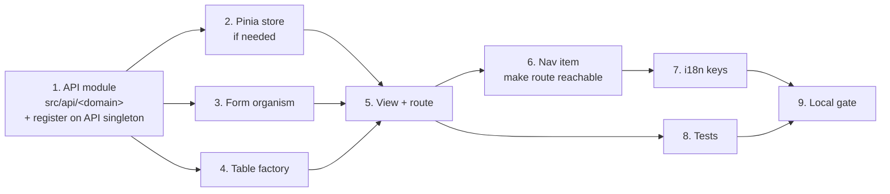

# Adding a New Feature (end-to-end)

**On this page:** 1. API module: `src/api/<domain>/` · 2. Pinia store: only if you need cross-component state · 3. Form: VeeValidate + Zod organism · 4. Table: TanStack column factory with `h()` · 5. View + lazy route · 6. Navigation: make the route reachable · 7. i18n: add locale keys · 8. Tests: colocated `*.test.ts` · 9. Local gate: run the full PR pipeline before pushing · Checklist · Done when · Related pages

This page is a practical, ordered walk-through for adding a typical CRUD-ish feature to the IniaAi.Web frontend — a new resource that lists, filters, creates, edits, and deletes records. It ties together the patterns documented across the other frontend architecture pages, using the existing **counterparty** feature as the worked reference because it exercises every layer end to end. Each step links to the deep-dive page for the rules and edge cases.

The order matters: build bottom-up (API contract first, UI last) so each layer compiles against the one below it.



> [!WARNING]
> **Two steps are easy to skip — and both leave the feature unreachable**
>
> A view that calls `API.MyFeatures.useGetX(...)` only works if the module is **registered on the `API` singleton** (step 1, below). A route alone does **not** put a link in the UI — you also need a **nav entry** (step 6). Skipping either produces a "feature" no user can reach: the first throws at runtime, the second hides the screen behind a URL nobody can discover.

## 1. API module: `src/api/<domain>/`

Every domain talks to the backend through the same triad of files. Create `src/api/<domain>/` with:

| File | Holds | Reference |
|---|---|---|
| `service.ts` | A `class Service extends BaseService` whose methods call `this.instance.<verb>(this.getApiPath('...'))` and return typed data | `src/api/counterparties/service.ts` |
| `schema.ts` | Request/response TypeScript `interface`s (add Zod only if the shape is dynamic/untrusted) | `src/api/counterparties/schema.ts` |
| `index.ts` | A default-exported class exposing TanStack Query hooks wrapping the service | `src/api/counterparties/index.ts` |

The service extends `BaseService` so it inherits the shared axios instance, the tenant/auth header interceptors, the version prefix, and 401 handling. Always wrap the relative path in `getApiPath(...)` — never hard-code `api/v1`:

```ts
// src/api/counterparties/service.ts
export default class Service extends BaseService {
  async getCounterparties(params: ODataQueryParams): Promise<OData<Counterparty> | null> {
    try {
      const { data } = await this.instance.get<ODataResponse<Counterparty>>(
        this.getApiPath('counterparties'), { params },
      )
      return toOdata(data)
    } catch {
      return null
    }
  }
  async createCounterparty(params: CreateCounterpartyRequest) {
    const { data } = (await this.instance.post(this.getApiPath('counterparties'), params)) || {}
    return data
  }
  // getCounterparty / updateCounterparty / deleteCounterparty …
}
```

The hooks in `index.ts` are built on `@tanstack/vue-query`. Reads use `useQuery` with a **reactive `computed` query key** so they re-run when inputs change; writes use `useMutation` and invalidate the domain by its key prefix in `onSuccess`:

```ts
// src/api/counterparties/index.ts
useGetCounterparties(params: Ref<ODataQueryParams>, config: any = {}) {
  return useQuery<OData<Counterparty>>({
    queryKey: computed(() => ['counterparties', JSON.stringify(params.value)]),
    queryFn: () => this.service.getCounterparties(params.value),
    ...config,
  })
}
useCreateCounterparty() {
  const queryClient = useQueryClient()
  return useMutation({
    mutationFn: (params: CreateCounterpartyRequest) => this.service.createCounterparty(params),
    onSuccess: () => queryClient.invalidateQueries({ queryKey: ['counterparties'] }),
  })
}
```

> [!TIP]
> **List endpoints are OData by default**
>
> If your list pages, filters, or sorts, take `ODataQueryParams`, run the response through `toOdata`, and `try`/`catch` → `null` so the view can render an empty state rather than throw. Eleven modules already do this ([OData support](api-layer.md#odata-support)).

> [!WARNING]
> **Never reach for raw `axios`/`fetch`**
>
> A bare call bypasses the interceptors, so it misses `X-Tenant-Id` and `Authorization` and can break under the deployed nginx path layout. Always go through a `BaseService` subclass.

### Register the module on the `API` singleton

Creating the triad is not enough. Components consume domains through the single `API` instance exported from `src/api/index.ts` (`import API from '@/api'`), so the new class must be wired into that aggregator or `API.MyFeatures` is `undefined` at runtime. Add your module in the **three** parallel places it expects — import, typed field, constructor instantiation:

```ts
// src/api/index.ts
import MyFeatures from './myFeatures'          // 1. import the default-exported hooks class

class API {
  MyFeatures: MyFeatures                        // 2. declare the typed field
  // …
  constructor() {
    this.MyFeatures = new MyFeatures()          // 3. instantiate it once
    // …
  }
}
```

Now `API.MyFeatures.useGetMyFeatures(...)` resolves in any view. Mind the casing — the folder is `camelCase` (`src/api/myFeatures/`), the `API` property is `PascalCase` (`MyFeatures`), the schema interface is `PascalCase` singular (`MyFeature`), and the backend path is `kebab-case` (`my-features`). See [the `API` singleton](api-layer.md#the-api-singleton-srcapiindexts) for the full naming map and the type-only `@/api/schema` barrel.

## 2. Pinia store: only if you need cross-component state

State is intentionally thin: server data is fetched on demand by the query hooks, **not** mirrored into a global store. Only add a store under `src/store/` when state must outlive a single component or be shared across unrelated views (e.g. theme, the desk's live agent activity, or a single-shot hand-off slot between two pages).

For an ordinary CRUD screen, **skip this step** — the TanStack Query cache is your shared state. See [State, Routing & Auth](state-routing-and-auth.md#pinia-stores) for the four existing stores and when each justifies itself.

## 3. Form: VeeValidate + Zod organism

Put the form in an organism directory that colocates the `.vue` with a `schema.ts`, e.g. `src/components/organisms/CounterpartyForm/{CounterpartyForm.vue,schema.ts}`. The schema file exports a **builder** that takes the i18n translator and returns a `z.object`, so validation messages are localized:

```ts
// src/components/organisms/CounterpartyForm/schema.ts
export const buildCounterpartyFormSchema = (t: (key: string) => string) =>
  z.object({
    id: z.string().min(3, t('shared.components.counterpartySelect.referenceId.validation.minLength')),
    name: z.string()
      .min(1, t('page.counterpartyManagement.form.validation.nameRequired'))
      .refine(isValidCounterpartyName, { message: t('…nameForbiddenCharacters') }),
    counterpartyTypeIds: z.array(z.string()).min(1, t('…typeRequired')),
    // email / website are .nullish() + a refine that passes when blank
  })
```

The component turns the builder into a typed VeeValidate schema, drives a `formData` ref for the template's `v-model`, re-baselines on `initialValues` change via an `immediate` watcher + `form.resetForm`, and communicates outward **only** through `submit`/`cancel` events (transform values in the submit handler, let the parent persist):

```ts
const { t: $t } = useI18n()
const schema = computed(() => toTypedSchema(buildCounterpartyFormSchema($t)))
const form = useForm<CounterpartyFormValues>({ validationSchema: schema, initialValues: formData.value })
const handleSubmit = form.handleSubmit(data =>
  $emits('submit', { ...data, email: blankToNull(data.email), website: blankToNull(data.website) }),
)
```

Bind fields through the `ui/form` primitives (`FormField` / `FormItem` / `FormControl` / `FormMessage`). See [Forms, Tables & Composables](forms-tables-and-composables.md#form-pattern-veevalidate--zod) for field binding, `useFormField`, and the edit/reset lifecycle.

## 4. Table: TanStack column factory with `h()`

Add a table module under `src/tables/<domain>.ts` that **default-exports a factory** taking the view's callbacks as `Options` and returning `{ columns }` typed as `ColumnDef<RowType>[]`. The module translates its own captions and control names through `useI18n` and stays free of store wiring; the view injects the row-action handlers:

```ts
// src/tables/counterparty.ts
export type CounterpartyRow = Counterparty & { type?: string; parentName?: string; searchQuery?: string }

export default ({ onEdit, onDelete, /* … */ }: Options) => {
  const { t } = useI18n()
  const columns: ColumnDef<CounterpartyRow>[] = [
    {
      accessorKey: 'name',
      header: 'Name',
      enableSorting: true,
      cell: ({ row }) => h('div', { class: 'name-cell' }, [
        h(HighlightedText, { text: row.getValue('name') as string, query: row.original.searchQuery ?? '' }),
      ]),
    },
    // … 'actions' column built from tableActionButton({ label: t('…edit', { name: row.original.name }), icon: 'pencil', onActivate: e => onEdit(row, e) })
  ]
  return { columns }
}
```

Cells and headers render via `h(Component, props, children)` (not SFC templates), the row type is the API contract intersected with view-computed display fields, and permission gating happens at column-assembly time (omit the column when not permitted). Lint cannot see `h()`, so add the module, with a few rows of fixtures, to the `rowControls.test.ts` guard of its folder: it fails until every clickable element in a row is a named control with a Tab stop, and until each control's name says which row it acts on. See [the tables section](forms-tables-and-composables.md#tables-tanstack-vue-table-column-factories) for row-action and selection patterns.

Re-export the factory from the `src/tables/index.ts` barrel under a `use…Table` name so the view can `import { useMyFeatureTable } from '@/tables'`:

```ts
// src/tables/index.ts
export { default as useMyFeatureTable } from './myFeature'
```

## 5. View + lazy route

Add the screen under `src/views/<Name>.vue`, then register it in `src/plugins/router/index.ts`. Lazy-import the component for per-route code splitting and add a route object with `meta`:

```ts
// src/plugins/router/index.ts
const MyFeature = () => import('../../views/MyFeature.vue')
// …
{
  path: '/my-feature',
  name: 'MyFeature',
  component: MyFeature,
  meta: {},                        // empty meta ⇒ authenticated, default layout
}
```

The view is where the previous four layers meet: it imports the singleton `API`, calls the read composable from the triad, reads `isLoading`/`data` off the returned refs, builds the columns from the table factory, and renders the shared `DataTable`. List endpoints return the OData envelope, so the rows live on `data.value` and the server total on `data.count`.

Give the page one `h1` in every state it can show. A page whose title comes from loaded data shows a visually hidden `h1` with the page's generic name while it loads or when the load fails: `PageLoadState` (`src/components/molecules/PageLoadState/PageLoadState.vue`) renders that `h1` with the standard loader (`loading`) or with the error message you pass in its slot. A not-found or error state titles itself with a visible `h1` inside `.error-message`. Below the `h1`, no heading skips a level. `src/headings.test.ts` reads every routed page, follows its components, and fails the build otherwise. Colour text with a theme token (`text-foreground`, `text-muted-foreground`, `text-error`, `var(--text-secondary)`), and give every icon button a target of at least 24px each way, for example with the shared `.hit-target` class: `src/textContrast.test.ts` and `src/targetSize.test.ts` check both.

Two imports in this example only resolve because of registration you did earlier: `API.MyFeatures.useGetMyFeatures` needs the module on the [`API` singleton](#register-the-module-on-the-api-singleton) (step 1), and `useMyFeatureTable` needs the [`src/tables` barrel export](#4-table-tanstack-column-factory-with-h) (step 4). `import type { ODataQueryParams } from '@/api/schema'` comes from the shared type barrel; the per-domain `import type { MyFeature } from '@/api/myFeatures/schema'` comes from your module's own `schema.ts`.

```vue
<!-- src/views/MyFeature.vue -->
<script setup lang="ts">
import { computed, ref } from 'vue'
import { useI18n } from 'vue-i18n'

import { IniaLoader } from '@/components/atoms'
import { DataTable } from '@/components/organisms'
import { useMyFeatureTable } from '@/tables'
import API from '@/api'
import type { ODataQueryParams } from '@/api/schema'
import type { MyFeature } from '@/api/myFeatures/schema'

const { t: $t } = useI18n()

const page = ref(0)
const pageSize = ref(50)
const orderBy = ref('name asc')
const selected = ref<MyFeature | null>(null)

const queryParams = computed<ODataQueryParams>(() => ({
  $skip: page.value * pageSize.value,
  $top: pageSize.value,
  $count: true,
  $orderby: orderBy.value,
}))

const { data: myFeatures, isLoading } =
  API.MyFeatures.useGetMyFeatures(queryParams)

const { columns } = useMyFeatureTable({
  labels: { edit: $t('page.myFeature.actions.edit') },
  onEdit: row => (selected.value = row.original),
})
</script>

<template>
  <div class="page-view">
    <IniaLoader v-if="isLoading" class="w-8" />
    <DataTable
      v-else
      :columns="columns"
      :data="myFeatures?.value ?? []"
      :page-size="pageSize"
      :total-count="myFeatures?.count ?? 0"
      :page="page"
      :order-by="orderBy"
      @update:page="page = $event"
      @update:order-by="orderBy = $event"
    />
  </div>
</template>
```

`DataTable` requires `columns` and `data`; `pageSize`/`totalCount`/`page`/`orderBy` drive its manual (server-side) pagination, and it emits `update:page` / `update:order-by` back to the view so the next `queryParams` recomputation refetches. For the real, fuller version — search/filter toolbar, an add/edit `Dialog` hosting the form organism, mutation wiring, and empty/loading states — read `src/views/CounterpartyManagement.vue`.

The full prop and event surface of the shared `DataTable` (`src/components/organisms/DataTable/DataTable.vue`):

| Prop | Type | Required / default | Purpose |
|---|---|---|---|
| `columns` | `ColumnDef<RowType>[]` | **required** | The TanStack column definitions from your table factory (step 4). |
| `data` | `RowType[]` | model (`v-model:data`) | The current page of rows. Bind it one-way as `:data="rows ?? []"`; it is a `defineModel`, so passing the OData page is enough. |
| `pageSize` | `number` | `50` | Page size used to compute `pageCount` (`totalCount / pageSize`). Match the `$top` in your `queryParams`. |
| `totalCount` | `number` | `0` | Server-side total row count (the OData `count`), not the length of `data`. |
| `page` | `number` | `0` (`v-model:page`) | Zero-based current page index; two-way, so the table writes back on navigation. |
| `orderBy` | `string` | `''` (`v-model:order-by`) | OData sort string `"<field> <asc\|desc>"`. A sortable header is a `SortableHeader` (`src/components/molecules/SortableHeader`): a native button inside the `th`, which carries `aria-sort`. A click, Enter or Space toggles the order and writes it back. |
| `rowTo` | `(row) => RouteLocationRaw` | — | Makes rows open a page. The row-link cell becomes a `RouterLink` named by that cell's text, which is the keyboard and new-tab path. A plain click elsewhere in the row opens the page; a Ctrl, Cmd or middle click opens it in a new tab. A click that starts on a link, button, form control or `role="button"` element in the row is ignored. Use the builders in `src/lib/routes.ts`. |
| `rowLinkColumn` | `string` | first visible column other than `select` | The column whose cell carries the row link. When that cell's text repeats across rows, give the column `meta.rowLinkLabel`, a function of the row that names the link: start with the cell text and add what tells the rows apart, such as the date added. |
| `rowClasses` | `object` | `{}` | Optional per-row CSS class map for conditional row styling, keyed by the row's `id`. |
| `dense` | `boolean` | `false` | Tighter rows for a dense list that is read row by row, instead of overriding the shared cells with `:deep`. |
| `fillColumn` | `string` | `''` | The id of the one column that takes the table's spare width; every other column keeps its size, which TanStack defaults to 150px. |

| Event | Payload | When |
|---|---|---|
| `update:page` | `number` | The user paginated — recompute `queryParams` and refetch. |
| `update:orderBy` | `string` | A sortable header was toggled (`update:order-by` in templates). |

Because `data`, `page`, and `orderBy` are `defineModel`/`useModel` bindings, the kebab-case template attributes (`:page-size`, `:total-count`, `@update:order-by`) map to the camelCase prop/event names above.

`meta` keys (all optional):

| Key | Effect |
|---|---|
| `layout: 'blank'` | Chrome-less layout (login, 2FA, callback, health) |
| `isPublic: true` | Bypass the auth guard entirely (the sign-in pages and the health check only) |
| `allowedRoles: readonly string[]` | Allow-list — access only if the user holds one listed role; **no** admin bypass |

Roles come from `ROLES` and the composite lists in `src/constants/roles.ts`. A route that admits an admin lists `ADMIN` and `SUPER_ADMIN` itself:

```ts
meta: { allowedRoles: [ROLES.SUPER_ADMIN, ROLES.SIGNATURE_CONTRIBUTOR] }
```

An ordinary authenticated screen just uses `meta: {}`. See [State, Routing & Auth](state-routing-and-auth.md#vue-router) for the navigation guard order and the full route table.

> [!TIP]
> **Route-synced filter state**
>
> If the view has table filters/sort/pagination you want shareable and reload-proof, add a `useXxxQueryState` composable (mirror `useCounterpartiesQueryState.ts`) that parses `route.query` into a `state` computed and `router.replace`s a `patchState`. See [composables](forms-tables-and-composables.md#composables-inventory).

## 6. Navigation: make the route reachable

A registered route is reachable by URL only. To put a link in the UI you must add the screen to the navigation, which is **not** a config file — it is built in code inside `src/components/layouts/DefaultLayout/DefaultLayout.vue` as two `computed` menus:

| `computed` | Where it shows | Item shape | Use it for |
|---|---|---|---|
| `mainMenuItems` | The top header bar (and, flattened, the navigation sidebar) | `{ title, to, children? }` | Primary, everyday destinations |
| `hamburgerMenuItems` | The left "Tools" drawer (and the navigation sidebar) | `{ title, to, icon }` | Admin / power-user tools |

A third menu, `menuItems`, is the navigation sidebar that takes the header menu's place whenever the menu does not fit — it is derived automatically by flattening the other two, so you never edit it directly. Pick the menu that fits and push an entry. The `title` is a vue-i18n key under `shared.menu.*`, and `to` is the route path you registered in step 5:

```ts
// src/components/layouts/DefaultLayout/DefaultLayout.vue — inside mainMenuItems computed
items.push({
  title: $t('shared.menu.myFeature'),
  to: '/my-feature',
})
```

Role-gate the item the same way the existing entries do — conditionally `push` based on `hasRole(...)` so the link only appears for permitted users. This is a UI affordance, not a security boundary; the route's `meta` guard from step 5 is what actually enforces access, so gate **both** consistently:

```ts
if (hasRole(ROLES.SUPER_ADMIN)) {
  items.push({ title: $t('shared.menu.myFeature'), to: '/my-feature', icon: 'gear' })
}
```

For a top-bar item with a submenu, give it a `children: { title, to }[]` array instead of a leaf `to`; the layout renders it as a dropdown. A module under `src/modules/` does not edit `DefaultLayout`: it adds its top-bar group or its drawer links to `extensionPoints.topMenu` and `extensionPoints.drawerMenu` (`src/modules/extensionPoints.ts`) when it registers, each link with the roles that may see it. Drawer items (`hamburgerMenuItems`) additionally need an `icon` — a Font Awesome name resolved by `IniaIcon` (see [Components & Design System](components-and-design-system.md)).


Add the `shared.menu.myFeature` key now in `src/assets/locales/en/shared/menu.json`; the rest of the screen's copy is added as page keys in the next step.

> [!TIP]
> **You're done with this step when…**
>
> You can launch the app, log in as a user who passes the gate, and **see the new link** in the header (or Tools drawer) — clicking it lands on your view. If the route works by typing the URL but no link appears, you registered the route but skipped this step.

## 7. i18n: add locale keys

Every visible string must route through vue-i18n. Add a per-screen JSON file under `src/assets/locales/en/page/<yourScreen>.json`, then register it in **two** barrels — a new module file is invisible until both are updated. First re-export the JSON from `src/assets/locales/en/page/index.ts`:

```ts
// src/assets/locales/en/page/index.ts
export { default as myFeature } from './myFeature.json'
```

Then import it in `src/assets/locales/en/index.ts` and add it to the `page` object of the assembled `EN` tree:

```ts
// src/assets/locales/en/index.ts
import {
  // …existing screens…
  myFeature,
} from './page'

export const EN = {
  common: { /* … */ },
  page: {
    // …existing screens…
    myFeature,
  },
  shared: { /* … */ },
}
```

A new **shared** module follows the same two-step shape against `en/shared/index.ts` and the `shared` object instead. Reuse `shared/` keys for cross-cutting copy (dialogs, enums, components, `common.{cancel,save,delete}`); add new shared keys only when the copy is genuinely reused across screens.

Address keys by their dot path (`page.counterpartyManagement.form.validation.nameRequired`) from `useI18n().t` in code or `$t` in templates. English is the only implemented locale, but mirror the tree shape so a second locale can be dropped in later. See [Internationalization](i18n.md).

## 8. Tests: colocated `*.test.ts`

Add Vitest tests next to the code they cover (`src/.../schema.test.ts`, `src/views/MyFeature.test.ts`). The suite runs on jsdom with `@vue/test-utils`, globals are enabled, and the schema builder, table factory, and pure utils are the cheapest high-value targets — they are plain functions. Test `*.test.ts` files are compiled by Vitest but excluded from the production type-check.

```bash
npm test            # vitest run — single pass (what CI runs)
npm run test:watch  # interactive
```

See [Testing](testing.md) for the stack, the shared `test-setup.ts`, and conventions.

## 9. Local gate: run the full PR pipeline before pushing

CI gates every PR on the same commands; run them locally first so nothing bounces back. The `validate` job runs type-check, lint, `verify:chart-builder` and build in that order, and the four `test` shards run `npm test`:

```bash
npm run type-check         # vue-tsc --build --force
npm run lint               # eslint . --fix
npm run verify:chart-builder
npm test                   # vitest run
npm run build
```

A Husky pre-commit hook already runs `npm run type-check && npm run lint` at commit time, but run `npm test` and `npm run build` yourself before opening the PR. The build requires **Node >= 24.11.0**. If your change touched the chart-builder source, `verify:chart-builder` will fail unless you regenerate and commit the bundle.

See [Build & Deploy](build-and-deploy.md) for the build/scripts.


## Checklist

| # | Step | Touches |
|---|---|---|
| 1 | API triad **+ register on the `API` singleton** | `src/api/<domain>/{service,schema,index}.ts`, `src/api/index.ts` |
| 2 | Store (only if cross-component state) | `src/store/<name>.ts` |
| 3 | Form organism | `src/components/organisms/<Name>Form/{*.vue,schema.ts}` |
| 4 | Table factory **+ barrel export** | `src/tables/<domain>.ts`, `src/tables/index.ts` |
| 5 | View + lazy route | `src/views/<Name>.vue`, `src/plugins/router/index.ts` |
| 6 | **Nav item (make it reachable)** | `src/components/layouts/DefaultLayout/DefaultLayout.vue`, `src/assets/locales/en/shared/menu.json` |
| 7 | i18n keys | `src/assets/locales/en/page/<screen>.json` + barrel |
| 8 | Tests | colocated `*.test.ts` |
| 9 | Local gate | `type-check` → `lint` → `verify:chart-builder` → `test` → `build` |

## Done when

- The new screen opens from its link in the header or the Tools drawer for a user who passes its gate, and its address alone answers the same screen.
- A user who fails the gate sees no link, and the address sends them to the home desk (`/`).
- The list loads, pages and sorts against the API, and a create, an edit and a delete each refresh it.
- `npm run type-check && npm run lint && npm run verify:chart-builder && npm test && npm run build` passes.

## Related pages

- [API Service Layer](api-layer.md) — `BaseService`, interceptors, the OData adapter, and the query/mutation hooks the view consumes.
- [Forms, Tables & Composables](forms-tables-and-composables.md) — the form organism, the `DataTable` column factory, and route-synced query-state composables.
- [State, Routing & Auth](state-routing-and-auth.md) — Pinia stores, the Vue Router guard order, and `meta`-based role gating.
- [Components & Design System](components-and-design-system.md) — `IniaIcon` names used by drawer nav items, and the shared `DataTable`.
- [Internationalization](i18n.md) — locale-key layout and the `page/` barrel.
- [Testing](testing.md) — Vitest + `@vue/test-utils` stack and conventions.
- [Build & Deploy](build-and-deploy.md) — the local PR gate and the build pipeline.

