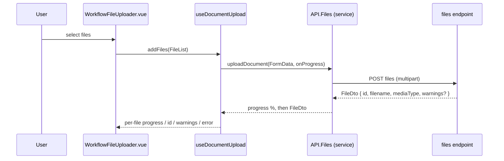

# Documents: Upload, Preview & Viewer (UI)

**On this page:** Views · Upload · Preview & viewing · Media-type grouping · API modules · Document categories & classification

How the Vue 3 frontend (the `IniaAi.Web` repository) lets users browse, upload, classify, preview, and download documents. This page maps the document views, the upload composable, the in-app preview/viewer components, and the three API modules behind them. For the backend contract see [Documents API reference](../../reference/api/documents.md); for the page-image endpoint integration see [Page-image API on the frontend](../../features/document-management/page-image-api-integration-on-frontend.md).

## Views

Three routed views, all lazy-loaded in `src/plugins/router/index.ts`:

| Route | Name | View file | Purpose |
|---|---|---|---|
| `/documents` | `Documents` | `src/views/DocumentsList.vue` | Searchable, filterable, paginated table of all documents |
| `/documents/:id` | `DocumentDetails` | `src/views/DocumentDetails.vue` | One document's metadata + its processed pages |
| `/document-category-management` | `DocumentCategoryManagement` | `src/views/DocumentCategoryManagement.vue` | CRUD for document categories |

### DocumentsList

`src/views/DocumentsList.vue` renders a `DataTable` (organism) over `API.Documents.useGetDocuments(queryParams)`. Notable behaviour, all confirmed in source:

- **Filters** — a debounced free-text search (300 ms via `useDebouncedRef`), plus media-type, category, and user dropdowns. Filter/sort/page state is held in the URL through `useDocumentsQueryState` and projected into an OData query by `buildDocumentsQuery` (`src/lib/documentsQuery.ts`). The name search ignores capitalisation: the builder lowercases the term and sends `contains(tolower(name), '<term>')` through `odataContainsAny` (`src/utils/odata.ts`), the helper the report search uses, so `Invoice`, `invoice` and `INVOICE` list the same documents, typed or loaded as `?search=`. Media-type options come from `MEDIA_TYPE_GROUPS` in `src/lib/formatMediaType.ts`; categories from `API.DocumentCategories.useGetDocumentCategories()`; users from `API.Users.useGetUsers`.
- **Document name** — the row's link to `DocumentDetails` (`DataTable` `rowTo` with `documentDetailsRoute`).
- **Row actions** — preview (opens `FilePreviewDialog`), download, edit, and delete, each named for its document ("Download invoice.pdf"). Preview is only wired when `previewKindOf(mediaType)` is non-null (PDF or image).
- **Upload documents** — the header button opens `UploadDocumentsDialog` (below).
- **Edit** — `EditDocumentDialog` sends `API.Documents.useUpdateDocument()` (`PATCH documents/{id}`). Its one switch marks the document static: a static document needs a workflow type and a document class, and the request carries `{ isStatic: true, workflowTypeId, class }`; switching it off sends `{ isStatic: false }`.
- **Selection & bulk delete** — selection is a plain `Set<string>` (not persisted), cleared whenever the query changes. Bulk and single delete share one confirmation `Dialog` and call `API.Documents.useBulkDeleteDocuments()`. Delete actions and the bulk bar are gated on `isAdmin` or `isOperator` from `useCurrentUserRoles`.
- **Job filter** — a `jobId` query param shows a dismissible chip, scoping the list to one job's documents.

> [!NOTE]
> **Download resolves by document id**
>
> `onDownload` calls `getFile({ fileId: doc.id, disposition: 'download' })` with the document summary's own `id`. The Files endpoint takes a document id: `GetFileQueryHandler` loads the document, then its file metadata, so no detail fetch for `fileMetadataId` is needed. See the [Files API reference](../../reference/api/files.md).

The Documents list and `DocumentDetails` name the downloaded file `${doc.name}${doc.extension}`. They do not use `fullFileName` (`src/lib/fileName.ts`), so a document whose stored name already ends in its extension downloads with the extension twice, such as `invoice.pdf.pdf`. The report page's download uses `fullFileName`; [Components and design system](components-and-design-system.md#the-reports-document-panel) explains the stored-name defect.

### DocumentDetails

`src/views/DocumentDetails.vue` loads one document via `API.Documents.useGetDocumentById(documentId)` and hands its pages to the `DocumentPageReader` organism (`src/components/organisms/DocumentPageReader/`).

- The header names the file type, size, upload date, category and uploader; a **Details** toggle opens the rest of the `DocumentDetail` fields (class, workflow type, extension, updated-at, description, topics, table of contents, `sources` chips), each rendered only when present.
- `DocumentPageReader` lists the pages through `API.Documents.useGetDocumentPages(documentId, params)`, 50 at a time, with the server-side `term` search. `DocumentPageView` reads the selected page through `useGetDocumentPage(documentId, pageNumber)` and its original image through the `usePageImage` composable, which `PagePreviewDialog` shares. The selected page lives in the route query (`?page=N`), so the address names it; the arrow keys step through pages unless focus is in a field. The **Previous page** and **Next page** buttons are `aria-disabled` at the first and last page instead of natively `disabled`, so a button that the step disabled keeps keyboard focus, and the **Page N of M** heading is a polite live region (`aria-live="polite"`, `aria-atomic="true"`), so a screen reader announces each new page however it was reached.
- Header actions: **Preview** (only when `canPreview`, i.e. PDF/image), **Download** and **Download text**.
- A 404 or 403 response renders a "not found" state with a back button.
- **Back** (in the header and in the "not found" state) returns to the previous page only when the router wrote that history entry, which `router.options.history.state.back` names. A page opened from an outside link or in a fresh tab has no such entry, so **Back** opens the Documents list instead of leaving the app.

### Upload documents dialog

`UploadDocumentsDialog` (`src/components/molecules/UploadDocumentsDialog/`) uploads files into the Documents library, outside any run. The person picks files and gives each a category from `API.DocumentCategories.useGetDocumentCategories()` (or none). **Upload and process** then takes the rows one at a time: it posts the file to `files` with its `documentCategoryId`, and when the answer's `producesPages` is true it calls `API.Documents.useProcessDocument()` (`POST documents/{id}/process`). A file that produces no pages, such as an email, ends as **Stored, not read into pages**. Each processing row mounts a hidden `DocumentReadWatch`, which reads the document through `useWatchDocumentProcessing`, polling every 2.5 seconds while `isDocumentProcessing(processingState)` holds, and marks the row **Processed** or **Failed** with the document's `processingError`. An upload failure reads its reason through `describeUploadError`, the same text the run uploader shows. The list's `['documents', 'list']` queries refresh once every row has been sent. The screen guide describes the flow from the user's side: [Documents screen guide](../../features/document-management/screen-guide.md).

### DocumentCategoryManagement

`src/views/DocumentCategoryManagement.vue` is a plain admin table (not `DataTable`) over `API.DocumentCategories.useGetDocumentCategories()`, sorted client-side by `displayOrder`. Create/edit use the `DocumentCategoryForm` organism inside a `Dialog`; delete uses a confirm dialog. Mutations are `useCreateDocumentCategory`, `useUpdateDocumentCategory`, `useDeleteDocumentCategory`, each invalidating the `['documentCategories']` query key. A `DocumentCategory` is `{ id, name, displayOrder, createdAt }` (`src/api/documentCategories/schema.ts`).

> [!WARNING]
> **Mixed i18n in the category view**
>
> Toast messages in `DocumentCategoryManagement.vue` are hard-coded English strings (e.g. `Successfully created document category "…"`) while titles and labels use `$t(...)`. This is a real inconsistency in the current code, not a documented pattern.

## Upload

`src/composables/useDocumentUpload.ts` owns the upload state of a run's files. It is consumed by `src/components/organisms/WorkflowFileUploader/WorkflowFileUploader.vue`, the file step of a new run. The Documents library has its own dialog, described under [Upload documents dialog](#upload-documents-dialog), which reuses only the composable's `describeUploadError`.

The composable manages an array of `UploadableDocument` (id, `ref` uuid, class, `File`, name, `progress`, `isUploading`, `error`, `errorDetail`, `warnings`) and exposes:

| Member | Role |
|---|---|
| `documents` | The rows themselves |
| `addFiles(files)` | Dedupe by name, queue new files, upload all in parallel |
| `uploadWithPassword(ref, password)` | Send one file again with the `password` form field |
| `retryFailed()` / `removeFailed()` | Resend, or drop, the failures a resend could clear (`retryableFailures`) |
| `removeDocument(ref)` / `clear()` | Queue management |
| `updateDocumentClass(ref, class)` | Set a per-file document class |
| `setDocuments(docs)` / `getFormDocuments()` | Sync to/from the parent form's `DocumentInfo[]` |
| `isAnyUploading` / `completedDocuments` / `retryableFailures` | Derived state |

Each upload builds a `FormData` (`formData.append('file', file, name)`) and calls `API.Files.useUploadDocument()`, which POSTs `multipart/form-data` to `files` and reports byte progress via axios `onUploadProgress` (`src/api/files/service.ts`). Progress is mapped to a 0–100 percent and written back onto the matching document by `ref`, so the `WorkflowFileUploader` can render a `<Progress>` bar per file.

Error handling (`toUploadError`) maps specific 400 error codes from the `errors` object (`FILE_UPLOAD_ERROR_CODES`): the three password keys `File.Password.Required`, `File.Password.Incorrect` and `File.Password.Unsupported` become `passwordRequired`, `passwordIncorrect` and `passwordUnsupported` (see [password-protected uploads](../../reference/api/files.md#400-bad-request--password-protected-file)). A key under `File.Refused.` is a `refused` file with the server's reason. A request that got no response at all is `blockedBeforeServer`, which the row explains as an upload blocked by security software or a proxy on the device or network. Everything else is `generic`. The API sends these keys exactly as written (`VerbatimErrorKeysConverter`); the app matches them case-insensitively, which also reads the lowercased `file.` keys older API builds sent. A `refused` or `passwordUnsupported` file is a verdict on its bytes, so **Retry** does not resend it and dismissing the retryable failures keeps its row and its reason. A `passwordRequired` row auto-opens the unlock dialog (a wrong attempt keeps it open with an inline `passwordIncorrect` alert), which re-sends the same upload with a `password` form field or skips the file. Skipped files are remembered and not re-prompted; the error summary's Retry clears that memory, so a re-flagged file prompts again. The uploader surfaces failures per-row with retry/dismiss controls, and a copy button puts a diagnostics text on the clipboard for support (`buildUploadDiagnostics`, `src/lib/uploadDiagnostics.ts`): the time, the page address, the absolute upload endpoint (`API.Files.service.uploadEndpoint`), the browser, and each failed file with its size and a one-line reason. The uploader accepts `.pdf, .xlsx, .xlsm, .docx, .csv, .jpg, .jpeg, .png`, plus the formats a module registers (the email and Excel 97-2003 module adds `.xls, .msg, .eml`, which the open platform does not read). Without that module, the uploader still sends a dropped or picked `.xls`, `.msg` or `.eml` file to the platform, so the file's row shows the platform's refusal and what to do instead. It skips a file of any other type with a note naming it, whether the file was dropped or picked, because a file picker can be set to show every type.

## Preview & viewing

Two molecules render inline previews; both fetch the file as a **blob** through `API.Files.useGetFile({ fileId, disposition: 'preview' })` and create an object URL, revoking it on unmount or when the source changes.

### FilePreviewDialog

`src/components/molecules/FilePreviewDialog/FilePreviewDialog.vue` is the shared viewer dialog used by both `DocumentsList` and `DocumentDetails`. Props: `fileId`, `filename`, `kind` (`'pdf' | 'image'`, default `'pdf'`), `unavailableText`; open state via `v-model:open`.

- `kind === 'pdf'` delegates to `<PdfPreview>`.
- `kind === 'image'` loads the blob itself and renders an ``, with a loader while fetching and the `unavailableText` fallback on failure. A request counter guards against out-of-order responses when `fileId`/`kind` change mid-session.

### PdfPreview

`src/components/molecules/PdfPreview/PdfPreview.vue` renders PDFs by fetching the blob, wrapping it as `Blob({ type: 'application/pdf' })`, and pointing an `<iframe>` at the object URL (browser-native PDF rendering — there is no PDF.js dependency here). Props: `fileId`, `heightVh` (default 80), `title`. It exposes loading and error states.

> [!NOTE]
> **Which files get an inline preview**
>
> `previewKindOf(mediaType)` in `src/lib/formatMediaType.ts` returns `'pdf'` for the PDF group, `'image'` for the image group, and `null` for everything else. Only PDFs and images have an in-app viewer; other types (Office docs, archives, email, audio/video, text) can only be downloaded.

## Media-type grouping

`src/lib/formatMediaType.ts` buckets the backend's long PascalCase `MediaType` enum (e.g. `ApplicationPdf`, `ApplicationVndMsExcelSheetMacroEnabled12`) into friendly groups: `pdf`, `image`, `csv`, `excel`, `word`, `powerpoint`, `text`, `archive`, `audio`, `video`, `email`, plus `unknown`. Each group carries a `match(raw)` predicate, an `odata()` `$filter` fragment (kept in lockstep so the media-type dropdown filters the same rows server-side), a `label`, and a Font Awesome `icon`. Helpers: `mediaTypeGroup`, `formatMediaType`, `mediaTypeIconName`, `previewKindOf`, `mediaTypeFilterByGroup`.

## API modules

Three sibling modules under `src/api/`, each a `BaseService` subclass with a TanStack-Query wrapper (see [API layer](api-layer.md)):

### `documents`

`src/api/documents/` — reads, the edit, processing, the text download and deletes (uploads live in `files`).

| Hook | Endpoint | Notes |
|---|---|---|
| `useGetDocuments(params)` | `GET documents` | OData list → `OData<DocumentSummary>`; returns `null` on error |
| `useGetDocumentById(id)` | `GET documents/{id}` | `DocumentDetail` (extends summary with description, sources, topics, tableOfContents, pageCount, fileMetadataId) |
| `useWatchDocumentProcessing(id)` | `GET documents/{id}` | The same read, polled every 2.5 s while the document is still being read |
| `useGetDocumentPages(docId, params)` | `GET documents/{docId}/pages` | OData list → `OData<PageSummary>` |
| `useGetDocumentPage(docId, pageNumber)` | `GET documents/{id}/pages/{pageNumber}` | One page's full text (`PageDetail`) |
| `useUpdateDocument()` | `PATCH documents/{id}` | Category, workflow type, class and the static mark (`UpdateDocumentRequest`) |
| `useProcessDocument()` | `POST documents/{id}/process` | Queues processing of an uploaded document |
| `useDownloadDocumentText()` | `GET documents/{id}/text` | The document's text as a file |
| `useDeleteDocument()` | `DELETE documents/{id}` | Invalidates `['documents']` |
| `useBulkDeleteDocuments()` | `POST documents/bulk-delete` | Body `{ ids }`; returns `{ deleted, failed }` |

`PageSummary` carries the page's `status` (`NotProcessed`, `ProcessedSuccessfully`, `ExtractedWithErrors`, `OCRFallback`, `OCRSuccessful`, `OCRFailed`, …), `location`, `textPreview`, `overview`, `hasEmbedding`, and `sourceUrl`.

### `files`

`src/api/files/` — upload + raw file fetch.

| Hook | Endpoint | Notes |
|---|---|---|
| `useUploadDocument()` | `POST files` | `multipart/form-data`, `onUploadProgress` → percent; returns `FileDto { id, filename, mediaType, warnings? }` |
| `useGetFile()` | `GET files/{id}?disposition=` | `responseType: 'blob'`; `disposition` is `'preview'` or `'download'` |

### `pages`

`src/api/pages/` — the page-image endpoint backing rendered page thumbnails/views.

| Hook | Endpoint | Notes |
|---|---|---|
| `useGetPageImage()` | `GET pages/{pageId}/image` | Validates `pageId` is a UUID before calling; `responseType: 'blob'`; returns `{ blob, contentType }` |

See [Page-image API on the frontend](../../features/document-management/page-image-api-integration-on-frontend.md) for how this is consumed alongside citations and the source chain ([Source chain & citations](source-chain-and-citations.md)).

## Document categories & classification

Two distinct classification concepts exist:

- **Document category** — an org-managed taxonomy (`DocumentCategory`, `documentCategoryId` on a document), CRUD-managed in `DocumentCategoryManagement.vue` and used as a filter dropdown in the documents list.
- **Document class** — a per-upload `class` string set on each file in `WorkflowFileUploader` (and shown on the detail page when present). It is part of the workflow `DocumentInfo` shape, not the category taxonomy.

Both are surfaced read-only on `DocumentDetails`; only categories have a dedicated management screen.
