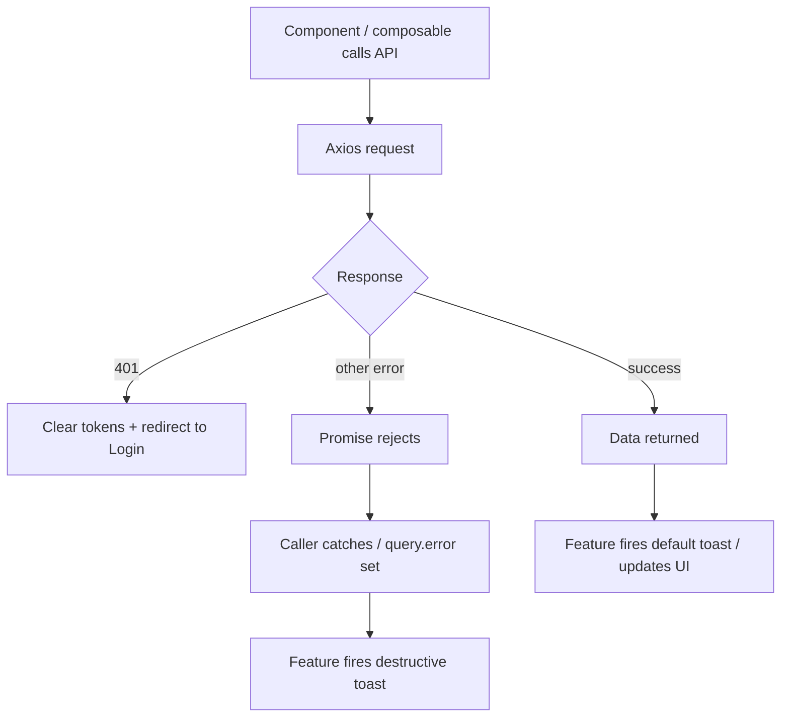

# Notifications & Error Handling

**On this page:** Toast system · Variants and status colour · HTTP error flow · Guidance for a new feature

The Vue SPA gives users feedback through one shared toast system and a single HTTP error path. Toasts live in `src/components/ui/toast/`; the global HTTP failure handling lives in the Axios interceptor in `src/api/base/index.ts`. This page covers how toasts are mounted and fired, how API failures surface to components, and the conventions a new feature should follow when reporting success or failure.

## Toast system

The toast UI is a shadcn-style wrapper around [reka-ui](https://reka-ui.com)'s toast primitives. The pieces in `src/components/ui/toast/`:

| File | Role |
|---|---|
| `use-toast.ts` | Headless store + `toast()` / `useToast()` API. Holds the `toasts` state and the dispatch reducer. |
| `Toaster.vue` | Renders the active toasts. Reads `toasts` from `useToast()` and binds each to a `<Toast>`. |
| `Toast.vue` | A single toast root (`ToastRoot` from reka-ui), applies `toastVariants`. |
| `ToastTitle.vue` / `ToastDescription.vue` | Title and body slots. Description accepts a string or a VNode. |
| `ToastClose.vue` / `ToastAction.vue` | Dismiss button and optional action button. |
| `ToastProvider.vue` / `ToastViewport.vue` | reka-ui provider and the fixed-position viewport. |
| `index.ts` | Barrel export plus the `toastVariants` CVA definition and `ToastProps` type. |

### Mounting

`Toaster` is mounted once, at the application root, in `src/App.vue`:

```vue
<template>
  <!-- layouts + RouterView -->
  <Toaster />
  <SourceChainPanel />
  <AgentActivityRail v-if="!isLoading && !route.meta.isPublic" />
</template>
```

Because it sits outside the layout/`RouterView` switch, toasts persist across route changes. The viewport (`ToastViewport.vue`) is fixed to the top on mobile and the bottom-right on `sm:` and up (`fixed top-0 ... sm:bottom-0 sm:right-0 sm:top-auto`), capped at `md:max-w-[420px]`, with `z-index: 100`.

### Firing a toast

Any component or composable imports `toast` (or `useToast`) from the toast module and calls it. The store is a module-level singleton, so the import works from anywhere — no provider injection required:

```ts
import { toast } from '@/components/ui/toast/use-toast'

toast({
  class: 'text-sm',
  title: 'Report deleted',
  duration: 2000,
})
```

`toast(props)` accepts `title`, `description` (string or VNode), `variant`, `duration`, `class`, an optional `action` component, and the rest of reka-ui's `ToastProps`. It returns `{ id, dismiss, update }` so a caller can later update or dismiss a specific toast. `useToast()` returns the reactive `toasts` list plus `toast` and a `dismiss(id?)` helper.

> [!WARNING]
> **One toast at a time**
>
> `use-toast.ts` sets `TOAST_LIMIT = 1`, so only the most recent toast is shown — a new toast replaces the visible one rather than stacking. `TOAST_REMOVE_DELAY` is set very high (`1000000` ms), so toasts are removed by the per-call `duration` (handled by reka-ui) and by explicit `dismiss`, not by that delay. Plan copy accordingly: do not fire several toasts in quick succession expecting all to be read.

## Variants and status colour

`toastVariants` (in `src/components/ui/toast/index.ts`) defines exactly two variants:

| Variant | Classes | Use |
|---|---|---|
| `default` (the default) | `border bg-background text-foreground` | Success and neutral/info messages |
| `destructive` | `border-destructive bg-destructive text-destructive-foreground` | Errors and failures |

There is **no dedicated success/warning variant** — success toasts use the neutral `default` look and convey meaning through their title/description text. Error toasts opt into the red styling with `variant: 'destructive'`:

```ts
toast({
  class: 'text-sm',
  variant: 'destructive',
  description: t('page.signatures.editor.submit.submitFailed'),
})
```

The `destructive` / `background` / `foreground` classes resolve to the semantic colour tokens described in [Components & Design System](components-and-design-system.md). Use those tokens rather than literal colours so the toast tracks the active theme ([Theme](components-and-design-system.md#theme-light--dark)).

## HTTP error flow

All API calls go through `BaseService` (`src/api/base/index.ts`), which configures a shared Axios instance. Its response interceptor handles one failure case itself: a `401` outside a sign-in step clears the stored tokens and sends the user to the `Login` route ([Interceptors](api-layer.md#interceptors) owns the details). For every other status it simply **re-rejects** — there is no global toast for non-401 errors. That is deliberate: error messaging is the calling feature's responsibility, so messages can be specific and localised. A caller that shows the server's own reason reads it with `extractApiErrorMessage` ([Error handling](api-layer.md#error-handling)).



For the request side of the interceptor (tenant header + bearer token injection) and how services are layered, see [API Layer](api-layer.md).

### How errors reach components

Data fetching and mutations use TanStack Query, so failures surface as reactive state rather than thrown exceptions in templates:

- **Queries** expose `error` and `isPending` (and `isError`). Components render a fallback or pass `error` into a toast.
- **Mutations** expose `error` / `isPending`; callers typically `await mutateAsync(...)` inside `try/catch` and toast on the result.

The shared `useConfirmedMutation` composable (`src/composables/useConfirmedMutation.ts`) is the canonical confirm-then-mutate pattern and shows the success/failure split:

```ts
try {
  await mutation.mutateAsync(current.id)
  toast({ class: 'text-sm', title: $t(successKey), duration: 2000 })
  onSuccess?.(current)
} catch (error) {
  const detail = extractApiErrorMessage(error, '')
  toast({ class: 'text-sm', title: $t(errorKey), description: detail || undefined, variant: 'destructive', duration: 3000 })
} finally {
  dismiss()
}
```

The failure toast keeps the localised title and puts the server's refusal reason, such as "run is still in progress", beneath it when the response carries one.

Some callers also branch on the HTTP status before toasting — e.g. `SignatureSettings.vue` treats a `409` as a benign concurrency outcome (handled inline) and only shows the `destructive` toast for genuine failures.

## Guidance for a new feature

When wiring user feedback into a new view or composable:

- **Import `toast` from `@/components/ui/toast/use-toast`** — do not build a second notification mechanism. The `Toaster` is already mounted in `App.vue`.
- **Success / info:** fire a `default` (no `variant`) toast with a short `title` or `description` and a modest `duration` (2000 ms is common).
- **Failure:** fire `variant: 'destructive'`. Keep the message specific; only catch what the feature can describe meaningfully, and pass the server's reason through `extractApiErrorMessage` when it has one.
- **Localise the text.** Pass `t('...')` keys, not hard-coded strings — see [Internationalization](i18n.md).
- **Let `BaseService` own the 401.** Do not re-implement token clearing or login redirects in feature code; the interceptor already handles session expiry globally.
- **Remember the single-toast limit.** If an operation has several outcomes, prefer one summarising toast over a burst.
- **For destructive confirm-then-act flows, reuse `useConfirmedMutation`** rather than re-deriving the prompt/confirm/toast plumbing.
