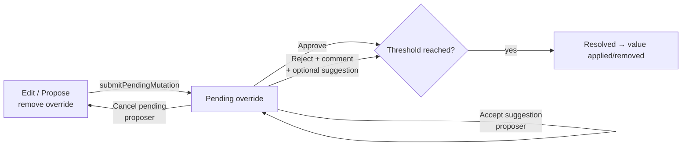

# Signatures & Signature Overrides (UI)

**On this page:** Routes & access · Component & module map · The picker (`/signatures`) · The four-column editor (`/signatures/:workflowTypeId`) · Signatures API (`src/api/signatures`) · The test-replay playground · History tab · Related

The **Signatures** feature lets a tenant customise individual signature fields (prompt fragments, labels, captured values) on a workflow template *without* editing the staff-authored template itself. A signature field has a staff **default**; an organization can layer a per-org, per-workflow-type **override** on top of it. The Vue frontend surfaces this as a four-column editor plus a peer-reviewed proposal queue, a side-by-side test-replay dialog, and an audit-log history tab.

For the backend model (per-org `SignatureFieldOverride`, shared-template rules), see [Signature overrides](../../features/signature-overrides.md). For the role/guard mechanism, see [State, routing & auth](state-routing-and-auth.md).

> [!NOTE]
> **Identity model**
>
> URLs key on `workflowTypeId`, which is stable across a backend Save-As-Core. Signature fields are defined on the workflow and keyed by `name`: the GET's top-level `fields` list holds each field once, blocks list the fields they use in `fieldNames`, and the client joins by name. One override value per field applies to every block that uses it. Writes key on the field name, so a staff rename or deletion of a field between the GET and a write returns **409** (`Signatures.Stale`), and the UI flips into an "outdated" state inviting a refresh. `sectionId` and `blockId` serve navigation and replay matching only: `sectionId` is a session-valid Core GUID that regenerates on every Save-As-Core, and `blockId` is the block's stable id. This is documented inline in `src/api/signatures/schema.ts`.

## Routes & access

Both routes are registered in `src/plugins/router/index.ts` and point at the single component `src/views/SignatureSettings.vue`.

| Path | Route name | Component | Purpose |
| --- | --- | --- | --- |
| `/signatures` | `SignaturesPicker` | `SignatureSettings.vue` | Workflow-type picker |
| `/signatures/:workflowTypeId` | `SignatureSettings` | `SignatureSettings.vue` | Four-column editor + History tab |

Both routes carry `meta.allowedRoles: [ROLES.SUPER_ADMIN, ROLES.SIGNATURE_CONTRIBUTOR]`. The role string constants live in `src/constants/roles.ts` (`SuperAdmin`, `SignatureContributor`).

> [!WARNING]
> **allowedRoles is authoritative**
>
> The `beforeEach` guard treats `allowedRoles` as an explicit allow-list with no implicit admin escalation. A user must hold one of the listed roles outright; an `Admin` who is neither `SuperAdmin` nor `SignatureContributor` is redirected to `/`.

## Component & module map

| File | Role |
| --- | --- |
| `src/views/SignatureSettings.vue` | Both routes: picker + four-column editor + review-queue UI (large single-file component) |
| `src/views/signatures/SignatureHistoryTab.vue` | Audit-log tab nested inside the editor |
| `src/views/signatures/helpers.ts` | Pure helpers (the field-by-name join, pending state, vote eligibility, vote progress, suggestion summaries, history labels, dependency resolution); unit-tested in `helpers.test.ts` |
| `src/components/signatures/SignatureTestDialog.vue` | Test-replay playground dialog |
| `src/api/signatures/` | `index.ts` (vue-query hooks), `service.ts` (axios calls), `schema.ts` (DTOs) |
| `src/api/signaturePlayground/` | `index.ts`, `service.ts`, `types.ts` — test-replay API |
| `src/composables/useMyReviewCounts.ts` | Cross-workflow "awaiting my vote" / "awaiting my action" aggregation; feeds the nav badge in `DefaultLayout.vue` |

## The picker (`/signatures`)

With no `workflowTypeId` in the URL, the view renders a flat, alphabetically-sorted list of workflow types derived from `API.WorkflowCategories.useGetWorkflowCategorySummaries()`. Each entry is a button that navigates by `workflowTypeId` (not the Core GUID, which would 404 after a save). Two count pills can appear next to a name:

- **Red pill** — fields in that workflow awaiting the current user's vote (reviewer side).
- **Amber pill** (`--proposer` modifier) — fields the user proposed that now have a counter-suggestion awaiting their decision.

Both counts come from `useMyReviewCounts`, which parallel-fetches every available workflow type's signatures via `useQueries` (sharing the `['signatures', id]` query cache with the editor) and returns zero for users without a reviewer role.

## The four-column editor (`/signatures/:workflowTypeId`)

The editor loads `API.Signatures.useGetWorkflowSignatures(workflowTypeId)` → `WorkflowSignaturesDto` and presents two tabs (`Settings` / `History`) whose selection is mirrored into the `?tab=` query. The Settings tab is the four-column grid:

```text
[ Sections ] → [ Blocks in section ] → [ Fields + pending panel ] → [ Dependencies ]
```

- **Sections / Blocks** columns are selectors: each entry is a button, and the selected one carries `aria-current`. Each carries the red reviewer pill and amber proposer pill (aggregated per section/block) plus a purple dot when any field is overridden, has an in-flight pending, or is being edited.
- **Fields** column is the working area: per field it shows display name, description, a state badge, the pending-review panel (when present), and an inline draft textarea.
- **Dependencies** are derived from each block's `dependsOn` (a list of upstream **ReplacementTags**, not block ids). Upstream/downstream connections are resolved through `blocksByTag` with fuzzy matching for parameterized loop suffixes (e.g. `_{PERIOD_ID}`) via `normaliseDepTag`, and support click-to-jump.

Only `AiQuery` and `Merge` blocks expose signature fields (`SignatureBlockType` in `schema.ts`); the union tail `(string & {})` keeps it open to future backend block types.

### Field states

`helpers.ts` `resolvePendingState` maps each field to one of four UI states, each rendered as a Badge variant:

| State | Meaning | Badge |
| --- | --- | --- |
| `default` | No override, no pending | `outline` |
| `override` | Active override, no pending | `secondary` |
| `pending-mine` | In-flight pending proposed by me | `default` |
| `pending-other` | In-flight pending proposed by someone else | `default` |

### Proposal & review flow

Submission is **per-field pending proposals**, not a batch save. Each gesture POSTs a single pending override that other reviewers vote on:



- **Approve** is a single click (`onApprove`), no dialog.
- **Reject** opens a dialog requiring a comment (max 2000 chars) and an optional counter-suggestion (max 4000 chars), seeded from the proposed value when opted in.
- **Accept suggestion** is proposer-only; it replaces the pending value and resets votes server-side.
- **Cancel pending** (proposer) is gated behind an "Are you sure?" confirmation because it discards the draft, every vote, and every suggestion — the escape hatch for sub-threshold stalemates in small tenants.
- **Withdraw vote** (reviewer) clears the caller's own vote so they can re-cast.

The per-tenant `reviewThreshold` (server minimum 2) drives the approve/reject progress bars via `computeVoteProgress`. `proposedValue: null` means "remove the override" (the field reverts to its staff default once approved). All mutations propagate **409** to flip the shared `isOutdated` banner.

Proposer/voter `userId`s are resolved to display names by fetching only the users actually referenced in the current workflow's pendings (an OData `id eq '…' or …` filter), avoiding a full tenant-user pull.

> [!NOTE]
> **Legacy batch update**
>
> `src/api/signatures/service.ts` still exposes `updateWorkflowSignatures` (a batch `PUT .../signatures`) and `index.ts` wraps it as `useUpdateWorkflowSignaturesMutation`, but no view consumes it — the editor uses the per-field pending flow.

## Signatures API (`src/api/signatures`)

`service.ts` issues these calls; `index.ts` wraps each in a `@tanstack/vue-query` hook that invalidates the `['signatures', workflowTypeId]` cache on success. `workflowTypeId` is read at call time (`MaybeRef`) because one component instance serves both routes.

| Hook | HTTP | Endpoint |
| --- | --- | --- |
| `useGetWorkflowSignatures` | GET | `workflow-types/{id}/signatures` |
| `useUpdateWorkflowSignaturesMutation` (unused) | PUT | `workflow-types/{id}/signatures` |
| `useSubmitPendingMutation` | POST | `workflow-types/{id}/signatures/pending` |
| `useCastVoteMutation` | POST | `workflow-types/{id}/signatures/pending/{pendingId}/votes` |
| `useAcceptSuggestionMutation` | POST | `workflow-types/{id}/signatures/pending/{pendingId}/accept-suggestion` |
| `useCancelPendingMutation` | DELETE | `workflow-types/{id}/signatures/pending/{pendingId}` |
| `useWithdrawVoteMutation` | DELETE | `workflow-types/{id}/signatures/pending/{pendingId}/votes/mine` |
| `useGetSignatureHistory` | GET | `workflow-types/{id}/signatures/history` |

The history hook requires a reactive `Ref`/`ComputedRef` of filters (a plain mutated object wouldn't change identity and the query wouldn't refetch) and uses `keepPreviousData` so paging doesn't flash an empty state. DTO shapes (`WorkflowSignaturesDto`, `SignatureFieldDto`, `PendingOverrideDto`, etc.) are defined in `schema.ts` and are documented as mirrors of the C# contracts under `platform/IniaAi.WebApi.Contracts/Responses/Signatures/` and `platform/IniaAi.WebApi.Contracts/Requests/Signatures/`.

## The test-replay playground

`SignatureTestDialog.vue` (opened from the field editor's "Try on a past execution" action) lets a user test a candidate signature value against a **past workflow execution** without leaving the page. It is backed by `src/api/signaturePlayground`.

Flow inside the dialog:

1. **Pick a run** — counterparty filter (server-side OData, `$top: 100`, ordered `createdAt desc`) → execution picker → block picker (only shown when more than one candidate block carries the placeholder). A deep-linked `initialExecutionId` outside the recent window surfaces a warning banner so the user doesn't silently test the wrong run.
2. The dialog loads the execution's blocks via `useGetExecutionBlocks` → `GET workflow-executions/{id}/blocks`, returning each AI Query block's `rawResponse` plus its `ReplayableSignatureField`s (including `capturedResolvedValue` and `canReplay`).
3. **Test the override** — the captured value (read-only) and an editable test value sit side by side. **Run** fires `useTestSignaturePromptMutation` → `POST workflow-executions/{id}/test-signature-prompt`, and the new output renders next to the original (XML-ish wrapper tags like `<answer>`/`<thinking>` are stripped for readability).
4. **Propose as override** emits `submit-proposal`; the parent routes it through the same `submitPendingMutation` as the inline editor (same validation, cache invalidation, and 409 → outdated fallback).

Run is gated on `canReplay`: pre-feature executions have `capturedResolvedValue: null` / `canReplay: false`, and the dialog explains the pre-capture case rather than showing an empty picker.

> [!WARNING]
> **IP boundary**
>
> Neither the playground response (`SignaturePromptTestResult`) nor the execution-blocks DTO carries `userPrompt` / `systemPrompt`. The backend deliberately strips prompt text — it is the template author's intellectual property and must never reach the client. `src/api/signaturePlayground/types.ts` calls this out and instructs that no field exposing prompts be added.

## History tab

`SignatureHistoryTab.vue` renders the override audit log for the current workflow type — every value transition (`Created` / `Updated` / `Removed`), newest first, via `useGetSignatureHistory`.

- **Filters**: field (placeholder, shown by friendly `displayName` but sent as the internal `placeholderName`), actor, and a from/to date range. Filter + pagination state lives in the URL (`?placeholder=`, `?actor=`, `?fromUtc=`, `?toUtc=`, `?skip=`) via `router.replace`, so reloads and shared links restore the view, and browser back/forward re-seeds the local refs.
- **Pagination** is server-side (`skip`/`take`, page size 50); changing any filter resets `skip` to 0 in the same synchronous step so the query fires once.
- Each row preview-truncates long values; clicking opens a read-only detail dialog with the full Previous/New text. `null previousValue` reads as "no prior value" (Created); `null newValue` reads as the removed marker (Removed). Action badges are colour-coded (`Created`/`Updated`/`Removed`) via design-token classes.
- Approver chips show who approved the pending whose resolution produced the change (snapshotted at promotion time, so they survive pending/vote-row deletion). Backfilled rows can carry an actor id with no email and render a friendly "unknown actor" label.

## Related

- [Signature overrides (backend feature)](../../features/signature-overrides.md)
- [State, routing & auth](state-routing-and-auth.md) — the role model and route guards
- [API layer](api-layer.md) — the service/hook/schema module convention used here
