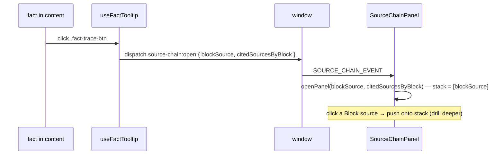

# Source Chain, Citations & Tracer (UI)

**On this page:** Pieces at a glance · Citation data model · Rendering content (`renderContent.ts`) · Source aggregation (`citationUtils.ts`) · Fact tooltips and interactions (`useFactTooltip.ts`) · SourceChainPanel — drilling the synthesis chain · TracerDialog — provenance Q&A · Locale catalogs · Related

The frontend renders AI-generated report content with inline **fact** markers, surfaces the
**citation sources** behind each fact on click, and lets a user drill into the **provenance
chain** of synthesized output. This page covers the Vue side of that system: how content is
rendered and sanitized, how citations are parsed and displayed, and the two panels that show
provenance. It is the UI counterpart to the backend
[Citations](../citations/index.md) and [Tracer Agent](../tracer-agent/index.md) pages.

> [!NOTE]
> **Where this lives**
>
> All paths below are relative to the `IniaAi.Web` repository root:
> content rendering in `src/lib/renderContent.ts`, citation helpers in
> `src/utils/citationUtils.ts` and `src/composables/useFactTooltip.ts`, the drill-down panel in
> `src/components/organisms/SourceChainPanel/SourceChainPanel.vue`, and the provenance dialog in
> `src/components/organisms/TracerDialog.vue`.

## Pieces at a glance

| Concern | File | Role |
| --- | --- | --- |
| Markdown → safe HTML | `src/lib/renderContent.ts` | Renders markdown, escapes unknown tags, sanitizes, preserves `fact` markup |
| Data output JSON → HTML | `src/lib/dataOutputJson.ts` | Writes a data output's JSON indented, escaped, with each cited figure as a `fact` marker |
| Source aggregation | `src/utils/citationUtils.ts` | Dedupes/orders sources, combines cited texts, finds and orders a block citation's pages and links |
| Fact tooltips + interactions | `src/composables/useFactTooltip.ts` | Global click/hover handlers, source list popover, opens panels/modals |
| Drill-down panel | `src/components/organisms/SourceChainPanel/SourceChainPanel.vue` | Slide-over panel that walks the block → upstream-source chain |
| Open-panel event | `src/utils/sourceChainEvents.ts` | `CustomEvent` channel used to open the panel from anywhere |
| Provenance Q&A dialog | `src/components/organisms/TracerDialog.vue` | Free-text questions against the provenance graph |
| Citation types | `src/api/workflows/schema.ts` | `CitationSource` union + type guards |
| Locale catalogs | `src/assets/locales/en/shared/citations.json`, `.../shared/tracer.json` | UI strings |

## Citation data model

Citations are typed in `src/api/workflows/schema.ts`. A `Citation` has an `id` (matching a
`fact` marker in the content) and a list of `sources`. Each source is a discriminated union
`CitationSource` keyed on `type`:

| Type | Interface | Key fields |
| --- | --- | --- |
| `Document` | `DocumentCitationSource` | `pageId`, `pageNumber`, optional `filePageNumber`, `documentName` and `unverified`, `citedText` |
| `Url` | `UrlCitationSource` | `url`, `citedText` |
| `Block` | `BlockCitationSource` | `blockId`, optional `blockTitle`, `upstreamSources: CitationSource[]`, `citedText`, optional `matchingSources` |

The guards `isDocumentSource`, `isUrlSource`, and `isBlockSource` narrow the union. A document source with `unverified: true` is one whose cited text could not be located in the document's pages: the UI shows it as unchecked, never as confirmed (`isUnverifiedDocumentSource` in `src/utils/citationUtils.ts`). A `Block`
source is the recursive case: its `upstreamSources` are the citations the block synthesized
*its own* output from, which is what makes a multi-level "synthesis chain" possible.

A block citation also leads to **every page and link** that the block, or a block upstream of it,
cited during the run. The server stores that list once per block on the report paragraph
(`citedSourcesByBlock: BlockCitedSources[]` on `ReportParagraph` in
`src/api/workflowReports/schema.ts`). `WorkflowElement.vue` passes the lists to `WorkflowContent.vue`,
which renders them once per paragraph as a `data-cited-sources-by-block` JSON attribute, beside
`data-citations`. `citedSourcesOf(blockSource, citedSourcesByBlock)` finds a block's list by its
`blockId`, so a block citation at any depth of the upstream chain finds its own list. The server
also sends `matchingSources` on a citation's own block source: the items of that list whose excerpt
states the cited fact. See
[Block citations lead to pages and links](../citations/index.md#block-citations-lead-to-pages-and-links)
for how the server builds both, and why the list sits on the paragraph. A report built before the
lists existed sends both as empty lists and renders as before.

## Rendering content (`renderContent.ts`)

`renderContent(raw)` turns model output into the HTML injected into report views. The
`v-safe-html.markdown` directive calls it for the `MarkdownText` atom, and
`src/components/organisms/WorkflowElements/WorkflowContent/WorkflowContent.vue` calls it for the
paragraph it opens with. The pipeline:

1. **Unwrap legacy `
` wrappers** — `unwrapLegacyPWrapper` strips a single outer `
…
`
   when it contains no block-level tags, so older stored content doesn't get double-wrapped.
2. **Escape unknown tags** — any tag not in `HTML_ALLOWLIST` is HTML-escaped rather than
   rendered. The allowlist includes the custom citation tags `fact`, `fact_source`, and
   `cited-text` alongside standard formatting tags.
3. **Markdown** — parsed with `marked` (`gfm: true`, `breaks: true`). Strikethrough is
   deliberately disabled (`disableMarkdownStrikethrough`).
4. **Sanitize** — `sanitizeHtml`: `DOMPurify.sanitize` with `ADD_TAGS: ['fact','fact_source','cited-text']`
   and `ADD_ATTR: ['label','type','page-id','block-id']`. Unknown protocols are forbidden,
   inline event handlers (`onerror`, `onload`, `onclick`, …) are explicitly stripped, and
   the `<style>`, `<form>`, `<button>`, `<textarea>` and `<select>` elements are dropped
   (`FORBID_TAGS`). The `class`, `style` and `title` attributes stay. `input` stays, because a
   Markdown task list renders as disabled checkboxes.

These views sanitize HTML that arrives already formed, without the Markdown step:

- `sanitizeModelHtml(raw)` runs steps 2 and 4, for text a model reads or writes: the Execution
  Logs prompt and output and the AI panel's preview of a refined version. A tag outside the
  allowlist shows as text, so a model's `<stop>OK</stop>` stays readable in a log. Step 4 alone
  would drop an unknown tag named like an SVG element, such as `stop` or `text`, with its text.

### Every HTML binding goes through `v-safe-html`

The app puts HTML into the page only through the `v-safe-html` directive (`src/lib/safeHtml.ts`).
The directive runs one of the three functions above on its value before it sets `innerHTML`, again
whenever the value changes:

| Binding | Function | Where |
|---|---|---|
| `v-safe-html` | `sanitizeHtml` | the report paragraph in `WorkflowContent.vue` |
| `v-safe-html.model` | `sanitizeModelHtml` | the prompt and the output in `WorkflowExecutionLogItem.vue`, and each refined version in `AiPanel.vue` |
| `v-safe-html.markdown` | `renderContent` | the `MarkdownText` atom |

A component passes the raw value, so each value is sanitised once, at the place it enters the page.
The `app/sanitised-html` block in `eslint.config.mjs` sets `vue/no-v-html` to an error, so a new
`v-html` fails lint. The `app/sanitised-html-script` block does the same for an unsanitised
`innerHTML` assignment in script code.

The AI panel sanitizes only what it shows: the refined text it applies is saved as the model
returned it. `WorkflowContent` shows the paragraph through `v-safe-html`, so an applied text
saved without edits renders clean before the page reloads and runs it through `renderContent`.
Its copy action puts the text through `sanitizeHtml` before it reads it back.
Both the AI panel and `WorkflowContent` parse stored HTML with `DOMParser`, whose document loads
no image and runs no handler.

> [!WARNING]
> **Two markup generations coexist**
>
> The renderer keeps both the **legacy** form (`<fact_source type="…" label="…" page-id="…">`
> with a nested `<cited-text>`) and the **structured** form (`<fact id="…">` whose sources come
> from a `data-citations` JSON attribute on an ancestor). `useFactTooltip` handles both; see below.

### Data outputs (`dataOutputJson.ts`)

A report can carry data outputs: JSON the run returns beside the report ([Get Report Data Outputs](../../reference/api/reports.md#get-report-data-outputs)). `WorkflowDetails.vue` lists them under **Data** at the end of the section list, and `ReportDataOutput.vue` shows the chosen one. `renderDataOutputJson(data, citations)` writes the JSON so that its text reads exactly as `JSON.stringify(data, null, 2)`, escapes it, and wraps each cited figure of a value in `<fact id>`: it groups the citations by their JSON Pointer `path` and finds each citation's `value` in that value's text, in the order the server found them. The HTML goes through `v-safe-html` into a `<pre>` that carries `data-citations` and `data-cited-sources-by-block`, and `useFactTooltip` on that `<pre>` gives the figures the same popover, page preview and source chain as a report paragraph. **Copy JSON** and **Download** take `JSON.stringify(data, null, 2)`, not the HTML. Both work on the JSON as the browser parsed it: integer-like keys come first in ascending order, trailing zeros of a number go, and a number beyond double precision loses digits, so its citation `value` may no longer be found and the figure stays unmarked. The API's own response is the stored text.

## Source aggregation (`citationUtils.ts`)

`aggregateSources(sources)` collapses a raw source list into
`AggregatedSource[]` (`{ source, citedTexts: string[] }`):

- **Documents** are deduplicated by `pageId`, **URLs** by `url`; repeated `citedText` values
  for the same target are collected into the `citedTexts` array (no duplicates).
- **Block** sources are *not* deduplicated — each appears separately — and are emitted
  **first**, followed by documents, then URLs.

`drawnFromSources(blockSource, citedSources)` returns the pages and links behind a block citation,
one entry per page or link: first its `matchingSources`, then the rest of the block's list in chain
order. Each
entry carries `matchesFact`. The popup and the panel show `DRAWN_FROM_VISIBLE_COUNT` (5) entries
before a "Show all" control.

`combineCitedTexts(texts)` joins multiple cited snippets with a `\n\n...\n\n` separator (or
returns the single text / `null`).

`documentSourceLabel(source, fallbackName)` names a document source as `<document> - page <n>`, and an unverified one by its document name alone.

## Fact tooltips and interactions (`useFactTooltip.ts`)

`useFactTooltip(scopeRef)` is the composable that makes rendered facts interactive. It
installs **global, idempotent** document handlers once (`ensureGlobalHandlers`) and, per
mounted scope, runs a debounced `MutationObserver` that toggles a `fact-empty` class on any
`<fact>` whose visible source count is zero. The same pass makes every cited fact a keyboard
control: `role="button"`, `tabindex="0"`, `aria-label` "Show sources for …" with the fact's text,
`aria-haspopup="dialog"` and `aria-expanded`. A fact with no source gets none of these.

**Resolving a fact's sources** has two paths:

- *Structured* — a `<fact id>` looks up its `Citation` from the nearest ancestor carrying a
  `data-citations` JSON attribute, then aggregates with `aggregateSources`.
- *Legacy* — a `<fact>` without an id reads its child `<fact_source>` elements directly via
  `formatLegacySource`.

On click of a fact, a popover (`#fact-tooltip-container`, appended to `<body>`) lists the
sources; clicking the same fact again hides it. The popover opens above the fact when it fits
there, and otherwise on the side with more room, capped to that room so it scrolls rather than
runs off the screen. A page scroll moves it with the fact; a scroll inside the popup (the expanded
list) moves nothing.

The keyboard does the same as the mouse. Enter or Space on a focused fact opens the popover
and moves focus to its first link or button. Escape closes it and returns focus to the fact.
Tab past the popover's last control, or Shift+Tab before its first, closes it and returns
focus to the fact, so a forward Tab continues with whatever follows the fact. The popover
carries `role="dialog"` and the name "Sources". A source's quoted excerpt shows while its link
or page button has focus, as it does on hover, and that control points at it with `aria-describedby`. **Show all**
moves focus to the first source it reveals before it removes itself. The observer follows the
scope element, so a paragraph that leaves edit mode gets its facts decorated again. An edit
saves each `<fact>` as stored ([Rich text editor](rich-text-editor.md)), so the
same facts come back decorated.

Block sources are shown to **every** user; no role check filters the popup or the empty-fact
count, so a fact whose only sources are upstream blocks keeps its marker for everyone.

A block source with a list renders as a **Drawn from** section: the pages and links from
`drawnFromSources`, the ones that state the fact in bold and first, cut to the visible count
with a "Show all N" button that reveals the rest in place. The list scrolls past 40% of the viewport
height. Under the list sit the block's title (hover shows its cited text) and the trace button. A
block source without a list keeps the one-line "Synthesized with: …" form.

Source rows wire up three interactions:

| Source kind | Click action |
| --- | --- |
| Document | A page button (`<button type="button" aria-haspopup="dialog">`) dispatches `PAGE_PREVIEW_EVENT`, which opens the [page preview dialog](../../features/document-management/page-image-api-integration-on-frontend.md#the-page-preview-dialog). An unverified source is plain text with an **Unverified** badge, whose tooltip says the quoted text could not be located in the document's pages, and opens no preview |
| URL | Anchor opens in a new tab (`target="_blank" rel="noopener noreferrer"`); `isWebUrl` lets only an `http(s)` address become a link, and anything else renders as plain text with the address as its title |
| Block | Its pages and links behave as the rows above; the "Trace sources / View" button dispatches the source-chain open event |

Hovering a source that carries a cited snippet shows a secondary `data-cited-text` tooltip,
placed the same way as the popover.

## SourceChainPanel — drilling the synthesis chain

`SourceChainPanel.vue` is mounted once, globally, in `src/App.vue`. It listens for the
`source-chain:open` window event (defined in `src/utils/sourceChainEvents.ts` as
`SOURCE_CHAIN_EVENT`, payload `{ blockSource: BlockCitationSource, citedSourcesByBlock:
BlockCitedSources[], opener?: HTMLElement }`) and a trace-button click in `useFactTooltip` is what fires it. The
trace button reads `citedSourcesByBlock` from the paragraph of the fact it was opened from, so
every block the panel drills into can show its own list. When the panel opens, focus moves to its
first button and stays inside the panel while it is open (a trapped reka-ui `FocusScope`); when it
closes, focus returns to `opener`, the fact that opened it, once the panel has gone. The panel also
hosts the [page preview dialog](../../features/document-management/page-image-api-integration-on-frontend.md#the-page-preview-dialog).

The panel keeps a `sourceChainStack` of `BlockCitationSource` and renders the **top** entry:

- **Breadcrumbs** for every level (`blockTitle`, or "prior analysis" when the report gives none); clicking one
  truncates the stack back to that level.
- The current block's **cited text**, with show-more/show-less when it overflows.
- A **sources list** built from `aggregateSources(currentBlock.upstreamSources)`, titled
  "Text above was synthesized with". Document and URL rows behave as in the tooltip (image modal /
  new tab, `http(s)` links only); clicking another **Block** source pushes it onto the stack to trace one level deeper.
  A block with no upstream sources but a Drawn from list skips this section.
- A **Drawn from** list built from
  `drawnFromSources(currentBlock, citedSourcesOf(currentBlock, citedSourcesByBlock))`, with the
  same rows, the matching ones in bold, and the same visible count and "Show all N" button.
- The "No further sources traced" empty state only when the block has neither upstream sources
  nor a Drawn from list.

A **Go back** button pops the stack (or closes at the root) and a **Close panel** button closes it; Escape and a backdrop click also close.
Strings come from `shared.citations.panel.*` (the panel is titled "Synthesis Chain").

## TracerDialog — provenance Q&A

`TracerDialog.vue` is a free-text question dialog over the provenance graph. It takes
`runId`, `targetTag`, `isOpen`, and an optional `initialQuestion`, and calls
`API.GraphRag.useQueryProvenance()`. That mutation posts to
`workflow-executions/{runId}/graph/query` (see `src/api/graphRag/service.ts`) with the body
`{ targetTag, question, startingDepth: 4, includePreviews: true }` and renders
`response.answer` as markdown via the `MarkdownText` atom (which binds it with `v-safe-html.markdown`), animated with a typewriter effect and a cycling
status line. HTTP 401/403/404/422 map to dedicated `shared.tracer.*` error strings.

The companion `validateTarget` (GET `workflow-executions/{runId}/graph/validate/{targetTag}`)
exists in the service and request/response shapes are validated against the zod schemas in
`src/api/graphRag/schema.ts`.

> [!WARNING]
> **Defined but not currently mounted**
>
> `TracerDialog.vue` is not imported or rendered anywhere in `src` at present (no references
> outside its own file), and unlike `SourceChainPanel` it is not exported from
> `src/components/organisms/index.ts`. The component and its `GraphRag` API client are complete
> and wired to each other, but the dialog is not reachable from the running UI today. Its locale
> keys (`shared/tracer.json`) are user-facing as **"Explore Analysis"** rather than "Tracer".
> `shared.tracer.title` is in use anyway: it names each paragraph's Explore Analysis button in
> `WorkflowElementWrapper.vue`.

## Locale catalogs

| File | Namespace | Notable keys |
| --- | --- | --- |
| `src/assets/locales/en/shared/citations.json` | `shared.citations` | `synthesis.*` (labels, trace/view buttons), `drawnFrom.*` (Drawn from title, "Show all N"), `panel.*` (Synthesis Chain UI), `sources.*`, `errors.*` (preview load / 403 / 404), `block.excludeFromSources*`, `marker.*` (a fact's accessible name and the popover's name), `unverified.*` (the badge and its tooltip) |
| `src/assets/locales/en/shared/tracer.json` | `shared.tracer` | `title` ("Explore Analysis"), `questionPlaceholder`, `status*` (cycling loading messages), `error*` (per HTTP status) |

## Related

- Backend provenance/citation construction: [Citations](../citations/index.md) and
  [Tracer Agent](../tracer-agent/index.md).
- The page-image endpoint behind document previews:
  [Page Image API integration](../../features/document-management/page-image-api-integration-on-frontend.md)
  and [Documents API](../../reference/api/documents.md).
- How content components consume these helpers:
  [Components & design system](components-and-design-system.md) and
  [Rich text editor](rich-text-editor.md).
