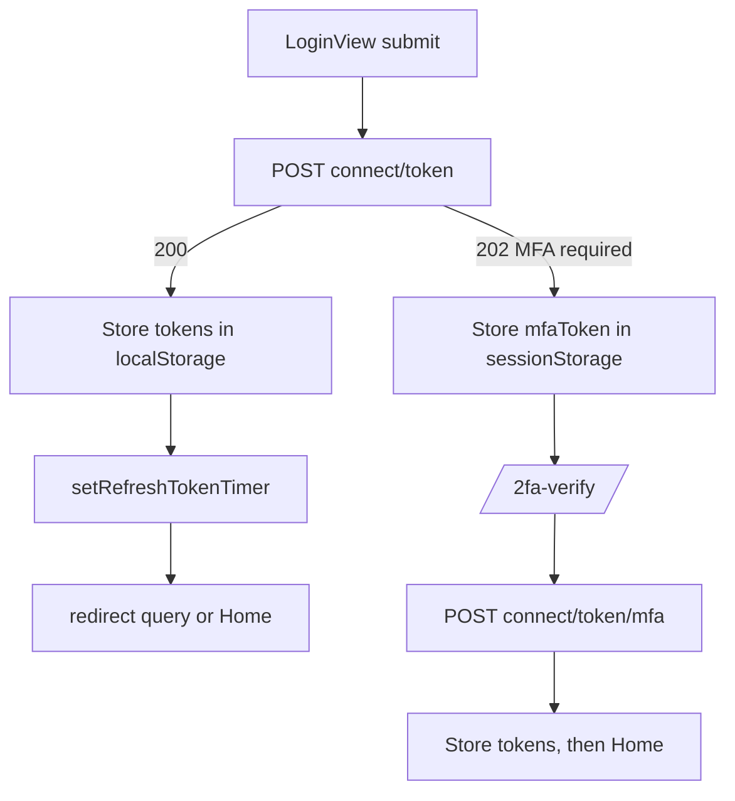

# State, Routing & Authentication

**On this page:** Pinia stores · Vue Router · Authorization: roles and route gating · JWT lifecycle · Login and 2FA flow · External authentication (Google / OIDC) · Capabilities: what the organization may use · Multi-tenancy on the client · Views and screens

The IniaAi.Web Vue 3 frontend ships a deliberately small client-side state surface (four Pinia stores), a single Vue Router instance with role-aware navigation guards, and a token-based auth model that talks to the backend OAuth-style `connect/token` endpoints. This page documents how those three concerns fit together: what state is held where, how routes are gated, and the full login / 2FA / external-provider lifecycle. For how requests are built and how the tenant header is attached, see [API layer](api-layer.md). For the backend side of multi-tenancy, see [API architecture](../multi-tenant/api-architecture.md).

## Pinia stores

State is intentionally thin — most server data is fetched on demand by the API services rather than mirrored into a global store. Only four Pinia stores exist (`src/store/`):

| Store | File | Holds | Persistence |
|---|---|---|---|
| `login` | `src/store/login.ts` | A single `creds` ref (`{}`). Minimal scratch slot. | In-memory |
| `theme` | `src/store/theme.ts` | `theme` (`'light' \| 'dark'`, default `'dark'`); `toggleTheme` / `setTheme`. Applies `.dark` class to `document.documentElement`. | `localStorage['theme']` |
| `createWorkflowPrefill` | `src/store/createWorkflowPrefill.ts` | A single-shot hand-off slot (`pending: WorkflowReRunPrefill \| null`) between `WorkflowDetails` ("edit inputs first" on a re-run) and the `/workflows/create` page. | In-memory |
| `agentActivity` | `src/store/agentActivity.ts` | The desk's live activity: one entry per agent block leg (run, block, round) with its activity digest and whether it has settled, the section progress of each running run, and which entry's panel is open. A run can have both, and the desk then shows its section progress and its agents together. `railEntries` shows the newest round of each block; `prune` drops an entry not seen for 15 minutes. | In-memory |

> [!NOTE]
> **Single-shot hand-off**
>
> `createWorkflowPrefill` exposes `set()` and `consume()`. The create page calls `consume()` once on mount, which returns the pending value **and clears it**, so a later unrelated visit to `/workflows/create` does not inherit a stale prefill. Before the prefill reaches the store, `extractReRunInputs` (`src/lib/workflowReRun.ts`) re-keys its `variables` to the definition-cased replacement tags via `restoreDefinitionCasedVariableKeys` — the report payload [camelCases dictionary keys](../../reference/api/reports.md#get-report-execution) while the create form names its fields by `replacementTag`, so without the restore step any tag starting with an uppercase run would prefill as empty.
>
> A re-run also sets the prefill when **Restart with same inputs** finds the workflow changed. `planRestart` and `planEdit` (`src/lib/workflowReRunPlan.ts`) call [`GET /workflow-executions/{id}/rerun-inputs`](../../reference/api/workflow-executions.md#check-re-run-inputs) and, through `withReRunInputs` (`src/lib/workflowReRunPrefill.ts`), keep only the values the check still submits, under the current tags, set `startStep` to the first step with something to fill in, and carry the check's changes as `reRunChanges`. The create page keeps `reRunChanges` after it consumes the prefill, so its note and the marks on the fields to fill stay while the user moves between steps.

## Vue Router

The router lives in `src/plugins/router/index.ts`. It uses `createWebHistory(import.meta.env.BASE_URL)` (HTML5 history mode, no hash) and lazy-imports every view via `() => import(...)` for per-route code splitting.

Route metadata is typed by augmenting `RouteMeta`:

```ts
declare module 'vue-router' {
  interface RouteMeta {
    layout?: 'blank'
    isPublic?: boolean
    allowedRoles?: readonly string[]
    capability?: string
    title?: string
  }
}
```

- `layout: 'blank'` selects a chrome-less layout (used by login, forgot-password, reset-password, 2FA, health).
- `isPublic` bypasses the auth guard entirely.
- `allowedRoles` drives role gating (see [Auth model](#authorization-roles-and-route-gating)).
- `capability` names what the organization must be allowed to use (see [Capabilities](#capabilities-what-the-organization-may-use)).
- `title` is the i18n key of the page's name in the browser tab.

### Browser tab title

The browser tab reads `<item> · <page> · Inia AI`. `useDocumentTitle` (`src/composables/useDocumentTitle.ts`), called once in `App.vue`, writes it from the route's `meta.title` in the current language. A page that shows one item, such as a report or a document, calls `useItemTitle` with the item's name: the name goes first once it has loaded, because a browser cuts a long tab title from the end and the name is what tells two tabs apart. The name leaves the tab when the page closes, unless the next page has already set its own: Vue closes the old page after it opens the new one, so only the page that set the name last clears it. A page with no `meta.title` shows `Inia AI` alone. A router test (`src/plugins/router/routeTitles.test.ts`) fails when a page of the app or of a paid module has no title key, or a key with no English text.

### Public routes

Routes flagged `meta.isPublic` skip authentication:

| Path | Name | Notes |
|---|---|---|
| `/login` | `Login` | blank layout |
| `/forgot-password` | `ForgotPassword` | blank layout |
| `/reset-password` | `ResetPassword` | blank layout |
| `/2fa-verify` | `TwoFactorVerify` | blank layout |
| `/health` | `Health` | blank layout |

No other route is public. A router test (`src/plugins/router/index.test.ts`) pins this list of five.

### Navigation guard

`router.beforeEach` enforces the model below. The order is significant: public short-circuits first, then token validity, then the organization, then `allowedRoles`, then the route's `capability` ([Capabilities](#capabilities-what-the-organization-may-use)).

```ts
router.beforeEach(async (to) => {
  if (to.meta.isPublic) {
    return
  }
  if (!isTokenValid()) {
    localStorage.removeItem('accessToken')
    localStorage.removeItem('refreshToken')
    localStorage.removeItem('expiration')
    return '/login?redirect=' + to.fullPath
  }
  if (!hasOrganization()) {
    return to.name === NO_ORGANIZATION ? undefined : { name: NO_ORGANIZATION }
  }
  if (to.name === NO_ORGANIZATION) {
    return '/'
  }
  if (to.meta.allowedRoles && !hasAnyRole(to.meta.allowedRoles)) {
    return '/'
  }
  if (to.meta.capability && !(await hasCapability(to.meta.capability))) {
    return {
      name: NOT_INCLUDED,
      params: { notIncludedAddress: to.path.substring(1).split('/').map(decodeURIComponent) },
      query: to.query,
      hash: to.hash,
      state: { capability: to.meta.capability },
    }
  }
})
```

When the token is missing or expired, the guard clears all three token keys and redirects to `/login?redirect=<fullPath>` so the user lands back where they were after authenticating.

A valid token that names no organization (`organization_id` absent, which is what the API issues to a user with no active membership) sends every page to `/no-organization`. `NoOrganizationView` says the account is not a member of any active organization and to ask an administrator, and offers **Sign out**; every other page would only meet `403` from the API. A user who has an organization is sent from that page to `/`.

An address that no route serves matches the last route, `UnknownAddress`, which shows `NotFoundView`: the address, and a link to the Dashboard. A bookmark to a page that a build does not include, such as a page of a removed paid module, shows that page instead of an empty screen. A module's routes, added later with `router.addRoute`, still win, because Vue Router ranks a specific path above the catch-all.

## Authorization: roles and route gating

Roles are string constants in `src/constants/roles.ts` (the value is the JWT `role` claim string, not the key):

| Constant | JWT value |
|---|---|
| `SUPER_ADMIN` | `SuperAdmin` |
| `ADMIN` | `Admin` |
| `USER` | `User` |
| `SIGNATURE_CONTRIBUTOR` | `SignatureContributor` |
| `WORKFLOW_EDITOR` | `WorkflowEditor` |
| `OPERATOR` | `Operator` |

`hasRole(role)` (in `src/lib/utils.ts`) decodes the JWT and checks the `role` claim, handling both a single string and an array of roles.


A route gates on `allowedRoles`, an allow-list: the user passes only by holding at least one listed role. There is no implicit admin escalation; a route that admits an admin lists `ADMIN` and `SUPER_ADMIN`. The lists in `src/constants/roles.ts` mirror the backend's composite gates (`EDITOR_ROLES`, `OPERATOR_ROLES`, `ADMIN_ROLES`, `ADMIN_AND_OPERATOR_ROLES`); `useCurrentUserRoles()` exposes the editor and operator gates as `isEditor` and `isOperator`, and `useRoleCheck(roles)` builds the same reactive check for any list. The route table below gives each route's list.

## JWT lifecycle

There is no httpOnly cookie session; the SPA stores tokens in `localStorage` and decodes the JWT client-side.

| Key | Value |
|---|---|
| `accessToken` | The JWT access token |
| `refreshToken` | The refresh token (when issued) |
| `expiration` | Absolute expiry as epoch **milliseconds** (computed as `Date.now() + expires_in * 1000`) |

Token helpers live in `src/lib/utils.ts`:

- `getDecodedToken()` — splits the JWT, base64-decodes the payload with `atob`, `JSON.parse`s it. Returns `null` if no token / malformed.
- `isTokenValid()` — true when `decoded.exp > now` (compared in **seconds**, since `exp` is a standard JWT seconds-since-epoch claim).
- `hasRole(role)` / `hasMultipleTenants()` — read the `role` and `tenant_ids` claims.

> [!WARNING]
> **Two different time units**
>
> `exp` inside the JWT is in **seconds** (checked by `isTokenValid`), while the separately stored `localStorage['expiration']` is in **milliseconds** (used by the refresh scheduler). Don't conflate them.

### Scheduled refresh

`useRefreshToken()` (`src/composables/refreshToken.ts`) schedules a single `setTimeout` to refresh **60 seconds before** `expiration`:

```ts
const diffInMs = Math.floor(expiration.getTime() - currentTime.getTime())
const expiryTime = diffInMs - 60 * 1000
```

When it fires, it POSTs `grant_type=refresh_token` (via the authentication service), rewrites `accessToken` / `refreshToken` / `expiration`, and re-arms itself. It is invoked after every successful login and external sign-in, and once when `App.vue` starts, so a reloaded tab with a stored session schedules its refresh too. The timer is module-level and is cleared before each (re)schedule.

**When the session ends.** The API ends a session in three ways, and the app sends the person to `/login?reason=session-ended` for each, with `redirect` set to the page they were on, where the sign-in screen says "Your session has ended. Sign in again." above the methods:

- The token that reaches the session's absolute limit comes without a refresh token ([Authentication API](../../reference/api/authentication.md)). With no stored refresh token, the timer fires when that last token expires, and signs the browser out.
- A refresh answered `400 invalid_grant` (a refresh token that was revoked, or a session past a limit that was shortened) signs the browser out at once. Any other failed refresh, such as a network error, leaves the session as it is.
- A `401` on any request that is not a sign-in step, while the browser holds a token, means the API revoked the session, for example when a customer's first sign-in by a second method ends their other sessions. The base service (`src/api/base/index.ts`) signs out the same way. Other requests of that session refused in the next 10 seconds do not replace the reason (`sessionJustEnded`, `src/lib/sessionEnded.ts`). A `401` with no token held goes to `/login` with no reason.

## Login and 2FA flow

The login view (`src/views/LoginView.vue`) calls the authentication service (`src/api/authentication/service.ts`), which posts form-encoded credentials to `connect/token` (`grant_type` and `scope` from `@/config/auth`). It names no OAuth client, see [Application Configuration → Vue SPA sign-in](../../operations/application-configuration.md#vue-spa-sign-in-browser-login). The service explicitly accepts both `200` and `202` as success:

```ts
validateStatus: status => status === 200 || status === 202
```

- **`200` — authenticated.** The view stores `access_token` / `refresh_token` / `expiration`, starts the refresh timer, and navigates to the `redirect` query param or `Home` (`destinationAfterSignIn`, `src/lib/signInDestination.ts`). The `redirect` counts only as a path inside the app: one that does not start with `/`, that starts with `//` or `/\`, which a browser reads as another site, or that holds a space or a control character, goes to `Home`.
- **`202` — MFA required.** The response carries an MFA token (tolerating both `mfaToken`/`MfaToken` casing), `availableMethods`, and an optional `maskedEmail`. The view stashes `mfaToken`, `mfaAvailableMethods`, and `mfaEmail` in **`sessionStorage`** and routes to `/2fa-verify`.



### MFA verification methods

The 2FA step (`/2fa-verify`) verifies via `connect/token/mfa` with `grant_type=mfa`, sending `mfa_token`, `code`, and `method` (and optional `trust_device` / `device_fingerprint`). Supported methods cover TOTP authenticator apps, email OTP (`connect/token/mfa/email` requests a code), and recovery codes. Once authenticated, signed-in users can manage 2FA through `auth/2fa/*` endpoints (status, TOTP setup/enable/disable, recovery-code regeneration, trusted devices).

## External authentication (Google / OIDC)

The login form emits one `signed-in` event with the tokens for Google, OIDC and a module's sign-in method alike. Google and OIDC exchange a provider credential for a first-party token via `connect/token` using a provider-specific `grant_type` (`google` or `oidc`), through `exchangeToken` in the authentication service, which takes any grant type and its fields and marks the request a sign-in step (`signInStep`) so a `401` there never signs the browser out. Available providers are discovered through `auth/providers`; when that call fails the form says "Sign-in is not available right now. Reload the page in a minute." and shows no method.

A refused Google or OIDC sign-in shows the API's `error_description`, else "Too many sign-in attempts from your network. Wait a minute, then try again." on a `429`, or "Wait N minutes" when the answer's `Retry-After` is over 60 seconds (`tooManyAttemptsText`), else for Google the text a listed module method names for the `error` code, else the form's own message; never the request library's message (`signInRefusalText`, `src/lib/signInFailure.ts`). The Google button is drawn `outline` in the light theme and `filled_black` in the dark one, again when the theme changes, and stays on the screen after a refusal.

A module can add a sign-in method of its own through the `signInMethods` extension point (`src/modules/extensionPoints.ts`). Its tokens reach the same `handleExternalLogin` as Google's. While its provider is listed, every sign-in on the screen, password included, asks the module's `landing` where to go first; a landing that answers nothing, fails, or takes over five seconds leaves the `redirect` rule above, and the form stays busy until the page changes. A sign-in that passes a second factor at `/2fa-verify` does not ask. With no module method listed the screen, its heading "Welcome back" and the landing are as before, and no extra request is made.

Google signs in through Google Identity Services in-page; the OIDC provider flow opens a popup driven by `src/lib/oidc.ts` — see [OIDC SSO](../../features/user-management/sso-oidc.md) for the full flow. There is no redirect-based callback route and no code that reads tokens from the URL — every stored token originates from an API response body (checked: no reader of `location.hash`/`location.search` token parameters remains under `src/`).

## Capabilities: what the organization may use

The platform names what an organization may use as capabilities, such as `run` or `run-logs` ([Authorization](../../features/user-management/authorization.md#capabilities)); `src/constants/capabilities.ts` holds the same names. The server refuses an endpoint whose capability is missing. The app only hides, so a customer never sees a control the server would refuse.

**When the app reads them.** Every organization has every capability unless a closed module takes some away, so the app reads the list only where a module says capabilities can vary on this deployment (the `capabilitiesVary` extension point in `src/modules/extensionPoints.ts`). Anywhere else nothing reads the list, nothing is hidden, and the app sends the same requests as before.

**How.** `useCapabilities()` returns a `has(capability)` check. It reads the active organization's `capabilities` from `GET /users/me/tenants` (the same query as the organization switcher, kept for 60 seconds) and follows the switch: a module that says capabilities vary later in the visit changes every piece on screen. Until the list arrives nothing gated shows, so a feature the organization lacks never flashes up. When the read gives no list, every feature shows: the server refuses what is missing either way. `withCapability(capability, component)` wraps a module's piece so it renders, and asks the API, only while the organization has the capability. A route or a loader that runs before any screen asks `hasCapability(capability)` (`src/lib/capabilityCheck.ts`), which shares the screens' read.


**What hides.** A route's `meta.capability`, a menu link's `capability` and a paid module's `capability` (set on every route the module adds) gate pages and menu entries; screens check the rest:

| Capability | Hidden without it |
|---|---|
| `run` | **Create New Report** on the Dashboard and the report list, the `/workflows/create` page, **Edit & Re-run** and the re-run actions of a failed report; the Dashboard's empty line reads "No reports are running. Your account cannot start new reports now." |
| `upload` | **Upload documents** on Documents (with `standalone-processing`) |
| `explore`, `refine` | the matching tab of the AI panel; with neither, the paragraph's **Explore Analysis** button and the **Trace source** button on selected text |
| `run-logs` | **View Logs**, the `/workflow-reports/:id/logs` page, the report's log read and the agent activity rail |
| `run-evidence` | **Run cost** and **Download workflow** in the report's Actions menu, and every executed-workflow download button |
| `usage-cost` | the personal usage read on Token Usage; the organization view stays, as the API serves it |
| `standalone-processing` | **Upload documents** on Documents |
| `team-view` | the Dashboard's team view toggle, the user filters and every `GET /users` read; a document's uploader then shows as the signed-in user's own address when it is theirs |
| `signatures` | **Signatures**, its pages, its review counts and the report's signature test |

The capabilities `baselines`, `validation`, `report-templates` and `monitoring` gate the paid modules' screens; the open build has no reader of them.


**A page the organization does not include.** An address whose route needs a missing capability opens `NotIncludedView` in place, keeping the address: "Not included in your account", then "Your account cannot start new reports now. The Dashboard says why and what to do next." for `run`, `upload`, `explore` and `refine`, or "Your account does not include this page. Contact support if you need it." for the rest, with a link to the Dashboard. The route `NotIncluded` is reached only by name: the catch-all above it wins every match by address.

## Multi-tenancy on the client

Every API request carries an `X-Tenant-Id` header, attached by the Axios request interceptor in `src/api/base/index.ts`:

```ts
config.headers['X-Tenant-Id'] = activeOrganizationId()
config.headers.Authorization = `Bearer ${localStorage.getItem('accessToken')}`
```

The active tenant, `activeOrganizationId()` in `src/lib/utils.ts`, is an explicitly selected org (`localStorage['selectedOrgId']`) falling back to the `organization_id` JWT claim. `hasMultipleTenants()` parses the `tenant_ids` claim (a JSON-array **string**) and returns true when more than one org is present — the signal that drives the org-switcher UI. The backend consumes this header for tenant resolution; see [API architecture](../multi-tenant/api-architecture.md).

## Views and screens

Each route maps to a lazy-loaded view under `src/views/`. The principal routes:

| Path | View | Gating |
|---|---|---|
| `/` | `HomeView` | authenticated |
| `/login` | `LoginView` | public |
| `/forgot-password` | `ForgotPassword` | public |
| `/reset-password` | `ResetPassword` | public |
| `/2fa-verify` | `TwoFactorVerifyView` | public |
| `/health` | `HealthView` | public |
| `/no-organization` | `NoOrganizationView` (blank layout) | authenticated, and only while the token names no organization |
| `/profile` | `ProfileView` | authenticated |
| `/workflow-reports` | `WorkflowReports` | authenticated |
| `/workflow-reports/:id/logs` | `WorkflowExecutionLogs` | authenticated |
| `/workflow-reports/:id/:action` | `WorkflowDetails` | authenticated |
| `/workflows/create` | `CreateWorkflow` | authenticated |
| `/documents`, `/documents/:id` | `DocumentsList`, `DocumentDetails` | authenticated |
| `/counterparty-management` | `CounterpartyManagement` | authenticated |
| `/counterparty-types` | `CounterpartyTypeManagement` | `allowedRoles: EDITOR_ROLES` |
| `/document-category-management` | `DocumentCategoryManagement` | `allowedRoles: EDITOR_ROLES` |
| `/token-usage` | `TokenUsageAnalytics` | `allowedRoles: ADMIN_AND_OPERATOR_ROLES` |
| `/model-pricing` | `ModelPricingManagement` | `allowedRoles: OPERATOR_ROLES` |
| `/signatures`, `/signatures/:workflowTypeId` | `SignatureSettings` | `allowedRoles: [SUPER_ADMIN, SIGNATURE_CONTRIBUTOR]` |

A paid module's routes are not in this table, and the router file does not name them: each module's `routes.ts` holds them, and its register call adds them with `router.addRoute` before the app mounts (`registerModules` in `src/modules/index.ts`). A build without a module has none of its routes.


### No Prompt Library

The analyst app has no Prompt Library. Its route, view, `templates` store, `src/api/templates` module and `TemplateFormDialog` were removed, and so was the admin app's Prompt Library. `/prompt-library` matches no route here, so the `UnknownAddress` route shows the not-found page, and the router test `leaves the retired regression and Prompt Library addresses gone` (`src/plugins/router/index.test.ts`) fails if it or one of the retired regression addresses (`/workflow-regression`, `/regression-baselines`) comes back. A second test pins the role lists of the authoring and operations pages (`/document-category-management`, `/counterparty-types`, `/token-usage`, `/model-pricing`).
