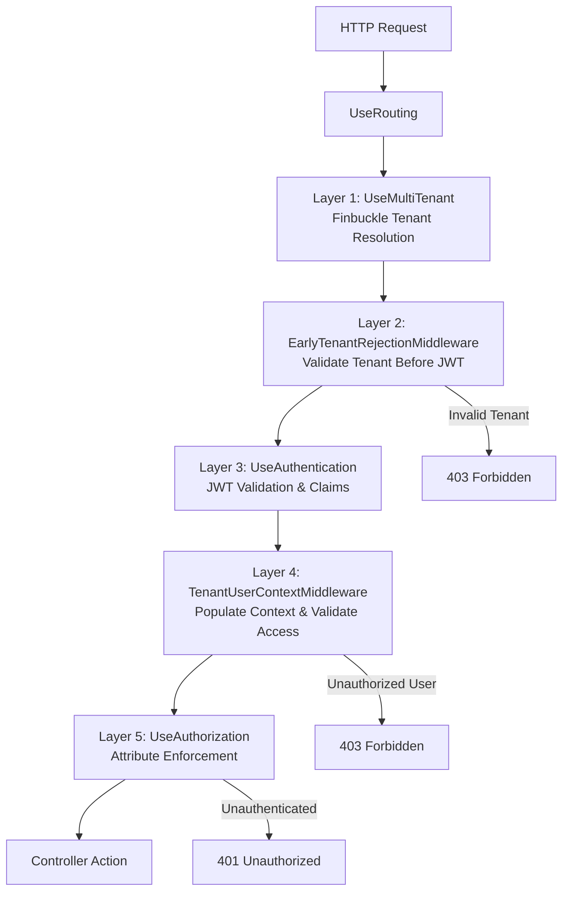
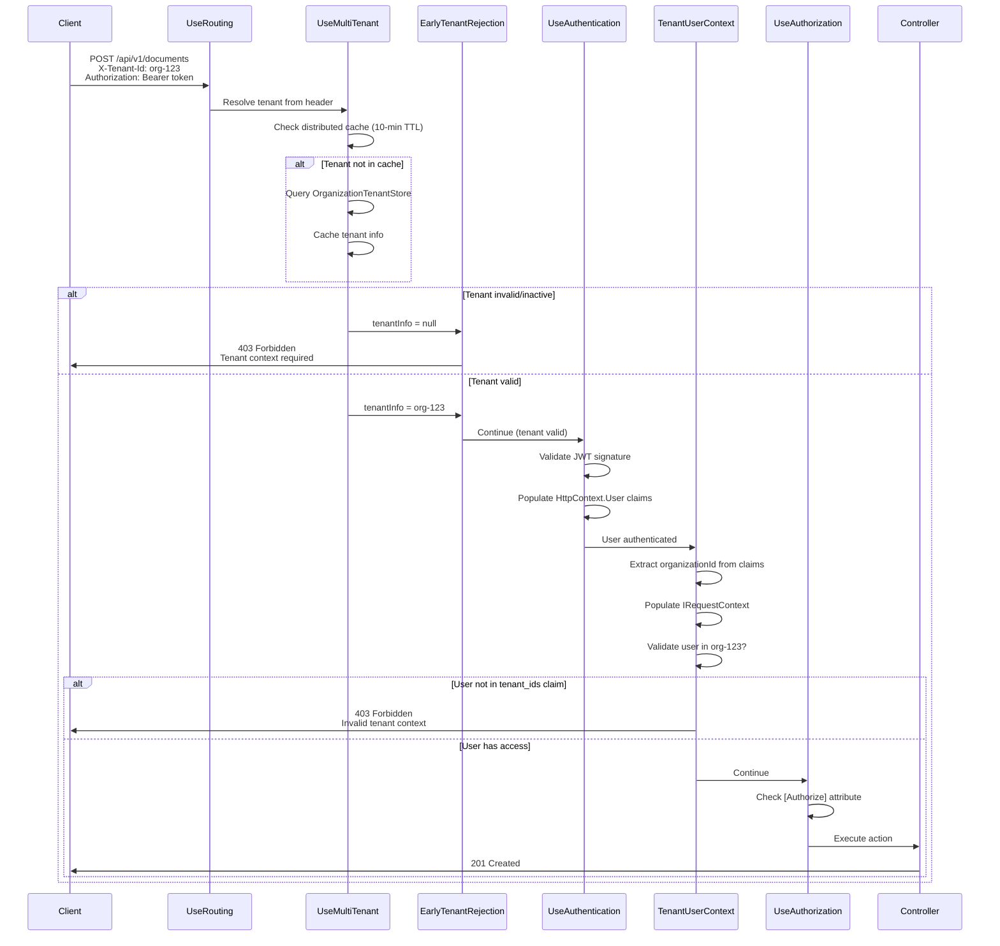

# Multi-Tenant API Architecture

**On this page:** Overview · Request Flow · Middleware Pipeline Architecture · Architectural Decisions · Key Patterns · Security Benefits · Error Handling · Implementation Reference

The IniaAi Platform API implements a defense-in-depth multi-tenant architecture that ensures secure tenant isolation through layered middleware validation while optimizing performance.

## Overview

The API design follows RESTful conventions with multi-tenancy integrated through:
- **X-Tenant-Id header**: Required for authenticated requests to specify organization context
- **JWT authentication**: Standard Bearer token with embedded user claims
- **Multi-layered validation**: Five security layers from tenant resolution to authorization
- **Early rejection**: Invalid tenant requests rejected before expensive JWT validation

## Request Flow

```http
POST /api/v1/documents
Headers:
  Authorization: Bearer <jwt-token>
  X-Tenant-Id: <organization-id>
  Content-Type: application/json

# Success Response
HTTP/1.1 201 Created
Content-Type: application/json
{
  "id": "doc-123",
  "organizationId": "<organization-id>",
  "title": "Financial Report"
}

# Early Rejection (missing/invalid tenant)
HTTP/1.1 403 Forbidden
Content-Type: application/problem+json
{
  "status": 403,
  "title": "Tenant context required",
  "detail": "A valid X-Tenant-Id header is required to access this endpoint."
}

# User Access Denied
HTTP/1.1 403 Forbidden
Content-Type: application/problem+json
{
  "status": 403,
  "title": "Invalid tenant context",
  "detail": "You do not have access to this tenant."
}
```

## Middleware Pipeline Architecture

### Five-Layer Security Model

Before the five layers, `Program.cs` runs `UseStaticFiles`, `UseCors`, `UseRouting`, `UseRateLimiter` (a fixed window on sign-in) and `ApiVersionReportingMiddleware`.



### Layer Details

| Layer | Purpose | Performance Impact | Security Benefit |
|-------|---------|-------------------|------------------|
| **1. UseMultiTenant()** | Resolve tenant from X-Tenant-Id header, validate tenant exists and is active | 10-min distributed cache reduces DB queries | Prevents invalid tenant IDs |
| **2. EarlyTenantRejectionMiddleware** | Reject protected endpoints with missing/invalid tenant BEFORE JWT validation | Saves CPU on invalid requests | Brute force prevention |
| **3. UseAuthentication()** | Validate JWT signature and populate user claims | Standard ASP.NET Core cost | Ensures valid user identity |
| **4. TenantUserContextMiddleware** | Populate IRequestContext, validate user has access to tenant | Claim parsing only | Defense-in-depth validation |
| **5. UseAuthorization()** | Enforce [Authorize] attributes | Standard ASP.NET Core cost | Role-based access control |

### Request Sequence Diagram



## Architectural Decisions

### Why Early Rejection Before JWT Validation?

**Problem**: JWT signature validation is computationally expensive. Attackers could brute-force tenant IDs while forcing the server to validate JWTs.

**Solution**: `EarlyTenantRejectionMiddleware` validates tenant exists (via Finbuckle's distributed cache) BEFORE JWT validation. Invalid tenant = immediate 403, no CPU wasted on cryptographic operations.

**Benefit**:
- Prevents brute force attacks on tenant enumeration
- Reduces server load during attack scenarios
- Cached tenant lookup is much faster than JWT validation

### Why Two Separate Middlewares?

**Layer 2 (EarlyTenantRejectionMiddleware)**: Runs BEFORE authentication
- Can only check: "Does this tenant exist and is it active?"
- Cannot check: "Does this user belong to this tenant?" (no user claims yet)
- Purpose: Performance optimization and brute force prevention

**Layer 4 (TenantUserContextMiddleware)**: Runs AFTER authentication
- Has access to user claims from validated JWT
- Checks: "Does this authenticated user have access to the requested tenant?"
- Purpose: Defense-in-depth security validation

### Why IRequestContext Pattern?

**Alternative Approaches Considered**:
1. ❌ `ICurrentUserService` throughout application - tight coupling to HTTP context
2. ❌ Passing organizationId via method parameters - error-prone, inconsistent
3. ✅ **Scoped IRequestContext service** - validated once by middleware, available everywhere

**Benefits**:
- Single validation point (middleware)
- Controllers access via clean properties
- Handlers receive via explicit parameters (testable, no HTTP context dependency)
- Separation of concerns

## Key Patterns

### Controller Pattern

All controllers inherit from `ApiController` base class providing:
- `OrganizationId` property - validated by middleware
- `UserId` property - validated by middleware
- `RequestContext` - full context access
- Error handling methods (`Problem()`, etc.)

Controllers pass these to commands/queries - **no inline validation needed**.

### Command/Query Parameter Order

Standard order enforced across all CQRS operations:
1. **OrganizationId** (string) - tenant isolation
2. **UserId** (string) - user identity for audit/logging
3. Domain-specific parameters

### Handler Pattern

Handlers use `request.OrganizationId` and `request.UserId` directly:
- ✅ DO: Use parameters from command/query
- ❌ DON'T: Inject `ICurrentUserService` (creates HTTP context dependency)

### Excluded Paths

Infrastructure endpoints bypass all middleware via `MiddlewareConstants.ExcludedPaths`:
- `/health`, `/healthz`, `/ready`, `/readyz`, `/readiness`, `/live`, `/livez`
- `/swagger` (served only in `LocalDevelopment`)

Controllers can use `[AllowAnonymous]` for public endpoints (e.g., `/connect/token`, `/passwords/forgot`). Both tenant middleware layers skip an anonymous endpoint, so it needs no `X-Tenant-Id` and reaches no organization through the header.


## Security Benefits

### Defense in Depth

1. **HTTP Layer**: X-Tenant-Id header validation
2. **Caching Layer**: Finbuckle distributed cache (10-minute TTL)
3. **Early Rejection**: Invalid tenant blocked before JWT validation
4. **Authentication**: JWT signature and claims validation
5. **Context Validation**: User-tenant access verification
6. **Authorization**: [Authorize] attribute enforcement
7. **Application Layer**: Explicit organizationId/userId parameters
8. **Data Layer**: every query carries an explicit `OrganizationId` predicate — there is **no** EF Core global tenant query filter (only the soft-delete filter is registered on both contexts); see [Data Isolation](data-isolation.md)
9. **Deployment**: each deployment is isolated; organizations *within* one deployment share the database, separated by the `OrganizationId` on each row (application scoping, not database row-level security)

### Performance Optimizations

- **Distributed Cache**: 10-minute TTL for tenant lookups reduces database queries
- **Early Rejection**: Saves JWT validation CPU for invalid tenant requests
- **Single Validation**: Middleware validates once, controllers trust the context

## Error Handling

All errors follow **Microsoft Problem Details (RFC 7807)** standard:

```json
{
  "status": 403,
  "title": "Error category",
  "detail": "Human-readable explanation",
  "instance": "/api/v1/resource"
}
```

Common error scenarios:
- **Missing X-Tenant-Id**: 403 "Tenant context required", detail `A valid X-Tenant-Id header is required to access this endpoint.` (Layer 2)
- **Invalid or inactive tenant**: the same 403 (Layer 2): the store resolves only an existing, active organization
- **Authenticated user without a tenant**: 403 "Tenant context required", detail `User is authenticated but does not belong to any tenant. Please contact support.` (Layer 4)
- **User lacks access**: 403 "Invalid tenant context", detail `You do not have access to this tenant.` (Layer 4)
- **Unauthenticated**: 401 Unauthorized (Layer 5)

## Implementation Reference

For detailed implementation patterns, code examples, and development guidelines, see:
- [Security Model](security-model.md) - Security considerations and threat model
- [Data Isolation](data-isolation.md) - Database-level isolation strategies
