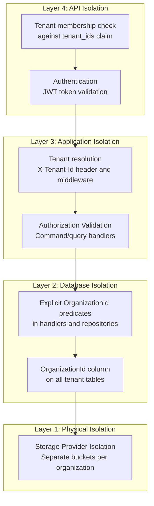

# Data Isolation

**On this page:** Isolation Layers · 1. Physical Storage Isolation · 2. Database-Level Isolation · 3. Application-Level Isolation · 4. API-Level Isolation · 5. Cross-Cutting Isolation Concerns · Testing Isolation · Monitoring and Auditing · Related Documentation

Data isolation is critical in a multi-tenant deployment (the platform runs on-premises or in the customer's own cloud) to ensure each organization's data remains private and secure. The IniaAi Platform implements multiple layers of isolation to prevent cross-tenant data access.

## Isolation Layers



## 1. Physical Storage Isolation

### File Storage Providers

See [File Storage Architecture](../file-storage/index.md) for complete implementation details.

**Database Storage (Legacy)**: the bytes sit in the shared `Files` table and the row of `FileMetadata` carries the `OrganizationId`. Isolation is the application filtering by that column.

**MinIO**: one bucket per organization and category, `{organizationId}-{category}` (for example `acme-corp-documents`), so a key read under one organization's id looks in that organization's bucket only. The storage call takes the organization id from the caller, so the caller's own scoping still decides which organization's bucket is read.

A [fixed bucket](../file-storage/index.md#fixed-bucket-mode-on-premise) (`FileStorage:MinIO:BucketName`) puts every organization's files in one bucket: there the object key is the only separation, and the application's scoping is the whole of it.

---

## 2. Database-Level Isolation

### Foreign Key Constraints

Tenant rows carry an `OrganizationId` column. Some tables also have a foreign key to `Organizations`, with the delete behaviour below (from the UserData model snapshot). No organization is ever deleted — the admin app only deactivates one ([Creating and deactivating an organization](index.md#creating-and-deactivating-an-organization)) — so the delete behaviour matters only to a hand-run delete.

| Table | Foreign key to `Organizations` | On delete |
|-------|-------------------------------|-----------|
| `Documents` | yes | Cascade |
| `Users` (legacy `User.OrganizationId`) | yes | Cascade |
| `OrganizationModelSettings`, `OrganizationCleanupSettings` | yes | Cascade |
| `FileMetadata` | yes | No action |
| `Counterparties` | yes | No action |
| `UserOrganizations` | yes | No action |
| `TokenUsages` | yes | Restrict |
| `Workflows` (executed copies) | yes | the EF default for an optional key |
| `WorkflowExecutions`, `Files` and most other tenant tables | no — an `OrganizationId` column only | — |

The full column and index list per table is on the [UserData database reference](../../reference/database/user-data-database.md).

### Explicit Organization Scoping (no global tenant filter)

> ⚠️ The platform does **not** use an EF Core global query filter for tenant isolation. The only model-wide `HasQueryFilter` applied today is the **soft-delete** filter. Do not assume queries are auto-scoped by organization. (A tenant-filter helper, `ApplyTenantFilter`, was deleted unused: it captured the tenant id as a constant when EF built the model, which EF does once per context type, so it could never have scoped per request. Background jobs, the operators' cross-organization pages and the shared Core templates also read with no tenant.)

**The only model-wide filter — soft delete** (`platform/IniaAi.Infrastructure/Persistence/Extensions/ModelBuilderExtensions.cs`), applied in both `CoreDbContext` and `UserDataDbContext`:

```csharp
public static void ApplySoftDeleteFilter(this ModelBuilder modelBuilder)
{
    foreach (var entityType in modelBuilder.Model.GetEntityTypes())
    {
        if (typeof(IAuditableEntity).IsAssignableFrom(entityType.ClrType))
        {
            // e => e.IsDeleted == false
            modelBuilder.Entity(entityType.ClrType).HasQueryFilter(/* ... */);
        }
    }
}
```

**Tenant scoping is explicit**: the active `OrganizationId` is resolved by middleware, passed into each command/query as a parameter, and applied as a predicate in the handler or repository call:

```csharp
// A list handler puts the request's OrganizationId into its specification or predicate
.Where(d => d.OrganizationId == request.OrganizationId)
```

**Implications**:
- **Discipline required**: every tenant query must include the `OrganizationId` predicate — there is no automatic backstop
- **Index on OrganizationId** keeps the explicit predicate fast
- The shared workflow-template case is handled by `WorkflowTypeOrganizationAccess` (the access join table), **not** by an `OR template` clause in a query filter

---

## 3. Application-Level Isolation

### Organization Context Injection

**HTTP Request Pipeline** (`platform/IniaAi.WebApi/Program.cs`):

```csharp
app.UseMultiTenant();                                      // Finbuckle resolves the tenant
app.UseMiddleware<EarlyTenantRejectionMiddleware>();      // reject unknown tenants pre-auth
app.UseAuthentication();                                   // JWT validation
app.UseMiddleware<TenantUserContextMiddleware>();         // populate IRequestContext + validate membership
app.UseAuthorization();                                    // [Authorize] enforcement
```

Tenant resolution is header-driven: `HeaderTenantStrategy` reads the `X-Tenant-Id` header, `OrganizationTenantStore` resolves it to an `OrganizationTenantInfo`, and `TenantUserContextMiddleware` then checks the resolved tenant against the caller's JWT membership claim (`tenant_ids`, falling back to `tenant_id` / `organization_id`). `SuperAdmin` may reach any tenant. Endpoints marked `[AllowAnonymous]` or `[TenantOptional]` skip the tenant requirement.

```csharp
public class TenantUserContextMiddleware
{
    public async Task InvokeAsync(
        HttpContext context,
        IRequestContext requestContext,
        ICurrentUserService currentUserService,
        IMultiTenantContextAccessor<OrganizationTenantInfo> tenantAccessor)
    {
        var organizationId = currentUserService.GetCurrentTenantId();
        var userId = currentUserService.GetUserId();

        if (requestContext is RequestContext mutable)
        {
            mutable.OrganizationId = organizationId;
            mutable.UserId = userId;
        }

        // 403 if an authenticated user reaches a tenant-required endpoint without tenant context,
        // or is not a member of the resolved tenant (unless SuperAdmin).
        await _next(context);
    }
}
```

**Request Context** (`IniaAi.Application.Common.Interfaces.Services.IRequestContext`):
```csharp
public interface IRequestContext
{
    string? OrganizationId { get; }
    string? UserId { get; }
    bool IsAuthenticated { get; }
    bool HasTenantContext { get; }
}
```

### Command/Query Validation

Every handler that reads or writes tenant data by id checks the row's organization against `request.OrganizationId`. Handlers answer another organization's row in one of two ways, and both answer `404`:

- **Not found, logged.** The document handlers (get, update, delete, bulk delete, process, page list, one page, text download) and the file read load the row by id and answer `NotFound` with `Document not found.` both when no row exists and when it belongs to another organization, and the page-image read answers both with `Page not found.`, so the caller cannot learn that the id exists elsewhere. `DocumentIsolationOnBothProvidersTests` runs every one of these handlers against a throwaway SQL Server and PostgreSQL database and holds the two answers equal. A foreign row is logged as a warning, for example `User {UserId} in organization {OrganizationId} attempted to read document {DocumentId} owned by {OwnerOrganizationId}`.
- **Not found.** Handlers that put the organization into the lookup itself (`Where(x => x.Id == id && x.OrganizationId == request.OrganizationId)`) cannot tell the two apart and answer `NotFound`. The job (`GetJobQueryHandler`), export (`ExportWorkflowExecutionCommandHandler`) and run graph (`WorkflowExecutionsGraphController`) reads load the row first and then answer a foreign row exactly as a missing one (`Job not found.`, `Workflow execution not found.`).

The admin app's by-id reads always answer as if the row were missing ([below](#by-id-reads-in-the-blazor-webapp)).

---

## 4. API-Level Isolation

### Authentication

**JWT Token Structure** (tenant membership in `tenant_ids`; roles in `role`):
```json
{
  "sub": "user-id-123",
  "email": "analyst@acme-corp.com",
  "tenant_ids": ["acme-corp", "acme-subsidiary"],
  "role": ["User", "WorkflowEditor"],
  "exp": 1704412800
}
```

The token proves *which* organizations the user may reach. The *active* organization for a given request is chosen by the `X-Tenant-Id` header and validated against `tenant_ids` (with legacy fallbacks `tenant_id` / `organization_id`).

### Authorization

Authorization is **role-based**, using ASP.NET Identity roles surfaced as `role` claims and enforced with `[Authorize(Roles = ...)]` rather than custom claim policies. The roles and the gate each one opens are on [Authorization](../../features/user-management/authorization.md).

A controller derives from `ApiController`, whose `OrganizationId` and `UserId` properties read the `IRequestContext` the middleware filled, and passes them as the first two parameters of its command or query (for example `new GetDocumentQuery(OrganizationId, UserId, id)` in `DocumentsController`).

---

## 5. Cross-Cutting Isolation Concerns

### Multi-Organization Users

**Challenge**: Users can belong to multiple organizations

**Solution**: There is **no `switch-organization` endpoint and no token re-mint**. The Vue SPA sends the chosen organization as the `X-Tenant-Id` header, and the API re-checks membership on every request in `TenantUserContextMiddleware`. The Blazor Server admin app calls no API: it holds the selection in `AppState` and validates it against the organizations the user's circuit loaded at sign-in:

```csharp
// IniaAi.WebApp — AppState.SwitchOrganization
public async Task SwitchOrganization(string organizationId)
{
    if (string.IsNullOrEmpty(organizationId) || organizationId == CurrentOrganizationId)
    {
        return;
    }

    if (!UserOrganizations.Any(o => o.Id == organizationId))
    {
        throw new UnauthorizedAccessException($"User does not have access to organization: {organizationId}");
    }

    CurrentOrganizationId = organizationId;
    OrganizationChanged?.Invoke(this, EventArgs.Empty);
    await Task.CompletedTask;
}
```

In the SPA the same token stays valid across organizations; only the header changes. In the admin app the switch changes `AppState.CurrentOrganizationId`, which every page reads, and raises `OrganizationChanged`.

### Tenant Switching in the Blazor Admin UI

**Challenge**: After `SwitchOrganization`, every page on screen still shows the previous organization's data — and on a Blazor Server circuit all components share one scoped `UserDataDbContext`, so uncoordinated reloads collide on it.

**Solution**: A single reload mechanism in the layout, and a rule that pages stay out of it. `MainLayout` wraps `@Body` in an element keyed on the selected organization; when the key changes, Blazor discards the whole page subtree and builds a fresh instance, so each page loads again under the new tenant:

```razor
@* IniaAi.WebApp — MainLayout.razor *@
<div @key="@AppState.CurrentOrganizationId" style="display: contents;">
    @Body
</div>
```

`MainLayout` subscribes to `OrganizationChanged` only to re-render itself — that re-render is what applies the new key. **Pages inside `@Body` must not subscribe**: the key already reloads them, so a handler adds nothing but a second, concurrent load of the same data. Both loads share the circuit's `UserDataDbContext` (the context and `IUserDataUnitOfWork` are scoped, and in Blazor Server the scope lives as long as the circuit), and EF Core rejects the overlap with *"A second operation was started on this context instance"* — an exception that escapes an `async void` event handler and kills the circuit. `Dashboard` carries a one-line comment where the subscription would go, recording why there isn't one. The legitimate subscribers sit outside the keyed subtree: `TenantSelector` in the layout chrome, and the scoped `SignatureOverrideReader` service, which invalidates its per-organization cache. (`PromptEditor`, `SignatureFieldsEditor`, `StoredKeysCard` and `WebApiCallBlock` still subscribe from inside the subtree; those handlers are redundant with the re-key and are not a pattern to copy.)

The shared context also dictates how the management pages load and save:

- **Loads stay on the circuit's unit of work, tracked.** The edit dialogs persist by mutating the loaded entity and calling `CompleteAsync`, and cancel with `RevertAsync`; the generic repository has no `Update`/`Attach` escape hatch (see [Repositories & Unit of Work](../services/infrastructure/database-services.md#repositories--unit-of-work)). Load a page through a throwaway DI scope, or with `AsNoTracking`, and every edit made to those entities reports success while writing nothing.
- **Blur-time work gets its own scope.** Clicking a dialog's Save button first blurs the focused field, so an async `@onblur` handler interleaves with the save on the same circuit. Such a handler reads through a scope resolved from `IServiceScopeFactory`, so that read can never collide with the save's `CompleteAsync`.

A page whose load uses a child component through `@ref` loads in `OnAfterRenderAsync(firstRender)`, not in `OnInitializedAsync`. Blazor renders a page before its first load call returns only when that call waits, and it never renders a page that the re-key discards before its first render. The three workflow designer pages wire their `DocumentUploadCard` into the workflow while loading: when they loaded in `OnInitializedAsync`, a switch during an opening left the card unset and killed the circuit with *"Delegate to an instance method cannot have null 'this'"*.

A switch does not cancel work already in flight. Switching organizations faster than a query returns can overlap the dying page's read with the new page's first load on the shared context — a known, accepted residual.

### By-id reads in the Blazor WebApp

The WebApp's MVC controllers and pages have no tenant header, so a read by id or by name checks the caller's organization itself. A caller acts in the organizations they are an active member of; a `SuperAdmin` acts in any organization, as the API's tenant check allows. The controllers ask `CallerOrganizations.ReadableAsync` (`platform/IniaAi.WebApp/Services/`), which also covers the message processor's API key: `RoleOrMessageProcessorApiKeyAuthorize` marks a request it admitted by key rather than by role, and that request carries no user and acts only for `PlatformSettings.CustomerOrgId`. A page or dialog asks `AppState.CanActIn`, which reads the memberships the circuit loaded at sign-in. A record of another organization answers exactly as a missing one does, so a guessed id or name reveals nothing.

| Surface | Check |
|---|---|
| `GET /FileDownload/document/{documentId}` | The document's organization must be one the caller may act in; the API key reads only `CustomerOrgId` |
| `GET /FileDownload/file/{fileName}` | The newest file of that name **within** the caller's organizations (`NewestFileMetadataByNameSpec` takes the organization list) |


The editor's other parameterized pages admit the editor roles only. `/library/{ComponentId}` reads through the same organization-scoped queries as the API. `/editors/{WorkflowTypeId}` reads the workflow type by id: templates are deployment-wide authoring content by design (see [Shared Resources](#shared-resources)).


### Shared Resources

**Challenge**: Workflow templates are shared across the organizations that have access to a given workflow type.

**Solution**: The `WorkflowTypeOrganizationAccess` join table (in the `Core` schema), **not** a query filter. A `WorkflowType` is reachable by the *set* of organizations that have an access row; among them the live template content is one shared `Workflow` row per type. The isolation boundary is "does the caller's org have an access row for this type?" — `Workflow.OrganizationId` is only a "who last saved" stamp and is **not** used to scope template reads.

```csharp
// Gate template access by the join table, not by Workflow.OrganizationId
var hasAccess = await _coreUnitOfWork.WorkflowTypeOrganizationAccess
    .AnyAsync(a => a.WorkflowTypeId == workflowTypeId
                && a.OrganizationId == request.OrganizationId, ct);
```

---

## Testing Isolation

Cross-organization reads are tested at the handler level, through the dispatcher, against real databases in `IniaAi.WebApi.IntegrationTests`. `DocumentsTests` seeds a document under another organization and asserts `GetDocument_CrossOrg_ReturnsNotFound`, `UpdateDocument_CrossOrg_ReturnsNotFound`, `DeleteDocument_CrossOrg_ReturnsNotFoundAndKeepsRow` and `ListDocumentPages_CrossOrg_ReturnsNotFound`, and that a list returns only the caller's organization (`ListDocuments_ReturnsOnlyCallerOrg`). `ODataListsOnBothProvidersTests` and `ReadPathsOnBothProvidersTests` run the OData lists and read paths on PostgreSQL and SQL Server. The tenant middleware itself (`EarlyTenantRejectionMiddleware`, `TenantUserContextMiddleware`) is tested over HTTP by `TenantContextTests`, which signs in a real account through the token endpoint and sends requests with no `X-Tenant-Id`, with the caller's own organization, another organization and a closed one.

## Monitoring and Auditing

### Cross-Tenant Access Attempts

A refused read is logged by the code that refused it: the middleware logs `Request to {Path} rejected: User {UserId} does not have access to organization {OrganizationId}. User's organizations: {UserOrgs}` and `Early tenant rejection: Request to protected endpoint {Path} rejected - missing or invalid X-Tenant-Id header. …`; a handler that finds another organization's row logs its own warning, as `GetDocumentQueryHandler` does above. Nothing raises an alert; these are Warning lines in the application log.

### Audit Logging

There is **no generic audit table**. The persisted audit records per subsystem are listed on [Multi-Tenant Architecture → Audit records](index.md#audit-records).

---

## Related Documentation

- [Multi-Tenant Architecture Overview](index.md) - Main multi-tenant documentation
- [File Storage Architecture](../file-storage/index.md) - Storage provider isolation
- [Security Model](security-model.md) - Authentication and authorization
- [Database Design](database-design.md) - Multi-tenant schema design
