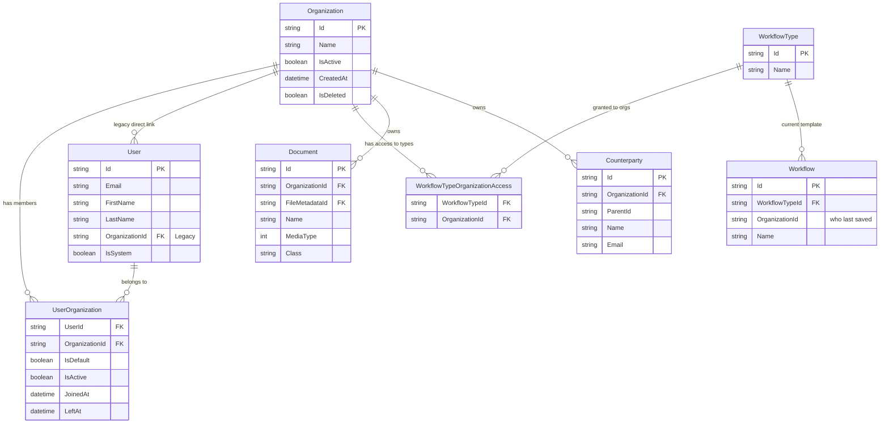

# Multi-Tenant Database Design

**On this page:** Two DbContexts, not two databases · Entity Relationship Model · Data Isolation Strategy · Performance Considerations · Migration & Data Lifecycle

The IniaAi Platform uses a shared-server approach with tenant discrimination by `OrganizationId`, enforced at the application layer, while keeping template authoring and execution history in separate EF Core contexts.

## Two DbContexts, not two databases

The platform splits persistence across **two EF Core `DbContext`s addressing two schemas** — `CoreDbContext` (schema `Core`) and `UserDataDbContext` (schema `UserData`). They may point at the **same physical database** (two schemas) or at **separate databases**; the topology is a deployment choice driven by connection strings, not an architectural assumption. Code reasons about the *context boundary*, not "two databases".

```text
CoreDbContext  (schema "Core")  — workflow TEMPLATES (what prompt engineers author)
├── Workflow / Section / Block / TextInput / RagSettings   (template shape)
├── WorkflowType / WorkflowTypeCategory
├── WorkflowTypeOrganizationAccess                          (org access join table)
├── WorkflowVersion                                         (template version history)
├── DocumentCategory
├── BlockTemplate / TemplateCategory                        (retired Prompt Library, empty)
├── prompt sets (PdfOcrPrompts, ExcelAnalysisPrompts, TopicsPrompts, …)
├── ModelPricing / ModelPricingComponent
└── SignatureFieldOverride family (per-org signature overrides + votes + audit log)

UserDataDbContext (schema "UserData") — EXECUTED workflows + tenant data
├── Organization / User / UserOrganization
├── Workflow / Section / Block / BlockResponse              (executed snapshots)
├── WorkflowExecution / WorkflowExecutionLog / WorkflowExecutionCounterparty
├── Document / DocumentInfo / Page / EmbeddingVector
├── File / FileMetadata                                     (blob + metadata)
├── Counterparty / CounterpartyType
├── WorkflowReport / ReportSection / ReportParagraph        (report tree)
├── paid-module tables kept in every build (HedgeFunds*, PrivateEquity*, WorkflowRegression*)
├── TokenUsage / OrganizationModelSettings / OrganizationCleanupSettings
├── DataProtectionKeys                                      (ASP.NET key ring)
└── OpenIddict (Applications / Authorizations / Scopes / Tokens)
```

The **same `Workflow`/`Block`/`Section` entity classes** are reused in both contexts. In `Core` they are canonical templates; in `UserData` each row is an immutable snapshot of "what the template looked like at run time, plus how the execution mutated it". `CoreDbContext` explicitly `Ignore<>`s the execution-only and tenant entities (`BlockResponse`, `WorkflowReport`, `ReportSection`, `ReportParagraph`, `Organization`, `User`, `Document`, `Page`, `File`, `Counterparty`, the agent-run outputs, `BlockCitationTrace`, etc.). Every entity derived from `Entity<T>` carries `Id`, `CreatedAt`, `UpdatedAt`, `UpdatedByUserId`, `IsDeleted`, `DeletedAt` and `DeletedByUserId`; the diagram below shows only the columns the relationships need. Every column is on the [Core](../../reference/database/core-database.md) and [UserData](../../reference/database/user-data-database.md) references.

## Entity Relationship Model



### Template isolation is by access join, not ownership

A `WorkflowType` is shared across a **set** of organizations through `WorkflowTypeOrganizationAccess` (Core schema, junction of `WorkflowTypeId` ↔ `OrganizationId`). Among orgs that have access, the **live template content is shared** — one logical `Workflow` row per type. Per-org variation comes from `SignatureFieldOverride` (a separate Core table keyed by `(OrganizationId, WorkflowTypeId)`), never baked into the template.

Consequences:

- The isolation boundary for templates is **`WorkflowTypeOrganizationAccess`** ("does the caller's org have an access row for this type?"), **not** `Workflow.OrganizationId`.
- `Workflow.OrganizationId` is a "who last saved" stamp, not an ownership/scoping key. Do **not** filter the shared template row by it.
- `User.OrganizationId` is a legacy direct link; membership is modelled by `UserOrganization` (a user can belong to several organizations).

## Data Isolation Strategy

### Soft-delete query filter (the only global filter)

The only global EF query filter actually wired up is **soft delete**. `ApplySoftDeleteFilter` reflects over the model and adds an `IsDeleted == false` filter to every `IAuditableEntity`; both contexts call it from `OnModelCreating`:

```csharp
public static void ApplySoftDeleteFilter(this ModelBuilder modelBuilder)
{
    foreach (IMutableEntityType entityType in modelBuilder.Model.GetEntityTypes())
    {
        if (typeof(IAuditableEntity).IsAssignableFrom(entityType.ClrType))
        {
            ParameterExpression parameter = Expression.Parameter(entityType.ClrType, "e");
            MemberExpression prop = Expression.Property(parameter, nameof(IAuditableEntity.IsDeleted));
            LambdaExpression filter = Expression.Lambda(Expression.Equal(prop, Expression.Constant(false)), parameter);
            modelBuilder.Entity(entityType.ClrType).HasQueryFilter(filter);
        }
    }
}
```

There is **no** automatic per-tenant query filter. A reflection-based `ApplyTenantFilter` once sat in `ModelBuilderExtensions` with no caller; it was deleted because it baked the tenant id into the model as a constant, and EF builds a model once per context type, so every later query would have filtered by the first tenant it saw. Automatic per-tenant query filtering is therefore **not active** — tenant scoping is enforced by the request pipeline and by handlers passing `OrganizationId` explicitly into specifications/queries (see [Security Model](security-model.md)).

### Where tenant scoping actually happens

- **Request pipeline** — `HeaderTenantStrategy` resolves the tenant from the `X-Tenant-Id` header (via Finbuckle.MultiTenant), `EarlyTenantRejectionMiddleware` rejects protected requests with a missing/invalid tenant before JWT validation, and `TenantUserContextMiddleware` confirms the authenticated user has access to the requested tenant.
- **Application layer** — commands/queries carry `OrganizationId` (and `UserId`) as their first parameters; handlers filter by `request.OrganizationId` when reading/writing UserData entities.
- **Templates** — Core reads gate on `WorkflowTypeOrganizationAccess`, not on `Workflow.OrganizationId`.

### Tenant Information Storage

The Finbuckle tenant descriptor is `OrganizationTenantInfo`:

```csharp
public class OrganizationTenantInfo : ITenantInfo
{
    public string Id { get; set; }                 // Organization.Id
    public string Identifier { get; set; }         // also Organization.Id
    public string? Name { get; set; }
    public string? ConnectionString { get; set; }  // optional, for future per-tenant DBs
    public bool IsActive { get; set; } = true;
    public DateTime CreatedAt { get; set; }
    public DateTime? UpdatedAt { get; set; }

    public OrganizationTenantInfo(string id, string identifier) { Id = id; Identifier = identifier; }
}
```

There is no tenant "tier" or free-form `Settings` bag on the tenant info, and no `TenantTier` enum — per-org behaviour lives in dedicated UserData tables (`OrganizationModelSettings`, `OrganizationCleanupSettings`) instead.

## Performance Considerations

Because `OrganizationId` is the dominant predicate on tenant-scoped UserData tables, composite indexes that lead with `OrganizationId` are the natural shape for hot queries (e.g. `(OrganizationId, CreatedAt)` on documents and executions). Soft-deleted rows are filtered in-query rather than physically removed, so high-churn tables benefit from filtered/partial indexes that exclude `IsDeleted = true`.

Connection pooling and EF retry-on-failure are configured per provider in `DatabaseConfigurator`; both PostgreSQL and SQL Server are supported (`PlatformSettings__UserDataDbProvider` / `CoreDbProvider`), and migrations live in `IniaAi.Migrations.PostgreSql` and `IniaAi.Migrations.Mssql` under `{Core,UserData}` folders.

## Migration & Data Lifecycle

EF migrations are applied on startup by `DatabaseConfigurator.InitializeDatabases()` — **UserData first, then Core** — via `context.Database.Migrate()`. This is not environment-gated; pending migrations apply on every boot. Hosts that start together migrate and seed one at a time ([Database Services](../services/infrastructure/database-services.md)). Setting `RESEED_DB=true` instead runs `EnsureDeleted` + `EnsureCreated`, which is destructive and wipes the database.

Per-tenant export/restore is an operational concern handled at the database level (schema/row-scoped `pg_dump`/restore), not via an in-app `TenantDataExportService`. Note that the standalone `Reports` table was removed (migration `RemoveReports`, Feb 2026); reporting data now lives in the `WorkflowReport` → `ReportSection` → `ReportParagraph` tree.

This design keeps template authoring and execution history cleanly separated while enforcing tenant isolation through the request pipeline and explicit `OrganizationId` scoping rather than an implicit database-level filter.
