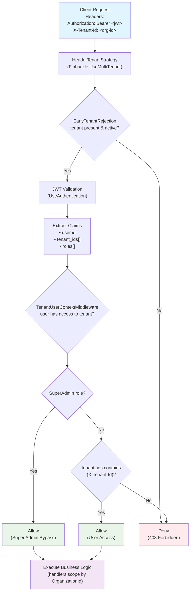

# Multi-Tenant Security Model

**On this page:** Security Layers · Security Flow Architecture · Threat Model & Mitigations · Security Testing Strategy · Data Encryption · Compliance & Auditing · Security Best Practices

The IniaAi Platform implements a layered security architecture designed to keep one organization's data from leaking to another, enforced in the request pipeline and at the application layer.

## Security Layers

### Layer 1: Transport Security
- **HTTPS / TLS**: Communication encrypted in transit. The API container listens on HTTPS with the deployment's certificate (`ASPNETCORE_Kestrel__Certificates__Default__Path` in the deployment's compose file); TLS policy is a deployment concern, since the platform runs in the customer's own environment
- **No HSTS from the app**: the API calls neither `UseHsts` nor `UseHttpsRedirection`; a deployment that wants HSTS sets it at its proxy

### Layer 2: Authentication
- **OpenIddict token server**: Standards-based OAuth 2.0 / OpenID Connect, hosted by the WebApi at `/api/v1/connect/token` (and `/api/v1/connect/token/mfa`)
- **Supported flows**: password, client-credentials, refresh-token, plus the custom `mfa`, `google` and `oidc` flows
- **JWT access tokens**: Signed tokens carrying user and organization claims

### Layer 3: Multi-Tenant Authorization
- **Header tenant resolution**: `HeaderTenantStrategy` reads the `X-Tenant-Id` header (Finbuckle.MultiTenant) and returns it as is; `OrganizationTenantStore` resolves it only to an existing, active organization. Neither looks at the user's claims, which are not validated yet
- **Early rejection**: `EarlyTenantRejectionMiddleware` rejects protected requests with a missing/invalid/inactive tenant *before* JWT validation
- **Membership check**: `TenantUserContextMiddleware` confirms the authenticated user has access to the requested organization and populates the request context
- **Super-admin override**: users in the `SuperAdmin` role may act across tenants
- **Fail-safe defaults**: deny when tenant validation fails

### Layer 4: Data Access Security
- **Soft-delete query filter**: the only global EF Core query filter wired up (`IsDeleted == false` on every `IAuditableEntity`)
- **Explicit tenant scoping**: handlers filter UserData reads/writes by `request.OrganizationId`; template reads gate on `WorkflowTypeOrganizationAccess`. There is no implicit per-tenant query filter (see [Database Design](database-design.md))

## Security Flow Architecture



The middleware order in `Program.cs` is: `UseRouting` → `UseMultiTenant` → `EarlyTenantRejectionMiddleware` → `UseAuthentication` → `TenantUserContextMiddleware` → `UseAuthorization`.

## Threat Model & Mitigations

### Threat: Unauthorized Tenant Access
- **Risk**: a user requests data for an organization they do not belong to
- **Mitigation**: `X-Tenant-Id` is resolved by `HeaderTenantStrategy` and checked against the user's claims by `TenantUserContextMiddleware`; protected requests with no valid tenant are rejected up front by `EarlyTenantRejectionMiddleware`
- **Detection**: failed access attempts are logged

The user's organizations come from the JWT claims. The middleware reads the `tenant_ids` claim (a JSON array), falling back to a single `tenant_id` claim, then the legacy `organization_id` claim:

```csharp
private HashSet<string> GetUserOrganizationsFromClaims(ClaimsPrincipal user)
{
    var organizations = new HashSet<string>();

    Claim? orgsClaim = user.FindFirst("tenant_ids");          // preferred: JSON array
    if (orgsClaim is not null)
    {
        string[]? orgIds = JsonSerializer.Deserialize<string[]>(orgsClaim.Value);
        // ... add each non-empty id ...
    }

    Claim? singleTenantClaim = user.FindFirst("tenant_id");    // single-tenant
    if (singleTenantClaim is not null) { organizations.Add(singleTenantClaim.Value); }
    else
    {
        Claim? legacy = user.FindFirst("organization_id");     // legacy fallback
        if (legacy is not null) { organizations.Add(legacy.Value); }
    }

    return organizations;
}
```

Endpoints that legitimately operate without a tenant (e.g. profile/account bootstrap) opt out with the `[TenantOptional]` attribute, which both the early-rejection and context middleware honour.

### Threat: JWT Token Manipulation
- **Risk**: an attacker forges or tampers with a token to impersonate another tenant
- **Mitigation**: tokens are issued and validated by the OpenIddict server; signature and lifetime validation are handled by the ASP.NET authentication pipeline (`UseAuthentication`), not by bespoke token-handling code
- **Detection**: invalid-signature failures surface as 401s and are logged

### Threat: Privilege Escalation
- **Risk**: a regular user tries to obtain cross-tenant (super-admin) access
- **Mitigation**: role-based authorization via `[Authorize(Roles = "...")]`; cross-tenant behaviour is gated on the `SuperAdmin` role, checked with `context.User.IsInRole("SuperAdmin")` in `TenantUserContextMiddleware`
- **Detection**: denied requests are logged

### Threat: Data Leakage Between Tenants
- **Risk**: an application bug returns one org's data to another
- **Mitigation**: handlers scope UserData reads/writes by `request.OrganizationId`; template reads gate on `WorkflowTypeOrganizationAccess`; the request pipeline rejects mismatched tenants before handlers run
- **Detection**: integration tests assert that a handler refuses another organization's document with `Forbidden`, and refusals are logged

Note that the **only** global EF query filter active is soft delete — there is no automatic per-tenant query filter, so isolation must be maintained by the pipeline and by explicit scoping in handlers:

```csharp
public static void ApplySoftDeleteFilter(this ModelBuilder modelBuilder)
{
    foreach (IMutableEntityType entityType in modelBuilder.Model.GetEntityTypes())
    {
        if (typeof(IAuditableEntity).IsAssignableFrom(entityType.ClrType))
        {
            // e => e.IsDeleted == false
            modelBuilder.Entity(entityType.ClrType).HasQueryFilter(/* IsDeleted == false */);
        }
    }
}
```

## Security Testing Strategy

Cross-tenant isolation is exercised at the handler level: `DocumentsTests` in `IniaAi.WebApi.IntegrationTests` sends queries and commands for one organization through the dispatcher against a document of another and asserts each answers `NotFound`, exactly as for an unknown id, and that lists return only the caller's organization ([Data Isolation → Testing Isolation](data-isolation.md#testing-isolation)):

```csharp
var query = new GetDocumentQuery(ORG_ID, USER_ID, document.Id);   // document seeded under OTHER_ORG_ID
ErrorOr<DocumentDetailDto> result = await _apiBuilder.SendAsync(query);

Assert.True(result.IsError);
Assert.Equal(ErrorType.NotFound, result.FirstError.Type);
```

The tenant middleware is tested through the HTTP pipeline: `TenantContextTests` in `IniaAi.WebApi.IntegrationTests` signs in a real account and checks that a request naming another organization answers `403` with `Invalid tenant context`, one naming no organization or a closed one answers `403` with `Tenant context required`, and one naming the caller's own organization goes through.

## Data Encryption

The platform is **deployed on-premise or in the customer's own cloud**, so at-rest encryption is a **deployment responsibility** rather than an application feature:

- **At rest**: provided by the underlying database and storage (e.g. PostgreSQL/SQL Server TDE, encrypted volumes, encrypted object storage) configured by the operator. The application does **not** implement per-tenant field-level encryption or an in-app key manager.
- **In transit**: TLS, terminated by the deployment's ingress/reverse proxy.
- **ASP.NET data protection**: key material for cookies/tokens is persisted via the `DataProtectionKeys` table in the UserData context, so keys survive restarts and are shared across instances.

## Compliance & Auditing

- **Application logging**: authentication, authorization, and tenant-access decisions are logged with user and organization context.
- **Domain audit trails**: specific subsystems keep their own audit records rather than a single platform-wide audit store; the list is on [Multi-Tenant Architecture → Audit records](index.md#audit-records).
- **Soft deletes**: auditable entities are soft-deleted (`IsDeleted`), preserving history for review.

Compliance posture (GDPR/HIPAA/SOX/ISO 27001 and similar) depends on how the customer operates their deployment; the platform provides the isolation, logging, and encryption hooks above as building blocks.

## Security Best Practices

### Development Guidelines
1. **Scope every UserData query** by `OrganizationId`; gate every template read on `WorkflowTypeOrganizationAccess` — never rely on an implicit tenant filter.
2. **Defense in depth**: keep the pipeline checks *and* the handler-level scoping; neither alone is sufficient.
3. **Fail secure**: default to deny when tenant resolution or membership is uncertain.
4. **Input validation**: validate at API boundaries via FluentValidation (`OrganizationId` and `UserId` first).
5. **Least privilege**: reserve cross-tenant behaviour for the `SuperAdmin` role.

This model keeps the platform's multi-tenant isolation anchored in the request pipeline and explicit data scoping, with encryption and broader compliance controls delivered by the customer-operated deployment.
