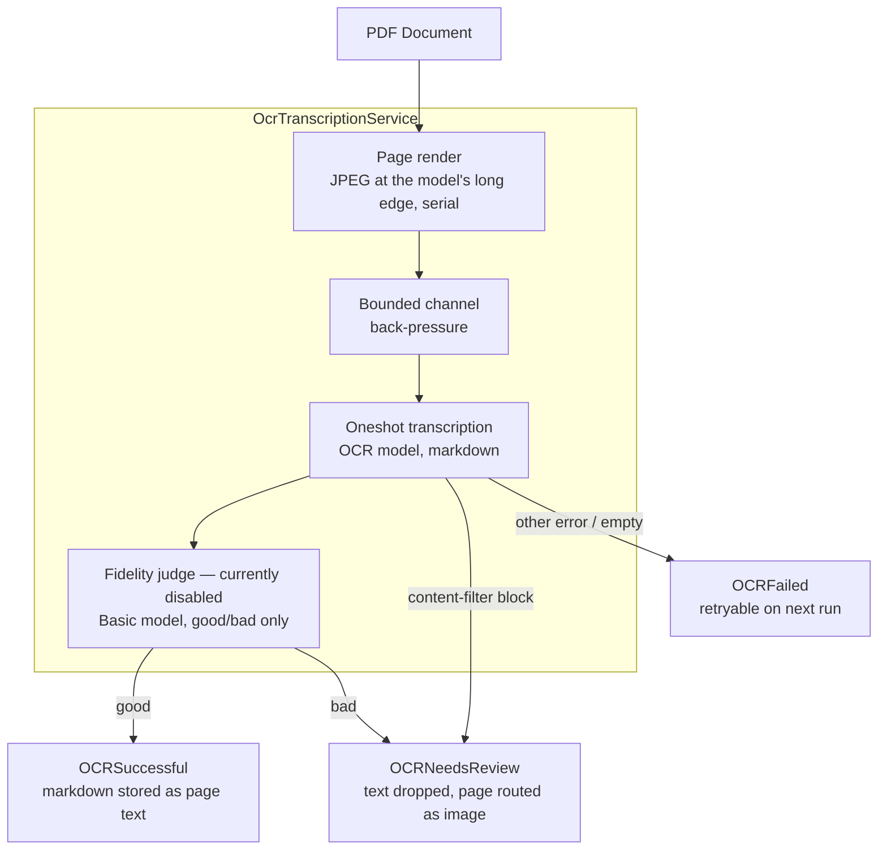

# OCR Architecture

**On this page:** Core Components · Architecture Overview · Pipeline · Fidelity Flag and Image Routing · Prompts · Models · Configuration · Token Recording · Document Processing Integration · Performance Monitoring · Troubleshooting

The platform performs OCR with the AI models themselves: each page image is transcribed in a single shot by the **OCR model** (markdown output; the Advanced model unless [`OcrSettings`](#models) names another), and the transcription is then graded by a **Basic-model fidelity judge** that emits only a `good`/`bad` verdict. There is no traditional OCR engine — Tesseract, its language packs, and per-page language detection were removed; the model reads any script natively. Pages whose transcription the judge rejects are not kept as text at all: they are flagged and routed to model consumers **as images**.

> [!WARNING]
> **The fidelity judge is currently disabled**
>
> `_fidelityJudgeEnabled = false` in `OcrTranscriptionService` skips the judge pass: each page costs a single model call and every non-error transcription is accepted as-is. Content-filter blocks still route pages by image, and `OCRFailed` retry behavior is unchanged. The judge code, prompts, and parser stay in place — re-enabling is a one-word flip. The judge-related sections below describe its behavior for when it is active.

## Core Components

| Component | File | Responsibility |
|-----------|------|----------------|
| `OcrTranscriptionService` | `platform/IniaAi.Core/Services/OcrTranscriptionService.cs` | Renders pages, runs the oneshot transcription + fidelity judge pipeline |
| `OcrJudgeResponseParser` | `platform/IniaAi.Core/Services/OcrJudgeResponseParser.cs` | Extracts the judge's `good`/`bad` verdict, handling truncation and negation |
| `PdfOcrPrompts` | `platform/IniaAi.Domain/Tools/PdfOcr/PdfOcrPrompts.cs` | The four DB-stored prompts (transcription + judge, each with a system prompt) |
| `OcrSettings` | `platform/IniaAi.Configuration/Platform/OcrSettings.cs` | Parallelism and output-token configuration |

## Architecture Overview



## Pipeline

`ProcessPdf` runs two phases connected by a bounded channel:

- **Render phase** — pages are rendered to JPEGs at quality 90, serially by default (`OcrMaxDegreeOfParallelism`, default `1`). Each page renders at the DPI that puts its longest edge on the long edge of the transcribing model's vision tier (`ModelImageLimits.ResolveRenderDpi`), never above 300. `ProcessPdf` asks the connector for the tier once per document (`IChatConnector.GetVisionTier` for the OCR model): 2576px and 4784 visual tokens for Claude 4.7 and later and for any model id the platform does not recognise, 1568px and 1568 tokens for the older models marked `[StandardVisionTier]` on `AiModel` (Sonnet and Opus 4.5/4.6, Haiku 4.5), per [Anthropic's vision tiers](https://platform.claude.com/docs/en/build-with-claude/vision). An A4 page renders at 220 DPI for a high-resolution model and at 134 DPI for a standard one. A finer render buys the model nothing, because the model downscales any image over either limit before it reads it; against a fixed 300 DPI (428–512 MiB allocated per page), the long-edge render allocated 233–330 MiB for the high-resolution tier and 93–169 MiB for the standard tier. For a page the token limit (one token per started 28 x 28 px patch) binds first, so the model still downscales the long-edge render; rendering the page that small in Aspose instead lost faint text the model's own downscale keeps (a grey footer page number in a 10-page comparison), so the render stops at the long edge. Because the DPI follows the page size, every page fits the provider's 8000px request-image limit, so page size never excludes a page from OCR. Parallel rendering adds no throughput — Aspose serializes rasterization on the document internally, and rendering already outpaces the LLM phase it feeds — so extra workers only stack each page's bitmap churn onto the peak: a full-pipeline memory A/B found serial rendering cut peak RSS ~45%, while every degree of parallelism of two or more sits on the same memory plateau. A compressor pass (`ImageCompressor.CompressJpeg`) runs only for renders that still exceed the 3.2 MB target. `ProcessPdf` opens the file through `IPdfFormat`, which rebuilds a lost `startxref` pointer and, in the Aspose implementation, repairs null pages (`AsposePdf.TryRepairPdf`) before rendering. A file that still needs its password fails with `DocumentPasswordProtectedException`.
- **Bounded channel** — capacity is `LlmMaxDegreeOfParallelism * 2` with `BoundedChannelFullMode.Wait`, so rendering back-pressures instead of buffering every page image in memory at once.
- **LLM phase** — a `Parallel.ForEachAsync` consumer (`LlmMaxDegreeOfParallelism`, default `ProcessorCount / 2`) takes each page image through transcription and judging. The calls are network-bound, but each in-flight page holds its rendered image in memory, hence the reduced default.
- **Teardown** — if the render phase fails, the consumer is cancelled and drained before the exception propagates, so a dead operation does not keep paying for model calls on already-buffered pages.

```csharp
public async Task<ConcurrentDictionary<int, OcrProcessingResult>> ProcessPdf(
    ReadOnlyMemory<byte> pdfBytes,
    string documentName,
    IEnumerable<int> pageNumbers,
    ModelFamily family,
    OcrTokenRecordingContext? tokenRecordingContext = null,
    CancellationToken cancellationToken = default)
```

Standalone images (single page) and `.docx` image regions go through the same transcribe-and-judge step — for how region results merge into Word pages, see [document processing](../document-processing/index.md#word-platforminiaaifileformatsword):

```csharp
public async Task<OcrProcessingResult> ProcessImageAsync(
    BinaryContent imageData,
    ModelFamily family,
    OcrTokenRecordingContext? tokenRecordingContext = null,
    CancellationToken cancellationToken = default)
```

### Per-page outcomes

Each page yields an `OcrProcessingResult { PageNumber, MarkdownResults, Succeeded, NeedsReview, EmptyTranscription, Refusal }`. The `Resulting PageStatus` column applies to PDF pages and standalone images; `.docx` regions feed the same result into [Word's own merge rules](../document-processing/index.md#word-platforminiaaifileformatsword) instead:

| Outcome | Trigger | Resulting `PageStatus` | Effect |
|---------|---------|------------------------|--------|
| **Succeeded** | Transcription returned text and the judge said `good` (or the judge could not run — see fail-open) | `OCRSuccessful` | Markdown stored as the page text |
| **NeedsReview** | Judge said `bad`, judge response was truncated before its verdict tag, the provider's content filter blocked the transcription, or the model refused to transcribe the page | `OCRNeedsReview` | Text destroyed; page is routed to models **as an image** (terminal — not retried) |
| **Failed** | Any other transcription error, or an empty transcription (the result flags `EmptyTranscription` so consumers can tell the two apart) | `OCRFailed` | No text; the page is retried on the next processing run |

A refusal is either the provider's (`stop_reason: "refusal"`) or one the model wrote as the transcription, such as "I can't transcribe this one. The image is an identity card" ([how a written refusal is told apart](../ai-integration/providers.md#model-refusals)). The page then gets `Refusal` set, `Page.RefusalCategory` stores its category, and a Warning log line names the page, the document, the category, the organization, the workflow type, the execution and the model. The refusal text is never stored as the page's text. When a run reads a document with a refused page, `JobExecutor` writes a Failed row on the run's logs in the `Document intake` section, named `<file>, page <n>` and carrying the category, so the run's refusal notice lists it. A later transcription that succeeds clears `RefusalCategory`. On a Word page the model can refuse one image region while the page keeps its own text; the page then has `RefusalCategory` set and its row says the image's content is not in the page's text.

Chat connectors report provider errors as `ERROR: `-prefixed **text** rather than throwing; the service inspects that prefix, and an error text containing the content-filter marker routes the page by image (the content itself triggered the block, so retrying cannot help), while any other error leaves the page retryable.

### Judge failure fails open

The judge is an audit, not a gate the pipeline can afford to lose pages to. If the judge **call** fails, or a complete (non-truncated) judge response contains no verdict tag, the transcription is **kept** and a Warning log marks the fidelity check as not-run for that page. Only a response truncated *before* the verdict tag fails closed (routed by image), because the verdict may have been cut off. `OcrJudgeResponseParser` anchors on the **last** verdict tag in the response and understands negation (`not bad`), so page content quoting the tag vocabulary cannot easily forge a verdict.

## Fidelity Flag and Image Routing

The judge's error asymmetry is deliberate: **a false `bad` is desirable, a false `good` is the catastrophic direction.** A page wrongly flagged just gets its image sent to a capable model, which extracts correct data; wrong text that gets extracted and cited downstream is unrecoverable. The judge prompt is biased to choose `bad` when evidence is mixed. This stays affordable because the expected corpus is normal-quality documents, so the flag rate is low — a flag-rate spike is a prompt regression to investigate, not a threshold to tune.

Flagged pages surface through two members on `Page`:

```csharp
public bool IsOcrImageOnly => Status is PageStatus.OCRNeedsReview;
public string? ReadableText => IsOcrImageOnly ? Overview : Text;
```

- **AI-query paths** send the page **image** to the model instead of text.
- **RAG / text-selection paths** use the page's image-derived `Overview`.
- The rejected transcription is **never retained** — `Page.Text`/`RawText` cross-populate through their getters, so keeping the raw text anywhere would leak the untrusted OCR back to consumers.

## Prompts

The four prompts live in the Core database (`PdfOcrPrompts` table) and are loaded at service startup via `SetupPromptsAsync()`:

| Column | Role |
|--------|------|
| `TranscriptionSystemPrompt` | Deployment context for the transcription call (see below) |
| `TranscriptionPrompt` | The oneshot instruction: transcribe the page verbatim as markdown — exact fidelity, no truncation, no added content, no translation |
| `JudgeSystemPrompt` | Auditor role: compare image and transcription, output **only** a verdict |
| `JudgePrompt` | Wraps the transcription in `<transcription>` tags alongside the page image |

Code-seeded defaults ship with the platform; bumping `PdfOcrPrompts.PromptsUpdateDate` seeds a new row at the next startup, which is how prompt updates are distributed to deployments. The prompts are editable in the admin app on the **OCR** tab of **Tools Settings** (`PdfOcrPromptsInteraction`).

> [!WARNING]
> **The transcription system prompt is load-bearing**
>
> It states that the customer lawfully holds the documents being processed. Without that deployment context, current-generation models refuse a substantial share of published-looking pages (books, dictionaries, newspapers) as copyright-protected. Its last sentence also puts pages with personal information in scope: without it, Claude Sonnet 5.5 on the Anthropic API and Microsoft Foundry refuses to transcribe an ID card, and the refusal reaches the blocks that read that page. If OCR starts returning refusals, check this prompt before anything else.

The judge emits nothing but `<ocr_quality>good</ocr_quality>` or `<ocr_quality>bad</ocr_quality>` — no markdown, no rewriting, no explanations.

## Models

| Call | Model selection | Default |
|------|-----------------|---------|
| Transcription | `OcrSettings.ShouldUseAdvancedModel`, or `OcrSettings.ModelIdOverride` when set | Advanced model (Sonnet 5) |
| Fidelity judge | `shouldUseAdvancedModel: false` | Basic model (Haiku 5.5 by default) |

Both calls go through the `IChatConnector` with the `ModelFamily` routing parameter. The transcription model is set for the whole deployment, in this order:

1. `ModelIdOverride` — a catalogue model id, such as `claude-sonnet-4-6` or `us.anthropic.claude-sonnet-4-6`. The connector resolves it to the id this deployment calls (`ModelRouteResolver`), the same way it resolves a block's `modelIdOverride`. When the deployment cannot call that model, `GetVisionTier` throws before the first page renders, so OCR fails loudly instead of failing page by page.
2. `ShouldUseAdvancedModel` — `true` (default) picks `Anthropic:AdvancedModel`, `false` picks `Anthropic:BasicModel`. With an override, it only picks the stack route the override resolves against.


The page render follows the same choice: `ProcessPdf` asks `GetVisionTier` with the tier and the override, so a page renders at the long edge of the model that reads it. There is no per-tenant OCR model: `ModelRouting:TenantModelOverrides` does not reach OCR, and `ModelRouting` families resolve to the same Anthropic model.

## Configuration

All settings are in `OcrSettings` under `PlatformSettings.OcrSettings`:

```csharp
public class OcrSettings
{
    public string? OcrMaxDegreeOfParallelism { get; set; }  // Render phase. Default: 1 (serial)
    public string? LlmMaxDegreeOfParallelism { get; set; }  // LLM phase. Default: CPU count / 2
    public int OcrMaxOutputTokens { get; set; } = 16384;    // Per LLM OCR call
    public bool ShouldUseAdvancedModel { get; set; } = true; // Transcription tier
    public string? ModelIdOverride { get; set; }            // Catalogue model id; wins over the tier
}
```

Both parallelism values are strings; a value that does not parse as a positive integer falls back to the default (`OcrTranscriptionService.ResolveRenderParallelism` / `ResolveLlmParallelism`).

```json
{
  "PlatformSettings": {
    "OcrSettings": {
      "OcrMaxDegreeOfParallelism": "8",
      "LlmMaxDegreeOfParallelism": "4",
      "OcrMaxOutputTokens": 16384,
      "ShouldUseAdvancedModel": true,
      "ModelIdOverride": "claude-sonnet-4-6"
    }
  }
}
```

> [!TIP]
> **Output-token ceiling**
>
> A dense page can exceed a low output cap, silently truncating the page text — `OcrMaxOutputTokens` defaults well above the legacy 4096 value while staying within the model's output ceiling.

There is no language configuration. The model transcribes any script natively (Latin, Arabic, mixed), preserving native digits and right-to-left content.

## Token Recording

When an `OcrTokenRecordingContext` is supplied, each page records two `TokenUsages` rows attributing OCR cost back to the originating document/execution:

- `UsageType.LlmOcrTranscription` (12) — the oneshot transcription call
- `UsageType.LlmOcrFidelityJudge` (13) — the judge call

The legacy enhancement/formatting usage types remain in the enum for historical rows only.

## Document Processing Integration

Nothing reaches this pipeline without passing the intake gate first: at the API upload and the Blazor upload card, [`DocumentIntakeGate`](../document-processing/file-content-inspector.md#where-it-runs) inspects the bytes, refuses what the platform does not read (and tells the intake refusal recorder, `IIntakeRefusalRecorder`), unlocks an encrypted container, and stores the file as the type its bytes are. `DocumentProcessingService` picks its reader from that `Document.MediaType`, so a PDF that arrived as `report.exe` is OCR'd like any other PDF.


The OCR system integrates into the broader pipeline via `DocumentProcessingService`:

1. **Text Extraction** — extract text from PDF pages through the [file-format interface](../document-processing/index.md#the-file-format-interface) (`IPdfFormat`: PDFium in a worker process in the open build, Aspose in the paid build)
2. **Quality Analysis** — identify "bad" pages. A page is bad when any of these holds:
   - blank, or very short (`<15 chars`)
   - high control-character ratio (`>10%`)
   - suspiciously short words (`avg <2.5 chars`)
   - implausibly long words (`avg >15 chars`) — the signature of a glyph-remapped ("obfuscated") text layer whose extraction is a printable substitution cipher, often with the space character remapped too. Guards on this check:
     - applies only to predominantly Latin-script text (`≥90%` of letters) — spaceless CJK scripts are exempt, the false positive that sank the earlier `PdfObfuscationDetector`
     - the average is over whitespace-separated tokens after trimming `.`/`…` runs — exempts TOC dot leaders glued to entries
     - only tokens that are `≥30%` letters count — exempts currency-prefixed number columns like `P=11,597,399,876`
     - at least 5 qualifying tokens required — exempts sparse cover pages

   Calibrated against a 50,825-page corpus: the long-word check flags 0.008% of pages, all garbled or degraded extractions.
   - a scrambled line — the signature of a font with no Unicode map, whose text layer extracts as letters from Latin Extended (U+0100–U+024F) with a control character where each space should be (`November 2025` reads `cŅƴåĵÆåų\u0003ƖLjƖĂ`). A line counts when more than 40% of its letters (at least 8) are Latin Extended, or when it has two or more control characters against letters and at least 4 Latin Extended letters, or when it holds one scrambled word: a run of six or more letters between spaces, more than half of them accented (U+00C0–U+024F), at least 3 from Latin Extended, and switching from lower to upper case at least twice inside the run. The word rule catches a scrambled date inside an otherwise readable line, where the line's share stays low. One line is enough, because such a page mixes clean fonts with the scrambled one and the scrambled lines are often the figures; the average-word-length checks miss it for the same reason. Guards on this check:
     - ordinary text stays below the share: Polish, Czech, Romanian and Vietnamese well below it, and a short Latvian line dense with macrons (`Rīgā ūdeņi tīrāki`) reaches exactly 40%, which is why the share must exceed it
     - control characters against plain letters alone do not count — some fonts map only the space to a control character, and their words read correctly
     - a line that is only shifted ASCII with control-character spaces (`XLI` for `the`) cannot be told from such a font, so it is caught only on a page that also has a Latin Extended line
     - no language writes a scrambled word, because a real word keeps its case: Turkish `ağırlığı`, Czech `řečiště` and Polish `zażółć` are as accented but never switch case; Polish `część` also has only five letters, and Icelandic `Þórður` is half accented with no Latin Extended letter

   Calibrated on 45,017 pages of locally held documents and four documents of one company's report set: it flags 100 of the 143 pages of that company's FY2025 annual report and no other page. The word rule was calibrated on a 47,111-page corpus: it adds one page, page 37 of the same annual report (and of a second copy of it), where a scrambled date sits inside a readable sentence; a five-letter minimum would also flag a Polish page. The case condition keeps that result and stops Turkish, Czech and Polish words from counting.


3. **OCR Processing** — `ProcessPdf` over the pages that need it (render → transcribe → judge); every page renders at the DPI its size and the model's long edge give (see the render phase above), so page geometry never drops a candidate
4. **Result Application** — `Succeeded` stores the markdown as `Page.Text` (the `RawText` backing column is nulled; its getter falls back to `Text`); `NeedsReview` sets `OCRNeedsReview` and destroys the text; anything else leaves the page `OCRFailed`, which `IsPageProcessed` treats as unprocessed so the next run retries it
5. **Embedding Generation** — create vector embeddings for RAG (flagged pages embed their image-derived overview)

> [!NOTE]
> **Smart OCR Fallback**
>
> - `shouldUseOcr=false`: Only OCR pages that failed quality analysis
> - `shouldUseOcr=true`: OCR all pages — for documents whose content the text layer does not carry, e.g. a rendered email body that shows a pasted table or chart
>
> In both modes every candidate page is sent to OCR — a page wider than A3 (wide monitoring tables) renders at a lower DPI rather than being skipped, so it is still transcribed.

### Page Status Tracking

```csharp
public enum PageStatus
{
    Undefined = 0,          // Status not defined
    NotProcessed,           // Page not yet processed
    ProcessedSuccessfully,  // Text extracted successfully
    ExtractedWithErrors,    // Extraction had errors
    OCRFallback,            // Marked for OCR processing
    OCRSuccessful,          // OCR completed successfully
    OCRFailed,              // OCR failed (retryable)
    OCRNeedsReview          // Fidelity judge rejected the text; page routed by image
}
```

The per-page OCR quality (good vs. flagged) is surfaced in the document pages API and the document viewer, so reviewers can see which pages are being consumed as images.

## Performance Monitoring

Per-page and pipeline timings are logged:

```
OCR timings (Page 3): transcription = 9214 ms, judge = 2107 ms, Total = 11321 ms
Pipeline summary: render phase = 5234 ms, total pipeline duration = 47210 ms
```

## Troubleshooting

| Problem | Cause | Solution |
|---------|-------|----------|
| Many pages flagged `OCRNeedsReview` | Judge prompt regression or genuinely degraded scans | Investigate the judge prompt/inputs — do not try to "tune a threshold"; the flag rate on a normal corpus should be low |
| Transcriptions come back as refusals | Missing/altered `TranscriptionSystemPrompt` deployment context | Restore the system prompt (see the warning above) |
| Page text truncated mid-page | Output-token cap too low for dense pages | Raise `OcrMaxOutputTokens` |
| Container restarts / high memory during OCR | Render parallelism raised above the default | Keep `OcrMaxDegreeOfParallelism` at its default of `1` (serial) — concurrent renders drive the peak |
| Processing too slow | Low LLM concurrency (rendering is not the bottleneck) | Increase `LlmMaxDegreeOfParallelism` |
