# Embedding Generation

**On this page:** What gets embedded: the page overview · Where it sits in the pipeline · The embeddings connector · What is stored · Without a Cohere key · Token accounting · Related pages

Semantic [retrieval](index.md) ranks pages by vector similarity, which means every page needs a vector. Embedding generation is the stage that turns each processed page into that vector. It runs during document processing, after text extraction and overview generation, and stores the result alongside the page in the `UserData` schema.

## What gets embedded: the page overview

The embedded text for a page is **not** its raw extracted text — it is the page's AI-generated **overview**, a short summary produced earlier in the pipeline by [overview generation](overview-generation.md). Embedding the overview rather than the full page text keeps each vector focused on what the page is *about*, and keeps token usage bounded regardless of how dense the page is.

A page is only (re-)embedded when both are true:

- its overview is non-empty, and
- it does not already have a valid embedding (`EmbeddingVector` present with a non-error model).

Pages whose overview generation failed are skipped, and pages re-processed after an overview change have their stale embeddings replaced.

## Where it sits in the pipeline

```mermaid
flowchart LR
    TXT[Extracted / OCR'd page text] --> OV[Per-page overview<br/>AI summary]
    OV --> BATCH[Batch overviews]
    BATCH --> CONN[IEmbeddingsConnector<br/>Cohere Embed]
    CONN --> VEC[double&#91;&#93; vectors]
    VEC --> STORE[(Page.EmbeddingVector<br/>UserData schema)]
```



Generation is driven by `DocumentProcessingService.GetEmbeddingsAsync` (`platform/IniaAi.Services/Documents/`). It collects the pages that need embedding, sends their overviews to the connector in batches of `PlatformSettings.IniaAi.BatchSizeForEmbeddings` (default `50`), and writes each returned vector back onto its page.

## The embeddings connector

All embedding calls go through `IEmbeddingsConnector` (`platform/IniaAi.AiConnection/Abstractions/IEmbeddingsConnector.cs`), an abstraction over the Cohere Embed family:

```csharp
public interface IEmbeddingsConnector
{
    string ModelName { get; }
    string ModelId { get; }
    string Provider { get; }
    string? MissingSetting => null;

    Task<EmbeddingsAnswer> EmbedAsync(List<string> documents, CancellationToken cancellationToken = default);
}

public sealed record EmbeddingsAnswer(List<double[]> Vectors, int InputTokens);
```

The concrete connector is registered by `AddModelConnectors` from `PlatformSettings.DeploymentMode`; the gateway mode's comes from the paid build's closed module:

| Deployment | Connector | Notes |
|------------|-----------|-------|
| Azure (`IsRunningInAzure`) | `AzureCohereEmbeddingsConnector` | Entra ID or key auth via AI Foundry. |
| AWS (`IsRunningInAws`) | `CohereAwsEmbeddingsConnector` | Cohere Embed on AWS Bedrock. |
| Direct | `CohereEmbeddingsConnector` | Cohere API directly. |


This mirrors the platform's [deployment model](../../operations/application-configuration.md): the same embedding code runs against whichever provider the customer's environment is wired to, with no change to the calling pipeline.

### Model and dimensions

The embeddings model and output dimension come from `CohereSettings`:

- **Default model** — Cohere **Embed v4** (`AwsEmbedV40` → `global.cohere.embed-v4:0` on Bedrock, `embed-v4.0` direct). The connector normalizes the model id between the AWS and direct forms automatically.
- **Output dimension** — `1024` by default (`EmbeddingsOutputDimension`).

Because the model id is recorded on every stored vector, you can tell which model produced a given embedding and detect when a model change has invalidated old vectors.

## What is stored

Each embedded page gets an `EmbeddingVector` (`platform/IniaAi.Domain/Entities/Documents/EmbeddingVector.cs`):

```csharp
public class EmbeddingVector
{
    public string Id { get; private set; }
    public string Model { get; set; }
    public double[] Vector { get; set; }
}
```

- `Vector` — the embedding itself, used at retrieval time by `EmbeddingsUtils` for cosine-similarity ranking.
- `Model` — the producing model's display name (`ModelName`, such as `Cohere: EmbedV40`), or the sentinel `ERROR` when the embedding call failed for that page. Pages marked with the error model are retried on the next processing pass rather than treated as embedded.

The vector hangs off the page (`Page.EmbeddingVector`) and is persisted in the `UserData` schema with the rest of the executed document. The page is the only embedded unit — see [chunking](chunking.md).

## Without a Cohere key

With AWS and Azure mode off, the platform embeds through `CohereEmbeddingsConnector`, which reads `PlatformSettings:Cohere:ApiKey`. When that key is empty or absent, the connector sends nothing and throws `ApiKeyNotSetException` before any call.

- **Document processing.** `DocumentProcessingService.GetEmbeddingsAsync` catches the exception, logs one warning per document, and gives each page that has an overview the `ERROR` vector. Processing goes on, and the pages keep their text and overviews.
- **Filter rules that read no embeddings.** `RagExecutionContext.PrepareVectorsAsync` embeds a rule's filter expressions only when the rule ranks pages by embeddings ([which rules do](index.md#strategy-selection)). Every other rule makes no embeddings call and selects its pages, even when it carries filter expressions. The page-range rule counts every page by its position, whether or not the page has an embedding record.
- **Filter rules that rank by embeddings.** Such a rule ranks only the pages that have an embedding. When it cannot rank, `PrepareVectorsAsync` throws `EmbeddingsUnavailableException`. Either the connector lacks the setting it needs (`IEmbeddingsConnector.MissingSetting`, which the direct connector sets to `PlatformSettings:Cohere:ApiKey` when the key is empty): the server log names the setting, and the message says the rule needs a Cohere API key. Or no page of the documents has an embedding: the message points to the document class's overview prompt and a new run. Both messages also name the rules that need no embeddings, and neither names a setting key ([Writing Messages for Users](../../getting-started/user-messages.md)). An AI Query block is skipped with that message as its reason. A Retrieve Data or Build Topics block fails with it.

Documents processed before the key was set keep the `ERROR` vector until they are uploaded again.

## Token accounting

Each call returns its vectors with the input tokens counted for that call alone (`EmbedAsync` answers an `EmbeddingsAnswer`). `GetEmbeddingsAsync` adds up its batches' counts and records them against the originating document (`RecordEmbeddingUsage`), and retrieval adds its filter calls to the run, so embedding cost is tracked the same way model-call cost is.

Each connector reads the count where its service sends it. Cohere's API and Azure put it in the answer body. Bedrock puts it only in the `X-Amzn-Bedrock-Input-Token-Count` response header, which the AWS SDK does not map onto the response, so the Bedrock connector reads it from the client's response event (`BedrockInputTokenCounts`).


A usage record carries the provider of the route the call ran on, which each connector names (`Provider`), and the model name the price list uses, as model-call records do. `EmbeddingUsageRecordFactory` builds it from the connector's `ModelId` through `ModelIdNormalizer`, for page embeddings and for retrieval queries alike. `eu.cohere.embed-v4:0`, `us.cohere.embed-v4:0` and `global.cohere.embed-v4:0` all record as `aws-bedrock` with the model `cohere.embed-v4`; `embed-v4.0` on Cohere's API records as `cohere-api` with `embed-v4.0`, and an Azure call as `azure-foundry` with `embed-v4.0`. Each has its own price row.

A call that answers vectors and counts no tokens logs a warning that starts with `EmbeddingTokensUncounted`, and records nothing. A record that matches no price row logs one that starts with `EmbeddingUsageUnpriced`. The AWS stack alarms on both when it has an alert email.

## Related pages

- [RAG architecture](index.md) — how the vectors produced here are ranked at retrieval time.
- [Overview generation](overview-generation.md) — how the page overview embedded here is produced, stored, and regenerated.
- [Chunking](chunking.md) — page grouping for large retrieved contexts.
- [Document processing](../document-processing/index.md) — the text-extraction stage that precedes overview generation and embedding.
- [Application configuration](../../operations/application-configuration.md) — where the provider and model settings are configured per deployment.
