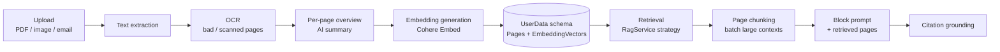

# RAG Architecture

Retrieval-Augmented Generation (RAG) is how a block answers questions grounded in a long document without sending the whole thing to the model. Instead of feeding an entire 200-page filing to every prompt, the platform selects the most relevant pages (or groups of pages) per block and feeds only those into the model's context. The retrieval logic lives in `platform/IniaAi.Core/Rag`; `RagService` selects the pages for a block using the strategy each of the block's RAG settings names.

## End-to-end pipeline

A document travels through several stages before a block can retrieve from it. Each stage has its own page in this site; this section is the map.

| Stage | What happens | Where it is documented |
|-------|--------------|------------------------|
| **Extraction** | Text is pulled from the PDF/Office file page by page; quality analysis flags blank or garbled pages. | [Document processing](../document-processing/index.md) |
| **OCR** | Flagged or scanned pages are rasterized and transcribed in one shot by the OCR model (the Advanced model unless `OcrSettings` names another); pages without a trustworthy transcription are routed as images. | [OCR architecture](../ocr/index.md) |
| **Overview** | Each page gets an AI-generated overview (a short summary) that becomes the text that is embedded, when its workflow has an overview prompt for it. A page without one is not embedded. | [Overview generation](overview-generation.md) |
| **Embedding** | Page overviews are embedded into vectors via the Cohere embeddings connector and stored. | [Embedding generation](embedding-generation.md) |
| **Retrieval** | At block-execution time, `RagService` ranks pages against the block's filter and returns the selected pages. | This page |
| **Chunking** | When a selected context is too large, pages are grouped into batches the model can process. | [Chunking](chunking.md) |
| **Citation** | The model's claims are matched back to the source pages they came from. | [Citations](../citations/index.md) |

## Strategy selection

`RagService` holds a dictionary keyed by `RagTypes` (`platform/IniaAi.Domain/Entities/Workflows/Enums/RagTypes.cs`), each mapping to a strategy in `platform/IniaAi.Core/Rag/Strategies/` (all implement `IRagStrategy`). The strategy is configured per RAG block by the workflow author (see the [Retrieve Data from Documents block](../../guides/blocks/block-reference.md#retrieve-data-from-documents-rag)).

| `RagTypes` value | Strategy class | Granularity | How it selects |
|------------------|----------------|-------------|----------------|
| `WholeDocument` | `WholeDocumentStrategy` | Whole document | Returns every page — no ranking. |
| `TopNPages` | `TopNPagesStrategy` | Pages | Ranks all page vectors against the filter vector(s) by cosine similarity, keeps the top N. |
| `TopNPagesPerFilterWithTwoNeighbors` | `TopNPagesPerFilterWithNeighborsStrategy` | Pages + neighbors | Top N per filter, plus the page immediately before and after each hit (context windows). |
| `TopPage` | `TopPageStrategy` | Single page | Highest-scoring page only. |
| `TopPageWithNFollowingPages` | `TopPageWithNFollowingPagesStrategy` | Page run | Highest-scoring page plus the next N pages in document order. |
| `NPagesStartingFromIndex` | `NPagesStartingFromIndexStrategy` | Page run | A fixed window of N pages from a given start index — positional, no embeddings. |
| `KeywordBased` | `KeywordBasedStrategy` | Pages | The top N pages per filter by vector similarity with their neighbours, plus every page whose text (or overview, when `ShouldSearchOverviews`) holds a keyword, with its neighbours when `ShouldIncludeNeighboringPages`. |
| `ExactPages` | `ExactPagesStrategy` | Pages | Author specifies exact page numbers — positional, no embeddings. |
| `UseTableOfContents` | `UseTableOfContentsStrategy` | Sections | Uses a document's table of contents to select section page ranges. |
| `UseAutoDetectedTableOfContents` | `UseAutoDetectedTableOfContentsStrategy` | Sections | Detects a table of contents automatically, then selects by section. |
| `RagAgent` | `RagAgentRagStrategy` | Iterative | An agent iteratively selects pages with reasoning across multiple rounds. |

> [!TIP]
> **Embeddings vs. positional strategies**
>
> `RagSettings.RanksPagesByEmbeddings` names the strategies that rank pages by vector similarity: `TopNPages`, `TopPage`, the neighbor and following variants, and `KeywordBased` when it carries filter expressions. A keyword search without filter expressions matches text only. `RagAgent` reads the page overviews and reasons over them, with no vectors. `WholeDocument`, `ExactPages`, `NPagesStartingFromIndex` and the two table-of-contents strategies select pages without embeddings, so they also run where the platform has no embeddings model ([Embedding Generation → Without a Cohere key](embedding-generation.md#without-a-cohere-key)).

`RagTypes` marks `TopNPages`, `TopPage`, `TopPageWithNFollowingPages` and `KeywordBased` as used only by old workflows; the strategies stay registered so those workflows keep running.

## How ranking works

Semantic strategies operate on **page-level** vectors. Each page's overview was embedded at processing time and stored as its `EmbeddingVector`. At retrieval time:

1. The block's filter text (the thing being searched for) is embedded into one or more `FilterVectors`.
2. `EmbeddingsUtils.RankVectors` scores every page that has a vector against each filter vector using cosine similarity (`GetSimilarityScore`).
3. Scores are sorted descending, de-duplicated (a page hit by several filters keeps its best score), and the top results are returned as the selected pages.

Because retrieval ranks **page** vectors, the unit of retrieval is a page, not a sub-page passage. What is embedded for each page is its AI overview — see [Overview generation](overview-generation.md) for how the overview is produced and [Embedding generation](embedding-generation.md) for why the overview (not the raw text) is the embedded unit.

## Where retrieved content goes

The selected pages are supplied to the block's model call automatically. `RequestContentSequenceHelper.FillContentSequenceWithInputContext` adds each page as its own tagged content element (`<…-text>` / `<…-image>`) ahead of the block's prompt — a block configured with RAG settings receives its retrieved pages as input context regardless of the prompt's wording. A request carries at most 100 page images (`MAX_IMAGES_PER_REQUEST`); pages that are only an image (OCR-routed) keep theirs first. There is **no `{InputContext}` placeholder substitution**: the token, if present in a prompt, is passed through to the model unchanged. The one thing the token does: an AI Query block whose prompt holds `{{InputContext}}` but that has no RAG settings is skipped with `Block uses {{InputContext}} placeholder but no RAG settings are configured. Add RAG settings to specify how to retrieve document content.` If the combined text is large, the [page chunking](chunking.md) layer groups pages into batches the model can handle, and the block runs once per batch. The model's answers are then matched back to their source pages by the [citation](../citations/index.md) layer.

## Storage

Pages, their overviews, and their `EmbeddingVector`s are persisted in the `UserData` schema alongside the executed workflow and its documents, and queried through the repository/specification layer. The embeddings connector itself (direct Cohere, AWS Bedrock or Azure) is selected by `PlatformSettings` — see [embedding generation](embedding-generation.md).

## Related pages

- [Chunking](chunking.md) — how large retrieved contexts are grouped into batches for the model.
- [Overview generation](overview-generation.md) — how each page's AI summary (the embedded unit) is produced.
- [Embedding generation](embedding-generation.md) — how page overviews become vectors, and what is stored.
- [Document processing](../document-processing/index.md) — the extraction and overview stages that feed RAG.
- [OCR architecture](../ocr/index.md) — how scanned pages get text before they can be embedded.
- [Citations](../citations/index.md) — how retrieved pages are matched back to model claims.
- [Retrieve Data from Documents block](../../guides/blocks/block-reference.md#retrieve-data-from-documents-rag) — the author-facing RAG block and its strategy setting.
