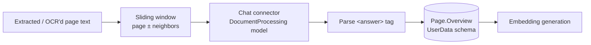

# Overview Generation

**On this page:** Why overviews exist · Where it sits in the pipeline · The sliding window · The prompt and the model · What is stored · Token accounting · Diagnosing a bad overview · Where the prompts lived before · Related pages

Before a page can be [embedded](embedding-generation.md) and [retrieved](index.md), the platform generates a short, AI-written **overview** of it — a one-to-two-sentence summary of what the page is about, plus a few structured fields (title, keywords, note headers). The overview, not the raw page text, is the unit that gets embedded into a vector, so the quality of retrieval depends directly on the quality of these overviews.

Overview generation runs during document processing, after text extraction and [OCR](../ocr/index.md) and before embedding. It is driven by `DocumentAnalysisService` (`platform/IniaAi.Core/Services/DocumentAnalysisService.cs`), which `DocumentProcessingService` invokes once per document.

## Why overviews exist

Embedding raw page text would push every page's full character count through the embeddings model and produce vectors dominated by boilerplate (headers, footers, repeated legal text). Summarizing first keeps each vector focused on what the page is *about* and keeps embedding-token usage bounded regardless of how dense the page is. The same overviews are reused downstream for [topic grouping](index.md) and table-of-contents detection, so they are generated once and stored on the page.

## Where it sits in the pipeline



`DocumentProcessingService.ProcessDocumentsAsync` takes the workflow the documents belong to, and calls `_documentAnalyzer.GenerateOverviewsAsync(document, organizationId, classPrompts, workflowDefault, workflowTypeId, ct)` after page text is available: the overview prompts of the document's class and the workflow's default. A caller with no workflow passes null, and its documents get no overviews. Output documents, and documents whose name ends in `_no_overview`, are skipped — their overviews are not used and skipping them saves tokens.

## The sliding window

`GenerateOverviewsSlidingWindowAsync` summarizes each page **in the context of its neighbors**. For a given page it builds a window of the surrounding pages and sends all of them to the model, but asks for a summary of the target page only. Each window page is wrapped in `<pageN>…</pageN>` tags so the model can tell the target page from its context:

- **Normal documents** use a context window of `1` — the previous page, the target page, and the next page (three pages per call). This lets the summary resolve content that spills across a page boundary (a table continued on the next page, a note that starts at the bottom of one page).
- **Non-monitoring Excel and CSV** documents use a context window of `0` (single-page mode): each row-block page is summarized on its own, with no neighbor context, because adjacent sheets/rows are independent records rather than continuous prose.

Pages are summarized in parallel via `Parallel.ForEachAsync`, capped at `PlatformSettings.IniaAi.LlmMaxDegreeOfParallelism` (default: `Environment.ProcessorCount`). Pages with empty `Text` are skipped — there is nothing to summarize.

## The prompt and the model

The system and user prompts live in the workflow. Each document class can carry its own `PageOverviews`, and the workflow carries a default in `WorkflowConfiguration.PageOverviews`. Both are `PageOverviewPrompts`: a prompt for pages read with their neighbours (`Pages`) and a one-page version for pages read alone (`SinglePage`). Each prompt holds a system prompt, a user prompt, and a `ShouldUseAdvancedModel` flag. Authors edit them on the workflow editor's Document Classes tab ([Page overview prompts](../../guides/page-overview-prompts.md)), and an exported workflow carries them.

`PageOverviewPrompts.Resolve` picks the prompt for a page:

| Page | Prompt, first one with text wins |
|------|----------------------------------|
| Windowed (default) | the class's `Pages`, then the workflow default's `Pages` |
| Single-page (Excel/CSV) | the class's `SinglePage`, then the default's `SinglePage`, then the windowed choice |

A prompt without a user prompt counts as no prompt: the user prompt carries the instruction and the answer format. **When nothing resolves, the page gets no overview**: no model call is made, overviews an earlier prompt left are cleared, and the document's `OverviewPromptHash` becomes `none`. A page without an overview is never embedded, so similarity search and the retrieval agent find nothing in it. A document processed outside a workflow (the Documents pages and their API) has neither a class nor a default, so it gets pages and text but no new overviews; the overviews, embeddings and hash an earlier workflow run wrote stay untouched, so that workflow's next run reuses them.

There is no fallback prompt outside the workflow. The standard prompts in `PageOverviewPromptDefaults` are a starting point the editor offers ("Use the standard prompts"); a workflow uses them only once they are copied into it. A new deployment seeds its test workflows with the standard prompts.


The standard user prompt fixes the output shape:

```text
For the provided page {0} content (which includes the main page and surrounding
pages for context), generate a concise summary in this exact format:

<answer>
Page {0}:
- **Page Title/Header:** [Extract the main title or header of the page, or "None".]
- **Page Description:** [1-2 sentences summarizing the key content.]
- **Financial Statement Notes:** [note headers OR omit section]
- **Parent Company Information:** [Parent Mentioned: Yes/No, Name OR omit section]
- **Relevant Keywords:** [3-5 key terms separated by commas]
</answer>

Be strictly factual based on the provided content.
```

The `{0}` placeholder is the page number.

The response is parsed with `Utils.GetStringFromTag(response, "answer")`, and a leading `Page N:` label is stripped before the result is stored on `Page.Overview`. The model copies the answer format it is shown, so a prompt whose format never closes the tag gets replies that end with a second `<answer>` or with no closing tag at all. Such a reply still gives the page an overview: the text from the first `<answer>` up to the second one, or to the end of the reply, is kept, and one warning per document counts such replies (`{Unclosed} of {Count} page overviews of document {DocumentId} never closed their answer tag; …`).

The editor and a template save both check the answer format. Under a user prompt that has no `<answer>`, the editor reads "The answer format has no &lt;answer&gt; tag. Put the summary between &lt;answer&gt; and &lt;/answer&gt;, or pages get no overview."; under one that opens `<answer>` and never writes `</answer>`, it reads "The answer format opens &lt;answer&gt; but never closes it. End it with &lt;/answer&gt;.". The format may sit in the system prompt instead. A template save through the API returns the same text as a warning, with the path of the prompt (`Configuration.PageOverviews.Pages`, `DocumentClasses[<key>].PageOverviews.SinglePage`). Neither blocks the save.

The model is resolved per tenant and per function, not pinned in this service:

- The **model family** comes from `TenantModelFamilyResolver.GetModelFamilyForFunction(organizationId, FunctionType.DocumentProcessing)`.
- The **tier** (advanced vs. basic) comes from the resolved prompt's `ShouldUseAdvancedModel` flag. `PlatformSettings.IniaAi.SummarizationModelType` (`ModelTier`, default `Basic`) applies only to a direct call of `GenerateOverviewsSlidingWindowAsync` that passes no flag. `GetModelOverride(organizationId, useAdvancedModel)` applies any tenant-specific override on top.

The overview call does not set an explicit output-token cap — it relies on the prompt asking for a concise, structured summary to keep the output short. The bounded token cost comes from the summary being short, not from a hard `maxTokens` limit on the call.

## What is stored

The overview lives directly on the page (`platform/IniaAi.Domain/Entities/Documents/Page.cs`):

```csharp
public string? Overview { get; set; }
```

It is persisted with the page in the `UserData` schema alongside the executed document. The page also records which prompt produced its overviews, on the parent document:

```csharp
public string? OverviewPromptHash { get; set; }
```

`GenerateOverviewsAsync` computes a hash of the current system + user prompt (`ComputeOverviewPromptHash`). If it differs from `Document.OverviewPromptHash`, every page's `Overview` is cleared and its `EmbeddingVector` is detached (the stale vectors are tracked in `OrphanedEmbeddingVectors` and deleted by `DocumentProcessingService`), forcing both overviews and embeddings to regenerate under the new prompt. This is how a prompt change propagates: editing a class's prompt or the workflow default invalidates and rebuilds the affected overviews on the next processing pass, and removing the last prompt clears them.

## Token accounting

`DocumentAnalysisService` is an `ITokenAccumulator`. `DocumentProcessingService` resets the accumulator before overview generation, the service accumulates input/output tokens across the parallel calls, and `RecordOverviewGenerationLlmUsage` attributes the total back to the document under `UsageType.LlmOverviewGeneration`, so overview cost is tracked the same way other model-call cost is.

## Diagnosing a bad overview

The pipeline degrades gracefully rather than failing the document — which means a bad overview surfaces as poor retrieval, not an exception. Where to look:

- **Logs.** `GenerateOverviewsSlidingWindowAsync` logs a per-page line on success (`Parsed overview for page {PageNumber}: '{Content}' Took {Ms} ms`) and a warning when the model's reply has no parseable `<answer>` (`Could not parse valid answer for page {PageNumber}. Raw response: …`). The per-document summary line reports how many pages were empty, already-valid, erroneous, or queued to summarize.
- **An answer format that never closes its tag.** When a prompt ends its format with `<answer>` instead of `</answer>`, about a third of the replies copy it. Before the fallback above, those pages got no overview, so retrieval could not find them and every later processing pass asked for them again. The editor warning above now points at such a prompt; fix the prompt rather than relying on the fallback.


- **Failed calls leave no overview.** When the model call itself errors, the connector returns text prefixed with `IChatConnector.ERROR_PREFIX` (`"ERROR: "`) and no `<answer>` tag, so the parse fails, the warning above is logged, and the page keeps no overview; the next processing pass tries it again. An overview stored with the `ERROR: ` prefix is treated as **erroneous** (`IsOverviewErroneous`), and `PageRequiresOverview` regenerates it before embedding.
- **Empty source text.** A page whose `Text` is blank is skipped entirely (no overview is attempted). If a page that clearly has content has no overview, suspect extraction/OCR upstream rather than this stage — check the [OCR architecture](../ocr/index.md) and [document processing](../document-processing/index.md) pages.
- **Missing overview at embed time.** A page that reaches embedding without a valid overview is not embedded (the embedded text would be `"An overview for this content is currently unavailable"`, which is deliberately not vectorized), so it never ranks in semantic retrieval. Re-running processing after fixing the upstream cause regenerates it.
- **Stale overviews after a prompt edit.** If you changed an overview prompt but old summaries persist, confirm the document's `OverviewPromptHash` actually changed — the regeneration is gated on that hash differing.
- **No overviews at all.** A hash of `none` means the document's class had no prompt and the workflow no default when it was processed. The Document Classes tab flags a class that blocks search without an overview prompt.

## Where the prompts lived before

Until this release, overview prompts lived in the Prompt Library and were matched by workflow type and document category through four tiers, with a general prompt as the last fallback. A one-time startup migration (`PageOverviewPromptsMigration`) gave every workflow the prompts that lookup resolved for its own organization: the prompt a document without a class got became the workflow default, and a class whose prompt differed kept its own. It checks that every class and a document without a class resolve the same prompt before and after, saves each template through the normal save path in its own transaction (one version, narrative "Page overview prompts moved here from the Prompt Library."), and deletes the library rows, soft-deleted ones included. A template whose check or save fails is rolled back and logged, the overview rows stay, and the next start tries again; a template already moved or already holding overview prompts is left alone.


One difference the check cannot see: the library matched the category stored on the document, so a document whose class had no category used the category it was uploaded with. Such a document now takes the workflow default.

## Related pages

- [Page overview prompts](../../guides/page-overview-prompts.md) — setting the prompts in the workflow editor.
- [RAG architecture](index.md) — the full pipeline map; overviews are the text that gets embedded and ranked.
- [Embedding generation](embedding-generation.md) — how the overview produced here becomes a vector, and what is stored.
- [Document processing](../document-processing/index.md) — the extraction stage that produces the page text fed into overview generation.
- [OCR architecture](../ocr/index.md) — how scanned pages get the text that overview generation summarizes.
- [Chunking](chunking.md) — how retrieved pages are batched for the model after retrieval.
