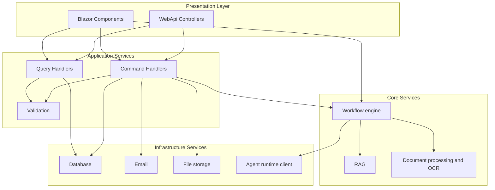

# Services Layer Overview

**On this page:** Service Architecture · Service Categories · Service Registration · Key Patterns · Cross-Cutting Concerns

The services layer holds the platform's business logic, data access and integrations, split by the layers on [Clean Architecture](../clean-architecture/index.md). This page maps it; each category links to the page that owns its detail.

## Service Architecture



The admin app (Blazor) also calls core services directly, in its own process; see [System Context & Containers](../c4-model/container.md).

## Service Categories

### Application services
CQRS through the in-house dispatcher:
- [Command Handlers](application/command-handlers.md) — writes
- [Query Handlers](application/query-handlers.md) — reads, projected to DTOs in explicit C# (there is no mapping library)
- [Validation Services](application/validation-services.md) — the FluentValidation step the dispatcher runs before a handler

### Core services
- [Workflow engine](../workflow-engine/index.md) — `WorkflowHandler` and the block strategies
- [RAG](../rag/index.md) — `RagService` and its retrieval strategies
- [Document processing](../document-processing/index.md) and [OCR](../ocr/index.md) — `DocumentProcessingService`, `OcrTranscriptionService`
- [AI providers & connectors](../ai-integration/providers.md) — the model connectors


### Infrastructure services
- [Database Services](infrastructure/database-services.md) — the two EF Core contexts, retries, repositories, migrations
- [Email Services](infrastructure/email-services.md) — `IOutgoingMail` over SMTP, SendGrid or Amazon SES: password reset, second-factor code and the admin app's account mail
- [File Services](infrastructure/file-services.md) — the storage providers
- [Agent Runtime Integration](infrastructure/agent-runtime-integration.md) — the client of the agent runtime

## Service Registration

Each layer exposes registration extensions (`AddApplication`, `AddInfrastructure`, `AddOutgoingMail`, `AddAgentRuntimeClient`, `AddIniaAiDatabases`), and each host composes them: the API in `ApplicationServicesConfiguration` (`AddTransientServices` / `AddScopedServices` / `AddSingletonServices`), the admin app in `ServicesConfigurator`. Real examples:

```csharp
// Application layer (IniaAi.Application/DependencyInjection.cs)
services.AddRequestDispatching(typeof(DependencyInjection).Assembly);

// Core services — mostly concrete types, not one-interface-per-service
services.AddTransient<RagService>()
    .AddTransient<DocumentProcessingService>()
    .AddKeyedTransient<IWorkflowHandler, WorkflowHandler>(WorkflowType.GENERIC);

// Infrastructure (InfrastructureServiceRegistration.cs) — one mail provider, picked at startup
services.AddOutgoingMail(configuration);
```

There is **no** `IWorkflowService`, `IRAGService`, `IFinancialAnalysisService` or `IEmailService` in the codebase — workflow execution is dispatched through keyed `IWorkflowHandler` registrations, RAG is the concrete `RagService`, and email goes through `IOutgoingMail`. Database contexts are configured through `DatabaseConfiguratorExtensions` (`platform/IniaAi.Infrastructure/Persistence/Setup/DatabaseConfigurator.cs`), which support both PostgreSQL and SQL Server.

The lifetimes, with examples, are on [Service Registration](service-registration.md); the entry points on [Dependency Injection](dependency-injection.md).

## Key Patterns

### Repository Pattern
Data access goes through one generic, specification-based repository per database (`IRepository<T>` via `ICoreRepository<T>` / `IUserDataRepository<T>`) plus a few feature repositories with named queries. A real feature repository:

```csharp
public interface ICoreWorkflowRepository
{
    Task<Workflow?> GetByIdAsync(string id);
    Task<Workflow?> GetByTypeIdAsync(string? workflowTypeId);
    Task<Workflow?> GetByTypeIdAsNoTrackingAsync(string? workflowTypeId);
    Task AddAsync(Workflow workflow);
    void Remove(Workflow workflow);
    IQueryable<Workflow> GetAll(ISpecification<Workflow> specification);
}
```

There is no update method: an update mutates a tracked entity and saves it with `CompleteAsync` ([Database Services](infrastructure/database-services.md#repositories--unit-of-work)).

### Unit of Work Pattern
Each database has a unit of work that hands out the repositories and saves:

```csharp
public interface ICoreUnitOfWork : IDisposable
{
    ICoreWorkflowRepository Workflows { get; }
    ICoreWorkflowTypeRepository WorkflowTypes { get; }
    IToolsSettingsRepository Tools { get; }
    IRepository<T> Repository<T>() where T : class;
    Task<int> CompleteAsync(CancellationToken cancellationToken = default);
    Task RevertAsync<T>(T entity) where T : class;
    Task UntrackAsync<T>(T entity) where T : class;
}
```

### Strategy Pattern
Each block type is a strategy behind one interface (`platform/IniaAi.Core/Workflows/Interfaces/IBlockStrategy.cs`); see [Block Strategy Pattern](../workflow-engine/block-strategy-pattern.md):

```csharp
public interface IBlockStrategy
{
    Task<BlockStrategyOutput> ExecuteBlockAsync(
        Block block,
        BlockExecutionContext context,
        CancellationToken cancellationToken = default);
}
```

## Cross-Cutting Concerns

- **Logging** — Serilog with structured properties; user-supplied values pass through `LogSanitizer`.
- **Validation** — FluentValidation, run by the dispatcher before a handler ([Validation Services](application/validation-services.md)).
- **Caching** — in-process only: `IMemoryCache` and an in-memory `IDistributedCache` (which also backs the 10-minute tenant cache). There is no Redis or other cache server.
- **Security** — authentication, authorization and tenant isolation are on [Multi-Tenant Security Model](../multi-tenant/security-model.md); the audit records on [Multi-Tenant Architecture → Audit records](../multi-tenant/index.md#audit-records).
