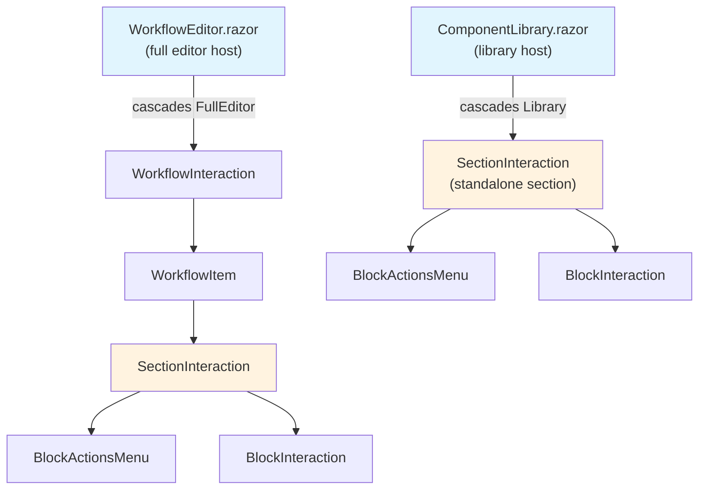

# Editor State Model

**On this page:** The container: `EditorSurfaceState` · The capability model: `EditorSurfaceCapabilities` · The section editing unit · The two hosts · The Library link index · Rendering model

The workflow editor is a Blazor Server surface. Its block-editing components share a single in-memory state object, `EditorSurfaceState`, cascaded once per page. That object owns the block structural mutations, raises granular change events, and carries the host's capability flags. The design lets one section editing unit render inside two different hosts — the full workflow editor and the Component Library — without a second implementation.

For the underlying `Workflow` → `Section` → `Block` domain hierarchy these components edit, see the [Workflow Engine Architecture](index.md). For adding a new block's editor component, see the [Block Implementation Guide](block-implementation-guide.md).

## The container: `EditorSurfaceState`

`EditorSurfaceState` is a plain object (no dependency injection) created by the page host and cascaded with `IsFixed="true"`. Because each host page creates its own instance, the editor page and the Library page never share state.

It exposes:

- **Structural mutations**, each operating on the in-memory domain graph and raising the matching event:
  - `AddBlock(Section, int) → Block` — inserts a new `AiQuery` block seeded with the `Any` document class.
  - `RemoveBlock(Block)` — removes via `Section.RemoveBlockAt`; a block with no section is a no-op.
  - `DuplicateBlock(Block) → Block?` — copies via `Block.DuplicateBlockToSection` (which re-mints the block's stable id and tag).
  - `MoveBlock(Block, Section, int)` — reorders within, or moves across, sections.
  - `ToggleSectionCitations(Section) → bool` — flips `ShouldGetCitationsFromModel` across the section's `AiQuery` blocks (through `ApplySectionCitations`) and returns the new setting.
- **Granular change events** — `SectionChanged(Section)`, `BlockChanged(Block)`, `DocumentClassesChanged()` — each carrying which entity changed, rather than one fat event that re-renders every subscriber. What each host does with them is covered under [Rendering model](#rendering-model).
- **Explicit notifiers** — `NotifySectionChanged`, `NotifyBlockChanged`, `NotifyDocumentClassesChanged` — for leaf components that mutate a block directly (for example toggling "Show in Output") and need to announce it.
- **Navigation requests** — a leaf component asks the host to switch view without knowing the host: `RequestSignaturesTab` (`SignaturesTabRequested`, the **Manage** link on a referenced signature field), `RequestDependencyChain` (`DependencyChainRequested`, a block's **Dependency chain** slide-over), `RequestGraphTab` (`GraphTabRequested`, the slide-over's link to the full graph), and `RequestOpenBlock` (`BlockOpenRequested`, e.g. a block name in the citation trace panel). `WorkflowInteraction` handles the Signatures, graph and open-block requests; `DependencySlideOver` handles the dependency-chain one.
- **Editor-agent marks** — the blocks and sections, by stable id, that the [editor agent](../../features/editor-agent.md)'s accepted changes touched (`MarkChangedByAgent`, kept per proposal until the next save or an undo) and the ones it proposes to change (`SetProposedByAgent`), read through `AgentMarkClass` / `AgentMarkLabel`; and `AgentPreview`, the workflow with the agent's undecided changes applied, which the graph draws.

The container never talks to the database. Save, execution, and copy-to-Core stay host concerns (see [The two hosts](#the-two-hosts)).

## The capability model: `EditorSurfaceCapabilities`

`EditorSurfaceCapabilities` is an immutable record of eight flags that describe what a host allows. The container carries the record; leaf components read it from the cascade and gate their own affordances.

| Flag | Gates |
|------|-------|
| `ShowCounterpartySettings` | The "Save Output for Company" settings in `BlockInteraction` |
| `CanExecute` | Run block, Isolate (show-related), and section/block execution |
| `CanCopyToCore` | Copy-to-another-workflow and copy-as-text affordances |
| `CanMoveAcrossSections` | The Move affordance and any cross-section destination |
| `CanShareToLibrary` | The block-level "Share to Library" menu item in `BlockActionsMenu` |
| `IsSingleBlockHost` | Suppresses add/duplicate/remove and the insert gaps so the host edits exactly one block — the Library's Block-component editor |
| `IsComponentDefinitionHost` | Renders a section's `ComponentRef` slots as `RefEntryCard`s and enables the inline "From Library…" ref-composition affordance — the Library's Section-component editor |
| `CanShowDependencyChain` | The block's **Dependency chain** button in `BlockActionsMenu` |

Two presets exist: `FullEditor` (every flag on except the two Library host flags) and `Library` (every flag off). The Library page derives two edit hosts from the `Library` preset with `with { … }`: a single-block host (`IsSingleBlockHost = true`) for editing or creating a Block component, and a component-definition host (`IsComponentDefinitionHost = true`) for a Section component, where inline blocks and refs compose in place and refs render as cards. `MoveBlock` enforces the move flag directly — it throws when `CanMoveAcrossSections` is false and the destination differs from the block's current section, so a capability is a hard guard, not only a hidden button. `CanShareToLibrary` is load-bearing on the Library host: the same `BlockActionsMenu` mounts there, and without the flag the share item would render on the page whose sections are not persisted templates.

## The section editing unit

The reusable unit is `SectionInteraction` together with `BlockActionsMenu`, `BlockInteraction`, and the per-type block components. These components are free of the editor's `EditorContext` cascade — they operate only on the `Section`/`Block` they are handed plus the cascaded `EditorSurfaceState`. `SectionInteraction`'s remaining host callbacks (execute, move, copy-to-Core, copy-as-text, go-back) are optional; a host that omits them simply presents fewer affordances, and `BlockActionsMenu` hides the corresponding buttons by capability.

## The two hosts

**Full workflow editor** — `WorkflowInteraction` (mounted by `WorkflowEditor.razor`) cascades the `FullEditor` preset, so every affordance renders. It subscribes to the container's three change events (and three of its navigation requests) in `OnInitializedAsync` and unsubscribes in `Dispose`, refreshing the surface when a mutation is announced. Save, execution, copy-to-Core, and the cross-section Move dialog remain host-owned; the container only mutates the in-memory graph and raises events. Editor save and its optimistic-concurrency conflict handling are described in [Workflow Template Versioning](../../features/workflow-template-versioning.md).

The editor host also owns the shared-component affordances: block-level and section-level "Share to Library" (capability- and delegate-gated), and inline **"From Library…"** insert buttons rendered by `InsertControls` at every gap — between blocks inside a section (`SectionInteraction`) and between sections in the workflow list (`WorkflowInteraction`). Each flow is save-first: the host runs its normal versioned save (a no-op when the editor is clean), dispatches the promote, materialize, or reconcile-apply command with the fresh head as `baseVersionId`, and on success **reloads the editor from the just-written version**. The reload is mandatory, not cosmetic — the server stamped, inserted, or rewrote nodes the in-memory graph does not have, the editor tracks no dirty state, and a later save from the stale graph would erase the server-side changes (the optimistic-concurrency check would surface it as a conflict, but reloading avoids ever getting there). The commands themselves are documented in [Shared Components](shared-components.md).

The editor host also carries the cross-deployment transfer gestures. **Export bundle** — a toolbar action and a floating button seated beside the JSON-download one — sends `ExportWorkflowTemplateQuery` for the open type and downloads the result as `{timestamp}_{name}.workflowbundle`, serialized by `TransferBundleFile` with the API's exact wire options (camelCase, enums as strings, case-insensitive read), so a GUI-saved file and a curl-saved API response are interchangeable in both directions. A bundle always carries the last **saved** version: when the editor's live content hash differs from the head's `ContentHash` (newly carried by the history summary DTO for exactly this check), a three-way prompt offers save-first / export-last-saved / cancel, and the gesture disables until a head exists. **Import bundle** — a toolbar action with its own file input (`.workflowbundle,.json`) — shares one router with the plain **Upload from file** input: every uploaded file is classified before parsing (`TransferBundleFile.Classify` — bundle marker keys, workflow marker keys, else unknown), so a bundle dropped on the workflow mouth opens the import dialog instead of silently deserializing into an empty workflow, and a workflow file dropped on the bundle mouth takes the normal upload path — behind a confirm, because that path replaces everything on screen with a different template and is the one destructive editor gesture no dialog used to guard. The import dialog (`ImportBundleDialog`) previews the bundle against the *open* type (cross-type import is legal) and renders the decision model from `BundleImportPlanner` — a pure planner in the `LibraryReconcilePlanner` mold: `New` auto-creates with no control, `InSync` no-ops, `LocalAhead` defaults keep-mine, `BundleAhead` defaults take-theirs, `Diverged` forces an explicit pick, `LocalRetired` locks keep-mine, and a row with `refWarnings` disables take-theirs with the embedded failure code as the reason. The apply command carries decisions only for take-theirs picks, each echoing the preview row's `localHeadVersionId`; apply-time conflicts resolve reactively in place — `DivergedLineage` raises an unrelated-histories confirm and retries acknowledged, `OrphansNeedAcknowledgement` reuses `SignatureOrphanAckDialog`, and a moved head or lost race re-previews and refreshes the dialog's rows. On success the editor reloads from the just-written head (the same mandatory-reload rule as every other shared-component write) and the toast breaks down created / updated / already-in-sync / kept components. The `/editors` list page (`WorkflowDesigners.razor`) carries the same flow behind an **Import workflow bundle** button, editor-roles-gated on an otherwise `[Authorize]`-only page: the target is the bundle's own `originWorkflowTypeId`, an absent target flows into the create-import documented in [Shared Components](shared-components.md) — the fresh-deployment door — and success navigates into the type's editor.

Two canvas gestures are entry-aware. **Remove** on a block inside a Linked section is intercepted (`SectionInteraction`'s `RemoveLinkedEntryCallback`): the host runs the reconcile read on the spot and matches the block's stable id against the section's entry rows — a local insert deletes like any block, while a definition-provided entry gets a confirm dialog (`HideEntryConfirmDialog`) and, on confirm, a save-first single `Hide` decision through the apply, hiding the entry in this workflow only before a quiet reload from the anchor save (the server independently refuses hides of local inserts and broken-out slots, so the client-side classification is a courtesy, not the guard). **Share** on a block inside a Linked section becomes convert-to-ref: the share dialog discloses that the section's definition will be rewritten and every workflow using the section follows along, and the dispatch carries `expectedContainerHeadVersionId` taken from the link index's registry snapshot. That disclosure is earned, not assumed — the host runs the same on-the-spot reconcile read the Remove gesture uses and shows it only when the block is a definition-provided entry, because a locally-added block shares as an ordinary component and propagates to nobody. Section title rows show a dimmed **"n hidden" chip** (counting `Hidden` values in `Section.SharedComponentSlotStates`, rendered by `SectionActionsMenu`) that opens the reconcile drawer — hidden entries have no canvas presence, so the chip is their only ambient trace.

**Component Library** — `ComponentLibrary.razor` at `/library` (and `/library/{ComponentId}`, which opens one component's detail view), gated to the editor roles (`WorkflowEditor`, with `SuperAdmin` admitted everywhere an editor is — `Roles.EDITOR_ROLES`). The page's primary content is the **registry gallery with a per-component detail view**: it dispatches the shared-components queries through the in-house `ISender`, each in a fresh scope through `SendScopedAsync` (the same command surface the HTTP API uses, not a direct repository read), filters by search text, kind, and curated category, and for the selected component loads the consumer list and version history. The detail view hosts the write affordances that operate on the component itself: retire (confirmed against the consumer count, and disabled until the consumer list has actually loaded — a failed load renders its error instead of silently arming the button), unretire, re-categorize, and per-version "Restore this version" through a dialog that previews the fan-out impact. Version history rows expand into server-computed diffs ("what this version changed" and "compare with current") with plain-language narratives. A ref-bearing section definition mounts only its inline blocks in the preview; its refs render as a **"Referenced Library blocks" strip** of `RefEntryCard`s (component name, slot tag, head hash, open-in-Library — an error state when the target no longer exists). The consumer list carries a How column: `Direct`, or a `Via '<section>'` chip that navigates to the section component the copy arrives through — the channel data comes from the in-process consumer scan, which the page reads directly rather than through the flat HTTP consumers DTO. For a section component with live copies, an **Entry by entry** grid follows: the [consumers×entries matrix](shared-components.md) (`GetSharedComponentConsumerMatrixQuery`), one row per live copy and one column per entry. The insert-from-Library picker labels each component with its consumer count, splitting out the via-section subset. The detail view's **Edit** button mounts the component's head definition on the editing surface (`GetSharedComponentContentQuery` → `SharedComponentDefinitionMount.BuildEditSection`, kind-dispatched): a Block component edits as one block under the single-block host; a Section component edits under the component-definition host, where inline blocks and `ComponentRef` slots compose in place — the "From Library…" insert picks an Active Block component and drops a linked placeholder, and each ref card carries swap and remove. **Save changes…** captures the mounted graph back to definition JSON, previews the blast radius through `PreviewSharedComponentReconcileQuery` in an impact-review dialog (consumer count, slot delta, stale baselines, and an orphaned-signature-override acknowledgement — rendered by `SharedComponentImpactPanel`, the same panel the per-version restore dialog hosts, so the two impact reviews cannot drift apart), and on confirm submits `SaveSharedComponentContentCommand` — the same append-and-fan-out the API PUT drives. A **New component** button creates from scratch: a kind/name/category dialog, then the same editing surface, whose first Save dispatches `CreateSharedComponentCommand` (a distinct call — a zero-version component has no head to append onto). Both edit and create carry a dirty flag with a discard confirm on back-out. The scratch composer remains only as a non-persisting preview of the authoring surface. A **Suggestions** toolbar toggle opens the promote-suggestions panel: an on-demand bootstrap scan (`ScanSharedComponentBootstrapQuery`, in-process — no HTTP endpoint) for sections and blocks repeated verbatim across templates but not yet Library-linked, rendered as group cards with per-node checkboxes (default-checked, broken-out copies disclosed with their provenance component). Cards are grouped Sections-then-Blocks and narrowable by kind, workflow type, and workflow-type category — each filter option carrying how many suggestions it covers, and a multi-select summarising selected ids by name so raw `WorkflowTypeId`s never surface. Every node names its location in the words the editor uses — workflow type, then section order and title, then block order and name (`Untitled section` / `Untitled block` when blank) — never the `Sections[i].Blocks[j]` locator, which remains the API addressing key underneath. Each card carries one action — attach every checked node to the matching Active component, or promote the first checked node behind the share dialog and attach the rest via `PromoteSharedComponentCommand.AttachToComponentId`, each dispatch fetching that template's fresh head token; `BootstrapSuggestionPlanner` owns the checked-set split, action labels, filtering, grouping, and location text — the page has no bUnit coverage, so anything that must be unit-tested lives in the planner rather than in razor markup. Per-node failures are disclosed without stopping the sweep, and the panel rescans afterwards.

## The Library link index

`WorkflowEditor.razor` loads the shared-component registry list alongside the template and builds a `LibraryLinkIndex` from it, cascaded to the leaf components under a name. That cascade is deliberately **not** `IsFixed`, unlike its siblings: the index is assigned behind an await, so the editor's first render publishes `null`. Any consumer created during that render and never recreated would hold that `null` for the whole session — which is exactly what happened to `WorkflowMap`, a single long-lived instance, while the per-section components, created later once workflow data exists, quietly received the real index. `RefreshVersionInfoAsync` splits into two independent loads on their own DI scopes — `RefreshLinkIndexAsync` and `RefreshSaveStateAsync` — run concurrently, and the index announces itself with its own `StateHasChanged` the moment it lands rather than queueing behind the version-history and last-touched reads it has nothing to do with. When the registry read genuinely fails the index is `null` and the ambient affordances disappear rather than erroring the editor. The index compares **only the stamped link hash against the component head** — never node content — so locally edited copies deliberately classify as up-to-date here; content-level drift (`LocalAhead`, `Diverged`) is the reconcile drawer's job, computed server-side by the reconcile read. A broken-out copy no longer follows its component, so it classifies as `None`, like content that never came from the Library, and carries no badge or accent. Its stored link fields stay as provenance, and Share works on it as on local content; a broken-out block inside an actively linked section stays with Library sync instead. An inner ref-entry block (a Linked copy inside a Linked section) classifies against its **own** component's head, so a section can read up-to-date while an inner ref shows update-available; each node still counts once toward `AttentionCount`. The index also serves registry head tokens (`HeadVersionIdFor`) for gesture dispatches such as convert-to-ref.

`LibraryLinkBadge` renders the per-node indicator (`UpToDate`, `UpdateAvailable`, `Missing`, `Retired`), and the toolbar's "Library sync" button — the reconcile-drawer opener — carries a warning badge with `AttentionCount`, the number of nodes classified `UpdateAvailable`, `Missing`, or `Retired`. Because the count is stamp-based, a copy whose content already equals the new head but whose stamp lags counts as attention-worthy until a fan-out restamps it: truthful, but coarser than the drawer. That window now closes itself faster — every reconcile apply sweeps the workflows it saves anyway and restamps content-clean Linked copies (see the restamp sweep in [Shared Components](shared-components.md)).

`LibraryAccent` turns the same classification into a **card-level accent**, because a small chip inside a dense canvas is easy to miss: a Library-linked block card, section card, and workflow-map row carry a rail and outline in `--editor-library-hue`, and a copy whose component has vanished switches to the error hue. The accent encodes **identity only** — that this node comes from the Library, and whether its component still exists — while update-available and retired stay with the badge, so the two channels cannot contradict each other. It is a third visual channel beside the two the editor already had, and composes with both: the loop body's background wash (`--editor-loop-hue`) and the output source's left rail (`--editor-output-hue`), where a node that is both shared and an output source shows both rails with the Library one outermost. The same hue lifts the otherwise-grey `Library` and `Retired in Library` chips; the warning and error chips keep their palette colours untouched. The workflow map marked shared blocks only through the generic badge strip and shared sections not at all; its block rows now take the same rail, and its section title rows take the rail plus a wash that fades out from it, keyed on `.map-section-title.editor-shared` — a gradient rather than a flat fill, and no icon, because a sidebar row is dense enough that a solid block and a pictogram stop reading as an accent and start reading as a chip.

`LibraryReconcileDrawer` is a thin client over the template-scoped reconcile read/apply pair documented in [Shared Components](shared-components.md): it lists every linked node with its server-computed relation and sanctioned decisions, expands Linked section rows into per-entry rows (state chips for hidden, locally-deleted, definition-removed, and locally-added entries; per-entry action selects that disable when a whole-section decision is armed), fetches the push impact per component before an update-shared decision — including ref-entry pushes and a removed-for-everyone warning when pushing a section that hides entries — and dispatches the chosen decision batch against the saved head, then reloads, like every other shared-component write. Opening the drawer writes nothing: it compares the last saved version, shows an info alert when the editor holds unsaved changes, and Apply refuses until they are saved (`LibraryReconcilePlanner.UNSAVED_CHANGES_REFUSAL`, checked through the editor's one dirty test, `IsEditorDirtyAgainstHead`), so the post-apply reload cannot discard them. The decision policy is not inlined in the component: `LibraryReconcilePlanner` is a pure static class covering preselects, quiet-row filtering, entry-select gating, decision building with the concurrency tokens, and the row badge labels. Two quiet-state details are planner-owned: the "Show up-to-date items (N)" switch counts quiet **entries inside shown rows** as well as fully-quiet rows (`QuietCount`), so a section whose only quiet content is entry-level still gets the reveal switch; and an `InSync` row with local inserts reads "Up to date · N local addition(s)" (`RowBadgeLabel`, fed by the read's `LocalInsertCount`) — surfacing the additions without reclassifying the row. Broken-out copies are local content, so the drawer leaves them out (`LibraryReconcilePlanner.Listed`): a broken-out section or block copy gets no row, a block broken out of a Linked section's slot gets no entry row, and a broken-out block added inside a Linked section lists as a plain local addition, with a local addition's actions. The section's own comparison reads a broken-out slot as its Library content, so leaving the slot out hides no difference. The reconcile read still returns them with their relation; only the drawer drops them. A broken-out copy has stopped following its component, so neither the component's state nor its absence says anything about the copy — and transfer makes that routine, since export carries only actively-linked components while the copy keeps its origin-deployment link fields. A row whose content differs from its component's head (`LocalAhead`, `HeadAhead` or `Diverged`, `HasContentDifference`) carries **Show differences**: it loads `GetSharedComponentInstanceDiffQuery` for that row on demand and renders the field-level diff from the Library version to the copy in `WorkflowVersionChangesPanel`, the panel version history uses. The diff leaves out what the comparison leaves out (signature fields and presentation), so a row flagged as different shows the fields that made it so. The comparison counts the order of a section's blocks, which a field diff matched by tag does not see, so a reordered section copy shows a **Block order** change with both orders, diffed by whole line (`TextDiffHighlighter.HighlightMergedLines`) so a moved block reads as removed from its old place and added at its new one, not as a rename. Closing and reopening the panel retries a failed load. Its preselects are deliberately more conservative than the server's default-first menu ordering — a `Diverged` entry preselects `KeepLocal`, never the menu-leading `UpdateShared`; only a moved head preselects `AdoptHead`, only a vanished component preselects `BreakOut`, and only a local deletion preselects `Hide`. `Relink` has no drawer path: it applies only to broken-out copies, which the drawer does not list, so only the reconcile API reaches it. The same holds for taking the Library version back into a broken-out slot (`AdoptHead` on that entry). After applying, in-process section-reconcile disclosures (renamed slots, preserved local blocks) surface in a post-apply summary the HTTP response does not carry.

## Rendering model

Mutations flow through the container, which raises a granular event; the host subscription reacts and refreshes. The full editor's refresh is currently whole-tree (its `UpdateWorkflowStateAsync` calls the sidebar map refresh and `StateHasChanged`), which is bounded because only one section's blocks render at a time. Targeted per-leaf rendering keyed on the granular events is a future optimization, not the current behavior; do not assume a change to one block re-renders only that block.
