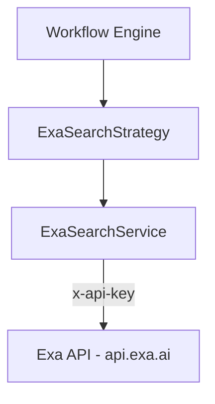

# ExaSearch Block (Intelligent Search)

**On this page:** Architecture · Key Components · Configuration · ExaSearchStrategy · Dependency Injection · Related

The **Intelligent Search** block (`BlockTypes.IntelligentSearch`, enum value `19`) gives workflows AI-powered web search through the [Exa](https://exa.ai) API — search, page text retrieval, AI summaries, highlights, domain filtering, and subpage crawling. It is a live, supported feature.

## Architecture



## Key Components

| Component | File | Responsibility |
|---|---|---|
| Block Strategy | `platform/IniaAi.Core/Workflows/Strategies/ExaSearchStrategy.cs` | Orchestrates search execution within workflows |
| Service Interface | `platform/IniaAi.Core/AugmentedSearch/Exa/Interfaces/IExaSearchService.cs` | Abstraction for search operations |
| Service Implementation | `platform/IniaAi.Core/AugmentedSearch/Exa/ExaSearchService.cs` | HTTP client for the Exa API |
| Block Properties | `platform/IniaAi.Domain/Entities/Workflows/Blocks/Properties/IntelligentSearchProperties.cs` | Strongly-typed configuration |
| Settings | `platform/IniaAi.Configuration/ExaSettings.cs` | API URL, key, timeout, retry config |

## Configuration

```csharp
// IniaAi.Configuration/ExaSettings.cs
public class ExaSettings
{
    public string ExaApiUrl { get; set; } = "https://api.exa.ai";
    public string ApiKey { get; set; } = string.Empty;
    public int TimeoutMinutes { get; set; } = 5;
    public int MaxRetries { get; set; } = 3;
}
```

Integrated into `PlatformSettings.Exa`. The service calls `{ExaApiUrl}/search` with the `x-api-key` header and camelCase JSON serialization. It has no other mode. A deployment that still sets the retired `UseDirectApi` and `ApiUrl` settings starts as before, because configuration binding ignores unknown keys.


```csharp
public interface IExaSearchService
{
    Task<ExaSearchResponse?> SearchAsync(
        ExaSearchRequest request,
        CancellationToken cancellationToken = default);
}
```

The service includes domain validation — URLs and invalid domains in `IncludeDomains`/`ExcludeDomains` are filtered, with hosts extracted from full URLs automatically.

## ExaSearchStrategy

Registered as the handler for `BlockTypes.IntelligentSearch` in `WorkflowHandler`. Configuration is read entirely from the strongly-typed `IntelligentSearchProperties` — the strategy casts `block.Properties` to `IntelligentSearchProperties` and throws `InvalidOperationException` if it is any other type. There is no `TextInputs` dictionary fallback.

### Execution Flow

1. Check that a search term exists (`props.ExecutionState.SearchTerm`). A missing term, or one that resolved to the no-data text, **skips** the block with `No search term available` and calls no API: nothing to search means the upstream block had no data, not a failure.
2. Build `ExaSearchRequest` via `CreateExaSearchRequest` from `props.ExecutionState`, the copy of the settings with every `{tag}` filled: search type, summary prompt and schema, category, published dates, live crawl strategy, include and exclude domains, and subpage keywords. Numbers and switches come from `props` directly
3. Call `IExaSearchService.SearchAsync()`
4. Paginate each result's text by `PlatformSettings.IniaAi.WordCountPerPage` words (default 250) and drop any result with more pages than `MaxPagesPerResult` (default `100`)
5. Format the remaining results into XML-tagged sections (`<searchResults>`, `<searchSummaries>`, `<searchHighlights>`); with no results the response is `No search results found`. When the block is a citation source, each result is recorded as a source of the block's output.
6. When `CreatesDocumentClass` is set, create a plain-text `Document` of that class, with one `Page` per text chunk, each stamped with its result's URL (`Page.SourceUrl`), so later blocks can read the results as documents ([Documents from blocks](../../features/docs-from-blocks.md)).

A failed search call fails the block: the response becomes `ERROR: Error executing search: <message>` and the message is stored on `block.ExecutionState.Error`.

The scheduler runs an Intelligent Search block in a layer of its own (it is a barrier type in `SchedulingViewBuilder.IsBarrier`; see [Barriers](parallel-execution.md#barriers-run-alone-layers)).

### IntelligentSearchProperties

| Property | Type | Default | Description |
|---|---|---|---|
| `SearchTermTemplate` | `string?` | — | Search-term template; placeholders are resolved at execution time into `ExecutionState.SearchTerm` (the value actually queried) |
| `SearchType` | `string` | `"auto"` | Search mode: auto, fast, keyword, neural |
| `NumResults` | `int` | `10` | Results to return (1-100) |
| `TextEnabled` | `bool?` | — | Retrieve page text content |
| `IncludeHtmlTags` | `bool?` | — | Preserve HTML in text |
| `MaxCharacters` | `int?` | — | Max characters per page |
| `HighlightsEnabled` | `bool?` | — | Extract key highlights |
| `SummaryEnabled` | `bool?` | — | Generate AI summaries |
| `SummaryQuery` | `string?` | — | Custom summary prompt |
| `SummarySchema` | `string?` | — | JSON schema for structured summaries |
| `ExcludeDomains` | `List<string>` | `[]` | Domains to exclude |
| `IncludeDomains` | `List<string>` | `[]` | Domains to include |
| `Category` | `string?` | — | Result category filter |
| `StartPublishedDate` | `string?` | — | Date filter start (ISO 8601) |
| `EndPublishedDate` | `string?` | — | Date filter end (ISO 8601) |
| `LiveCrawlStrategy` | `string?` | — | never, fallback, always, preferred |
| `LiveCrawlTimeout` | `int?` | — | Live crawl timeout (seconds) |
| `Subpages` | `int?` | — | Subpages to crawl (1-10) |
| `SubpageTarget` | `List<string>` | `[]` | Keywords for subpage targeting |
| `MaxPagesPerResult` | `int?` | `100` | Cap on paginated pages a single result may produce; results above the cap are dropped from both text output and the created document |
| `CreatesDocumentClass` | `string?` | — | Document class for retrieved pages |

> [!TIP]
> **Auto-subpages**
>
> When `IncludeDomains` is specified but `Subpages` is not, the strategy automatically sets `Subpages = 3` — assuming domain-filtered searches benefit from deeper crawling.

### Response Format

Results are formatted into XML-tagged sections. Subpages are flattened into the same result list via `GetAllResults()`:

```xml
<searchResults>
URL: https://example.com
TITLE: Example Title
TEXT: Content text here...
</searchResults>

<searchSummaries>
URL: https://example.com
TITLE: Example Title
SUMMARY: AI-generated summary...
</searchSummaries>

<searchHighlights>
URL: https://example.com
TITLE: Example Title
HIGHLIGHTS: Key phrases and relevant excerpts...
</searchHighlights>
```

## Dependency Injection

```csharp
// Registered as transient in both WebApi and WebApp
services.AddTransient<IExaSearchService, ExaSearchService>();
```

The `BlockExecutionContext` exposes `ExaSearchService` for use by the strategy during workflow execution.

## Related

- [Block Reference → Intelligent Search](../../guides/blocks/block-reference.md#intelligent-search-exasearch) — author-facing configuration guide
- [Block Strategy Pattern](block-strategy-pattern.md) — how strategies are registered and dispatched
