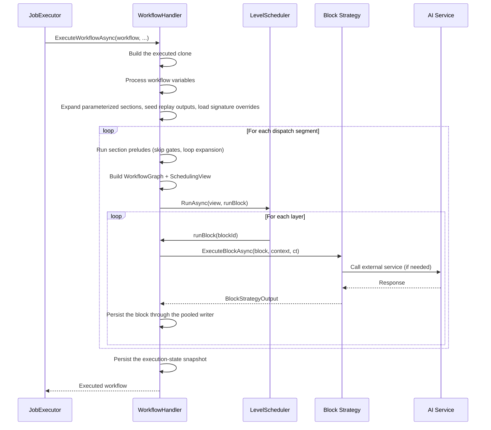

# Execution Context

**On this page:** WorkflowHandler Overview · Execution Flow · Shared Inputs & Context Management · Loop Processing System · Error Handling · Related Documentation

The execution context is the state a workflow run carries from the job that starts it to the last block it runs. This page follows a run through `JobExecutor` and `WorkflowHandler`; how the handler schedules blocks against each other is on [Whole-workflow parallel DAG execution](parallel-execution.md).

## WorkflowHandler Overview

The `WorkflowHandler` class (`platform/IniaAi.Core/Workflows/WorkflowHandler.cs`) runs one workflow execution. The job resolves it as a keyed `IWorkflowHandler` by the workflow's type: a closed module can register its own subclass for its types, and every other type uses the generic handler.


### Core Responsibilities

**Strategy registry**
- The `WorkflowHandler` constructor takes its strategies from `BlockStrategies`: the platform's own `IBlockStrategy` for each built-in `BlockTypes` value, and each strategy a closed module or an extension registers through `BlockStrategyRegistration`. A block of a platform type with no strategy, such as a loop block left unexpanded, fails with `No strategy found for block type: …`. A block of a closed module's type, an extension's type or a type the build does not know fails with `UnavailableBlockTypes.RunMessage`. The catalog is on [Block Strategies](block-strategy-pattern.md).

**State**
- The `SharedInputs` `ConcurrentDictionary<string, string>` holds the run's system values and variable values (see [Shared Inputs](#shared-inputs--context-management)).
- Block responses stay on the executed workflow's blocks, so a later block's `{tag}` resolves against them.

**Scheduling**
- The handler segments the sections, builds a dependency graph per segment and dispatches it through `LevelScheduler` under the per-run cap. See [Whole-workflow parallel DAG execution](parallel-execution.md).

**Output**
- The handler writes the report as it runs: one `WorkflowReport` root, a `ReportSection` per executed section, and a `ReportParagraph` per block output, through `IWorkflowOutputService`.

## Execution Flow

### The job around the handler

`JobExecutor` runs one job per execution, and the handler is its last step. The steps before it decide which documents the run reads:

1. **The execution row.** `InitiateWorkflowOutputAsync` calls `WorkflowHandler.CreateRootOutputAsync`, which loads the execution the orchestrator created or creates one, and the job resolves its id (`ResolveExecutionId`). An email run starts its job with no id and takes the handler's.
2. **Preparing.** The execution shows `ProcessingDocuments`. On a confidential job, `IConfidentialDocumentAnonymiser` repoints each document at an anonymised copy and records the pairing in `Job.AnonymisedFrom`. A build with no anonymiser fails the job with `This build does not anonymise documents, so it cannot run a confidential job.`; the orchestrator refuses such a submission before any execution row exists.
3. **Email intake.** `EmailIntakeJobStage` expands the run's email files into their body and attachments.
4. **The run input.** `LoadRunInputAsync` loads every document linked to the job or to its workflow type and hands them to the run-input stage, `IRunInputStage`, then keeps only the documents still in the run. The platform's own stage, `PassThroughRunInputStage`, keeps every document; a closed module can register its own stage.
5. **Document processing.** `ProcessDocumentsAsync` pages, transcribes, overviews and embeds the run input, and `LoadContextToWorkflowAsync` loads the pages into the workflow. A document the stage dropped reaches neither. `RecordRefusedPagesAsync` then appends a log row for every page the model refused to read.
6. **The handler.** The execution shows `Running`, `ExecuteWorkflowAsync` runs the phases below, and the job concludes the execution as `Draft`.


A failure at any step reaches `HandleJobError` once, which marks the execution `Failed` with the failure kind the exception carries (`IWorkflowExecutionFailure`; [UserData reference](../../reference/database/user-data-database.md#workflowexecutions)). A password-protected document (`DocumentPasswordProtectedException`) also appends an intake error log row naming the document. A cancellation is not a failure: at any step it ends the job as cancelled and marks the execution `Cancelled`.


### Workflow Execution

The entry point is `ExecuteWorkflowAsync(workflow, anonymisationMap, organizationId, jobId, userDataUnitOfWork, userId, inputs, replayOutputs, replayUncoveredBlockPolicy, cancellationToken)`. The `replayOutputs` and `replayUncoveredBlockPolicy` parameters carry a frozen replay: a block whose captured output was supplied is served that output and never calls out live.



### Execution Phases

**1. Initialization**
- Stamps `OrganizationId`/`UserId` and seeds the `SharedInputs` system values `OrganizationId` and `JobId`; `ReportDate` is set in the `WorkflowHandler` constructor.
- Builds the executed-workflow clone via `BuildExecutedWorkflowAsync`.

**2. Variable processing**
- `ProcessWorkflowVariables` writes each variable's default, then the caller's `inputs`, into `SharedInputs` ([Variable System](variable-system.md#sharedinputs-population)).

**3. Expansion**
- `ProcessParameterizedSectionsAsync` expands parameterized sections into their variants before scheduling ([Parameterized Sections](parameterized-sections.md)).
- On a replay run, `InjectReplayOutputs` seeds each captured output onto its matching block.
- `LoadActiveSignatureOverridesAsync` loads the organization's active signature overrides once ([Signature Overrides](../../features/signature-overrides.md)).
- `ClearChangeTracker` detaches the executed graph, so each block persists through its own pooled context.

**4. Dispatch**
- `ExecuteSectionSegmentsAsync` runs the dispatch segments in order: a loop section alone through `ExecuteSectionAsync`, which expands the loop at run time; a run of loop-free sections together through `ExecuteSectionsInParallelAsync`. Each section's prelude runs first: it sets up the section's report section, evaluates the section's skip gate, and expands any loop.

**5. Block execution**
- For each block, the handler resolves the block's placeholder values into `BlockExecutionContext.TextInputs`, evaluates the block's skip rules, calls the strategy, processes the output and annotations, writes a counterparty value back when the block is set to, and persists the block with its report paragraph and log row.

**6. Conclusion**
- `ThrowIfResultsLostAsync` fails the run when a block result could not be saved, and `SaveExecutedWorkflowResultsAsync` persists the final workflow and section execution states. Both are part of the [persistence-failure contract](parallel-execution.md#persistence-failure-contract).

## Shared Inputs & Context Management

### SharedInputs Dictionary

The `SharedInputs` `ConcurrentDictionary<string, string>` on `WorkflowHandler` holds the values every block of the run can read:

| Key | Value | Source |
|-----|-------|--------|
| `ReportDate` | `yyyy-MM-dd` (UTC) | `WorkflowHandler` constructor |
| `OrganizationId` | Organization id | `ExecuteWorkflowAsync` |
| `JobId` | Background job id | `ExecuteWorkflowAsync` |
| `fund_name` | Variable value | `ProcessWorkflowVariables` |

Block outputs are not copied into `SharedInputs`: a `{tag}` that names a block is resolved against that block's `BlockResponse` when a reader runs. The reserved keys are constants in `platform/IniaAi.Common/Constants/SharedInputKeys.cs`; the full list and the resolution order are on [Variable System](variable-system.md#substitution-sources).

### What a block strategy receives

Block strategies do not read `SharedInputs` directly. Before calling a strategy, the handler collects the values the block can see into `BlockExecutionContext.TextInputs` (a `Dictionary<string, string?>`) and the blocks its placeholders point at into `ReferencedBlocks`:

```csharp
// Access resolved inputs in a block strategy
var fundName = context.TextInputs["fund_name"];
var portfolioData = context.TextInputs["Portfolio_Analysis"];
```

`BlockExecutionContext` (`platform/IniaAi.Core/Workflows/BlockExecutionContext.cs`) carries no `SharedInputs` and no `CancellationToken`: the token is the third parameter of `IBlockStrategy.ExecuteBlockAsync(block, context, ct)`. Each block gets a fresh context in its own service scope. The services and run fields the context carries are listed on [Block Strategies](block-strategy-pattern.md).

## Loop Processing System

LoopStart/LoopEnd blocks iterate over a list. The section prelude expands a loop into concrete cloned blocks before its section dispatches; a loop that would start more Agent runs than `PlatformSettings:AgentRuntime:MaxLoopAgentCopies` fails the run with `The loop in section '<title>' would start <n> agent runs, more than the <cap> one loop may start (PlatformSettings:AgentRuntime:MaxLoopAgentCopies). No agent run was started. Shorten the list the loop runs over, or raise the setting.` The loop mechanics are on [Loop Processing](loop-processing.md).

## Error Handling

### When a block or section is skipped

A skipped block is marked `ExecutionStatus.Skipped` with its reason (`BlockExecutionState.MarkAsSkipped`) and persisted with a log row. The skip reasons:

- **`Required documents not provided`** — `Block.RequiredDocumentsNotProvided()`: the block has RAG settings and received no documents, unless one of its classes is an output document class a block of the run creates. A section skips with the same reason when every document-reading block in it has none.
- **`Stop term 'AF11' found in execution input`** — a block's resolved text input, or a section's text input, holds the stop marker `AF11` as a whole token, in any letter case (`StopMarker`, `platform/IniaAi.Domain/Constants`). A letter, digit, `_` or `-` beside it makes it part of another token, such as an id, and then it does not count.
- **An unexpandable parameterized section** — its config cannot be parsed or has no variants, so its blocks are skipped with the config error.

A frozen replay is not a skip. A freeze-eligible block with a captured output completes with that output and makes no live call. One without a captured output is recorded as uncovered, and the replay's `ReplayUncoveredBlockPolicy` decides the rest: `SkipAsInconclusive` (the dormant regression path) marks it completed with no response and no live call, and `RunLive` (the freeze submission option) runs it live.

### When a block fails

The per-block runner (`RunResolvedBlockUnitAsync`) wraps each block in a catch-log-continue shell. A real cancellation (the run's token fired) is rethrown; a block-internal `TaskCanceledException` with no token fired (e.g. an HttpClient timeout) is a block failure like any other. Any other exception marks the block failed, logs it, and persists the failed block with its error log through the guarded persist wrapper:

```csharp
catch (OperationCanceledException) when (cancellationToken.IsCancellationRequested)
{
    throw;
}
catch (Exception ex)
{
    block.ExecutionState ??= new BlockExecutionState(block);
    block.ExecutionState.MarkAsFailed(ex.Message);
    // a model refusal is logged as a warning with its category; any other error as an error
    bool abortsExecution = ex is IAbortsWorkflowRun || block.AbortsExecutionOnFailure();
    await PersistBlockResultGuardedAsync(block, null, errorLog, abortsExecution ? CancellationToken.None : cancellationToken);
    if (abortsExecution)
    {
        TripCriticalBlockAbort(block, ex);
    }
}
```

- `BlockExecutionState.MarkAsFailed(error)` sets `Status` to `ExecutionStatus.Failed`, stamps `CompletedAt`, and stores the message in `Error`. A strategy that catches its own failure and records it on the execution state fails the block the same way.
- **Most failures do not end the run.** The run continues, and blocks that read the failed block's tag get the no-data text.
- **A critical block's failure ends it.** An Agent block is critical by default and any block can be marked critical (`BlockProperties.IsCritical`); an exception that implements `IAbortsWorkflowRun` ends the run whatever the block. The run then fails with the failure kind the abort carries: [Critical blocks abort the run](parallel-execution.md#critical-blocks-abort-the-run).
- **A model refusal** (`ModelRefusalException`) fails the block, and its error log row carries the refusal category.
- **A persistence failure** on a block result does not stop the run, but it fails it at the end: [Persistence-failure contract](parallel-execution.md#persistence-failure-contract).
- **Cancellation** (`OperationCanceledException`) propagates out and ends the run as `Cancelled`; a run whose execution another writer already concluded stops without writing anything ([Terminal states absorb](parallel-execution.md#terminal-states-absorb-and-a-fenced-engine-stops)).

There is no engine-level retry of a failed block. Where a block retries, its strategy does it.

## Related Documentation

- [Whole-workflow parallel DAG execution](parallel-execution.md) - Segments, the graph, the scheduler, and how a run fails
- [Loop Processing](loop-processing.md) - Template-and-clone loop expansion system
- [Block Strategies](block-strategy-pattern.md) - Strategy pattern for block execution
- [Variable System](variable-system.md) - Variable configuration and substitution
- [Workflow Executions API](../../reference/api/workflow-executions.md) - Execution API reference
- [Background Jobs](../background-jobs/index.md) - Async execution system
