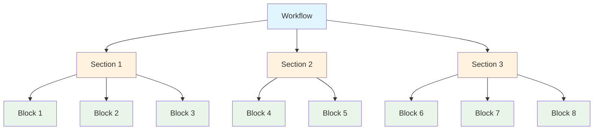
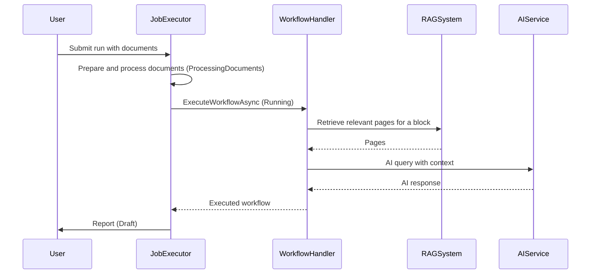

# Workflow Engine Architecture

**On this page:** Core Structure & Hierarchy · Architecture Components · Replacement Tag System · Document Processing Integration · Best Practices · Related Documentation

The workflow engine is the heart of the IniaAi Platform, orchestrating AI-powered document analysis and business process automation through a flexible, block-based execution system.

## Core Structure & Hierarchy

### Workflow Entity Overview

The workflow system is built around three explicit levels: a `Workflow` owns an ordered collection of `Section` entities, and each `Section` owns an ordered collection of `Block` entities. All three derive from `Entity<T>` and implement `ITemplatable`.

**Core Architecture:**
- **Three-Level Structure**: `Workflow` → `Section` → `Block`. A workflow always organizes its blocks through sections; blocks are never attached directly to a workflow.
- **Block-Based Execution**: Sections own ordered blocks; a run schedules them as a cross-section dependency graph (see [Block Execution Flow](#block-execution-flow))
- **Variable System**: Dynamic user-configurable parameters via `WorkflowVariable` entities
- **Execution State**: Runtime state management for workflows, sections, and blocks

### Workflow Hierarchy Rules

**Parent-Child Relationships:**

**Hierarchy Constraints:**
- A `Workflow` owns a collection of `Section` entities (`Workflow.Sections`); it has no direct blocks and does not self-reference.
- Each `Section` belongs to exactly one `Workflow` (via `Section.WorkflowId` / `Section.Workflow`) and owns its `Block` entities (`Section.Blocks`).
- Each `Block` belongs to a `Section` (via `Block.SectionId` / `Block.Section`); `Block.SectionId` is nullable by design, so transient/unparented blocks are valid.
- Sections are ordered within their workflow via `Section.Order`; blocks are ordered within their section via `Block.Order`. `Workflow.GetAllBlocks()` flattens across sections (`Sections.SelectMany(s => s.Blocks)`).
- A separator is a `Section` (with no blocks), not a workflow-level flag — see [Separator Sections](#separator-sections).

### Key Workflow Properties

| Property | Type | Description |
|----------|------|-------------|
| `Name` | string | Display name for the workflow |
| `Title` | string | Alternative title for presentation |
| `Description` | string? | Optional detailed description |
| `Notes` | string? | The author's plain-words intent for the workflow. The [editor agent](../../features/editor-agent.md) reads it with every message; nothing reads it when the workflow runs |
| `WorkflowTypeId` | string? | Cross-instance string identity shared across template and executed copies |
| `Sections` | `ICollection<Section>` | Ordered child sections that own the workflow's blocks |
| `Variables` | `ICollection<WorkflowVariable>` | User-configurable input parameters |
| `DocumentClasses` | `ICollection<DocumentClass>` | Document classes available to the workflow |
| `SignatureFields` | `ICollection<WorkflowSignatureField>` | Workflow-level signature field definitions (see [Signature Overrides](../../features/signature-overrides.md)) |
| `RegressionFields` | `ICollection<WorkflowRegressionField>` | Workflow-level regression field definitions |
| `Configuration` | `WorkflowConfiguration?` | Extended settings including grid layout and custom properties |
| `TextInputTemplate` | string? | Template for text input substitution |
| `ExecutionState` | `WorkflowExecutionState?` | Runtime state (`[NotMapped]`; rides along inside the serialized JSON) |

### Key Section Properties

| Property | Type | Description |
|----------|------|-------------|
| `WorkflowId` | string | FK to the owning workflow (`[ForeignKey(nameof(Workflow))]`) |
| `Workflow` | `Workflow` | Parent workflow navigation (a section's parent is always a `Workflow`, never another `Section`) |
| `Blocks` | `ICollection<Block>` | Ordered blocks owned by the section |
| `Name` / `Title` / `Description` | string / string / string? | Display names and optional description |
| `Order` | int | Position within the workflow's section collection |
| `GroupColor` | `GroupColor?` | Optional display color for the section group |
| `ParameterizedConfig` | string? | Variant configuration of a parameterized section (see [Parameterized Sections](parameterized-sections.md)) |
| `StableSectionId` | string? | Durable cross-instance section key |
| `Properties` | `SectionProperties` | Serialized section properties: `IsSeparator` and `ExcludeFromWordExport` |
| `IsSeparator` | bool | `[NotMapped]` computed shortcut for `Properties.IsSeparator` |

### Block Structure

Blocks are the fundamental execution units within workflows:

**Core Block Properties:**
- `Type`: Enum defining block functionality (AiQuery, WebApiCall, Loop, etc.)
- `SectionId` / `Section`: FK and navigation to the parent section. `SectionId` is nullable (`string?`) by design — unparented blocks are valid.
- `Order`: Execution sequence within the parent section
- `ReplacementTag`: Identifier for referencing block outputs (e.g., "Portfolio_Analysis"), at most 100 characters. Two blocks may share a tag; a save only warns. How a shared tag resolves: [Block Replacement Tags](variable-system.md#block-replacement-tags)
- `StableBlockId`: Durable block key that survives the template-to-execution clone and a cross-instance transfer; signature overrides key on it
- `Name`: Display name for the block in the Editor
- `Properties`: Strongly-typed configuration object per block type (`BlockProperties`)
- `TextInputs`: Block-local placeholder values; the run resolves them before any other source
- `RagSettings`: Configuration for RAG (Retrieval-Augmented Generation) functionality
- `SupportedDocumentClasses`: Which document classes the block receives (empty means any)
- `IsOutputSource`: Whether the block's output is a report output
- `RunsAlone`: Makes the scheduler run the block in a layer of its own
- `SharedComponentId`, `SharedComponentLinkState`, `SharedComponentVersionHash`, `SharedComponentBindings`: The link record of a Library copy (see [Shared Components](shared-components.md))

### Block Execution Flow

A workflow run is not a strict top-to-bottom loop. `WorkflowHandler` splits the ordered sections into dispatch segments (`DispatchSegments.Split`), builds one dependency graph per segment from the blocks' `{tag}` references, and runs independent blocks at the same time under a per-run concurrency cap. A loop section runs in a segment of its own. How the graph, the layers, the barriers and the cap work: [Whole-workflow parallel DAG execution](parallel-execution.md).

- A block can reference the output of any block in any section through its replacement tag; the scheduler runs the producer first.
- The run executes a clone of the template, so a block's template properties do not change; what a run produces is the block's `ExecutionState` (`BlockExecutionState`) and its `BlockResponse`.

### Separator Sections

A separator is a `Section`, not a block and not a workflow-level flag. It is expressed purely through `SectionProperties.IsSeparator`, surfaced by the `[NotMapped]` computed `Section.IsSeparator => Properties.IsSeparator`.

- A separator section holds no blocks. `Section.Add` / `Section.Insert` throw when `IsSeparator` is true, and `Block.MoveToSection` refuses a separator destination.
- A run skips separator sections, and so do `Workflow.IsolateBlockWithDependencies` and the text export.

## Architecture Components

The workflow engine consists of several key architectural components:

### [Execution Context](execution-context.md)
Central orchestrator managing workflow execution lifecycle, state management, and error handling.

**Key Topics:**
- WorkflowHandler overview
- Execution flow and phases
- Shared inputs and context management
- Loop processing system
- Error handling strategies

### [Block Strategies](block-strategy-pattern.md)
Strategy pattern implementation for block execution with type-specific behavior.

**Key Topics:**
- Strategy pattern architecture
- Block execution strategies by type
- Strategy registry
- Implementing new block types

### [Shared Components](shared-components.md)
The Library registry and link model: definition version chains, the per-instance link record on blocks and sections, the hash-vs-payload canonicalization split, and the reconcile loop with atomic fan-out.

**Key Topics:**
- `SharedComponents` registry, append-only `SharedComponentVersions` chain, curated categories
- The four link fields and their copy-verbatim lifecycle
- Content normalization and the bindings comparison contract
- The reconcile loop, atomic fan-out, definition writes, restore, retire/unretire
- Agent-facing API guards and the `SharedComponent.*` error family

### [Object Cloning Patterns](object-cloning-patterns.md)
Convention-based cloning for workflow entities using `CloneHelper.CopyScalars` and `[CloneIgnore]`.

**Key Topics:**
- Three-phase clone method pattern
- When and where to apply `[CloneIgnore]`
- Adding new fields to existing entities (no manual clone update required)
- `ExecutionState` reference-copy semantics

### [Variable System](variable-system.md)
Dynamic configuration system using WorkflowVariable entities and replacement tags.

**Key Topics:**
- WorkflowVariable entity structure
- Replacement tag system
- Variable types and validation
- Options dictionary for dropdowns

## Replacement Tag System

A `{tag}` in a block's prompt or settings is replaced at run time with a reserved system value, a workflow variable's value, or another block's output. Example: `"Analyze the portfolio holdings: {Portfolio_Analysis}"` receives the output of the block tagged `Portfolio_Analysis`. The tag sources, their order, and how duplicate tags resolve: [Variable System](variable-system.md#replacement-tag-system).

## Document Processing Integration

A workflow run is a job, and `JobExecutor` prepares the run's documents before any block executes: the execution shows `ProcessingDocuments` while the job processes and loads the documents, then `Running` while `WorkflowHandler.ExecuteWorkflowAsync` runs the blocks, then `Draft` when the report is ready. A block that reads documents receives the ones its `SupportedDocumentClasses` allow, and a block with RAG settings retrieves the relevant pages before its AI call.

How documents are converted, OCR'd and chunked: [Document Processing](../document-processing/index.md), [OCR](../ocr/index.md), and [RAG](../rag/index.md).

## Best Practices

### Workflow Design

**Structure**:
- Keep sections focused on specific tasks
- Use descriptive names for workflows, sections, and blocks
- Organize related blocks within the same section

**Replacement Tags**:
- Use descriptive names (e.g., `Portfolio_Top10` not `block_1`)
- Give every block that other blocks read a tag of its own: a shared tag resolves to whichever block has a usable response first
- Document which blocks are intended for reference

**Variables**:
- Use clear, descriptive replacement tags
- Provide default values where appropriate
- Mark a variable confidential when a later reader of the run should not see its value

### Performance Considerations

- Keep independent blocks free of unnecessary replacement-tag references so the scheduler can run them in parallel.
- Set `RunsAlone` only on a block whose side effects must not overlap another block: each one adds a layer the run waits on.
- Narrow a block's `SupportedDocumentClasses` so it reads only the documents it needs.

## Related Documentation

- [Block Implementation Guide](block-implementation-guide.md) - How to create new block types
- [Whole-workflow parallel DAG execution](parallel-execution.md) - How a run schedules its blocks
- [Workflow Types](workflow-types.md) - Workflow type classification and template version history
- [Editor State Model](editor-state-model.md) - The editor's shared state container, capability model, and Component Library
- [Workflow Executions API](../../reference/api/workflow-executions.md) - API reference for workflow execution
- [Tracer Agent](../tracer-agent/index.md) - Workflow execution analysis
- [AI Integration](../ai-integration/index.md) - AI provider abstraction and configuration
