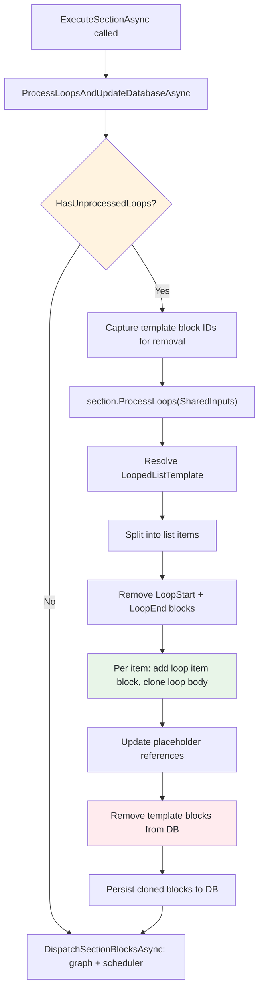

# Loop Processing

**On this page:** Overview · Block Types · How It Works · Execution Flow · Concrete Example · UI Configuration · Validation and Edge Cases · Constraints and Limitations · Key Source Files · Related Documentation

The workflow engine supports iterating over a dynamic list of items using **LoopStart** and **LoopEnd** blocks. Rather than executing blocks in a traditional loop at runtime, the engine uses a **template-and-clone** approach: it expands loop blocks into concrete cloned blocks before execution begins.

## Table of Contents


---

## Overview

A loop is defined by placing a `LoopStart` block and a `LoopEnd` block inside a `Section`. All blocks between them form the **loop body**. A `Section` is a first-class entity that owns its `Block`s (`Section.Blocks`), and each block points back to its parent via `Block.SectionId`. Before execution, the engine:

1. Resolves the list of items to iterate over
2. Adds one loop item block per item, followed by a clone of the loop body
3. Rewrites all placeholder references to point to the correct iteration
4. Removes the original LoopStart, LoopEnd, and template blocks
5. Dispatches the resulting flat list of blocks through the parallel scheduler

This means a loop section is fully expanded before any of its blocks runs. There is no runtime iteration or conditional branching. A loop section is a dispatch segment of its own: when its turn comes, the section prelude expands the loop and `DispatchSectionBlocksAsync` builds a dependency graph over the expanded blocks and runs them under the per-run concurrency cap, so independent iterations overlap while placeholder dependencies within an iteration are respected. Because the list is resolved at that moment, it can read the output of any block in an earlier segment. See [Whole-workflow parallel DAG execution](parallel-execution.md).

---

## Block Types

### LoopStart (`BlockTypes.LoopStart = 10`)

Marks the beginning of a loop and carries the loop configuration.

**Properties** (`LoopStartProperties`):

| Property | Type | Description |
|----------|------|-------------|
| `ListTitle` | `string?` | Name used as a prefix for loop variable keys (e.g. `"Funds"`) |
| `LoopedListTemplate` | `string?` | Multi-line template that resolves to the list of items to iterate over |

**Source**: `platform/IniaAi.Domain/Entities/Workflows/Blocks/Properties/LoopStartProperties.cs`

### LoopEnd (`BlockTypes.LoopEnd = 11`)

Marks the end of the loop scope. Has no configuration properties.

---

## How It Works

### Step 1: Resolve the Loop List

The `LoopedListTemplate` is a multi-line string that can contain `{Placeholder}` references to block outputs or shared inputs.

**Resolution process** (`CreateLoopList`):

1. Extract all `{Placeholder}` references from the template
2. Look up each placeholder's value from:
   - Block outputs (via `Workflow.GetBlockOutput` on the root workflow, which flattens across all sections)
   - The `SharedInputs` dictionary (workflow variables and system values), which wins when both supply a tag
3. Replace all placeholders with their resolved values
4. Split the result on line breaks (`\r\n`, `\r` or `\n`) and drop empty lines to produce the list of items; the items are not trimmed

**Example**:

```
Template:       "{PreviousBlock}"
Resolved value: "Fund A\nFund B\nFund C"
Loop list:      ["Fund A", "Fund B", "Fund C"]
```

If the template is empty, contains no items after splitting, or `ListTitle` is null, the loop is not expanded; see [Validation and Edge Cases](#validation-and-edge-cases) for what the run does then.

### Step 2: Add a Loop Item Block per Item

For each list item, `CloneBlocksInLoop` first adds a **loop item block**: a Merge block whose text is the item itself.

- **ReplacementTag** is `{ListTitle}_{index}` (e.g. `Funds_0`), so `{Funds_0}` resolves to `"Fund A"`
- **Name** is the item (e.g. `"Fund A"`)
- **StableBlockId** is `loopitem_{LoopStartStableBlockId}_{index}` (`Block.LOOP_ITEM_STABLE_ID_PREFIX`), which is how the run recognizes it as a loop item

The list items are not written into `SharedInputs`: an iteration reads its item through this block.

### Step 3: Clone Blocks

All blocks between LoopStart and LoopEnd are then cloned once per list item, after that item's loop item block.

For each clone:
- **ReplacementTag** becomes `{ListTitle}_{OriginalTag}_{iterationIndex}` (e.g. `Funds_Analysis_0`)
- **Name** becomes `"{ListItem} - {OriginalName}"` (e.g. `"Fund A - Analysis"`)
- **StableBlockId** gets the suffix `_{ListTitle}_{iterationIndex}`, so a baseline run and a re-run align iteration by iteration
- The clone keeps the template block's documents
- **`{ListTitle}`** references within the clone are rewritten to a single per-iteration placeholder `{ListTitle_iterationIndex}` (e.g. `{Funds_0}`) so each iteration binds to its own loop item block
- **`{ListTitle.Path}`** references are rewritten the same way, to `{ListTitle_iterationIndex.Path}` (e.g. `{Funds_0.reportingStyle}`) — see [Counterparty data per iteration](#counterparty-data-per-iteration)

Blocks are grouped by iteration, not by original block. For a loop body with blocks A and B iterating over 3 items, the expanded block order is:

```
item 0, A for item 0, B for item 0, item 1, A for item 1, B for item 1, item 2, A for item 2, B for item 2
```

This is the authored order the scheduler falls back to at concurrency cap `1`. At the default cap the scheduler runs independent clones concurrently: the three `A` clones (which only depend on their item) can run at once, while each `B` clone waits on the `A` clone of its own iteration.

### Step 4: Update Placeholder References

Three separate updates ensure all `{Placeholder}` references resolve correctly after cloning:

**Within looped blocks** (`UpdateReplacementTags`; the third update, the `{ListTitle}` rewrite, is described in Step 3):
References to other loop body blocks are updated to point to the same iteration.
```
{Analysis} in iteration 0 → {Funds_Analysis_0}
{Analysis} in iteration 1 → {Funds_Analysis_1}
```

**In blocks after the loop** (`UpdateLoopedBlocksReplacementTagsInBlocksAfterLoop`):
References to loop body blocks are expanded to include all iterations, separated by newlines.
```
{Analysis} → {Funds_Analysis_0}
              {Funds_Analysis_1}
              {Funds_Analysis_2}
```

**Agent templates** follow the same three updates. The loop calls `Block.ReplaceAllForExpansion`, which applies the replacements to the classic fields and, through `BlockProperties.TransformAgentTemplateTags`, to an Agent block's double-brace tags in its skills, task prompt and system prompt override: <code>{{Funds}}</code> becomes <code>{{Funds_0}}</code>, and <code>{{Analysis}}</code> after the loop becomes one double-brace tag per iteration. A tag rename outside expansion (`RenameTagReferences`) still leaves agent templates alone.

**In later sections** (`UpdateLoopedBlocksReplacementTagsInSectionsAfterCurrent`):
The same expansion is applied to blocks in sections that come after the loop's own section. Sections are ordered within the workflow by `Section.Order`, and the loop's expanded outputs are made available to every block in subsequent sections, not just the remaining blocks in the current one.

### Counterparty data per iteration

A loop item block's whole output is the list item itself, so a **dotted** reference to the list title
asks for stored data about the counterparty that item names, rather than for a tag inside a response:

```
{Funds}                             → the fund name, as listed
{Funds.reportingStyle}              → that fund's `reportingStyle` bag value, verbatim
{Funds.reportingStyle.currency}     → a field inside it, when the value is JSON
```

At expansion time `{Funds.reportingStyle}` is rewritten to `{Funds_0.reportingStyle}`; at execution
time `WorkflowHandler.PopulatePlaceholderStringFromSection` sees that the referenced block is a loop
item (its `StableBlockId` carries `Block.LOOP_ITEM_STABLE_ID_PREFIX`) and resolves the value through
`IEntityPlaceholderResolver.ResolveCounterpartyByName`, scoped to the executing organization.

Name matching mirrors `CounterpartyLocatorService.GetFundByName`: trimmed and case-insensitive,
`Counterparty.Name` first, then `Counterparty.NameVariants`. The first segment selects a raw value — a
counterparty column (`Name`, `Email`, …) if one matches, otherwise a key in the freeform
`Counterparty.Properties` bag, falling back to the same key on the parent manager. Any remaining path
is then applied to that raw value **exactly as it is to a block response**: a JSON value is walked by
path, XML-tagged text has its leading tag extracted, and anything else is returned verbatim. Because
the resolver only ever returns a column or a bag string, related entities (`Parent`, `Organization`,
child collections) can never be rendered into a prompt. See
[Counterparties](../../reference/database/user-data-database.md#counterparties) for the stored shape.

An unmatched fund name, or a path that resolves to nothing, yields the configured no-data text. A
dotted list-title reference used **outside** a loop body has no iteration to bind to and would reach
the model verbatim, so the editor's tag validation flags it.

### Step 5: Database Synchronization

After the in-memory loop expansion, the `WorkflowHandler` updates the database (`ProcessLoopsAndUpdateDatabaseAsync` → `UpdateWorkflowWithNewLoopBlocksAsync`):

1. Remove the original LoopStart, LoopEnd, and template blocks from the database
2. Insert each new block, with its text inputs and RAG settings, through `IExecutedBlockWriter.InsertLoopBlockAsync`, one entity at a time, so a clone's back-reference to its template never re-inserts the persisted section or workflow
3. Log the number of removed and added blocks

A failure here fails the run: the per-block writer later updates these rows and assumes they exist.

Once the list is resolved and before any block is cloned, `ProcessLoops` hands its item count to `ThrowIfLoopExceedsItemCap`. More than `PlatformSettings:IniaAi:MaxLoopItems` fails the run before any block of the loop runs, with the error "The loop in section '{Title}' runs over {N} items, more than the {Cap} one loop may run over. No block of the loop ran. Shorten the list the loop runs over." The setting is not set by default, and then a loop has no item cap.

Before the sync, `ThrowIfLoopExceedsAgentCopyCap` counts the Agent-family blocks the expansion added. More than `PlatformSettings:AgentRuntime:MaxLoopAgentCopies` fails the run before any agent run starts (the error text is on [Execution Context](execution-context.md#loop-processing-system)).

---

## Execution Flow



---

## Concrete Example

### Before Loop Processing

```
Section "Analysis"
├── Block 0: LoopStart    (ListTitle: "Funds", Template: "Fund A\nFund B\nFund C")
├── Block 1: AI Prompt     (Name: "Analyze", Tag: "Analysis", Prompt: "Analyze {Funds}...")
├── Block 2: AI Prompt     (Name: "Score", Tag: "Score", Prompt: "Score based on {Analysis}...")
├── Block 3: LoopEnd
└── Block 4: AI Prompt     (Name: "Summary", Tag: "Summary", Prompt: "Summarize:\n{Analysis}\n{Score}")
```

### After Loop Processing

```
Section "Analysis"
├── Block: Fund A             (Merge, Tag: "Funds_0", Text: "Fund A")
├── Block: Fund A - Analyze   (Tag: "Funds_Analysis_0", Prompt: "Analyze {Funds_0}...")
├── Block: Fund A - Score     (Tag: "Funds_Score_0",    Prompt: "Score based on {Funds_Analysis_0}...")
├── Block: Fund B             (Merge, Tag: "Funds_1", Text: "Fund B")
├── Block: Fund B - Analyze   (Tag: "Funds_Analysis_1", Prompt: "Analyze {Funds_1}...")
├── Block: Fund B - Score     (Tag: "Funds_Score_1",    Prompt: "Score based on {Funds_Analysis_1}...")
├── Block: Fund C             (Merge, Tag: "Funds_2", Text: "Fund C")
├── Block: Fund C - Analyze   (Tag: "Funds_Analysis_2", Prompt: "Analyze {Funds_2}...")
├── Block: Fund C - Score     (Tag: "Funds_Score_2",    Prompt: "Score based on {Funds_Analysis_2}...")
└── Block: Summary            (Tag: "Summary", Prompt: "Summarize:\n{Funds_Analysis_0}\n{Funds_Analysis_1}\n{Funds_Analysis_2}\n{Funds_Score_0}\n{Funds_Score_1}\n{Funds_Score_2}")
```

The LoopStart and LoopEnd template blocks are removed, the loop body is expanded in place within the same `Section`, and the trailing `Summary` block's references are expanded across every iteration. Each `{Funds_N}` resolves to its loop item block's output when the block runs.

---

## UI Configuration

The LoopStart block is configured in the workflow editor via `LoopStartBlock.razor`:

- **List Title** — text field for the variable name prefix
- **List Values Template** — multi-line monospace text field for the template that defines what items to loop over; supports `{Placeholder}` references to prior block outputs
- **List Title After Execution** and **List Values After Execution** — read-only fields shown when the block carries an execution state (`LoopStartProperties.ExecutionState`), with the resolved values

The LoopEnd block has no configuration UI.

**Source**: `platform/IniaAi.WebApp/Components/WorkflowEditor/Components/Blocks/LoopStartBlock.razor`

---

## Validation and Edge Cases

| Scenario | Behavior |
|----------|----------|
| No LoopStart or LoopEnd | No loop processing; blocks execute normally |
| LoopStart without LoopEnd | `InvalidOperationException` thrown |
| LoopEnd without LoopStart | `InvalidOperationException` thrown |
| Empty `LoopedListTemplate`, a template that resolves to no lines, or a null `ListTitle` | The loop is not expanded. LoopStart and LoopEnd stay in the section and have no strategy, so each fails with `No strategy found for block type: LoopStart` (or `LoopEnd`); the body blocks run once, and `{ListTitle}` resolves to the no-data text. The run continues, because neither block is critical. |
| The list holds more items than `MaxLoopItems` | The run fails before any block of the loop runs |
| Expansion would start more Agent runs than `MaxLoopAgentCopies` | The run fails before any agent run starts |

---

## Constraints and Limitations

- **One loop per section**: `Section.FindLoopStartAndEnd` pairs the first LoopEnd in the section with the last LoopStart before it, and only that pair expands. A second loop in the same section is not supported; its LoopStart and LoopEnd stay and fail like an unexpanded loop.
- **No nested loops**: A loop body cannot contain another LoopStart/LoopEnd pair.
- **Static expansion**: The list is resolved once before execution. Items cannot be added or removed during execution.
- **Block ordering**: Cloned blocks are emitted grouped by iteration (all blocks for item 0, then all blocks for item 1, etc.). This authored order is the scheduler's cap-`1` fallback; at higher concurrency caps the dependency graph — not the emission order — governs what runs when, so independent iterations overlap.

---

## Key Source Files

| File | Purpose |
|------|---------|
| `platform/IniaAi.Domain/Entities/Workflows/Enums/BlockTypes.cs` | `LoopStart` and `LoopEnd` enum values |
| `platform/IniaAi.Domain/Entities/Workflows/Blocks/Properties/LoopStartProperties.cs` | Loop configuration properties |
| `platform/IniaAi.Domain/Entities/Workflows/Section.cs` | Core loop processing algorithm (`ProcessLoops`, `CloneBlocksInLoop`, `UpdateReplacementTags`, `UpdateLoopedBlocksReplacementTagsInSectionsAfterCurrent`, etc.) |
| `platform/IniaAi.Core/Workflows/WorkflowHandler.cs` | Orchestration, database synchronization (`ProcessLoopsAndUpdateDatabaseAsync`), the Agent copy cap (`ThrowIfLoopExceedsAgentCopyCap`), and post-expansion dispatch (`DispatchSectionBlocksAsync`) |
| `platform/IniaAi.Core/Workflows/Scheduling/LevelScheduler.cs` | Runs the expanded loop body's dependency graph under the concurrency cap |
| `platform/IniaAi.WebApp/Components/WorkflowEditor/Components/Blocks/LoopStartBlock.razor` | Editor UI component |
| `platform/IniaAi.Domain.Tests/Data/Workflows/WorkflowTests.cs` | Unit tests for loop processing |

---

## Related Documentation

- [Execution Context](execution-context.md) — overall workflow execution lifecycle
- [Whole-workflow parallel DAG execution](parallel-execution.md) — how a loop section dispatches as its own segment
- [Block Strategy Pattern](block-strategy-pattern.md) — how block execution strategies work
