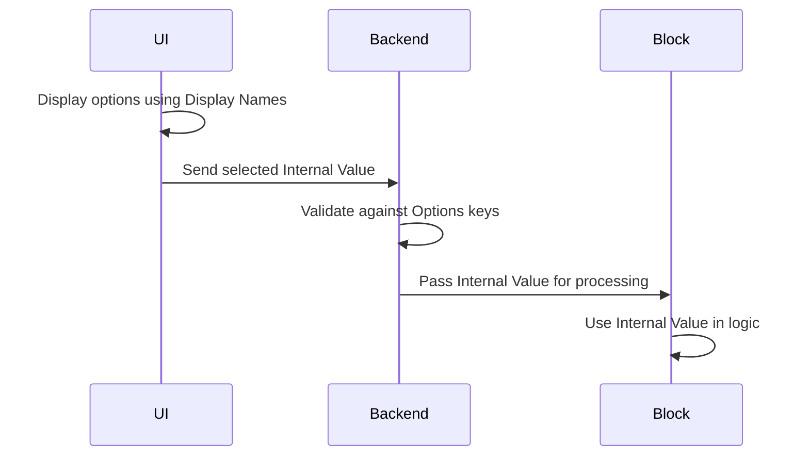
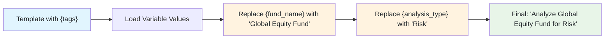
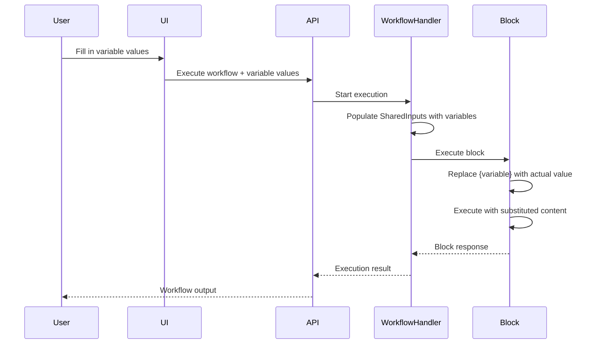
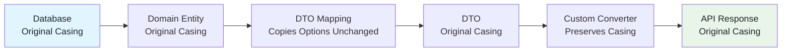

# Variable System

**On this page:** WorkflowVariable Entity · Replacement Tag System · Variable Validation · Variable Usage in Execution · JSON Serialization · Best Practices · Related Documentation

The workflow variable system provides dynamic, user-configurable input parameters that enable workflows to be reusable templates with runtime-specified values.

## WorkflowVariable Entity

`WorkflowVariable` is an Entity Framework entity (`platform/IniaAi.Domain/Entities/Workflows/WorkflowVariable.cs`) that defines configurable input parameters for workflows.

### Entity Structure

**Core Properties:**

| Property | Type | Description |
|----------|------|-------------|
| `Id` | string | Unique identifier for the variable (GUID string, defaults to `Guid.NewGuid().ToString()`) |
| `WorkflowId` | string | Owning (root) workflow reference — variables hang off the root `Workflow`, not a `Section` |
| `ReplacementTag` | string | Identifier for template substitution (e.g., "workflowVariable_1"); max length 450 |
| `DisplayName` | string | Human-readable name shown in UI (max length 1000) |
| `Description` | string | Help text for users (non-nullable, defaults to empty string) |
| `Type` | WorkflowVariableTypes | Data type of the variable (defaults to `String`) |
| `IsRequired` | bool | Whether user must provide a value (defaults to `true`) |
| `IsHidden` | bool | Hide from user input UI |
| `IsConfidential` | bool | Masks the value wherever a finished run is shown and withholds it from a re-run (see [Confidential Variables](#confidential-variables)) |
| `DefaultValue` | string? | Optional preset value (nullable; omitted from JSON when null) |
| `Options` | Dictionary<string, string> | Available choices for Dropdown/MultiSelect (non-nullable, defaults to empty dictionary) |

### Variable Types

**Supported Types:**

```csharp
public enum WorkflowVariableTypes
{
    String,      // Text input
    Number,      // Numeric input with validation
    DateTime,    // Date picker; its placeholder gets yyyy-MM-dd
    List,        // Multi-line string input, array of strings
    Dropdown,    // Single selection from predefined options
    MultiSelect  // Multiple selections from predefined options
}
```

### Options Dictionary

For `Dropdown` and `MultiSelect` types, the `Options` property defines available choices.

**Structure:**
```json
{
  "internalValue": "Display Name",
  "comprehensive": "Comprehensive Analysis",
  "basic": "Basic Review",
  "detailed": "Detailed Assessment"
}
```

**Key Concepts:**
- **Keys (Internal Values)**: Used internally for processing and storage
- **Values (Display Names)**: Shown to users in the UI
- **JSON Serialization**: Custom converter preserves key casing (no camelCase conversion)
- **Validation**: At least one option required for Dropdown/MultiSelect types

**Usage Flow:**


## Replacement Tag System

The replacement tag system enables dynamic content substitution throughout workflow execution.

### Variable Replacement Tags

**Format Rules:**
- Variables are defined once on the root `Workflow` (`Workflow.Variables`); there is no per-`Section` variable scope, so the tag is visible to every block in every section.
- Uniqueness is enforced only by the workflow editor: `EditWorkflowVariableDialog` refuses a tag another variable already holds, ignoring case (`A variable with replacement tag '...' already exists`). The template-save API and `WorkflowTemplateStructuralValidator` do not check variable tags, and nothing restricts the characters a tag may hold.
- A new variable gets `workflowVariable_N` (N is the variable count plus one) when it is given no tag or a taken one; descriptive names like `fund_name` read better in prompts.
- Maximum length: 450 characters (`[StringLength(450)]`)

**Usage in Workflow Templates:**

```json
{
  "userPromptTemplate": "Analyze {fund_name} for {analysis_type}",
  "systemPromptTemplate": "You are analyzing {document_type} dated {report_date}"
}
```

**Substitution Process:**


### Block Replacement Tags

**Purpose**: Reference outputs from previously executed blocks

**Format**: Descriptive identifier (not enforced pattern)
- Examples: `"Portfolio_Analysis"`, `"Risk_Metrics"`, `"Top10_Holdings"`

**Important Constraints:**
- Duplicate tags are **always a warning, never an error**. `WorkflowTemplateStructuralValidator.ValidateReplacementTags` calls `warnings.Add(...)` for both cases, and `WorkflowStructuralValidationWarning` carries no severity field — nothing about a duplicate tag blocks a save. Two blocks sharing a tag **within one section** get the stronger message (`ReplacementTag '...' is used by N blocks in the same section`) because the execution engine resolves a tag to "the first block with that tag that produced a response", which makes every reference ambiguous.
- The **same tag across different sections** is a legitimate authoring pattern (duplicated sections, branch variants) and carries the milder warning. The editor discloses it inline instead of preventing it: the Replacement Tag field shows *"Also used by 'X' in 'N. Section' — a reference to this tag resolves to whichever block runs first."*
- **The editor no longer mints a colliding tag.** A newly added block takes `block_N`, where N starts at the block's position and counts up past every tag its section already holds (`Section.MintFreeReplacementTag`), so inserting above an existing `block_0` — or adding after a delete freed that position number — cannot mint a second copy of a tag that is still held. **Duplicating** a block takes `{tag}_copy`, or `{tag}_copy_2`, `_3`… when that is already held, so duplicating the same block twice yields distinct tags. A block **moved into another section** whose tag is already taken there keeps its own name with a numeric suffix (`final_summary` → `final_summary_2`), matching how `SharedComponentEditor` disambiguates a landing slot tag. An explicitly supplied tag is never overridden, so loop expansion, parameterized variants and shared-component slot landing keep their deterministic names.
- **Derived tags are clamped to the column width.** `Core.Blocks.ReplacementTag` is `varchar(100)`, so a composed tag trims its *base* to make room for the marker rather than truncating the marker itself — a 98-character tag duplicates to a 100-character `…_copy`, then `…_co_2`. The editor's tag field caps typed input at the same limit, and a tag longer than the column width supplied straight to the template-save API is a **blocking validation error** naming the section, block and actual length — the one duplicate-tag condition that does block a save.
- **A move never rewrites `{tag}` references.** A collision on arrival means the tag was already duplicated across the workflow, so no reference was unambiguously the moved block's; every existing reference keeps resolving where it did before, and the moved block starts fresh under its new tag.
- At resolution time, when a tag does match more than one candidate block (e.g. cross-section duplicates), the first block with a non-error `BlockResponse` is referenced (`WorkflowHandler` prefers a block whose `RawResponse` is non-empty and does not start with the error prefix, falling back to the first block with any response).
- Tags compare case-sensitively (`ReplacementTags.Comparison` is `Ordinal`).
- Can be used in any subsequent block configuration. Resolution spans every block in the workflow — `Workflow.GetAllBlocks()` flattens across all sections (`Sections.SelectMany(s => s.Blocks)`), so a tag set in one section's block is usable from blocks in later sections.

**Usage Example:**
```json
{
  "block1": {
    "name": "Extract Portfolio",
    "replacementTag": "Portfolio_Data",
    "type": "AiQuery"
  },
  "block2": {
    "name": "Analyze Risk",
    "replacementTag": "Risk_Analysis",
    "type": "AiQuery",
    "userPromptTemplate": "Analyze the following portfolio: {Portfolio_Data}"
  }
}
```

### Substitution Sources

All substitutable values live in a single per-execution `SharedInputs` dictionary on `WorkflowHandler`, populated from several sources:

1. **Reserved system tags** - Seeded by the engine before execution and substituted into the prompt. Defined in `platform/IniaAi.Common/Constants/SharedInputKeys.cs` (`ReservedReplacementTags`): `ReportDate` (set to `DateTime.UtcNow` as `yyyy-MM-dd`), `OrganizationId`, `JobId`, `Counterparty`, `PeerCompanies`, `Organization`, `FundsListFromDb`, `base_info_fund_manager`, `TriggerEmailIdentifier`, and `StoredKey` (a Web API Call header reads an organization's stored key as `{StoredKey.Name}`; see [Stored Keys](../../features/user-management/stored-keys.md)). There is **no** `{CurrentDate}` tag — use `{ReportDate}`. The same list also reserves `InputContext` and `InputContext.Overviews`, but these are **not substituted** — `WorkflowHandler` never seeds them into `SharedInputs`. They exist only to reserve the names and to flag a block as document-consuming; the retrieved pages are injected automatically as separate tagged content (see [Where retrieved content goes](../rag/index.md#where-retrieved-content-goes)). Writing `{InputContext}` in a prompt has no substitution effect.
2. **Workflow Variables** - User-provided values (or each variable's `DefaultValue`), keyed by `ReplacementTag` (`{workflowVariable_1}`, `{fund_name}`). `WorkflowHandler.ProcessWorkflowVariables` binds a `DateTime` variable through `WorkflowVariable.ToPlaceholderText`, which writes the date alone as `yyyy-MM-dd`. A value with a time part, such as `2026-09-25T00:00` from the API or a stored default, reaches `{AsOfDate}` as `2026-09-25`, so an editor test and a real report see the same text. A value that does not parse as a date passes through unchanged.
3. **Block Outputs** - Previous block responses, keyed by block `ReplacementTag` (`{Portfolio_Data}`, `{Risk_Analysis}`).

Reserved tags bypass the "no data" placeholder fallback (`GetDefaultEmptyPlaceholderValue` returns their value verbatim), so a reserved tag is never replaced with the configured `NoDataForPlaceHolderText`.

## Variable Validation

Validation is **error-collecting, not exception-throwing**. Two distinct mechanisms apply at different times:

### Runtime value validation — `WorkflowVariableValidationService`

`platform/IniaAi.Application/Workflows/Services/WorkflowVariableValidationService.cs` validates the **values supplied at execution time** against the variable *definitions*. It does not throw; `ValidateVariables(Workflow workflow, Dictionary<string, JsonElement>? variables)` returns a `List<Error>` (the project's `ErrorOr` validation errors). Incoming keys are matched case-insensitively.

Per-type rules applied to each provided value (a `JsonElement`):

| Type | Validation Rules |
|------|-----------------|
| `String` | Value kind must be a JSON string |
| `Number` | Value kind must be a JSON number |
| `DateTime` | Must be a string that `WorkflowVariable.TryParseDate` reads (`DateTimeOffset.TryParse`, invariant culture); placeholder binding uses the same reading |
| `List` | Must be a JSON array; if the variable is required, the array must be non-empty |
| `Dropdown` | Must be a string; if non-empty, must match a key in `Options` (empty + required → "missing or empty") |
| `MultiSelect` | Must be a JSON array of strings; every item must match a key in `Options` |

Required variables that are absent produce a `WorkflowVariable.Required` error. The execution orchestrator returns these errors as they are, so a refused submission's `errors` map names each failing variable and its rule, for example `"WorkflowVariable.Required": ["Required variable 'Note' (qa_required_note) is missing."]`. Error codes include `WorkflowVariable.Required`, `WorkflowVariable.InvalidType`, `WorkflowVariable.InvalidOption`, `WorkflowVariable.InvalidDateTime`, and `WorkflowVariable.InvalidList`.

The same service converts values into job inputs:

- `ConvertVariablesToStrings` — arrays are joined with `|`, primitives stringified. As a special case, a key named `CompanyURL` (case-insensitive) is reduced to its host (e.g. `https://acme.com/x` → `acme.com`); if it is not a valid URI, the first dotted path segment is used.
- `ConvertVariablesToObjects` — recursively materializes the `JsonElement` into nested dictionaries/lists/primitives.

### Template structural validation — `WorkflowTemplateStructuralValidator`

When a workflow **template** is saved, `platform/IniaAi.Application/Common/Workflows/WorkflowTemplateStructuralValidator.cs` validates the template structure and returns both `Error`s and `WorkflowStructuralValidationWarning`s. Relevant to variables and tags:

- **Duplicate block tags** are warnings, within a section and across sections; only a tag longer than 100 characters is an error (see [Block Replacement Tags](#block-replacement-tags)). Variable tags are not checked.
- **Unresolved-reference detection** (`CollectPlaceholderWarnings`): plain identifier tags referenced in templates that match no known block `ReplacementTag`, workflow variable `ReplacementTag`, or document class are surfaced as warnings. Detection is conservative — only simple identifier tags are checked, since the full tag grammar (nested parameterized tags, loop list titles) cannot be resolved statically.
- Negative or duplicate `Order` values produce warnings (orders are normalized on save).

## Variable Usage in Execution

### Workflow Execution Flow



### SharedInputs Population

`WorkflowHandler.SharedInputs` is a `ConcurrentDictionary<string, string>`. Variables are loaded by `ProcessWorkflowVariables`: each variable's `DefaultValue` is seeded first (only if a value for that tag is not already present and the default is non-null), then user-supplied `inputs` overwrite. Both go through `ToSharedInput`, which formats a `DateTime` variable's value with `WorkflowVariable.ToPlaceholderText` and converts a `|` in the value to a newline, so multi-line defaults can be authored on a single line.

```csharp
private void ProcessWorkflowVariables(Workflow workflow, Dictionary<string, string>? inputs)
{
    foreach (WorkflowVariable variable in workflow.Variables)
    {
        if (SharedInputs.ContainsKey(variable.ReplacementTag)
            || variable.DefaultValue is null)
        {
            continue;
        }

        SharedInputs[variable.ReplacementTag] = ToSharedInput(variable, variable.DefaultValue);
    }

    if (inputs is null)
    {
        return;
    }

    foreach ((string replacementTag, string value) in inputs)
    {
        WorkflowVariable? variable = workflow.Variables.FirstOrDefault(
            v => string.Equals(v.ReplacementTag, replacementTag, ReplacementTags.Comparison));
        SharedInputs[replacementTag] = ToSharedInput(variable, value);
    }
}

private static string ToSharedInput(WorkflowVariable? variable, string value)
{
    return (variable?.ToPlaceholderText(value) ?? value).Replace('|', '\n');
}
```

**Type Conversion:**

Everything in `SharedInputs` is stored as a `string`. Consumers parse on demand:

```csharp
string stringValue = SharedInputs["workflowVariable_1"];

if (int.TryParse(SharedInputs["max_results"], out int maxResults))
{
    // Use maxResults
}

if (DateTime.TryParse(SharedInputs[SharedInputKeys.REPORT_DATE], out DateTime date))
{
    // Use date
}

// List - MultiSelect values arrive joined with '|' (see ConvertVariablesToStrings)
var items = SharedInputs["selected_items"]
    .Split('\n', StringSplitOptions.RemoveEmptyEntries);

// Dropdown/MultiSelect - internal value(s) provided
string analysisType = SharedInputs["analysis_type"]; // e.g., "comprehensive"
```

### Template Substitution

**Simple Substitution:**
```csharp
// Template
string template = "Analyze {fund_name} for {analysis_type}";

// After substitution
string result = "Analyze Global Equity Fund for comprehensive";
```

**Complex Substitution:**
```csharp
// Template with multiple variables
string template = @"
You are analyzing {fund_name} (Legal Entity: {legal_entity_name})
as of {report_date} for {analysis_type} analysis.

Previous Analysis: {Previous_Analysis}
Risk Factors: {Risk_Metrics}
";

// All variables and block outputs are substituted
```

## JSON Serialization

### Database Storage

**Configuration:**

`WorkflowVariable` is **not** a standalone entity in EF — it is an **owned collection** of `Workflow`, configured in `platform/IniaAi.Infrastructure/Persistence/Core/EntityConfigurations/WorkflowConfiguration.cs` via `builder.OwnsMany(w => w.Variables, ...)`. The `Options` dictionary is stored as JSON (`jsonb` on PostgreSQL, `nvarchar(max)` on SQL Server) with `JsonDefaults.OptionsWithOriginalKeys` preserving dictionary key casing, plus a `ValueComparer` for change tracking.

```csharp
builder.OwnsMany(w => w.Variables, variableBuilder =>
{
    variableBuilder.Property(v => v.Options)
        .HasConversion(
            v => v == null
                ? null
                : JsonSerializer.Serialize(v, JsonDefaults.OptionsWithOriginalKeys),
            v => string.IsNullOrEmpty(v)
                ? new Dictionary<string, string>()
                : JsonSerializer.Deserialize<Dictionary<string, string>>(v, JsonDefaults.OptionsWithOriginalKeys)!)
        .HasColumnType(providerName?.Contains("npgsql") == true ? "jsonb" : "nvarchar(max)");
});
```

**Casing Preservation:**
```json
// Stored in database exactly as defined
{
  "comprehensive": "Comprehensive Analysis",
  "MyOption": "My Display Name",
  "customKey": "Custom Display"
}
```

### API Layer

**Custom Converter:**
```csharp
// WorkflowVariableDto.Options uses custom converter
[JsonConverter(typeof(WorkflowVariableOptionsConverter))]
public Dictionary<string, string>? Options { get; set; }
```

**Data Flow:**


## Best Practices

### Variable Design

**Naming:**
- Use descriptive replacement tags (`fund_name` not `var1`)
- Follow consistent naming convention (snake_case or camelCase)
- Keep names concise but meaningful

**Defaults:**
- Provide sensible default values where possible
- Use defaults to guide users to expected input format
- Leave defaults empty for required critical values

**Descriptions:**
- Write clear, helpful descriptions for complex variables
- Explain expected format and constraints
- Provide examples in descriptions

### Type Selection

**Choose Appropriate Types:**
- `String`: Free-form text, names, descriptions
- `Number`: Counts, limits, thresholds
- `DateTime`: Dates, report periods
- `List`: Multiple related values
- `Dropdown`: Predefined choices (single selection)
- `MultiSelect`: Predefined choices (multiple selection)

**Dropdown vs MultiSelect:**
- Use Dropdown for mutually exclusive choices
- Use MultiSelect when multiple values are meaningful
- Keep option counts reasonable (<20 options)

### Options Configuration

**Internal Values:**
- Use stable, code-friendly values as keys
- Avoid spaces and special characters in keys
- Keep keys consistent with system enumerations

**Display Names:**
- Use user-friendly, descriptive display names
- Follow UI conventions for capitalization
- Consider localization needs

**Example:**
```json
{
  "risk_low": "Low Risk",
  "risk_medium": "Medium Risk",
  "risk_high": "High Risk"
}
```

### Confidential Variables

A confidential variable (`IsConfidential`) still reaches the prompts: the run substitutes its value like any other. What the flag changes is who can read the value afterwards:

- **The run page and the execution API mask it.** `WorkflowExecutionVariableResolver` shows a confidential variable's value as a mask, and `GetWorkflowExecutionQueryHandler.StripConfidentialValues` drops its raw value from the response.
- **A re-run does not carry it over.** `ReRunInputsPlanner` withholds every confidential value, so the person re-running enters it again.
- **The editor agent never sees it.** `EditorAgentRunVariables` masks every form of a confidential value in a run the agent is shown.

Use it for a value a later reader of the run should not see, such as a client name or an account number. For a third-party API key, use a [stored key](../../features/user-management/stored-keys.md) instead: a variable's value is part of the run's inputs.

## Related Documentation

- [Execution Context](execution-context.md) - How variables are used during execution
- [Editor Guide](../../guides/workflows/editor-guide.md) - Creating and managing variables in the UI
- [Block Reference](../../guides/blocks/block-reference.md) - Using variables in blocks
