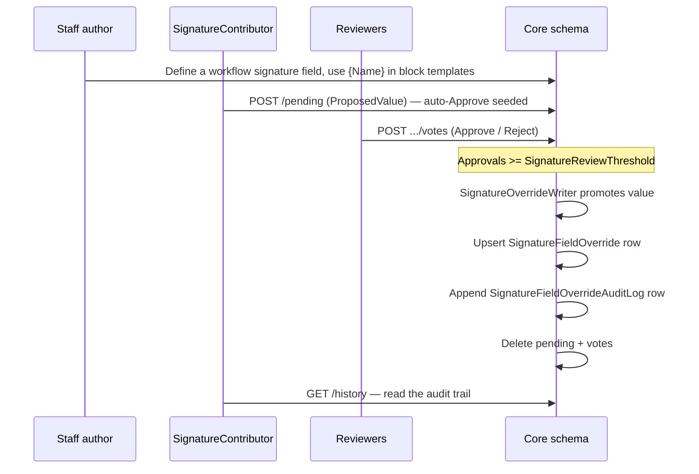

# Signature field overrides

**On this page:** Why a dedicated table · Fields are defined on the workflow · The `SignatureFieldOverride` entity · How values are written: the review queue · The audit log · Renames and deletions on save (not baked into the template) · The `SignatureContributor` role · API endpoints · End-to-end flow · Related documentation

Signature field overrides let an organization tailor the resolved value of a **signature field** without editing the staff-authored workflow template. Staff authors define the fields on the workflow, and AI Query and Merge blocks use a field by writing its `{Name}` token in their prompt templates. Each tenant supplies its own value for a field, that value stays private to the tenant and applies to every block that uses the token, and every value change is recorded in an append-only audit log.

This feature is **shipped and live**. It has two surfaces. Staff define the fields in the Blazor workflow editor's **Signatures** tab. Clients propose, review and test values on the analyst workspace's **Signatures** page (`/signatures` and `/signatures/{workflowTypeId}` in the SPA, for `SuperAdmin` and `SignatureContributor`), described on [Signatures (frontend)](../architecture/frontend/signatures.md).

## Why a dedicated table

A `WorkflowType` template is **shared across an organization set** — one logical `Workflow` row serves every org that has access to the type. Override values, by contrast, are per-organization client data. Baking them into the shared template would both leak one tenant's values to another and contaminate downloaded `.workflow` JSON.

So overrides live in their own Core table, `SignatureFieldOverride`, keyed independently of the template. The marker interface `IHasSignatureFields` (`platform/IniaAi.Domain/Entities/Workflows/Blocks/Properties/Abstractions/IHasSignatureFields.cs`) records the design intent directly:

> Clients can override the resolved value per workflow via the `SignatureFieldOverride` table without touching the workflow JSON.

`IHasSignatureFields` is implemented by `AiQueryProperties` and `MergeProperties`. Consumers branch on the interface, not the block type, so any future block can opt in by implementing it.

## Fields are defined on the workflow

A signature field is a `WorkflowSignatureField` (`platform/IniaAi.Domain/Entities/Workflows/WorkflowSignatureField.cs`) on the workflow: a `Name`, a `DisplayName`, a `Description` and the staff `DefaultValue`. `Name` is unique per workflow, case-insensitive, and at most 200 characters. A block binds to a field only by carrying the `{Name}` token in its templates. Nothing is stored on the block, so one field can serve any number of blocks, and restructuring blocks never orphans a field or its overrides.

The `{Name}` token must be unambiguous, so `WorkflowTemplateStructuralValidator` refuses a field whose name collides with a block `ReplacementTag`, a workflow variable tag, or a reserved input tag or document class key.

The per-block `SignatureFields` dictionary on `AiQueryProperties` and `MergeProperties` is legacy input on a workflow block: `SignatureFieldsLegacyMigrator.Hoist` moves its entries to workflow-level definitions on every load and save, and clears it. It stays the storage format for block-template library rows, which have no workflow. An import hoists it into the target workflow, and an export writes the workflow's definitions back into it.

At run time `WorkflowHandler` loads the organization's active overrides once per execution. For each block, `InjectSignatureFieldValues` writes the override value of every field whose token the block's templates contain, or the staff default when no override exists.

## The `SignatureFieldOverride` entity

Defined in `platform/IniaAi.Domain/Entities/Signatures/SignatureFieldOverride.cs`. It holds the single active client-authored value for one signature field, scoped to one organization.

```csharp
[Index(nameof(OrganizationId), nameof(WorkflowTypeId), nameof(PlaceholderName), IsUnique = true)]
public class SignatureFieldOverride : Entity<SignatureFieldOverride>
{
    [Required]
    [StringLength(450)]
    public string OrganizationId { get; set; } = string.Empty;

    [Required]
    [StringLength(200)]
    public string WorkflowTypeId { get; set; } = string.Empty;

    [Required]
    [StringLength(200)]
    public string PlaceholderName { get; set; } = string.Empty;

    [Required]
    [StringLength(4000)]
    public string Value { get; set; } = string.Empty;
}
```

Key facts that drive the rest of the design:

- **The unique key is `(OrganizationId, WorkflowTypeId, PlaceholderName)`** — at most one active override row per organization, workflow type, and field. `PlaceholderName` is the field's `Name`, the durable identity: one value applies to every block that uses the field's token.
- **Row absence means "use the staff-authored default."** Removing an override is modelled as deleting the row, not writing a sentinel value.
- The table lives in the **`Core` schema** alongside the templates it modifies, not in `UserData`.
- It is deliberately a separate table from the inline block properties so that downloaded `.workflow` JSON carries workflow structure only, never client override values — keeping cross-environment workflow transfer safe from accidental client-data leakage.

## How values are written: the review queue

Override values are not edited directly. Every change flows through a **pending / vote / promote** review queue so that a value change requires sign-off from more than one reviewer.

The moving parts (all under `platform/IniaAi.Domain/Entities/Signatures/`):

| Entity | Role |
| --- | --- |
| `PendingSignatureOverride` | A proposed change awaiting reviewer votes. One pending per `(OrganizationId, WorkflowTypeId, PlaceholderName)` — the same field-name key the active override uses; carries `ProposedValue` (null = "remove the override") and `ProposerUserId`. |
| `SignatureOverrideVote` | One reviewer's vote on a pending. Unique per `(PendingOverrideId, VoterUserId)`; cascades on pending delete. Carries `VoteKind`, optional `Comment`, and an optional `SuggestedValue` on rejection. |
| `SignatureVoteKind` | `Approve` / `Reject`. |

The flow:

1. A contributor submits a `PendingSignatureOverride`. The proposer is automatically seeded as an `Approve` vote so the tenant threshold counts them.
2. Reviewers cast `Approve` / `Reject` votes.
3. When approvals reach the organization's `SignatureReviewThreshold` (`Organization.SignatureReviewThreshold`, default **2**), the `ProposedValue` is promoted onto the live override and the pending row (with its votes) is deleted. When rejections reach the threshold, the pending is deleted with no change to the active value.

### Promotion is the only writer

Promotion runs through `SignatureOverrideWriter.ApplyUpdatesAsync` (`platform/IniaAi.Application/Commands/Signatures/SignatureOverrideWriter.cs`), the canonical writer for override rows. It upserts by `(OrganizationId, WorkflowTypeId, PlaceholderName)`:

- A non-null update value **inserts** a row when none exists, or **updates** the existing value.
- A null update value **deletes** the row (the staff default applies again).
- A no-op (value identical to the stored one) is skipped — no row write, no audit row.

The writer does **not** commit its own unit of work; callers commit so the override write joins the same transaction as the pending/vote deletion. Each non-noop transition also emits one audit-log row in that same transaction.

## The audit log

Because the pending and vote rows are deleted the moment a proposal resolves, the audit log is what preserves "what the value used to be and who signed off." It is defined in `platform/IniaAi.Domain/Entities/Signatures/SignatureFieldOverrideAuditLog.cs`.

```csharp
[Index(nameof(OrganizationId), nameof(WorkflowTypeId), nameof(CreatedAt))]
public class SignatureFieldOverrideAuditLog : Entity<SignatureFieldOverrideAuditLog>
{
    [Required] [StringLength(450)]  public string OrganizationId { get; set; } = string.Empty;
    [Required] [StringLength(200)]  public string WorkflowTypeId { get; set; } = string.Empty;
    [StringLength(450)]             public string? BlockId { get; set; }
    [Required] [StringLength(200)]  public string PlaceholderName { get; set; } = string.Empty;
    [Required] [StringLength(32)]   public string Action { get; set; } = string.Empty;
    [StringLength(4000)]            public string? PreviousValue { get; set; }
    [StringLength(4000)]            public string? NewValue { get; set; }
    [StringLength(450)]             public string? ActorUserId { get; set; }
    [StringLength(256)]             public string? ActorUserEmail { get; set; }
    [StringLength(4000)]            public string? ApproversJson { get; set; }
    [StringLength(4000)]            public string? ReferencedBlockNamesJson { get; set; }
}
```

Properties of note:

- **Append-only.** One row per value transition; rows are never updated. `Entity.CreatedAt` (from the base class) is the canonical event timestamp.
- **`Action`** is a stable string constant, not an enum — `"Created"`, `"Updated"`, or `"Removed"` (`SignatureAuditAction` in the same folder). Kept as text so the column reads cleanly in SQL and persists identically across providers.
- **`PreviousValue` / `NewValue`** capture the before/after. `PreviousValue` is null on a create; `NewValue` is null on a remove.
- **`ActorUserId` / `ActorUserEmail`** record the proposer. The email is snapshotted at write time so attribution survives later user renames or deletions.
- **`ApproversJson`** is a JSON snapshot of the approving voters at promotion time, shape `[{"UserId":"...","Email":"..."}, ...]` (PascalCase keys, pinned by the writer's serializer options so a future global naming-policy flip can't silently break the round-trip).
- **`WorkflowTypeId`** is denormalized onto the row so the workflow-scoped History tab can query by type. The audit log is keyed (`Id`) and indexed for the newest-first, `(OrganizationId, WorkflowTypeId)`-scoped read; the per-field lookup belongs to the live `SignatureFieldOverride`, not the log.
- **Rows are frozen snapshots and are never re-keyed.** Rows written since fields moved to the workflow have a null `BlockId` and carry `ReferencedBlockNamesJson`, a snapshot of the names of the blocks that used the field at that moment. Older rows keep the block id that was current when the event happened: the block's `StableBlockId` after the stable-id re-key, the block row id before it.

Reads go through `SignatureFieldOverrideAuditLogHistorySpec` (and its companion count spec) in `platform/IniaAi.Domain/Specifications/Signatures/`, scoped to one `(OrganizationId, WorkflowTypeId)` with optional placeholder, actor, and date-range filters, newest-first with skip/take paging, `AsNoTracking`.

## Renames and deletions on save (not baked into the template)

Because overrides are keyed by field name, ordinary saves, re-uploads, execution clones and block restructuring never touch them. Only two staff actions can affect client rows, and `SignatureFieldSaveSynchronizer` (`platform/IniaAi.Application/Common/Signatures/SignatureFieldSaveSynchronizer.cs`) handles both inside the save transaction:

- **A rename** moves the override and pending rows of every organization to the new name. The editor sends the renames of its session with the save, and the synchronizer collapses chains (A to B, then B to C, applies as A to C) and drops reverted renames. A rename whose final name is not a field of the saved workflow is discarded, so a stale record from a replaced editor session cannot re-key live rows. A rename is refused while an agent skill or prompt still references the old name (`Signatures.RenameTouchesAgentSkill`), because renames never rewrite agent content.
- **A deletion** removes the field's override and pending rows. It is refused while a block's templates still use the field's token (`Signatures.DeletedFieldStillReferenced`), and refused when it would destroy existing client rows unless the caller confirmed it (`Signatures.DeletionRequiresConfirmation`). Uploads, version restores and API saves reach this path without the editor's confirmation dialog.

Deletions are applied before renames, so a rename can take the name of a field deleted in the same save. The save reports how many overrides it renamed and deleted and how many pendings it deleted, and the editor shows that after the save. The template JSON never carries client values, so overrides are carried through a save, never baked into the shared template.

A proposal or vote on a field that was renamed or deleted after the client loaded it fails with `409` and the error code `Signatures.Stale`.

### Migrations that changed the key

Two data migrations moved existing rows, both on both providers:

- `RekeySignatureOverridesToStableBlockIds` (July 2026) re-keyed override and pending rows from block row ids to stable block ids.
- `AddWorkflowSignatureFields` (July 2026) hoisted the per-block field dictionaries into workflow-level definitions and dropped the `BlockId` column from the override and pending tables. Identical entries merged into one field. An entry whose content differed from an earlier one with the same name became a new field named `name_ReplacementTag`, its block's token was rewritten to match, and its override and pending rows moved with it, so no block's resolved prompt changed. A collision that this naming could not resolve fails the migration, so the data is fixed by hand first. Audit-log rows were left as they were, and their `BlockId` column became nullable.

## The `SignatureContributor` role

Access to every signature surface is gated by the `SignatureContributor` role, defined in `platform/IniaAi.Domain/Entities/UserManagement/Roles.cs`:

```csharp
public const string SIGNATURE_CONTRIBUTOR = "SignatureContributor";
```

> A signature contributor can view the Signatures page, propose overrides for review, and vote on others' proposals.

Every signature endpoint authorizes the union of `SuperAdmin` and `SignatureContributor`:

```csharp
[Authorize(Roles = $"{Roles.SUPER_ADMIN},{Roles.SIGNATURE_CONTRIBUTOR}")]
```

## API endpoints

### `SignaturesController`

Route prefix: `api/v{version:apiVersion}/workflow-types/{workflowTypeId}/signatures`. The whole controller carries the class-level `[Authorize(Roles = "SuperAdmin,SignatureContributor")]` gate. The route is scoped by `workflowTypeId` (not the Core workflow GUID) so the URL survives Save-As-Core id regeneration.

| Method & route | Purpose |
| --- | --- |
| `GET /` | The full signature surface for the workflow type (`WorkflowSignaturesDto`): each workflow-level field once, with its definition, the org's override, any pending awaiting review, and the stable ids of the blocks that use it; plus the sections and blocks that use any field, for navigation. |
| `GET /history` | A page of audit-log entries for the type's override transitions. Optional `placeholderName`, `actorUserId`, `fromUtc`, `toUtc`, `skip`, `take` (default 50) query params; newest-first. Returns `SignatureHistoryPageDto`. |
| `POST /pending` | Submit a new proposed override for voting. The proposer is auto-seeded as an Approve; a null `ProposedValue` means "remove the active override." Replaces any existing pending for the same field and clears its votes. |
| `POST /pending/{pendingOverrideId}/votes` | Cast an Approve / Reject vote. Reaching the tenant threshold either promotes the value or discards the pending. |
| `POST /pending/{pendingOverrideId}/accept-suggestion` | The proposer accepts a replacement value suggested on a rejection vote; votes reset and the review cycle restarts. Proposer-only. |
| `DELETE /pending/{pendingOverrideId}/votes/mine` | A reviewer withdraws their own vote (the proposer's structural auto-approve cannot be withdrawn). |
| `DELETE /pending/{pendingOverrideId}` | The proposer cancels their pending before the threshold is reached; votes cascade. Proposer-only. |

The `fromUtc` / `toUtc` history filters are bound as `DateTimeOffset` on the wire so clients must send a timezone-aware value, avoiding ambiguous comparison against the UTC `CreatedAt` column.

### Test-signature-prompt (replay playground)

Two endpoints on `WorkflowExecutionsController` (`platform/IniaAi.WebApi/Controllers/v1/WorkflowExecutionsController.cs`) back a playground that lets contributors try a candidate signature value against a real past execution **before** proposing it. Both carry their own `[Authorize(Roles = "SuperAdmin,SignatureContributor")]` gate.

| Method & route | Purpose |
| --- | --- |
| `GET /{id}/blocks` | Returns every AI Query block from a persisted execution snapshot with its captured output and the signature-field values used at execution time. Returns `ExecutionBlocksDto`. Prompts are deliberately omitted — they never leave the backend. |
| `POST /{id}/test-signature-prompt` | Replays a single AI Query block from a past execution with one signature value swapped for a user-supplied test value. Calls the AI provider directly with the modified prompt; no new workflow execution, RAG, or downstream blocks run. Returns `SignaturePromptTestResultDto` — the resulting signature values, response text, and metadata. The modified prompts themselves stay server-side. |

The replay command is validated by `TestSignaturePromptCommandValidator`: `BlockId` ≤ 64 chars, `PlaceholderName` ≤ 200, and `TestValue` ≤ 64 KB (matching `AiQueryProperties.MAX_CAPTURED_VALUE_LENGTH` so capture-side and replay-side limits stay in lockstep).

## End-to-end flow



## Related documentation

- [Workflow Template Versioning](workflow-template-versioning.md) — the related shipped change-history feature for the shared template itself.
- The signature override history log (`SignatureFieldOverrideAuditLog`) is the only audit trail the platform actually ships today; a broader platform-wide audit system has been proposed but is not built.
- [Authorization → Roles](user-management/authorization.md#the-role-catalog) — the role catalog, and how roles such as `SignatureContributor` are actually assigned (seeding, not a UI).
