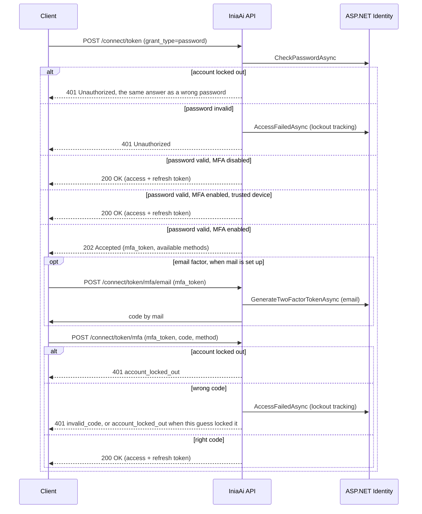

# Multi-factor authentication (MFA)

**On this page:** Overview · How it works · Factors · Brute-force lockout · Audit · How MFA composes with OIDC/SSO · API reference · Configuration · Security considerations · Related documentation

The IniaAi Platform supports optional multi-factor authentication (MFA, also referred to internally as two-factor authentication / 2FA) for users who sign in with a password. After a correct password, the user must present a second factor before the platform issues an access token.

## Overview

MFA is built on ASP.NET Core Identity's token providers and adds a platform-specific two-step token endpoint. The supported factors are:

| Factor | Method value | Backed by |
|--------|--------------|-----------|
| **TOTP authenticator app** | `totp` | Identity `DefaultAuthenticatorProvider` (RFC 6238, 6-digit codes) |
| **Email one-time code** | `email` | Identity `DefaultEmailProvider` |
| **Recovery codes** | `recovery` | Identity two-factor recovery codes (single-use) |
| **Trusted device** | n/a (bypass) | `UserTrustedDevice` records, skips the second factor entirely |

Key characteristics:

- **MFA gates the password grant only.** Login via OIDC SSO or Google does **not** trigger the platform's second-factor step — the external identity provider is expected to enforce its own MFA. See [How MFA composes with OIDC/SSO](#how-mfa-composes-with-oidcsso).
- **Enrollment is TOTP-first.** A user enables MFA by setting up an authenticator app; recovery codes are issued at that moment. Email OTP and recovery codes become available as fallback factors once MFA is enabled.
- **The login flow is two requests.** A successful password check on an MFA-enabled account returns `202 Accepted` with a short-lived `mfa_token` instead of `200 OK` with tokens. The client then completes the second factor against a dedicated endpoint.

> **Email codes need mail.** The `email` method is offered, and its code sent, only when the deployment configures a mail provider (`EmailSettings:Provider` with its `Smtp` or `SendGrid` settings, see [Application configuration](../../operations/application-configuration.md)). Without one, users see the authenticator app and recovery codes only.

## How it works



### The two-step token flow

1. The client posts the **password grant** to `POST /api/v1/connect/token`. The handler validates credentials and lockout through `SignInAttempts.CheckPasswordAsync`, and then asks Identity whether 2FA is enabled (`AuthenticationController.HandlePasswordGrantAsync`).
2. If 2FA is enabled and the request is **not** from a trusted device, the API returns `202 Accepted` with a `TwoFactorRequiredResponse` containing a short-lived `mfa_token`, the user's available methods, a masked email, and the token's expiry in seconds.
3. The client completes verification at `POST /api/v1/connect/token/mfa`, submitting the `mfa_token`, the `code`, and the chosen `method`. On success the API issues the normal access/refresh tokens, preserving the scopes requested in the original login.

### The MFA token

The `mfa_token` is **not** a JWT. It is an encrypted, self-contained payload produced by the ASP.NET Data Protection API (`MfaTokenService.GenerateMfaToken`, protector purpose `IniaAi.MfaToken.v1`). The protected payload carries:

```csharp
public class MfaTokenPayload
{
    public string UserId { get; set; }
    public string Email { get; set; }
    public string? IpAddress { get; set; }
    public DateTime ExpiresAt { get; set; }
    public List<string> Scopes { get; set; }
}
```

- It expires after `MfaTokenValidityMinutes` (default **5 minutes**).
- It records the originating IP. By default an IP change between issue and verification is **logged but allowed**; set `TwoFactor:EnforceIpValidation` to `true` to reject MFA tokens whose IP changed (`MfaTokenService.ValidateMfaToken`).
- It carries the OAuth scopes from the original login so the final token grant matches what the client asked for.
- It is not single-use: the server keeps no record of it, so one `mfa_token` serves every code guess until it expires. The lockout, not the token, bounds the guesses.

## Factors

### TOTP authenticator app

Enrollment generates a new authenticator key and answers with the key (`sharedKey`, formatted for typing) and an `otpauth://` URI for a QR code (`authenticatorUri`, `SetupTotpCommandHandler`). The URI format is:

```
otpauth://totp/Inia%20AI:{email}?secret={key}&issuer=Inia%20AI&digits=6
```

The URI holds the user's email and the key. The Blazor admin app (`EnableAuthenticator.razor.js`) and the Vue app's setup dialog (`src/lib/qrCode.ts`) both draw the QR code in the browser, so the URI never leaves the page.

The issuer label is `IniaAi` and codes are 6 digits. Verification uses Identity's `DefaultAuthenticatorProvider`; submitted codes are stripped of spaces and hyphens before validation.

`POST /auth/2fa/totp/setup` always resets the account's authenticator key (`ResetAuthenticatorKeyAsync`). Called on an account that already has MFA on, it makes the old authenticator app's codes stop working at once, before the new key is confirmed.

### Email one-time code

The `email` method appears in the `202` response only when the deployment configures a mail provider (`IOutgoingMail.IsConfigured`). During an MFA challenge the client can then request a code via `POST /api/v1/connect/token/mfa/email`, passing the `mfa_token`. `SendEmailOtpCommandHandler` generates a code with Identity's `DefaultEmailProvider` and mails it to the user through `IOutgoingMail`. With no mail provider the request is refused with `EmailOtp.Unavailable` and nothing is generated. A per-user cooldown (default **60 seconds**, `TwoFactor:EmailOtp:CooldownSeconds`) backed by an in-memory cache answers repeated requests inside the window with `EmailOtp.RateLimited`. No log line on this path carries the user's address.

The code length and lifetime are Identity's built-in defaults: `DefaultEmailProvider` issues a **6-digit** code that stays valid for a few minutes.

### Recovery codes

Recovery codes are generated when MFA is first enabled (`EnableTotpCommandHandler`) and can be regenerated later. The default count is **10** (`TwoFactorSettings.RecoveryCodeCount`). Each code is single-use — verification redeems it via `RedeemTwoFactorRecoveryCodeAsync`. Identity issues the codes with a dash in the middle and compares them as issued, so the sign-in strips only spaces from a recovery code. The `recovery` method is only offered while the user has at least one unused code remaining.

### Trusted device

After a successful MFA verification, a client may ask the platform to remember the device by sending `trust_device=true` together with a `device_fingerprint`. The platform stores a `UserTrustedDevice` row (`platform/IniaAi.Domain/Entities/UserManagement/UserTrustedDevice.cs`) valid for `TrustedDeviceDays` (default **30 days**).

On subsequent password logins the API reads the `X-Device-Fingerprint` request header; if a non-expired trusted-device record matches the user and fingerprint, the second factor is skipped and tokens are issued directly (`AuthenticationController.IsTrustedDeviceAsync`). Users can list and revoke their own trusted devices through the management API below; there is no admin control for another user's devices.

## Brute-force lockout

One lockout counter covers both steps of a password sign-in, counted by `SignInAttempts` the way ASP.NET Core's `SignInManager` counts them. It uses ASP.NET Identity's built-in lockout (configured in `AuthenticationConfiguration.AddAuthentication`):

| Setting | Config key | Default |
|---------|------------|---------|
| Max failed attempts before lockout | `Authentication:Password:MaxFailedAccessAttempts` | 5 |
| Lockout duration | `Authentication:Password:LockoutDurationMinutes` | 15 minutes |

Lockout is always on for people; no setting turns it off. Every account starts with lockout on, however it is created: the seeder, the CSV import and the admin app's **Create user** all build accounts directly, not through Identity's create path, and Identity locks only an account whose lockout is on. Earlier builds created those accounts with lockout off; every start switches it on for every person's account. Identity also refuses every update to an account whose user name breaks its character rule (letters, digits and `- . _ @ +`), so such an account could not count a failure either: every start gives it its email as user name, and the CSV import and the admin app's **Edit User** dialog refuse such a name. When Identity refuses to save a failure count anyway, the API logs an error naming the account and Identity's error codes.

Behaviours:

- Lockout is checked **before** the password is validated, so a locked account cannot be probed; the password is still hashed and compared for consistent timing.
- Each failed password increments the failed-attempt counter (`AccessFailedAsync`).
- A correct password clears the counter only when the sign-in ends there. While a second factor is pending, the counter stays, so a fresh password sign-in does not reset it before each code guess.
- Each wrong second-factor code, of any method, increments the same counter; so does a `method` the platform does not know, such as `sms`. `POST /connect/token/mfa` refuses a locked-out account with `401 account_locked_out` before it checks the code, and answers the guess that locks the account the same way. A correct code clears the counter.
- To avoid user-enumeration and timing leaks, missing users are compared against a dummy hash, and the password step answers a wrong password and a locked-out account alike (see [Authentication API](../../reference/api/authentication.md#401-unauthorized) for the status).

Beside the per-account lockout, each sign-in endpoint is limited per client address; past the limit it answers `429`. See [Authentication API](../../reference/api/authentication.md) and the `RateLimiting:SignIn` keys in [Application configuration](../../operations/application-configuration.md).

## Audit

Every sign-in outcome (success, refusal, lockout, second factor required; a token issued by a refresh or a service sign-in counts as a success, named by its grant) and every two-factor change (setup, enable, disable, authenticator reset, recovery-code regeneration, trusted-device removal) goes to one seam, `IAuthenticationAuditLog`, from the API and from the admin app alike. The platform's own `LoggingAuthenticationAuditLog` writes one structured log record per event with the kind, the user id, the method and the client address, and never an email, a password or a code. A compliance module replaces it by registering its own implementation; the call sites do not change. A two-factor change that Identity refuses to save leaves no record: the API answers it with a `TwoFactor.EnableFailed`, `TwoFactor.DisableFailed` or `TwoFactor.RecoveryCodesFailed` error, and the admin app's page fails the request.

## How MFA composes with OIDC/SSO

The platform's `/connect/token` endpoint supports several grant types (`password`, `refresh_token`, `client_credentials`, `google`, `oidc`). **Only the `password` grant runs the MFA check.** The `google` and `oidc` handlers validate the external ID token and then issue platform tokens directly, with no second-factor step (`HandleOidcGrantAsync` / `HandleGoogleGrantAsync` in `AuthenticationController.cs`).

The intended model is therefore:

- **Password login** → platform-enforced MFA (this page).
- **OIDC SSO / Google** → MFA is delegated to the corporate identity provider; configure step-up/MFA policies there.

For details of the SSO grant, token validation, and provider configuration, see [OIDC SSO Authentication](sso-oidc.md).

## API reference

All MFA management endpoints live under `api/v1/auth/2fa` and require an authenticated user. The token endpoints under `api/v1/connect` are anonymous (they are part of the login flow).

### Login: the token endpoints

The wire contract of the two-step sign-in — `POST /api/v1/connect/token`, `POST /api/v1/connect/token/mfa` and `POST /api/v1/connect/token/mfa/email`, their parameters and their errors — is on [Authentication → Two-Factor Authentication](../../reference/api/authentication.md#5-two-factor-authentication-mfa).

`POST /connect/token/mfa/email` refuses with:

| Status | `code` | `title` |
|---|---|---|
| `401` | `MfaToken.Invalid` | `Invalid or expired MFA token` |
| `401` | `User.NotFound` | `User not found` |
| `400` | `EmailOtp.Unavailable` | `Codes by email are off on this deployment. Use your authenticator app or a recovery code.` |
| `409` | `EmailOtp.RateLimited` | `Please wait {seconds} seconds before requesting another code` |

### Management endpoints

| Method & path | Purpose |
|---------------|---------|
| `GET /api/v1/auth/2fa/status` | Returns whether MFA is enabled, whether an authenticator is set up, remaining recovery codes, and available methods. |
| `POST /api/v1/auth/2fa/totp/setup` | Resets the authenticator key and returns it (`sharedKey`) with its `otpauth://` URI (`authenticatorUri`, for the QR code). |
| `POST /api/v1/auth/2fa/totp/enable` | Verifies a TOTP code, enables MFA, and returns recovery codes. |
| `POST /api/v1/auth/2fa/totp/disable` | Verifies a TOTP code and disables MFA. |
| `POST /api/v1/auth/2fa/recovery-codes/regenerate` | Issues a fresh set of recovery codes, invalidating the old ones. |
| `GET /api/v1/auth/2fa/trusted-devices` | Lists the user's trusted devices. |
| `DELETE /api/v1/auth/2fa/trusted-devices/{deviceId}` | Removes one trusted device. |
| `DELETE /api/v1/auth/2fa/trusted-devices` | Removes all trusted devices. |

The management endpoints answer these refusals:

| Status | `code` | `title` | From |
|---|---|---|---|
| `400` | `TwoFactor.InvalidCode` | `Invalid verification code` | `totp/enable`, `totp/disable` |
| `400` | `TwoFactor.NotEnabled` | `Two-factor authentication is not enabled` | `recovery-codes/regenerate` |
| `404` | `User.NotFound` | `User not found` | setup, enable, disable, regenerate |
| `404` | `TrustedDevice.NotFound` | `Device not found` | `DELETE trusted-devices/{deviceId}` |
| `500` | `TwoFactor.KeyGenerationFailed` | `Failed to generate authenticator key` | `totp/setup` |
| `500` | `TwoFactor.EnableFailed`, `TwoFactor.DisableFailed`, `TwoFactor.RecoveryCodesFailed` | `Two-factor authentication could not be turned on for this account`, `... could not be turned off ...`, `New recovery codes could not be saved for this account` | enable, disable, regenerate |

`status` returns a `TwoFactorStatusResponse`:

```json
{
  "isEnabled": true,
  "hasAuthenticator": true,
  "recoveryCodesRemaining": 8,
  "availableMethods": ["totp", "email", "recovery"]
}
```

## Configuration

MFA behaviour is controlled by the `TwoFactor` configuration section (`platform/IniaAi.Configuration/Security/TwoFactorSettings.cs`):

```json
{
  "TwoFactor": {
    "MfaTokenValidityMinutes": 5,
    "TrustedDeviceDays": 30,
    "RecoveryCodeCount": 10,
    "EnforceIpValidation": false,
    "EmailOtp": {
      "CooldownSeconds": 60
    }
  }
}
```

| Setting | Default | Effect |
|---------|---------|--------|
| `MfaTokenValidityMinutes` | 5 | Lifetime of the `mfa_token` between password success and factor verification. |
| `TrustedDeviceDays` | 30 | How long a trusted device skips the second factor. |
| `RecoveryCodeCount` | 10 | Number of recovery codes generated on enable/regenerate. |
| `EnforceIpValidation` | false | When true, an `mfa_token` is rejected if the request IP differs from the issuing IP. |
| `EmailOtp.CooldownSeconds` | 60 | Minimum interval between email OTP requests per user (`SendEmailOtpCommandHandler`). The code's length and lifetime are Identity's defaults and have no setting. |

Lockout is configured separately under `Authentication:Password` (see [Brute-force lockout](#brute-force-lockout)).

## Security considerations

- **Encrypted, short-lived challenge token.** The `mfa_token` is protected with the Data Protection API and self-expiring, so it cannot be tampered with or used after expiry; until then it can be sent again. Optionally bind it to the originating IP with `EnforceIpValidation`.
- **Codes are normalized but not logged.** TOTP and email codes are stripped of spaces and hyphens before verification, recovery codes of spaces only; verification codes and email addresses are never written to logs.
- **Recovery codes are single-use.** Surviving codes are tracked, and `recovery` is only offered while codes remain. Regeneration invalidates all previous codes.
- **Trusted devices are revocable.** Users can clear individual or all of their own trusted devices, immediately forcing the second factor again on the next login.
- **MFA only protects password logins.** SSO/Google logins must rely on the identity provider for step-up authentication — there is no platform-side second factor on those grants.

## Related documentation

- [OIDC SSO Authentication](sso-oidc.md) — external identity providers and where MFA responsibility shifts to the IDP
- [User Management](index.md) — user provisioning, organizations, and roles
- [Authorization](authorization.md) — how roles and permissions are evaluated after authentication
