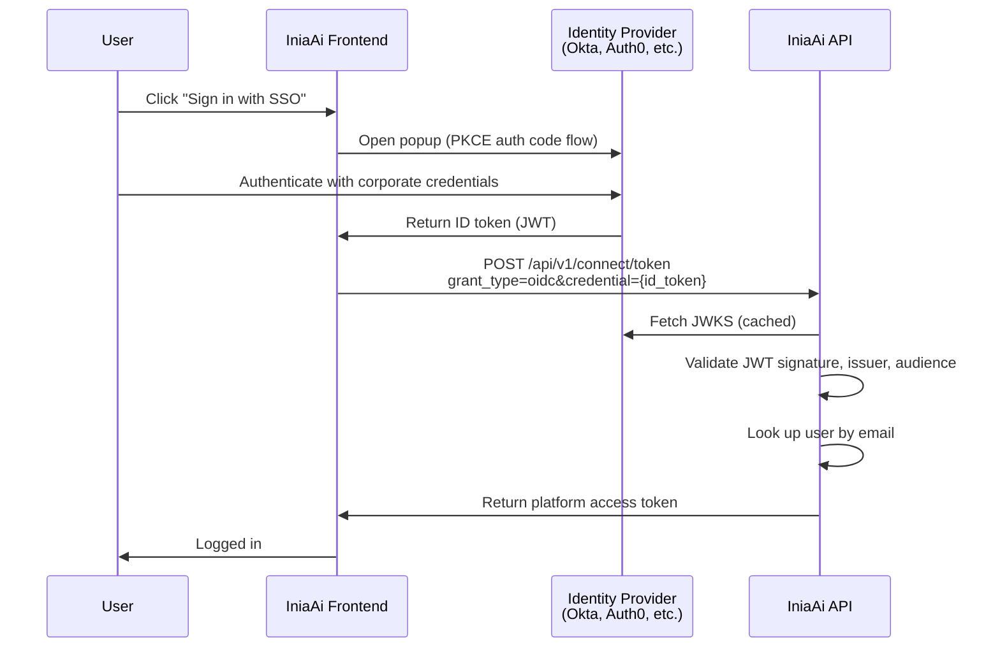

# OIDC SSO Authentication

**On this page:** Overview · How It Works · Authentication Modes · Configuration · Identity Provider Setup · Admin App (Blazor) Login · User Provisioning · API Reference · Security Considerations · Related Documentation

The IniaAi Platform supports Single Sign-On (SSO) via any OIDC-compliant identity provider, including Okta, Auth0, Azure AD, and Keycloak.

## Overview

OIDC SSO allows organizations to authenticate users through their existing corporate identity provider instead of managing separate passwords in the platform. Users click "Sign in with {Provider}" on the login page, authenticate in a popup window, and are redirected back to the platform with a valid session.

## How It Works



### Key Design Decisions

- **Frontend popup flow**: A single bundled OIDC client (`oidc-client-ts`, in `src/lib/oidc.ts`) authenticates via popup against any compliant provider — standard discovery plus authorization code with PKCE. No provider SDKs and no CDN scripts at login time. The popup — opened under a fixed window name — redirects back to the app origin, where the SPA bootstrap recognizes it as the sign-in popup and relays the response to the opener window instead of booting the app.
- **Backend token validation**: The platform validates the ID token (JWT) against the provider's JWKS endpoint. No IDP client secret is needed — PKCE handles the code exchange. The token exchange with the platform names no platform OAuth client, see [Application Configuration → Vue SPA sign-in](../../operations/application-configuration.md#vue-spa-sign-in-browser-login).
- **Email-based user matching**: Users must exist in both the identity provider and the platform with matching email addresses. The platform does not auto-provision users from SSO.
- **Generic OIDC**: The backend validator (`OidcTokenValidator`) uses standard OIDC discovery (`.well-known/openid-configuration`) and works with any compliant provider.

## Authentication Modes

The platform supports three authentication modes, each toggled by its own setting. The application treats them independently: any combination can be enabled at once, and the login page renders a button for every enabled provider (the `GET /api/v1/auth/providers` endpoint reports which are active).

| Mode | Config Key | Use Case |
|------|-----------|----------|
| **Password** | `Authentication:Password:Enabled` | Standalone deployments without corporate IDP |
| **Google OAuth** | `Authentication:Google:Enabled` | Organizations using Google Workspace |
| **OIDC SSO** | `Authentication:Oidc:Enabled` | Organizations with Okta, Auth0, Azure AD, Keycloak, etc. |

Google and OIDC are advertised only when their `Enabled` flag is set **and** their `ClientId` is configured; password is advertised whenever it is enabled (`ExternalAuthController.GetProviders`).


## Configuration


### Application Settings (appsettings.json)

Configure OIDC directly in the app settings:

```json
{
  "Authentication": {
    "Oidc": {
      "Enabled": true,
      "ClientId": "<client-id>",
      "ClientSecret": "",
      "Issuer": "https://your-org.okta.com/oauth2/default",
      "DisplayName": "Company SSO",
      "AllowedDomains": [],
      "TrustUnverifiedEmail": false
    }
  }
}
```

| Setting | Required | Description |
|---------|----------|-------------|
| `Enabled` | Yes | `true` to enable OIDC authentication |
| `ClientId` | Yes | OAuth client ID from your identity provider |
| `ClientSecret` | No | Admin app only: runs its server-side OIDC flow as a confidential client when set, as a public PKCE client when empty |
| `Issuer` | Yes | OIDC issuer URL (must serve `/.well-known/openid-configuration`) |
| `DisplayName` | No | Text shown on the login button (default: `"SSO"`, in the settings class) |
| `AllowedDomains` | No | Restrict login to specific email domains (empty = allow all) |
| `TrustUnverifiedEmail` | No | Trust the email of a provider that sends neither `email_verified` nor `xms_edov` (default `false`); see [Verified email](#verified-email) |

### Issuer URL Formats

| Provider | Issuer URL Format |
|----------|-------------------|
| Okta | `https://your-org.okta.com/oauth2/default` |
| Auth0 | `https://your-tenant.us.auth0.com/` |
| Azure AD | `https://login.microsoftonline.com/{tenant-id}/v2.0` |
| Keycloak | `https://your-server/realms/{realm}` |

## Identity Provider Setup

Create a **Single-Page Application (SPA)** in your identity provider with these settings:

| Setting | Value |
|---------|-------|
| Application type | Single-Page Application (SPA) |
| Allowed grant types | Authorization Code (with PKCE) |
| Client authentication | None (public client) — or a client secret for the admin app's confidential mode (see Admin App Login) |
| Sign-in redirect URI | `https://app{-suffix}.yourdomain.com` and `https://admin{-suffix}.yourdomain.com/signin-oidc` |
| Sign-out redirect URI | `https://app{-suffix}.yourdomain.com` |
| Allowed web origins | `https://app{-suffix}.yourdomain.com` |

Replace with your actual frontend URL. If your deployment uses a URL suffix (e.g., `app-staging.yourdomain.com`), include it. If no suffix, use `app.yourdomain.com`.

### Provider-Specific Notes

**Okta**: The default authorization server (`/oauth2/default`) requires an Access Policy with a rule that allows the SPA app. Go to Security > API > Authorization Servers > default > Access Policies and ensure a policy exists.

**Auth0**: Create a "Single Page Application" type app. Auth0 automatically configures PKCE for SPA apps. No client secret is generated.

**Azure AD / Entra ID**: Register the app in Azure Portal > App Registrations. Set the frontend redirect URI type to "Single-page application (SPA)". The tenant ID in the issuer URL is your Azure AD tenant ID. For the admin app's server-side callback, add a **Web** platform with the `/signin-oidc` redirect URI and mint a client secret (`Authentication:Oidc:ClientSecret`) — Entra restricts secret-less token redemption on Web-platform redirect URIs.

## Admin App (Blazor) Login

The Blazor admin app signs users in with the classic **server-side authorization-code redirect** (ASP.NET authentication handlers, cookie session) rather than the SPA's in-browser popup flow. The same `Authentication:Google` / `Authentication:Oidc` / `Authentication:Password` settings drive both apps: the admin login page renders the password form only while `Password:Enabled` is true and one button per fully configured external provider.

Both apps enforce the same policy through a shared resolver (`ExternalLoginUserResolver`): no user is ever created on external login, the email must be one the provider vouches for and the account's own address apart from case (a spelling that only the lookup folds onto it, such as a long s for an s, matches no account), the email domain must pass the provider's allowlist (compared ignoring case), and system and locked-out accounts are rejected. On success the external identity is recorded as a login of the user (`AspNetUserLogins`, provider `Google` or `OIDC`, key = `sub`), but neither app matches on that record: both look the user up by email on every sign-in. The resolver records each outcome in the [authentication audit](mfa.md#audit). External logins bypass the platform's local 2FA in both apps; multi-factor is the identity provider's responsibility.

### Verified email

A local account matches an outside sign-in only on an email the provider vouches for (`ExternalEmailVerification`), in the API's `google` and `oidc` grants and in the admin app alike:

- `email_verified` decides when the provider sends it. Google always sends it.
- Entra ID sends no `email_verified`. Its optional `xms_edov` claim (email domain owner verified) decides next; add it to the app registration's optional claims.
- With neither claim, the email is refused unless `Authentication:Oidc:TrustUnverifiedEmail` is `true`. Set it only when your organization manages every address at the provider, such as a single-tenant Entra ID.


An unverified email fails with `email_not_verified` in the API and with a message on the admin app's sign-in page.

Two deployment details are specific to the admin app:

- Its callback URLs (`/signin-google`, `/signin-oidc` on the admin host) must be registered at the identity provider.
- Behind a TLS-terminating proxy, or one that reaches the admin under a different host name from the one the browser uses (such as a Teleport application), the admin needs forwarded-header settings, or its `redirect_uri` names the wrong scheme or host: see [Admin behind a reverse proxy](../../operations/application-configuration.md#admin-behind-a-reverse-proxy).


## User Provisioning

Users must be provisioned in the platform before they can authenticate via SSO. The platform matches users by **email address** — the email in the OIDC ID token must be the same address as a user's email in the platform database, ignoring case.

**Workflow:**
1. Admin creates a user in the platform (via the Blazor admin UI) with their corporate email
2. User is added to the appropriate organization(s) and assigned global ASP.NET Identity roles
3. User authenticates via their corporate identity provider
4. Platform looks the user up by the ID token's email claim (`UserManager.FindByEmailAsync`), then checks that the stored address is the same address, ignoring case, after Unicode normalization (NFC). A lookalike that only the lookup matches fails as `user_not_found`
5. Platform issues its own JWT with the user's roles and tenant access

## API Reference

### Token Exchange

```
POST /api/v1/connect/token
Content-Type: application/x-www-form-urlencoded

grant_type=oidc
credential=<oidc-id-token-jwt>
scope=offline_access api
```

> **Note**: the SPA names no platform OAuth client in this request. The identity provider side uses PKCE with a public client for the SPA. An identity provider secret is involved only when the admin app is configured as a confidential client via `Authentication:Oidc:ClientSecret`.

### Provider Discovery

```
GET /api/v1/auth/providers

Response:
{
  "providers": [
    { "name": "password", "displayName": "Email & Password" },
    {
      "name": "oidc",
      "displayName": "Company SSO",
      "clientId": "0oa1bcdef...",
      "issuer": "https://your-org.okta.com/oauth2/default"
    }
  ],
  "passwordReset": false
}
```

The frontend uses this endpoint to discover which authentication methods are available and configure the login page accordingly. A `google` entry carries `name`, `displayName` and `clientId`. `passwordReset` is `true` when password sign-in is on and the deployment can mail a reset link ([User Management → Password resets](index.md#password-resets)).

### Error Responses

The `oidc` grant answers `400` with one of `oidc_disabled`, `invalid_request` (no `credential`), `invalid_token` (bad signature, expired, wrong issuer or audience), `missing_email`, `email_not_verified`, `domain_not_allowed` or `user_not_found`, and `401` for a system or locked-out account. The exact `error_description` of each is on [Authentication → Error Responses](../../reference/api/authentication.md#error-responses).

## Security Considerations

- **Token validation**: ID tokens are validated against the provider's JWKS (public keys). The platform never stores or transmits the user's IDP credentials.
- **PKCE**: The Authorization Code flow with PKCE prevents authorization code interception attacks. No client secret is exchanged between the browser and the identity provider.
- **Domain restriction**: The `AllowedDomains` setting provides defense-in-depth by restricting which email domains can authenticate, even if the identity provider allows broader access.
- **External login linking**: The platform stores the provider name and subject ID (from the `sub` claim) in ASP.NET Identity's `AspNetUserLogins` table, linking the external identity to the platform user.

## Related Documentation

- [Authentication API](../../reference/api/authentication.md) - OAuth 2.0 token endpoint reference
- [User Management](index.md) - User provisioning and management
- [Multi-Tenant Security Model](../../architecture/multi-tenant/security-model.md) - How authentication integrates with multi-tenancy
- [Application Configuration](../../operations/application-configuration.md) - `appsettings` keys for authentication, SSO/OIDC, and provider toggles (placeholders only)
