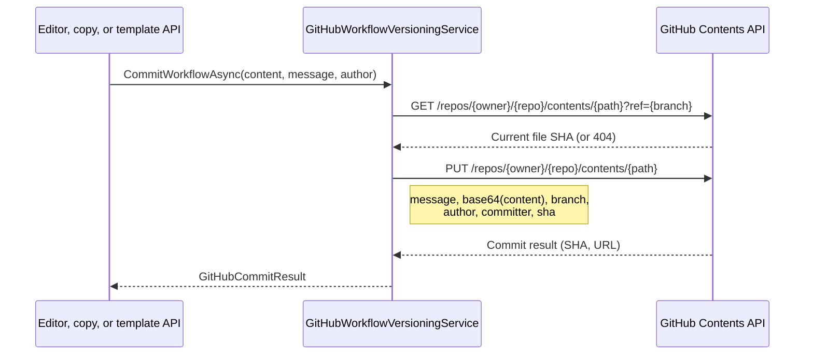

# Workflow GitHub Save

**On this page:** When a workflow is committed · Architecture · Key Components · Configuration · PAT setup · Local development · Troubleshooting · Observability

Workflow templates are mirrored to a GitHub repository, so every saved template has a version-controlled copy with change tracking.

## When a workflow is committed

Four paths commit, and all of them go through `GitHubWorkflowVersioningService.CommitWorkflowAsync`:

| Path | Trigger | Commit message | Author | On failure |
|------|---------|----------------|--------|------------|
| Editor auto-save | Every database save in the Workflow Editor (`AutoCommitToGitHubAsync` in `WorkflowEditor.razor`) | `Save workflow {workflowTypeId}` | Signed-in user | The save stands; a warning toast shows `GitHub auto-save failed: {reason}` |
| Editor manual commit | **Commit to GitHub** in the editor's overflow menu opens the **Save to GitHub** dialog | The text in the dialog | Signed-in user | An error toast shows the reason |
| Copy to another workflow | The copy saves the target template (`TryMirrorTargetWorkflowToGitHubAsync` in `WorkflowInteraction.razor`) | `Save workflow {workflowTypeId}` | Signed-in user | The copy stands; the failure is logged |
| Template API save | `SaveWorkflowTemplateContentCommandHandler`, skipped when the save was deduplicated | `Save workflow {workflowTypeId}` | `Workflow API` | The save stands; a warning is logged |

The editor shows the **Commit to GitHub** menu item and runs the auto-save only when `Enabled` is `true` and a PAT is present. The other two paths call the service regardless, and the service does nothing when `Enabled` is `false`.

> [!NOTE]
> - A manual commit with an empty message gets the default `No commit message provided. Saved workflow {workflowTypeId}`.
> - The workflow saves even if there are unknown replacement tags; a warning dialog lists them so they can be fixed later.

## Architecture



The editor and the copy path run inside the Blazor admin app (WebApp) and call the service in-process. Only the template API path runs in the WebApi.

### File Layout

```
workflows/{workflowTypeId}/{workflowTypeId}.workflow
```

### Commit Identity

| Role | Name | Email |
|------|------|-------|
| Author | Signed-in user's name, or `PlatformSettings:GitHub:ApiAuthorName` for template API saves (`Workflow API` unless set) | Signed-in user's email, or `PlatformSettings:GitHub:ApiAuthorEmail` (`workflow-api@example.com` unless set) |
| Committer | `PlatformSettings:GitHub:CommitterName` (`Workflow versioning` unless set) | `PlatformSettings:GitHub:CommitterEmail` (`workflow-versioning@example.com` unless set) |

## Key Components

| Component | File | Responsibility |
|-----------|------|----------------|
| `IGitHubWorkflowVersioningService` | `platform/IniaAi.Common.Interfaces/GitHub/IGitHubWorkflowVersioningService.cs` | Service interface |
| `GitHubWorkflowVersioningService` | `platform/IniaAi.Infrastructure/GitHub/GitHubWorkflowVersioningService.cs` | Implementation -- GitHub Contents API client |
| `GitHubSettings` | `platform/IniaAi.Configuration/Platform/GitHubSettings.cs` | Configuration settings |
| `GitHubCommitResult` | `platform/IniaAi.Common.Interfaces/GitHub/IGitHubWorkflowVersioningService.cs` | Result DTO with SHA, URL, created flag |

### Service Interface

```csharp
public interface IGitHubWorkflowVersioningService
{
    Task<GitHubCommitResult> CommitWorkflowAsync(
        string workflowTypeId,
        string area,
        string function,
        string content,
        string commitMessage,
        string authorName,
        string authorEmail,
        CancellationToken cancellationToken = default);
}
```

### Implementation Details

The `GitHubWorkflowVersioningService` uses the GitHub Contents API:

1. **GET** the file at the target path to resolve the current `sha` (if the file already exists)
2. **PUT** the new content with:
   - `message`: the caller's commit message (or the default)
   - `content`: base64-encoded workflow file
   - `branch`: `DefaultBranch` from settings
   - `author` / `committer`: as described above
   - `sha`: included only when updating an existing file (required by the API to prevent conflicts)
3. On a `409 Conflict` (a concurrent save changed the file between GET and PUT), fetch the `sha` again and retry the PUT once

Authentication uses the configured PAT as a Bearer token.

## Configuration

### GitHubSettings

```csharp
public sealed class GitHubSettings
{
    public bool Enabled { get; set; } = false;
    public string? Owner { get; set; }
    public string? Repo { get; set; }
    public string DefaultBranch { get; set; } = "main";
    public string? Pat { get; set; }
}
```

| Property | Type | Default | Description |
|----------|------|---------|-------------|
| `Enabled` | bool | `false` | Kill-switch. When `false`, the service commits nothing and the editor hides **Commit to GitHub** |
| `Owner` | string? | -- | GitHub org or user that owns the repository |
| `Repo` | string? | -- | Repository name |
| `DefaultBranch` | string | `"main"` | Branch to commit to |
| `Pat` | string? | -- | Fine-grained personal access token |

The section is bound in `AddInfrastructure` (`InfrastructureServiceRegistration.cs`) from `PlatformSettings:GitHub`.

### Where the values live

| Source | Key |
|--------|-----|
| AWS SSM Parameter Store (AWS deployments) | PAT: `/iniaai/{env}/shared/secrets/PlatformSettings/GitHub/Pat` (SecureString). `Enabled`, `Owner`, `Repo`, `DefaultBranch`: `/iniaai/{env}/shared/config/PlatformSettings/GitHub/*` for both apps, and `/iniaai/{env}/admin/config/PlatformSettings/GitHub/*`, which overrides them for the admin app only |
| Azure Key Vault (Azure deployments) | `PlatformSettings--GitHub--Pat` |
| Environment variable | `PlatformSettings__GitHub__Pat` |
| `appsettings.*.json` | `PlatformSettings:GitHub:Pat` |

Both apps read the shared PAT, but the WebApi commits template API saves only when `Enabled` is `true` in its own configuration, which on AWS means the `shared/config` scope. A deployment that keeps the flags only in `admin/config` mirrors editor saves and silently skips template API saves. The order in which these sources load is on [Application configuration](../operations/application-configuration.md#cloud-mode-configuration-sources).


### When a new value takes effect

The service reads `IOptionsMonitor<GitHubSettings>.CurrentValue` on every commit, and the editor reads it on every save, so a changed value takes effect when the configuration source reloads. No restart is needed:

- SSM Parameter Store reloads every 5 minutes (`ReloadAfter` in `ConfigurationBuilderExtensions.cs`).
- `appsettings.*.json` reloads when the file changes.
- Environment variables and AWS Secrets Manager load once at startup. A PAT kept in either needs a restart.

## PAT setup

Create a **fine-grained** token:

1. Open **GitHub** > **Settings** > **Developer settings** > **Fine-grained tokens** > **Generate new token**.
2. Set **Resource owner** to the organization that owns the target repository.
3. Under **Repository access**, choose **Only select repositories** and select the target repository.
4. Under **Permissions**, set **Contents** to **Read and write**. **Metadata: Read-only** is added automatically.
5. Set an expiration. The token stops working on that date, and every commit then fails with `401`.

If the **Resource owner** menu fails to load, open the form with the owner and permission already filled in by URL parameters, then pick the repository:

```
https://github.com/settings/personal-access-tokens/new?name=<token-name>&target_name=<org>&expires_in=366&contents=write
```

An organization owner can see every fine-grained token that can reach the organization, with its expiration, under the organization's **Settings** > **Personal access tokens** > **Active tokens**.


## Local development


- Supply a PAT through `PlatformSettings__GitHub__Pat` in the process environment. Keep it out of files the repository tracks.

## Troubleshooting

| Error | Cause | Fix |
|-------|-------|-----|
| 401 Unauthorized | The PAT expired, was revoked, or is wrong | Check the token's expiration under **Active tokens**; create a new one ([PAT setup](#pat-setup)) and set it where the [values live](#where-the-values-live) |
| 403 Forbidden | The PAT lacks **Contents: Read and write** on the repository, or branch protection blocks the push | Check the token's repository and permissions; review branch protection rules |
| 404 Not Found | Owner, repo, branch, or path mismatch | Verify `Owner`, `Repo`, and `DefaultBranch` match the actual repository |
| 409 Conflict | The file changed between GET and PUT twice in a row | Save again; the service already retried once with a fresh `sha` |
| `GitHub PAT is not configured in app settings.` | `Enabled` is `true` but no PAT reached the process | Set the PAT in one of the [sources above](#where-the-values-live) |

## Observability

- The editor's auto-save logs `Auto-committed workflow {WorkflowTypeId} to GitHub ({Sha})` on success, and `Auto-commit to GitHub failed for workflow {WorkflowTypeId}` with the exception on failure.
- The manual commit shows a toast with the short commit SHA on success.
- The template API save logs `Mirrored workflow template {WorkflowTypeId} to GitHub ({Sha})`, or a warning that the mirror was skipped.
- `GitHubCommitResult.Created` tells a new file from an update.
