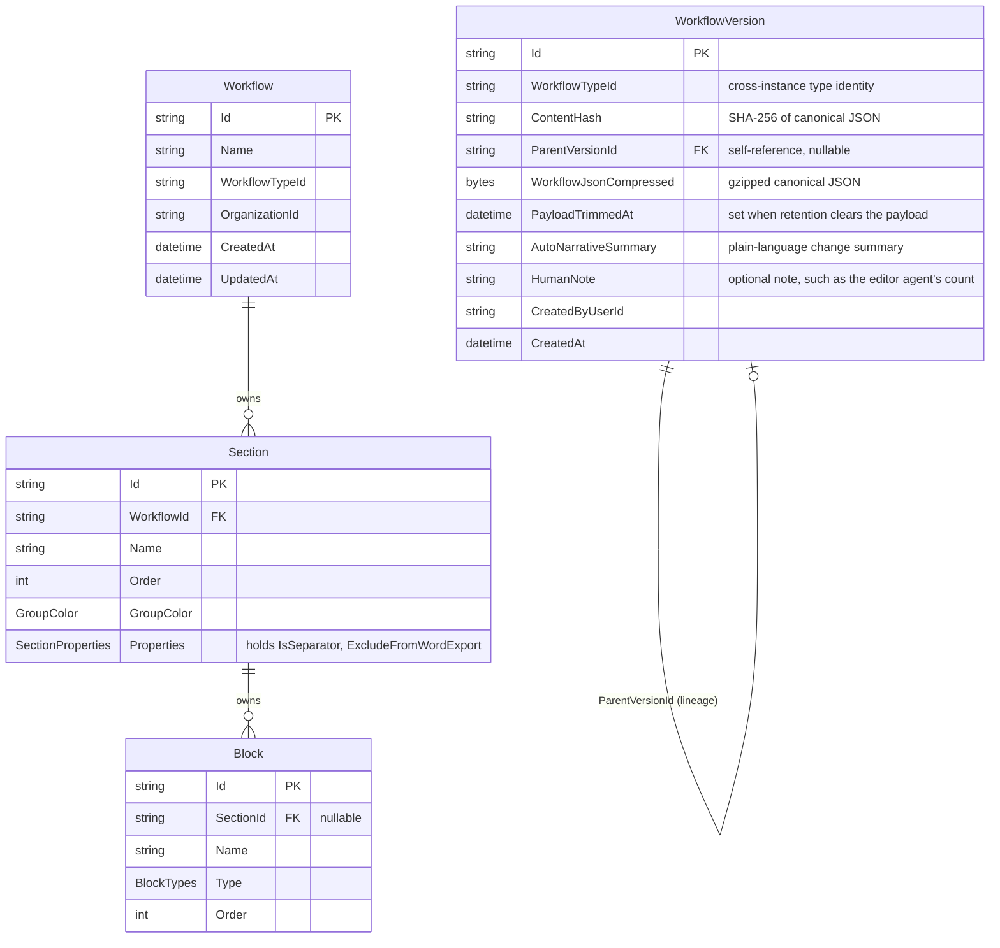
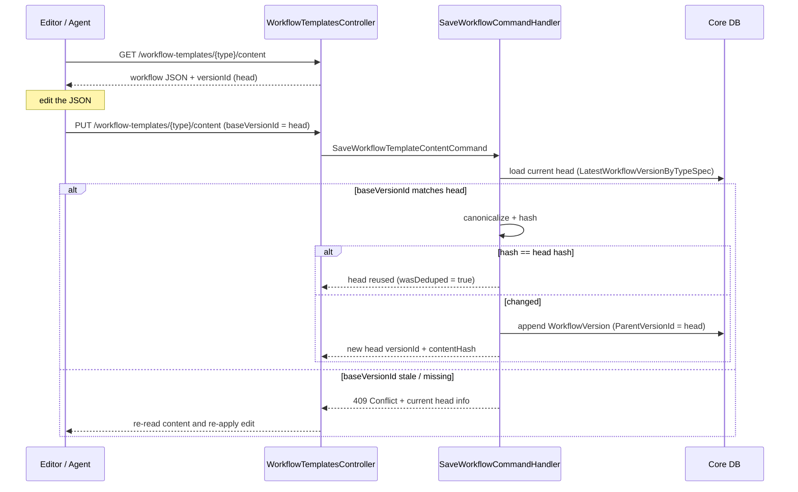

# Workflow Template Versioning System

**On this page:** Architecture Overview · How a Version Is Recorded · Database Schema · Saving Through the API · The version note · Viewing History and Diffs · Cross-Instance Currency Cards · Retention

The Workflow Template Versioning System keeps an immutable, append-only history of every workflow template. Each time a prompt engineer saves a template in `CoreDbContext` (schema `Core`), a point-in-time snapshot is appended so they can review what changed, open an earlier version, compare any two versions, and reconcile templates across separate deployments.

This system is **shipped and live**. Its user interface is the Blazor Server editor's history drawer and the deployment comparison page; the analyst workspace SPA shows no template history.

## Architecture Overview

Versioning snapshots the whole template — the `Workflow` → `Section` → `Block` tree described on [Workflow Engine Architecture](../architecture/workflow-engine/index.md) — but it does **not** store a field-by-field changeset. Instead, each save records one canonical snapshot plus a content hash; diffs and narratives are computed **on demand** from two snapshots.

## How a Version Is Recorded

A version is created by `WorkflowSavePipeline.SaveCoreAsync` (`platform/IniaAi.Application/Commands/Workflows/SaveWorkflow/`), which every save path runs (`SaveWorkflowCommandHandler` behind the editor and the template API, duplication, promote, shared-component fan-out and transfer import, and the startup page-overview-prompts migration), as part of the same transaction that replaces the live Core template:

1. **Backfill stable ids.** A block or section with no stable id, or with one another node already holds, gets a fresh one.
2. **Canonicalize.** `WorkflowCanonicalizer` (`platform/IniaAi.Domain/Serialization/`) serializes the saved `Workflow` to a deterministic JSON form: entity Ids, audit timestamps, and execution state are stripped, object keys are ordered, and collections are sorted by a stable key (sections/blocks by `Order`, variables/text inputs by `ReplacementTag`, document classes by `Key`). Two semantically equal templates produce byte-identical canonical JSON. This **payload** form keeps stable ids and shared-component link fields, so a restore or an API round-trip keeps them.
3. **Hash.** `ComputeContentHash` takes the lowercase hex SHA-256 of the canonical JSON in its **hash** form, which also leaves out the stable ids and link fields. This `ContentHash` is the version's identity — stable across repeated saves and across deployments — and linking or unlinking a node never changes it ([the hash/payload split](../architecture/workflow-engine/shared-components.md#the-hashpayload-split)).
4. **Deduplicate.** When the content hash equals the current head's **and** the stored payload is byte-identical to the new canonical JSON, no new row is written; the existing head is reused (`WasDeduped`). A save that does not actually change the template never grows the history, while a link-only change, which leaves the hash as it was, still appends a version. A head whose payload retention trimmed never dedups.
5. **Summarize.** When the content differs, `WorkflowDiffService.Compare(priorJson, newJson)` builds a `WorkflowDiff`, and `WorkflowNarrativeGenerator` turns it into a short plain-language `AutoNarrativeSummary` (e.g. what was added/removed/changed). Deliberately no developer jargon — no "diff", "commit", or "hash" wording — because the audience is prompt engineers, not developers. A save with no readable prior payload records `WorkflowNarrativeGenerator.FirstVersionSummary`, and a caller may override the narrative (duplication writes `Duplicated from <source id>`).
6. **Append.** A new `WorkflowVersion` row is inserted, pointing at the previous head via `ParentVersionId`, with the save's version note as `HumanNote`.

The whole transaction runs inside the database's [retrying execution strategy](../architecture/services/infrastructure/database-services.md#transient-fault-resilience); the handler clears the change tracker at the start of each attempt, so a transient database failure replays the entire save cleanly instead of surfacing an error.

### Content-Hash Identity, Not Semantic Versioning

There is **no semantic version number** and no Major/Minor/Patch classification. A version is identified by its full `ContentHash`; the editor shows a short, cosmetic **version code** derived from the first 8 hex characters of that hash (`WorkflowVersionCode.Short`). Lineage is expressed structurally through `ParentVersionId`, not through a numeric sequence.

## Database Schema

### `WorkflowVersion` (schema `Core`)

Key points, all verifiable in `platform/IniaAi.Domain/Entities/Workflows/WorkflowVersion.cs`:

- The snapshot is stored gzip-compressed in `WorkflowJsonCompressed`; the `WorkflowJson` property (`[NotMapped]`) compresses/decompresses on access via `WorkflowJsonCompression`.
- `ParentVersionId` is a self-foreign-key with `DeleteBehavior.NoAction` — history is append-only and rows are never hard-deleted, and `NoAction` is also the only self-FK delete behavior SQL Server permits (CASCADE/SET NULL fail with error 1785).
- Indexed on `(WorkflowTypeId, CreatedAt)` and on `ContentHash`.
- Rows created before the `UniversalWorkflowVersionChains` migration (July 2026) had `ParentVersionId` rewritten to chronological order when the former per-organization chains were merged — for those rows the pointer is **not** edit provenance and must never be read as such.
- There are **no** separate changeset/change-entry tables (`WorkflowVersionChangeset`, `BlockChangeEntry`, etc.). Per-field change information is computed on demand by `WorkflowDiffService`, never persisted.

### History Is Universal (One Chain Per Type)

`WorkflowTypeId` is the cross-instance type identity carried in both the Core template and its versions, and it is the only scoping key: the history chain for a template is universal — exactly one chain per `WorkflowTypeId`, matching the shared live template it snapshots.

- `LatestWorkflowVersionByTypeSpec(workflowTypeId)` resolves the current head.
- `WorkflowVersionsByTypeSpec(workflowTypeId)` returns the full chain, newest first.

A workflow type can be shared across a set of organizations (via `WorkflowTypeOrganizationAccess`); every accessing organization sees the same chain and races against the same optimistic-concurrency head. Version reads carry no organization-access gating: they serve the role-gated editor and template API, where templates are deployment-wide authoring artifacts. Organization access scopes which types an organization can consume (execute), not which history editors can read.

## Saving Through the API

The REST surface for reading and saving template content is `WorkflowTemplatesController` at `api/v1/workflow-templates` (`platform/IniaAi.WebApi/Controllers/v1/`). Every editing and content endpoint (`list`, `agent-guide`, `GET .../content`, `PUT .../content`) requires an editor role: `[Authorize(Roles = "WorkflowEditor,SuperAdmin")]`. The one exception is the lightweight `GET .../summary` endpoint, which carries no role restriction and inherits only the base controller's `[Authorize]` — any authenticated user may read it.

| Method & route | Purpose |
|----------------|---------|
| `GET /api/v1/workflow-templates` | List all template types in the deployment |
| `GET /api/v1/workflow-templates/{workflowTypeId}/content` | Return the verbatim template JSON **plus head version info** (`versionId`, `contentHash`, created-at/by) |
| `PUT /api/v1/workflow-templates/{workflowTypeId}/content` | Full-document save with optimistic concurrency (`baseVersionId`) |
| `POST /api/v1/workflow-templates/{workflowTypeId}/content/validate` | Rehearse that save read-only — see [Rehearsing a save](#rehearsing-a-save) |
| `GET /api/v1/workflow-templates/{workflowTypeId}/summary` | Lightweight summary (variables, document classes) |
| `GET /api/v1/workflow-templates/agent-guide` | Markdown guide for agents/scripts editing templates |
| `POST /api/v1/workflow-templates/{workflowTypeId}/duplicate` | Copy the template into a new workflow type — see [Duplicating a template](#duplicating-a-template-into-a-new-type) |
| `DELETE /api/v1/workflow-templates/{workflowTypeId}` | Delete the type; its version history goes with it after the retention window — see [Deleting a type](../architecture/workflow-engine/workflow-types.md#deleting-a-type-through-the-template-api) |
| `GET /api/v1/workflow-templates/{workflowTypeId}/versions` | Version history, newest first, see [Reading history over the API](#reading-history-over-the-api) |
| `GET /api/v1/workflow-templates/{workflowTypeId}/versions/{versionId}/content` | One saved version's template JSON |
| `GET /api/v1/workflow-templates/{workflowTypeId}/versions/{versionId}/changes` | Diff of a version against the version before it |
| `GET /api/v1/workflow-templates/{workflowTypeId}/versions/compare?from=&to=` | Diff between any two versions of the type |

The version routes are read-only. There is no version-creation POST and **no restore endpoint**: versioning happens as a side effect of the normal save path, and a restore is an ordinary save of old content (see [Restoring over the API](#restoring-over-the-api)).

### Optimistic Concurrency

`PUT .../content` enforces optimistic concurrency on `baseVersionId`:

On a stale or missing `baseVersionId`, the save returns **409 Conflict** with the current head surfaced in the problem-details extensions (`currentHeadVersionId`, `currentContentHash`, `headCreatedAtUtc`) so the caller can re-read and re-apply. A genuinely concurrent save that races on the underlying template row is caught as `DbUpdateConcurrencyException` and returned as the same 409 shape (`WorkflowTemplate.ConcurrentSave`).

### Rehearsing a save

`POST .../content/validate` takes the same body as the save and answers with the same verdicts — 400 with field-level paths, 409 with the same head extensions, 200 when the payload would be accepted — while writing nothing. Both paths run one shared `WorkflowTemplateSavePreflight` (structural validation, shared-component reference resolution, workflow-type existence, category resolution) plus the save pipeline's own `CheckBaseVersion`, so the rehearsal cannot drift from the save it predicts.

Its 200 body adds `wouldCreateWorkflowType`. The content PUT is an **upsert**, so a mistyped `workflowTypeId` creates a second workflow type rather than 404ing — and the save creates that type *before* the concurrency check runs, rolling it back only best-effort if the save then fails. The flag is decisive on a save carrying `baseVersionId: null` (a first save, or a legacy template whose GET returned a null `versionId`), which is exactly where a typo lands silently. A save that does carry a `baseVersionId` already conflicts on a mistyped id, since the named type has no head to match.

The rehearsal is deliberately narrower than the save. It does not predict dedup or signature-field deletion gating, both of which are decided only after the template graph is replaced; predicting them would mean reimplementing pipeline internals that could then drift and lie. Neither outcome is costly to meet on the real save — a dedup is a no-op, and an unconfirmed signature deletion is refused with nothing written. Like every preview in this system the answer is advisory: the save re-runs all of it inside its own transaction, so a write landing in between still turns an accepted rehearsal into a 409.

### Duplicating a Template Into a New Type

`POST .../duplicate` creates a variant: a new `WorkflowType` carrying a copy of the source's template content. It exists because client-specific flavours of a process were previously rebuilt by hand, which silently lost the per-type prompt tuning.

**Carried over:** all content (sections, blocks, variables, document classes with their page overview prompts, the workflow's default overview prompt and the rest of its configuration, signature field *definitions*); every shared-component link, still **live**, so future component updates reach the variant too; every per-entry deviation (hidden slots, broken-out entries, ref entries); and all **stable ids**, which is what keeps a variant diffable and regression-comparable against its parent block-by-block. The page overview prompts live in the template, so the duplicate carries them like any other content; the response has no prompt count since the Prompt Library was removed.

**Deliberately not carried,** each reported in the response's `skippedCarriers[]` with a reason: `WorkflowTypeOrganizationAccess` rows (the duplicate is invisible until an org is granted access, so a per-client variant never auto-exposes itself), `SignatureFieldOverride` values (every field falls back to its staff default until re-approved through the pending/vote flow), company type mappings (the carrier named `Company type mappings`; company is the screens' word for a counterparty), and all execution history.

The new type records `DuplicatedFromWorkflowTypeId`, pointing at its **immediate** source rather than the root, so a family is the transitive closure of those edges. It is a plain indexed string with no self-referencing foreign key: provenance must outlive its target's deletion and must never become a delete-ordering constraint. Only this endpoint writes it — a value supplied to the template PUT is ignored, so lineage cannot be fabricated.

The duplicate starts its **own** version chain: the returned `versionId` is a root with a null `ParentVersionId`, not a child of the source's history. Its first `ContentHash` equals the source head's, because `CanonicalContractResolver` excludes `WorkflowTypeId` from the canonical contract — correct, since the content is identical, but it means a content hash never identifies which type a snapshot belongs to.

Failure modes: **404** `WorkflowType.NotFound` (source missing or contentless), **409** `WorkflowType.AlreadyExists` (`Workflow type '<id>' already exists; choose a different id.`), **400** when the new id equals the source id or names a category that does not exist.

## The version note

An editor save passes `SaveWorkflowCommand.VersionNote`, and the save pipeline stores it on the new version as `HumanNote`: when the save carries changes the [editor agent](editor-agent.md) proposed and the user accepted, the note reads "1 change proposed by the editor agent" or "N changes proposed by the editor agent", followed by the agent's plain-language overview of each proposal the save carries. The editor's history drawer shows it on the version's entry. A deduplicated save writes no version, so its changes are counted on the next save that does. The versions API (`WorkflowTemplateVersionDto`) does not return the note.

## Viewing History and Diffs

The version queries live in `platform/IniaAi.Application/Queries/Workflows/Versions/`. The Blazor Server editor sends them in process through `ISender`, and `WorkflowTemplatesController` serves four of them over HTTP (see [Reading history over the API](#reading-history-over-the-api)):

- **`GetWorkflowHistoryQuery`** → the list of saved versions for a type (newest first): version id, parent version id, created-at/by (resolved to display name), short version code, narrative summary, the version's note (`HumanNote`, returned as `Note`), and whether the payload has been trimmed. The handler projects these columns, so a history page never loads the compressed payloads. `RequireKnownType` (set by the API) answers an unknown type with `WorkflowTemplate.NotFound` instead of an empty page.
- **`CompareWorkflowVersionsQuery`** → a `WorkflowDiff` between any two versions. By default the handler diffs older→newer whatever the argument order (the editor's behavior); `PreserveArgumentOrder` (set by the API) diffs the first argument to the second as given. A trimmed payload on either side returns `WorkflowVersion.PayloadTrimmed`; a row with no payload and no trim stamp returns `WorkflowVersion.PayloadMissing` (`WorkflowVersionErrors.PayloadProblem`).
- **`GetWorkflowVersionChangesQuery`** → one version diffed against its `ParentVersionId`, resolved server-side. It reports `FirstVersion` when there is no parent (checked first, so a trimmed first version still reports it) and `Unavailable` when the version's or the parent's payload cannot be read. `FailWhenUnavailable` (set by the API) returns the payload error instead of `Unavailable`; the editor keeps the status and falls back to the stored narrative.
- **`GetAllBlocksLastTouchedQuery`** → resolves, in a single pass over the history, the version in which each block (keyed by `ReplacementTag`) last changed, so the editor can stamp per-block "last touched" information without one query per block.
- **`GetWorkflowVersionQuery`** → a single version's snapshot.
- **`GetWorkflowHeadVersionQuery`** → just the current head's version id (null when the type has no versions yet), as a single-row lookup for callers that only need a concurrency base — no payloads, no author-name resolution.

`GetWorkflowVersionQuery`, `GetWorkflowVersionChangesQuery` and `CompareWorkflowVersionsQuery` take an optional `WorkflowTypeId`. When it is set, a version that belongs to another type answers `WorkflowVersion.NotFound` with the same message a missing version gets (`WorkflowVersionErrors.NotFound`). The editor passes none; the API always passes the route's type.

`WorkflowDiff` (`platform/IniaAi.Core/Workflows/Diff/`) is a structural comparison covering section, block, variable, document-class, and workflow-level field changes, each tagged `Added`, `Removed`, `Modified`, or `TypeChanged`. Blocks match by `ReplacementTag` across the whole template, variables by replacement tag, document classes by key, and sections by the blocks they hold, so a reorder alone is not a change. A block moved to another section with no other edit produces no block entry, though the sections it moved between can then read as `Modified`, because section matching ties on block overlap. A `ReplacementTag` that repeats is told apart per block (`KeyBlocks`): by `StableBlockId` when every same-tag block on both sides carries a unique one, else by order of occurrence, so an edit to one same-tag block is never hidden behind another. Each `BlockDiff` names its section (`SectionName`: the after side, or the before side for a removed block) and its `StableBlockId`; each `SectionDiff` carries its `StableSectionId`. Stable ids are identity only and never produce field diffs; they are null on payloads saved before stable ids rode in the payload. Modified blocks, sections, variables and document classes carry `FieldDiffs` with the whole before and after values; added and removed elements carry none. Values are rendered through Newtonsoft `JToken.ToString()`: strings are verbatim, booleans read `True` / `False`, and ISO date-time strings are re-rendered, so non-string scalars are not byte-exact.

### Reading history over the API

Four `WorkflowEditor,SuperAdmin` routes on `WorkflowTemplatesController` expose the queries above, so an API agent can answer what changed in a template, when, and by whom. Like the content routes they are role-gated and not filtered by `WorkflowTypeOrganizationAccess`. Every diff is computed from stored version payloads, which the content GET already serves to the same role. The one addition is `createdByName` on the history list: `UserDisplayNameResolver` resolves it with no organization filter, because the chain is shared across organizations, so an editor can see the name (or email fallback) of an author from another organization. `SharedComponentVersionDto.CreatedByName` is served the same way. The request and response contract, with examples, is section 9 of the agent guide (`GET /api/v1/workflow-templates/agent-guide`, source `platform/IniaAi.WebApi/Resources/WorkflowTemplatesAgentGuide.md`); this page records the behavior rules.

- **`GET .../versions?top=&cursor=`** returns `versions[]` (`versionId`, `contentHash`, `parentVersionId`, `createdAtUtc`, `createdByUserId`, `createdByName`, `payloadStored`, `payloadTrimmedAtUtc`, `narrative`) with `totalCount`, `hasMore` and `nextCursor`. `versions[0]` is normally the head, but the page orders by `(CreatedAt, Id)` while head election also weighs `ContentHash`, so on identical timestamps `GET .../content` is the authority for the head. `top` is 1 to 200, default 30. `nextCursor` is an opaque keyset token (`WorkflowVersionCursor`: the last row's `CreatedAt` ticks and id); the keyset keeps pages stable while saves prepend new heads. A bad `top` or `cursor` answers 400.
- **`GET .../versions/{versionId}/content`** returns that version's stored JSON verbatim in the shape of the head content read, plus `parentVersionId` and `narrative`.
- **`GET .../versions/{versionId}/changes`** returns `fromVersionId` (the parent), `toVersionId`, `isFirstVersion`, `storedNarrative`, `narrativeParts[]` (from `WorkflowNarrativeGenerator.GenerateParts`) and the `diff`. A first version answers 200 with `isFirstVersion: true` and a null `diff`.
- **`GET .../versions/compare?from=&to=`** returns the same shape for any two versions of the type, read from `from` to `to` as given. `storedNarrative` is null there.

Failure rules:

| Code | Status | When |
|------|--------|------|
| `WorkflowTemplate.NotFound` | 404 | `/versions` on a workflow type that does not exist. A known type with no saves answers 200 with an empty list. |
| `WorkflowVersion.NotFound` | 404 | The version does not exist, or it belongs to another workflow type than the one in the route. |
| `WorkflowVersion.PayloadTrimmed` | 404 | The version's payload (for `/changes`, its own or its parent's) was trimmed by retention. The API never answers an undiffable version with an empty or null diff: the handler returns the error, and `WorkflowTemplateVersionResponseMapper` refuses an `Unavailable` result. A trimmed first version still answers `/changes` with `isFirstVersion: true`, which needs no payload. |
| `WorkflowVersion.PayloadMissing` | 404 | The version row has no payload and no trim stamp (damaged data). |

`parentVersionId` is chain order, not edit provenance: for rows that predate the chain merge (see the `ParentVersionId` note under [`WorkflowVersion`](#workflowversion-schema-core)) it is the chronologically previous save, so `/changes` on such a row is a true content difference between two consecutive saves and nothing more. The API documentation and the agent guide state this wherever the pointer is served.

### Restoring over the API

There is no restore route. To restore, read the old version's `workflow` from `.../versions/{versionId}/content` and `PUT` it to `.../content` with the **current head's** `versionId` as `baseVersionId`. The old version's own id is not the head, so using it answers 409 `WorkflowTemplate.VersionConflict`. The restore is appended as a new version; history is never rewritten. Its `contentHash` normally equals the restored version's, and differs when the save normalizes old-shaped content on the way in.

### Blazor UI

The editor surfaces versioning through MudBlazor components in `platform/IniaAi.WebApp/Components/WorkflowEditor/`:

- **`WorkflowHistoryDrawer.razor`** — the "Saved versions" panel listing every save, with actions to open an earlier version back into the editor or compare two versions.
- **`VersionStamp.razor`** — inline version-code / last-touched stamps.

Opening an earlier version loads its snapshot back into the editor; re-saving then appends a **new** head version. Because history is append-only, there is no destructive "restore" that rewrites or deletes existing versions.

Editor saves enforce optimistic concurrency: the editor tracks its concurrency base explicitly — seeded from the history read when the editor loads, then adopted from each successful save's returned version id (and from the version it loads after a conflict) — and passes it as the save's `baseVersionId`. If someone else saved a newer version meanwhile, a conflict dialog offers three ways out — **save mine anyway** (retries on top of the other save, which stays in history as the parent), **discard mine and load latest** (drops local edits and loads the current head into the editor), or **keep editing** (no save). Because save-mine writes the editor's full snapshot, it reverts everything the other party changed — so the dialog names it: it diffs the editor's stale base against the current head in-process (`WorkflowDiffService` over both versions' stored payloads, lines built by `SaveConflictDisclosure`) and lists exactly which sections, blocks, variables, document classes, and template fields the save would undo; when either payload cannot be loaded it falls back to an honest static warning instead of blocking. Copying a block or section into another Core workflow (`WorkflowInteraction.razor`) enforces the same check against the target's head (`GetWorkflowHeadVersionQuery`) captured when the copy started; on conflict the copy aborts with nothing saved.

## Cross-Instance Currency Cards

Because templates can only be authored inside each customer's own deployment, the same workflow type can drift between deployments. The versioning system reconciles this peer-to-peer through **currency cards** rather than a central server.

- **`GenerateCurrencyCardQuery`** builds this deployment's card: for every workflow type in the deployment, the current head version (id, content hash, short code, created-at/by), the workflow type's name, plus the full lineage of content hashes. The card is labelled with the deployment's `PlatformSettings:InstanceName` and downloaded as a JSON file.
- **`WorkflowCardComparer`** is a pure function that compares cards gathered from several deployments into a grid. By comparing version-hash lineages, it distinguishes a deployment that is simply **behind** from one that has **diverged** (edited on a separate line) or is **ahead**, benchmarked against the most recently saved version across all compared deployments. Each row is named by the workflow type's name from the newest card that carries one; a card written before cards carried names leaves the row on the unaltered `WorkflowTypeId`.
- **`CrossInstanceCompare.razor`** (route `/workflows/compare-deployments`, `[Authorize(Roles = Roles.EDITOR_ROLES)]`, so `WorkflowEditor` or `SuperAdmin`) lets an editor download this deployment's card and drop in cards from other deployments to render the comparison. A file that is not a card (a `.workflow` download or any other JSON) is left out with the warning `{file name} is not a deployment report, so it was left out. Choose a file saved with "Download this deployment's report".`, and the cards added after it still compare on the same page (`DeploymentReportFile`).

## Retention

History is append-only, so version rows are never deleted. To bound storage, `WorkflowVersionRetentionService` (`platform/IniaAi.Infrastructure/Services/`) can **trim payloads**: it NULLs `WorkflowJsonCompressed` and stamps `PayloadTrimmedAt`, keeping every version's metadata (hash, lineage, narrative summary) intact. A trimmed version still appears in history and provenance, but can no longer be diffed or reopened.

Retention is deployment-static configuration (`PlatformSettings:WorkflowVersionRetention`, `WorkflowVersionRetentionSettings`):

| Setting | Default | Meaning |
|---------|---------|---------|
| `Mode` | `Disabled` | `Disabled` never touches payloads; `ReportOnly` logs what it would clear; `Trim` clears them |
| `KeepLastNPayloads` | `20` | Always keep the most recent N payloads per type |
| `KeepNewerThanDays` | `180` | Always keep payloads newer than this many days |
| `TrimDayOfWeek` / `TrimHourUtc` | Sunday / 02:00 UTC | When the sweep runs |
| `MaxPayloadsTrimmedPerRun` | `500` | Upper bound per run |

Which payloads to clear is decided by `WorkflowVersionRetentionPlanner` from scalar metadata only — no snapshot JSON is loaded to make the decision. There is no per-organization override (changing retention requires a redeploy, deliberate for an irreversible operation), and there are no digital signatures, external checksums, cold-storage tiers, or IP/session audit records — the integrity guarantee is the content hash plus append-only history.
