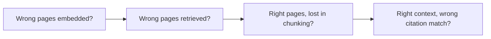

# Debug a Retrieval Problem

**On this page:** First: which layer is wrong? · Steps · Done when · Applying the fix · Stuck? · Related pages

**Persona:** an engineer or prompt engineer investigating a report where **the AI cited the wrong page** (or missed a fact that is clearly in the document, or pulled in an irrelevant page).

**Goal:** go from the symptom to the **one configuration knob** to change — without guessing.

**Prerequisites:**

- The failing **execution id** *(from the dashboard or whoever reported it).*
- Access to read that execution's logs (admin UI, or the API with a token — see [API: zero to result](api-zero-to-result.md)).
- A rough idea of which **block** produced the bad citation (a report paragraph's `replacementTag` links it back to its source block).
- Access to the [workflow editor](../workflows/editor-guide.md) for the workflow type, to read and change the blocks.

A wrong citation is almost always a **retrieval** problem — the block was given the wrong pages as its input context, so the model cited from the wrong place. This guide walks the [RAG pipeline](../../architecture/rag/index.md) backwards from the symptom, and the [Citations](../../architecture/citations/index.md) layer for the one case that is *not* retrieval. Each step links the subsystem page that owns the knob.

## First: which layer is wrong?

The pipeline that produces a citation has distinct stages, and the fix is different at each one. Walk them in this order — stop at the first one that is wrong.

## Steps

### 1. See what the block actually retrieved

Do not theorize — look at the pages the block actually retrieved. Where you find them depends on how the block reads documents:

- **Through a Retrieve Data From Documents block** (its prompt holds that block's `{tag}`): find the logs with `GET /workflow-executions/{id}/logs` and locate blocks by `replacementTag`. The retrieval block's own log entry, `GET /workflow-executions/{id}/logs/{logId}`, returns the retrieved page text as its `output`. On the reading block's entry, `GET /workflow-executions/{id}/logs/{logId}/placeholders` returns the full value of each `{tag}` in its prompt, keyed by the tag name.
- **Through its own filter rules** (the block's **Document filtering** settings): the logs API does not return these pages. The log entry carries the block's prompt and output, and the placeholders endpoint covers only the `{tag}`s in the prompt. Open the workflow in the editor, upload the same document, and click **Run block** on that block: **Retrieved document content after execution** shows the pages it was given.

Each retrieved page arrives tagged with its document name and page number.

→ [Workflow Executions → execution logs](../../reference/api/workflow-executions.md#get-execution-logs) · [log placeholders](../../reference/api/workflow-executions.md#get-log-placeholders)

**Decision:** Is the cited page **present** in the retrieved pages?

- **No — the right page was never retrieved** → go to step 2 (retrieval) and step 4 (embedding).
- **Yes — the right page was retrieved but the citation still points elsewhere** → skip to step 5 (citation matching).

### 2. Check the block's RAG strategy — the primary knob

The strategy decides *how* pages are selected, and it is configured **per RAG block** by the workflow author. The wrong strategy is the single most common cause of wrong-page retrieval:

- `TopNPages` ranks all pages by similarity and keeps the top **N** — if the relevant page ranked N+1, raising N (or switching to a neighbor variant) fixes it.
- `TopPage` keeps only the single best page — too narrow for a fact that spans pages.
- `TopNPagesPerFilterWithTwoNeighbors` adds the page before/after each hit — use it when the fact continues across a page boundary (a table spilling onto the next page).
- `ExactPages` / `NPagesStartingFromIndex` are **positional, no embeddings** — great when the page is always in a known place, wrong when document layout varies.
- `WholeDocument` sends everything — never "wrong page", but expensive and dilutive.

→ [RAG → Strategy selection](../../architecture/rag/index.md#strategy-selection) · [Retrieve Data from Documents block](../blocks/block-reference.md#retrieve-data-from-documents-rag)

**Decision:** if the page is *close* in ranking, the knob is **N or the strategy variant** on this block. If positional retrieval picked a structurally-wrong page, the knob is the **strategy choice itself**.

### 3. Check whether batching split the context

If the retrieved pages contain the right page but the model still missed the fact, check whether the block splits its pages into batches. Only an AI Query block that retrieves through its own filter rules does this, and only with **Process Pages in Batches** ticked (`ShouldChunkLargeInputContexts`): it then runs once per batch, so a fact and the thing that gives it meaning can land in different batches. Pages pulled in through a `{tag}` are prompt text and are never batched.

→ [Chunking](../../architecture/rag/chunking.md)

**Decision:** if the relevant pages were split apart, the knob is the block's batching: untick **Process Pages in Batches**, raise **Pages per Batch** or **Max Characters**, or retrieve fewer pages (step 2) so the context fits one batch.

### 4. Check the embedding input — the overview, not the raw text

Semantic strategies do **not** rank raw page text. Each page is embedded via its **AI-generated overview**; retrieval ranks those overview vectors. So a page that *should* match but never surfaces usually has a **bad overview** — the summary missed the salient content, so its vector is far from the query.

- Inspect the page's stored overview: open the document on the **Documents** page of IniaAi.Web (`/documents/:id`). Its page reader shows each page's **Text**, its **Overview**, and its **Embedding** (the model and the vector's dimensions); **No overview yet** or **No embedding yet** means the page was never summarised or embedded.
- A systematically poor overview points at the **overview prompt** of the document's class or the workflow default, not the strategy.
- A whole document of garbled overviews points further upstream — bad text extraction or [OCR](../../architecture/ocr/index.md) on scanned pages.

→ [Overview Generation](../../architecture/rag/overview-generation.md) · [Embedding Generation](../../architecture/rag/embedding-generation.md)

**Decision:** if overviews are wrong, the knob is the **overview-generation prompt template** (or fixing OCR/extraction upstream), not the per-block strategy.

### 5. Right page, wrong citation: it's matching, not retrieval

If the retrieved pages clearly contain the cited page and the model used it, but the **citation** still resolves to the wrong source, the problem is in the citation layer, not RAG. Citations link `<fact id="cX">` markers to sources via **quantity-aware** matching, and trace through block-to-block provenance. A mis-attributed numerical fact usually means two similar quantities matched, or an upstream `BlockSource` chain resolved to the wrong document.

→ [Citations Architecture](../../architecture/citations/index.md) — fact extraction, quantity-aware matching tiers, and source flattening.

**Decision:** the knob here is **not** a RAG setting — it is a citation/quantity-matching issue; capture the block, the fact value, and both candidate sources and report them as a bug ([Stuck?](#stuck)).

## Done when

You can name the single thing to change and why:

- **the block's RAG strategy or its N** (step 2) — the relevant page ranked just outside the cutoff or a positional strategy picked the wrong page;
- **the block's batching** (step 3) — the right pages were split across batches;
- **the overview-generation template, or upstream OCR/extraction** (step 4) — the page's embedded overview did not represent its content;
- or **it is a citation-matching problem, not retrieval** (step 5) — to be handled in the citations layer.

That identification *is* the deliverable. The next section is where you actually turn each knob.

## Applying the fix

Each knob lives in a different place, and not all of them are something you change yourself. Match your diagnosis to its editing path:

### The block's RAG strategy, its N, or its batching (steps 2–3) — Workflow Editor

This is the common case and the one fully in a prompt author's hands. Open the workflow type in the [Workflow Editor](../workflows/editor-guide.md) and find the block that produced the bad context: the **Retrieve Data From Documents** block whose `{tag}` the citing block reads, or the citing block's own **Document filtering** settings. Change **Select The Filter Type To Use For Documents' Pages** (or raise **Number Of Pages To Use Template**, or switch to a neighbour variant), or change **Process Pages in Batches** on the AI Query block. Save the workflow, then re-run to confirm the right page now appears in the retrieved pages.

→ [Retrieve Data from Documents block](../blocks/block-reference.md#retrieve-data-from-documents-rag) · [Workflow Editor → configuring blocks](../workflows/editor-guide.md#7-configure-blocks)

### The overview-generation prompt (step 4) — the workflow's Document Classes tab

The summary that gets embedded is produced by the overview prompt of the document's class, or by the workflow's default when the class has none; a spreadsheet or CSV file reads the one-page version first ([where a page gets its prompt](../page-overview-prompts.md#where-a-page-gets-its-prompt)). Both live in the workflow, on the editor's **Document Classes** tab:

1. Open the workflow in the editor and select the **Document Classes** tab. The **Overview prompt** column shows where each class gets its prompt: **Own**, **Workflow default** or **None**.
2. To change one class, edit the class and improve its **Page overview prompt** so the summary captures the salient content the query should match. To change every class without its own prompt, select **Edit** in the **Page overviews** card. Then save the workflow.
3. Re-run the workflow. The run sees that the document's overviews came from another prompt, writes them again under the new one, embeds them, and retrieves against them. The document's page on the **Documents** page (`/documents`) shows each page's overview and embedding.

A class with **None** gets no overviews at all, so a similarity search over it finds nothing; the tab warns about it.

→ [Page overview prompts](../page-overview-prompts.md) · [Overview Generation architecture](../../architecture/rag/overview-generation.md)

### Garbled overviews across a whole document (step 4) — this is a deployment-level fix

If the overviews are garbled everywhere rather than just imprecise, the problem is upstream of the prompt — bad text extraction or [OCR](../../architecture/ocr/index.md) on scanned pages. **This is not an admin-UI knob.** OCR is model-based and reads any script natively (there is no language setting to correct). A page whose transcription fails the fidelity check is flagged (`OCRNeedsReview`) and consumed as an image instead of text, so also check whether the affected pages are flagged rather than mis-transcribed. Capture the document and the symptom and route it to whoever owns your deployment.

### A citation-matching problem (step 5)

Not a knob you turn — see step 5; report it as a bug ([Stuck?](#stuck)).

## Stuck?

If the retrieved pages look right, overviews look right, and the citation still mis-resolves, you are in citation-matching territory (step 5) — gather the execution id, block, and the two candidate sources and open an issue with them, as [CONTRIBUTING.md](../../../CONTRIBUTING.md) describes.

## Related pages

- [RAG Architecture](../../architecture/rag/index.md) — the pipeline and every strategy.
- [Overview Generation](../../architecture/rag/overview-generation.md) · [Embedding Generation](../../architecture/rag/embedding-generation.md) — what actually gets embedded.
- [Chunking](../../architecture/rag/chunking.md) — how large contexts are batched.
- [Citations Architecture](../../architecture/citations/index.md) — how facts are matched back to sources.
- [Workflow Executions](../../reference/api/workflow-executions.md) — the logs/placeholders endpoints used to inspect a run.
