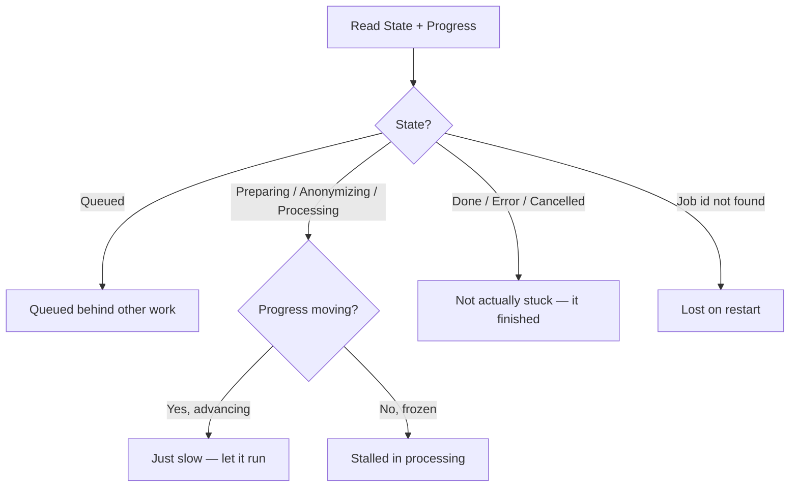

# Debug a Stuck Job

**On this page:** First: what does "stuck" actually mean? · Steps · Done when · What to try, per cause · Stuck? · Related pages

**Persona:** an engineer or on-call operator investigating a workflow run that **never finishes** — the Dashboard shows it spinning, a report never appears, or a user reports "it's been stuck for an hour."

**Goal:** go from the symptom ("it's stuck") to a **named cause** — is it merely *queued behind other work*, is it *stalled inside processing*, or was it *lost on a restart*? — without guessing.

**Prerequisites:**

- The failing **job id** *(from the Dashboard, or from a `GET /api/v1/jobs` listing — see step 1).*
- A way to read that job, which depends on where the run started (step 1): the token of the user who submitted it, or access to the admin app's Dashboard.
- For the production-log step: access to the deployment host.


A job is an **in-memory** record of one long-running operation, here a workflow run. It is tracked by `JobsService` in a plain dictionary, with **no database persistence**: jobs exist only for the lifetime of the running process and are lost on restart. The API and the admin app each run their own `JobsService`, so each sees only the jobs it runs. That single fact drives most "stuck job" diagnoses, so keep it in mind throughout. The full model is on the [Background Jobs API](../../reference/api/background-jobs.md) and [Background Jobs Service](../../architecture/background-jobs/index.md) pages; this runbook threads them into one diagnostic path.

## First: what does "stuck" actually mean?

The job's **State** and **Progress** tell you which of three very different situations you are in. Read them first (step 1), then branch.



## Steps

### 1. Read the job's State and Progress

Do not theorize — read the job record. Where you read it depends on where the run started:

- **A run submitted through the API or IniaAi.Web** runs in the API process. `GET /api/v1/jobs/{id}` returns a `JobDto` with `state`, `progress` (a percentage, `0–100`), `type`, `createdAt`, `completedAt`, and `error`, but only to the user who submitted the job: another user of the organization gets `403` with `You are not authorized to access this job.`, and a caller in another organization gets `404` (`Job not found.`). To find the id, list your own jobs: `GET /api/v1/jobs?$orderby=createdAt desc` (OData paging/filtering supported).
- **A run started from the workflow editor** (**Generate Report**) runs in the admin app's process, so the API never sees it. The admin app's **Dashboard** lists every job of that process for the current organization, with its state and progress.

The `state` is one of the `JobState` values, in lifecycle order: `None` → `Queued` → `Preparing` → `Anonymizing` *(confidential jobs only, full edition only)* → `Processing` → `Done` (or `Error` / `Cancelled`). A job is **finished** only when `state` is `Done`, `Error`, or `Cancelled`.

→ [Get Background Job](../../reference/api/background-jobs.md#get-background-job) · [List Background Jobs](../../reference/api/background-jobs.md#list-background-jobs)

**Decision:**

- **`Done` / `Error` / `Cancelled`** → the job is **not** stuck; it finished. If it errored, `error` holds the message — stop here and read it. If it's `Done` but the user sees nothing, the problem is downstream (report rendering / the user looking at the wrong place), not the job.
- **`Queued`** → go to step 2 (queued behind other work).
- **`Preparing` / `Anonymizing` / `Processing`** → go to step 3 (is it advancing or stalled?).
- **The id is not found at all** → go to step 5 (lost on restart).

### 2. Queued: it's waiting its turn, not stuck

`Queued` means the job is sitting in the in-memory queue waiting for a worker. Jobs run in one of two modes — **sequential** (placed on a queue and drained one slice at a time) or **parallel** (run immediately) — and concurrency is capped by `PlatformSettings.IniaAi.MaxConcurrentJobs` (default **6**), enforced with a semaphore. If six heavy jobs are already `Processing`, the seventh stays `Queued` until a slot frees.

- Count how many jobs are `Processing` right now. The cap is per process and counts every user's jobs, so look where the whole process is visible: the admin app's Dashboard for editor runs. `GET /api/v1/jobs?$filter=state eq 'Processing'` lists only your own jobs, so its count is a lower bound for the API process.
- If the process is at the configured maximum, your job is simply **behind the line**, not stalled.

→ [Concurrency Control](../../architecture/background-jobs/index.md#concurrency-control)

**Decision:** if the concurrency slots are full, the cause is **queue contention** — the job will start when a slot frees. If you can see that nothing is `Processing` yet the job stays `Queued`, that points at a stalled worker/process — go to step 4 (read the logs).

### 3. Processing but frozen: is progress actually moving?

`Preparing`, `Anonymizing`, and `Processing` are all *active* states. A job that legitimately takes a while (a large document, many model calls, image-heavy pages) is **slow, not stuck**. Distinguish the two by watching `progress`:

- Poll `GET /api/v1/jobs/{id}` a few times over a minute and watch the `progress` value.
- **Advancing** (e.g. 40 → 55 → 70) → it is working; let it run.
- **Frozen** at the same value, with `completedAt` still null long past a reasonable time → it is **stalled inside processing**. Go to step 4.

Note the state itself for the clue it gives: stuck in `Preparing` points at **document loading** (a large or unreadable input); stuck in `Anonymizing` (full edition only) points at the **confidential-value redaction** pass on the input documents; stuck in `Processing` points at the **model-execution** phase (a slow or failing model call).

→ [Progress Tracking](../../architecture/background-jobs/index.md#progress-tracking) · [Job types](../../reference/api/background-jobs.md#type-the-job-types) · [Status values](../../reference/api/background-jobs.md#state-the-status-values)

**Decision:** progress moving → **not stuck, just slow**. Progress frozen → a genuine stall; confirm the cause in the production logs (step 4).

### 4. Read the production logs for the real cause

The job record tells you *where* it froze; the logs tell you *why*. Because jobs are in-memory, the only durable trace of what a worker was doing is the application log on the host that is running it.

On the deployment host, follow the running service log and grep for the job id or the execution it is running.

```bash
# Plain single-VM compose host only — follow the live application log
docker-compose logs -f
docker-compose logs --tail=200 api
```


Look for: an exception or stack trace tied to the job, a model call that timed out or was rate-limited, a document that failed to load or OCR, or **no recent log lines at all** for that worker (a sign the process died — go to step 5). A `Processing` job that the model is silently retrying, or one blocked on a slow external call, will show up here even though the API still reports `Processing`.

**Decision:** the log line names the cause — a failing/slow model call, a bad input document, an external dependency, or a dead process. That is your diagnosis.

### 5. The job id is gone, or the app was restarted: it was lost in memory

This is the most important caveat and the easiest to miss. Jobs live **only** in the running process's memory — there is no database row, no retention, no archival. If the application restarted (a deploy, a crash, a host reboot, an out-of-memory kill) while your job was `Queued` or `Processing`, the job is **gone**: a `GET /api/v1/jobs/{id}` returns `404` with `Job not found.`, and the work was *not* resumed on the new process. Nothing marks the workflow execution of a job that was already running: it keeps its last state, so the report list shows it as still running. One nuance for `Queued` jobs: on a **graceful** stop (a deploy or the admin restart) the [shutdown drain](../../architecture/background-jobs/index.md#graceful-shutdown) cancels them and marks their workflow execution rows `Cancelled`, so the executions list shows a terminal state instead of a row stranded in `Queued`. A crash skips the drain.

- A `404` for an id that definitely existed earlier, **plus** a recent restart/deploy in the logs, is the signature of this case.
- Confirm the restart: check the deploy timeline and the startup lines in the log (on a plain compose host `docker-compose logs --tail=50 api` shows a fresh boot).


→ [Which jobs the Jobs API sees](../../reference/api/background-jobs.md#which-jobs-the-jobs-api-sees) — "there is no database table and no retention, and the list empties when the process restarts."

**Decision:** the cause is **a restart that dropped in-flight jobs**. There is nothing to "unstick" — the run must be **re-submitted**. Do not wait on it; it will never complete on its own.

## Done when

You can name which of these the job is, and why:

- **Queued behind the concurrency cap** (step 2) — `MaxConcurrentJobs` slots are full; it starts when one frees;
- **Slow, not stuck** (step 3) — `progress` is advancing; the input is just large/heavy;
- **Stalled in processing** (steps 3–4) — frozen `progress` plus a log line naming a failing/slow model call, a bad input document, or an external dependency;
- **Lost on restart** (step 5) — the id `404`s after a deploy/crash; the job was in memory and must be re-submitted.

That identification *is* the deliverable.

## What to try, per cause

- **Queued behind the cap** — nothing to fix; it will run. If queue depth is a recurring problem, raising `PlatformSettings.IniaAi.MaxConcurrentJobs` is a deployment-configuration change, traded off against the model's rate limit and the container's memory ([Job concurrency](../../operations/application-configuration.md#job-concurrency)).
- **Slow, not stuck** — let it finish. If runs are routinely too slow, the levers are on the *workflow*, not the job: tighter RAG retrieval (fewer pages), the deployment's basic model instead of its advanced model for simple blocks, or fewer/lighter blocks — see the [Block Reference](../blocks/block-reference.md).
- **Stalled in processing** — act on the log cause: a failing model call may be rate-limiting or an AccessDenied on the deployment's model credentials; a bad input document may need re-upload or OCR (see [Debug a retrieval problem → garbled overviews](debug-retrieval.md)). Capture the log line and take it to whoever owns the deployment.
- **Lost on restart** — **re-submit the run.** Then, if jobs are being dropped often, that is a stability/deploy-cadence issue for whoever owns the deployment — capture the restart timeline and take it to them.


## Stuck?

If `state` and `progress` look healthy and advancing but the user still sees no result, you are past the job layer — the run finished and the question is about the **report** (rendering or where to find it), covered in [Build your first workflow → Read the report](build-your-first-workflow.md#8-read-the-report). If the job errored with a citation/retrieval symptom, cross to [Debug a retrieval problem](debug-retrieval.md). For anything that needs host access or a config change, ask whoever runs the deployment. A run that stalls with no cause in the log is a bug: open an issue as [CONTRIBUTING.md](../../../CONTRIBUTING.md) describes.


## Related pages

- [Background Jobs API](../../reference/api/background-jobs.md) — the `GET /jobs` and `GET /jobs/{id}` endpoints, the `JobDto` shape, and the full state list.
- [Background Jobs Service](../../architecture/background-jobs/index.md) — the authoritative state machine, concurrency control, and the in-memory/no-persistence model.
- [Debug a retrieval problem](debug-retrieval.md) — the sibling runbook for when the job *did* finish but cited the wrong page.
- [API: zero to result](api-zero-to-result.md) — how to get a token and poll a run to completion.

