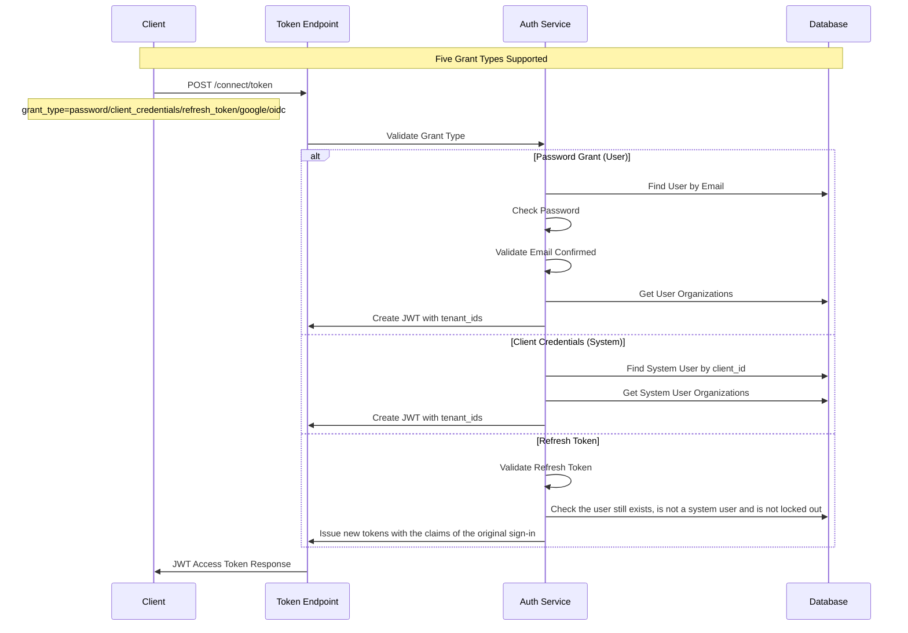
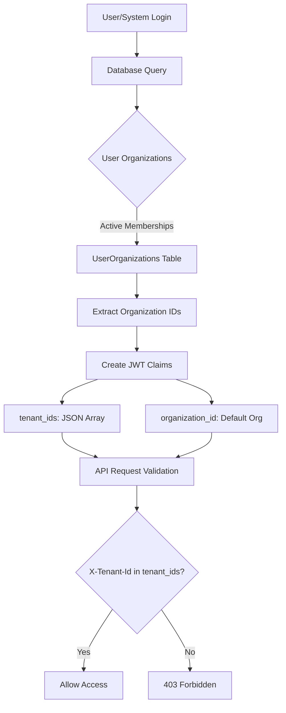

# Authentication API

**On this page:** Token Endpoint · OAuth 2.0 Flow Diagram · Grant Types · Multi-Tenant Token Claims · Error Responses · Token Usage Flow · Token Lifecycle Management · Related pages

The IniaAi Platform uses OAuth 2.0 with OpenIddict for secure authentication. This endpoint provides access tokens for both user and system authentication.

## Token Endpoint

### `POST /api/v1/connect/token`

The token endpoint `POST /api/v1/connect/token` serves five grant types: `password`, `client_credentials`, `refresh_token`, `google` and `oidc`. This page documents each of them, plus the two-factor (MFA) step at `POST /api/v1/connect/token/mfa`. The `google` grant takes the same `credential` parameter as the `oidc` grant (see [OIDC SSO Authentication](../../features/user-management/sso-oidc.md)). Any other `grant_type` is refused with `400` and `error: "unsupported_grant_type"`, unless a module registered it: a module serves its own grant type through an `ICustomGrantHandler`, which decides who signs in, and the endpoint issues the tokens as for its own grants. The open build registers none.


**URL**: `/api/v1/connect/token`
**Method**: `POST`
**Content-Type**: `application/x-www-form-urlencoded`
**Authentication**: None (public endpoint)

## OAuth 2.0 Flow Diagram



## Grant Types

### 1. Password Grant (User Authentication)

Used for interactive user authentication with email and password.

#### Request Parameters

| Parameter | Type | Required | Description |
|-----------|------|----------|-------------|
| `grant_type` | string | Yes | Must be `password` |
| `username` | string | Yes | User's email address |
| `password` | string | Yes | User's password |
| `client_id` | string | No | Omit it, see [Application Configuration → Vue SPA sign-in](../../operations/application-configuration.md#vue-spa-sign-in-browser-login). A request that names a client must also send that client's secret |
| `client_secret` | string | No | Omit it, with `client_id` |
| `scope` | string | No | Send `offline_access api`. Only `offline_access` brings a refresh token; no endpoint checks the `api` scope |

#### Example Request

```bash
curl -X POST "https://api.example.com/api/v1/connect/token" \
  -H "Content-Type: application/x-www-form-urlencoded" \
  -d "grant_type=password&username=user@example.com&password=secretpassword&scope=offline_access api"
```

#### Success Response (200 OK)

```json
{
  "access_token": "eyJ...",
  "token_type": "Bearer",
  "expires_in": 60000,
  "refresh_token": "def50200a1b2c3d4e5f6789...",
  "scope": "api offline_access"
}
```

#### JWT Claims (Password Grant)

```json
{
  "sub": "user-id-12345",
  "name": "john.doe",
  "preferred_username": "john.doe",
  "email": "user@example.com",
  "tenant_ids": "[\"org-123\", \"org-456\"]",
  "organization_id": "org-123",
  "tenant_id": "org-123",
  "role": ["Admin"],
  "scope": ["api", "offline_access"],
  "exp": 1640995200,
  "iat": 1640991600
}
```

> `tenant_id` is the preferred default-tenant claim; `organization_id` carries the same value and is kept for backwards compatibility. One `role` claim is emitted per ASP.NET Identity role assigned to the user. The token also carries the user id a second time, as the ASP.NET Core name-identifier claim (`ClaimTypes.NameIdentifier`), and `name` and `preferred_username` both hold the user name (`CreateUserClaimsIdentityAsync`).

### 2. Client Credentials Grant (System Authentication)

Used for system-to-system authentication without user interaction.

#### Request Parameters

| Parameter | Type | Required | Description |
|-----------|------|----------|-------------|
| `grant_type` | string | Yes | Must be `client_credentials` |
| `client_id` | string | Yes | System user's client identifier |
| `client_secret` | string | Yes | System user's client secret |
| `scope` | string | No | Send `api`. A system user never gets a refresh token, so `offline_access` is dropped |

#### Example Request

```bash
curl -X POST "https://api.example.com/api/v1/connect/token" \
  -H "Content-Type: application/x-www-form-urlencoded" \
  -d "grant_type=client_credentials&client_id=system_client&client_secret=system_secret&scope=api"
```

#### Success Response (200 OK)

```json
{
  "access_token": "eyJ...",
  "token_type": "Bearer",
  "expires_in": 60000,
  "scope": "api"
}
```

#### JWT Claims (Client Credentials Grant)

```json
{
  "sub": "system-user-id",
  "name": "system_client",
  "preferred_username": "system_client",
  "email": "system_client@inia.ai",
  "client_id": "system_client",
  "tenant_ids": "[\"org-123\", \"org-456\"]",
  "organization_id": "org-123",
  "tenant_id": "org-123",
  "scope": ["api"],
  "exp": 1640995200,
  "iat": 1640991600
}
```

> A system user's token carries the same claims as a user's, plus `client_id`. Its `email` is the `service_user_<organization id>@inia.ai` address the seeder gives it ([Provisioning a System User](system-users.md)). The seeder grants a system user no role, so its token carries no `role` claim.

### 3. Refresh Token Grant

Used to obtain a new access token using a refresh token.

The refresh grant builds a new token from the user's current roles and active memberships, the same way a sign-in does (`HandleRefreshTokenGrantAsync` calls `GenerateSessionTokenAsync`). A role or an organization membership granted or removed since the sign-in therefore reaches the token at the next refresh. The grant also checks the user again: a deleted user, a system user and a locked-out (disabled) user are refused with `401`. A refresh token that an account change revoked is refused with `400` ([Revocation and Sign-Out](#revocation-and-sign-out)). A refresh past the user's session limit is refused with `400` and `invalid_grant` ([Session Limits](#session-limits)).

#### Request Parameters

| Parameter | Type | Required | Description |
|-----------|------|----------|-------------|
| `grant_type` | string | Yes | Must be `refresh_token` |
| `refresh_token` | string | Yes | Valid refresh token |
| `client_id` | string | No | Send the client the refresh token was issued to, and only that one. A token issued without a client redeems without one |
| `client_secret` | string | No | Send it with `client_id` |

#### Example Request

```bash
curl -X POST "https://api.example.com/api/v1/connect/token" \
  -H "Content-Type: application/x-www-form-urlencoded" \
  -d "grant_type=refresh_token&refresh_token=def50200a1b2c3d4e5f6789..."
```

### 4. Google and OIDC Grants (External Sign-In)

The `oidc` grant signs a user in through an enterprise identity provider (Okta, Auth0, Azure AD, Keycloak). The frontend authenticates the user via the provider's popup flow and sends the resulting ID token to this endpoint. The `google` grant works the same way with a Google ID token, which the backend checks against `Authentication:Google:ClientId` as the audience. Each grant must be switched on (`Authentication:Google:Enabled`, `Authentication:Oidc:Enabled`); a switched-off grant answers `google_disabled` or `oidc_disabled`.

#### Request Parameters

| Parameter | Type | Required | Description |
|-----------|------|----------|-------------|
| `grant_type` | string | Yes | `oidc` or `google` |
| `credential` | string | Yes | The ID token (JWT) from the identity provider |
| `scope` | string | No | Send `offline_access api`, as for the password grant |

#### Example Request

```bash
curl -X POST "https://api.example.com/api/v1/connect/token" \
  -H "Content-Type: application/x-www-form-urlencoded" \
  -d "grant_type=oidc&credential=eyJhbGciOiJSUzI1NiIs...&scope=offline_access api"
```

> **Note**: the identity provider's authentication uses PKCE with a public client, so no identity provider secret is involved. The token request to the platform names no platform client either.

The backend validates an OIDC ID token by:
1. Fetching the provider's OIDC discovery document (`{issuer}/.well-known/openid-configuration`)
2. Retrieving the JWKS (signing keys) from the discovery document
3. Verifying the JWT signature, issuer, audience, and expiration
4. Extracting the `email` claim and matching it to a platform user

Neither grant creates an account in the open build: the email must match an existing user, and the provider must vouch for it. A module can create the account instead through `IExternalSignUp`, which the resolver asks only for an address the provider vouches for, that passes the domain list and that has no account. The sign-up can also refuse, and the endpoint then returns the sign-up's own `error` and `error_description` with `400`. For setup, the allowed-domain lists and the matching rules, see [OIDC SSO Authentication](../../features/user-management/sso-oidc.md).


### 5. Two-Factor Authentication (MFA)

When two-factor authentication is enabled for a user, a successful `password` grant does **not** immediately return tokens, unless the request's `X-Device-Fingerprint` header names an unexpired trusted device. Instead `POST /connect/token` returns **`202 Accepted`** with a short-lived MFA token; the client must then complete the flow at `POST /connect/token/mfa`. The `google` and `oidc` grants issue tokens without the MFA step.

#### Step 1 — Login returns 202 (MFA required)

```json
{
  "mfaToken": "eyJ...",
  "availableMethods": ["totp", "email"],
  "maskedEmail": "u***@example.com",
  "expiresIn": 300
}
```

`expiresIn` reflects `TwoFactor:MfaTokenValidityMinutes` (default 5 minutes). `availableMethods` lists `totp` when the user has an authenticator key, `email` when the deployment configures a mail provider and the user has an email address, and `recovery` while the user has recovery codes left (`GetAvailableMfaMethodsAsync`). Request the email one-time code with `POST /connect/token/mfa/email` (JSON body: `{ "mfaToken": "..." }`); it answers `200` with `{ "message": "Verification code sent to your email" }`.

#### Step 2 — Verify the code

`POST /api/v1/connect/token/mfa` (`application/x-www-form-urlencoded`):

| Parameter | Required | Description |
|-----------|----------|-------------|
| `grant_type` | Yes | Must be `mfa` |
| `mfa_token` | Yes | Token from the 202 response |
| `method` | No | `totp` (the default), `email`, or `recovery` |
| `code` | Yes | 6-digit code (TOTP/email) or a recovery code |
| `trust_device` | No | `true` skips 2FA on this device for `TwoFactor:TrustedDeviceDays` (default 30) |
| `device_fingerprint` | No | Device identifier, required with `trust_device`. A later password sign-in skips the second factor when its `X-Device-Fingerprint` header carries it |

On success the endpoint returns the standard token response (with the scopes preserved from the original login). Every refusal is `401 Unauthorized` with an `error` body: an invalid or expired `mfa_token` returns `error: "invalid_mfa_token"` (`Invalid or expired MFA token`), a user deleted since the sign-in `error: "user_not_found"`, a wrong code `error: "invalid_code"` (`Invalid verification code`), and a locked-out account `error: "account_locked_out"` (`Too many failed attempts. The account is locked for a few minutes.`). Every wrong code counts toward the [account lockout](../../features/user-management/mfa.md#brute-force-lockout), and a locked-out account is refused before its code is checked.

Enrollment and recovery-code management live under the `/api/v1/auth/2fa` endpoints ([MFA](../../features/user-management/mfa.md)).

## Multi-Tenant Token Claims

The IniaAi Platform's multi-tenant architecture is reflected in JWT token claims:



### Tenant Access Claims

- **`tenant_ids`**: JSON array of organization IDs the user can access
- **`tenant_id`**: Default organization ID (preferred claim): the membership marked default, else the first one
- **`organization_id`**: Same default organization ID, retained for backward compatibility
- **`role`**: One claim per assigned role, used by `[Authorize(Roles = ...)]` checks
- **User tokens**: Include the organizations the user is an active member of (`UserOrganizations.IsActive = true`) whose organization is open (`Organizations.IsActive = true`); a closed organization stays out even when the membership is active (`UserActiveMembershipsSpec`)
- **System tokens**: Include the system user's organizations by the same rule
- **No active membership**: the token carries no `tenant_ids`, `tenant_id` or `organization_id` (`AddOrganizationClaimsAsync` in `TokenGenerationService`), so `TenantUserContextMiddleware` refuses every tenant-scoped request with `403`. There is no fallback to the user's home organization (`User.OrganizationId`): an inactive membership, or one in a closed organization, grants nothing. The analyst app sends such a user to a page that says the account has no organization, with a **Sign out** button ([State, Routing & Auth](../../architecture/frontend/state-routing-and-auth.md#navigation-guard))

### Example Multi-Tenant Token

```json
{
  "sub": "user-12345",
  "email": "user@example.com",
  "tenant_ids": "[\"org-ABC123\", \"org-DEF456\", \"org-GHI789\"]",
  "organization_id": "org-ABC123",
  "tenant_id": "org-ABC123",
  "scope": ["api", "offline_access"]
}
```

## Error Responses

The token endpoint answers a refusal in the OAuth shape `{ "error": "...", "error_description": "..." }`, not as Problem Details.

### 400 Bad Request

The token endpoint returns `400` with one of these `error` values. The `error_description` column quotes the text the controller sends.

| `error` | Grant | `error_description` |
|---|---|---|
| `unsupported_grant_type` | any other grant | none |
| `unsupported_grant_type` | `password` | `Password authentication is not enabled.` (`Authentication:Password:Enabled` is `false`) |
| `invalid_request` | `password` | `Username and password are required.` |
| `invalid_request` | `client_credentials` | `Client ID is required.` |
| `google_disabled` | `google` | `Google authentication is not enabled.` |
| `oidc_disabled` | `oidc` | `OIDC authentication is not enabled.` |
| `invalid_request` | `google`, `oidc` | `Google credential is required.` or `OIDC credential is required.` |
| `invalid_token` | `google`, `oidc` | `Invalid Google credential.` or `Invalid OIDC credential.` |
| `missing_email` | `google`, `oidc` | `{provider} token does not contain a valid email claim.` |
| `email_not_verified` | `google`, `oidc` | `{provider} does not confirm that this email address belongs to you.` |
| `domain_not_allowed` | `google`, `oidc` | `Email domain '{domain}' is not allowed.` (Google) or `Email domain is not allowed.` (OIDC) |
| `user_not_found` | `google`, `oidc` | `Your account is not registered. Please contact your administrator.` |
| `invalid_grant` | `refresh_token` | `Your session has ended. Sign in again.` (the session reached its limit), or OpenIddict's own text for an expired or revoked refresh token |
| set by the module | a grant type a module registered | set by the module |
| set by the module | `google`, `oidc` | set by the module's `IExternalSignUp`, when it refuses to create the account |

How the `google` and `oidc` grants match an account: [OIDC SSO](../../features/user-management/sso-oidc.md).

### 401 Unauthorized

Authentication failed due to invalid credentials, locked account, or other authentication issues. The controller answers each of these with `Forbid()`, which the API's default authentication scheme (OpenIddict validation) turns into `401 Unauthorized` with no `error` body (`TokenEndpointTests.ASignInThatNamesNoClientReachesTheCredentialCheck`).

A locked-out account answers exactly like a wrong password, so a lockout does not reveal which accounts exist.

#### Common Failure Scenarios

1. **Invalid Credentials**: Wrong username/password combination
2. **User Not Found**: Email address not registered
3. **Account Locked**: User account is locked due to failed attempts, or disabled by an admin
4. **Email Not Confirmed**: User email address not verified
5. **System User Misuse**: Attempting password grant for system users
6. **Client Not Found**: Unknown `client_id`, missing or wrong `client_secret`, or a `client_id` that names no system user, for the client credentials grant
7. **Refresh refused**: the refresh token is invalid, expired or revoked, or its user is gone, is a system user or is locked out

The MFA step at `POST /connect/token/mfa` answers `401` with an `error` body; see [Two-Factor Authentication](#5-two-factor-authentication-mfa).

### 429 Too Many Requests

`POST /connect/token`, `POST /connect/token/mfa`, `POST /connect/token/mfa/email`, `POST /passwords/forgot` and `POST /passwords/reset` each allow one client address a fixed number of requests per window, counted per endpoint (`RateLimiting:SignIn:PermitLimit`, default 30 per `RateLimiting:SignIn:WindowSeconds`, default 60). The first request past the limit gets `429` with a `Retry-After` header in seconds: the wait its policy's window sets. Behind a proxy the address is the client's only when the API trusts that proxy (`ForwardedHeaders:KnownNetworks`, see [Application configuration](../../operations/application-configuration.md)). The limit counts the endpoint routing matched, so another spelling of the path (a trailing slash, `v1.0`) shares it, and an IPv6 client counts by its /64 network. The limit bounds guessing across accounts; the [account lockout](../../features/user-management/mfa.md#brute-force-lockout) bounds it on one account.

## Token Usage Flow

A client sends the access token as `Authorization: Bearer {token}` with an `X-Tenant-Id` header naming the organization. The order of the checks, and the `401` and `403` answers each one gives, are on [API Reference → Tenant Access Control](index.md#tenant-access-control).

## Token Lifecycle Management

`AuthenticationConfiguration` sets the access-token lifetime from `Jwt:TokenValidityInMinutes` (default **1000 minutes** in `appsettings.json`) and the refresh-token lifetime from `Jwt:RefreshTokenValidityInMinutes`, which defaults to the same value. Both bind to `JwtSettings`. A session policy can shorten both for a user ([Session Limits](#session-limits)). The `expires_in` returned with each token is the access token's lifetime in seconds.

### Access Token Expiration

- **Default Lifetime**: 1000 minutes (`TokenValidityInMinutes`), i.e. `expires_in` ≈ `60000` seconds
- **Configurable**: Set `Jwt:TokenValidityInMinutes` in configuration
- **Automatic Expiry**: Tokens expire after the lifetime; use a refresh token to obtain new ones

### Refresh Token Usage

- **Lifetime**: `Jwt:RefreshTokenValidityInMinutes`, or `TokenValidityInMinutes` when it is not set. Each refresh issues a new refresh token with a full lifetime, so this is how long a session may sit unused
- **Scope Required**: Must request `offline_access` scope
- **Rolling Refresh**: each use returns a new refresh token and retires the one sent. This is OpenIddict's default; `AuthenticationConfiguration` does not change it
- **Not for system users**: a client credentials token comes without a refresh token, even when the request asks for `offline_access`. A service gets a new token with the client credentials grant

### Session Limits

Every sign-in grant adds an `auth_time` claim, the sign-in time in whole seconds, to the refresh token, and each refresh copies it to the new refresh token. A session therefore keeps the time of its first sign-in through every refresh. A refresh token issued before this claim existed has none, and its session counts from its next refresh.

`ISessionLifetimePolicy` returns two values for a user at each sign-in and each refresh:

- **The absolute limit**: the longest a session lasts from its first sign-in. No token outlives it: both lifetimes are cut to the time the session has left, and the token that reaches the limit comes without a refresh token, because a refresh could buy no more time. A refresh past the limit, which a policy that shortened it can meet, is refused with `400 invalid_grant`, `Your session has ended. Sign in again.`
- **The idle lifetime**: the refresh token's lifetime for this user, in place of the configured one.

The default policy (`NoSessionLimit`) returns neither, so a session lasts as long as it is refreshed in time. A module or a deployment registers its own policy.

### Revocation and Sign-Out

- **No revocation endpoint**: the token server registers only the token endpoints (`SetTokenEndpointUris` in `AuthenticationConfiguration`); there is no revocation, introspection or end-session endpoint. Signing out discards the tokens in the client and nothing more.
- **An account change that takes access away, and a new password, revoke at once**: disabling a user, an admin's password reset, removing one of their roles, removing one of their organization memberships, deleting one's own account in the admin app, a user's own password change (`POST /profiles/change-password`, the admin app's Account page) and a reset from the mailed link (`POST /passwords/reset`, the admin app's reset page) mark every stored token of that user `revoked` (`IUserSessionRevoker`, implemented by `UserSessionRevoker` over the UserData `Tokens` table). The API checks each access token's stored entry on every request (`EnableTokenEntryValidation` in `AuthenticationConfiguration`), so the next request with a revoked access token answers `401`, and a revoked refresh token is refused with `400`. The user signs in again and gets a token built from their current roles and memberships.
- **A module can end sessions at a sign-in**: before it issues the tokens of any grant but `refresh_token`, the endpoint passes the user and the grant type to `ISignInMethods`. The open build's default does nothing.
- **A change that grants access** (a new role or membership) revokes nothing; it reaches the token at the next refresh or sign-in ([Refresh Token Grant](#3-refresh-token-grant)).


> The `https://api.example.com` host in the examples above is a placeholder. The platform is deployed on-premises or in the customer's own cloud, so the base URL is per-deployment — there is no single hosted endpoint.

## Related pages

- [API Reference](index.md) — full endpoint index and multi-tenant request flow.
- [Submit Workflow Execution](submit-workflow-execution.md) — single-call integration flow that uses client-credentials tokens.
- [Workflow Executions](workflow-executions.md) — what to call once you hold a token.
- [Key Terms](../glossary.md) — organization/tenant and the other core concepts referenced here.
