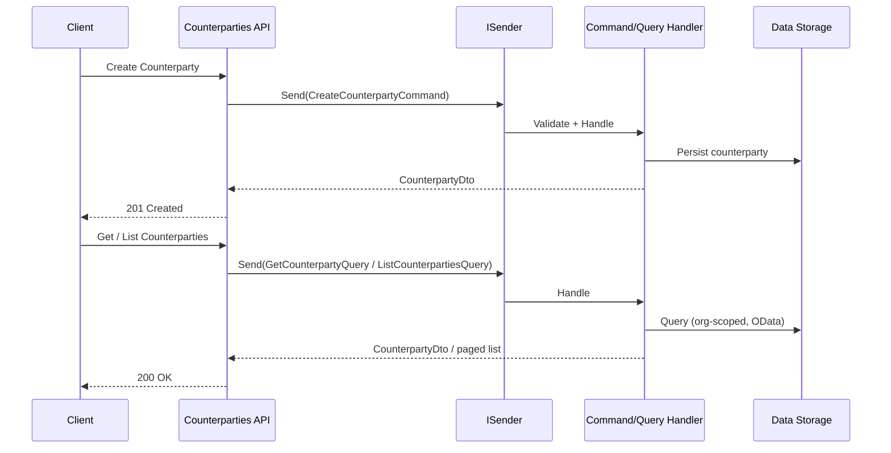

# Counterparties API

**On this page:** Base URL · Authentication · Counterparty Management Flow · Endpoints · Validation Rules · Bundles: export and import · Counterparty types · Error Responses · Authorization note

The Counterparties API manages counterparty records — the business entities (companies, subsidiaries, etc.) that workflow executions are run against — within the IniaAi Platform. The API is a straightforward CRUD surface: list (with OData paging/filtering), get by ID, create, update, and delete. Counterparties can be organized hierarchically via `parentId` and categorized via counterparty type IDs. A counterparty also carries an optional `lastFinancialAnalysisResult` field that simply stores the JSON of the most recent analysis run produced elsewhere; this API does not itself compute financial analysis, peer comparisons, or visualizations.

Counterparty is the name in the API: its paths, fields, error codes and placeholders. Every screen and every message a person reads calls a counterparty a **Company**, so the analyst app's page is **Company Management** and the error texts below say company ([Key Terms](../glossary.md#counterparty)).

## Base URL
`/api/v1/counterparties`

## Authentication
All endpoints require authentication and tenant context:

```http
Authorization: Bearer {access_token}
X-Tenant-Id: {organization_id}
Content-Type: application/json
```

## Counterparty Management Flow



## Endpoints

### List Counterparties

#### `GET /api/v1/counterparties`

Retrieves a paginated list of counterparties with OData query support. List items are `CounterpartyListItemDto` (a lightweight projection — identity, hierarchy, and naming only) wrapped in an `ODataPaginatedResponse`.

**Query Parameters:**

| Parameter | Type | Description |
|-----------|------|-------------|
| `$filter` | string | OData filter expression |
| `$orderby` | string | OData ordering expression |
| `$top` | integer | Maximum number of results |
| `$skip` | integer | Number of results to skip |
| `$count` | boolean | Include total count in response |
| `counterpartyTypeId` | string | Filter by a single counterparty type ID |
| `counterpartyTypeIds` | string | Filter by multiple counterparty type IDs (comma-separated) |

**Example Request:**

```bash
curl -X GET "https://api.example.com/api/v1/counterparties?$top=20&$orderby=name asc&$filter=contains(name,'Corp')" \
  -H "Authorization: Bearer {token}" \
  -H "X-Tenant-Id: org-123"
```

**Response (200 OK):**

```json
{
  "value": [
    {
      "id": "cp-12345",
      "parentId": null,
      "counterpartyTypeIds": ["type-67890"],
      "name": "Acme Corporation",
      "nameVariants": "ACME Corp|Acme Inc"
    }
  ],
  "@odata.count": 1,
  "@odata.skip": 0,
  "@odata.top": 20
}
```

### List Peer Candidates

#### `GET /api/v1/counterparties/peer-candidates`

Returns the counterparties that the run form may offer as peer companies. Each one says whether its stored financial analysis can fill a column of the Peer Financials block, and why not when it cannot. The check reads the stored analysis through the same reader the block uses (`StoredPeerFinancialsReader`), so a candidate marked usable is one the block can render.

**Only the paid build judges the stored financials.** The reader belongs to the PeerFinancials module, which a build from the open source does not include. There the route still lists the counterparties of the accepted types, but judges none: every candidate comes back with `isEligible: true` and `availability: "NotJudged"`, and no `reportedName`, `currency` or `latestPeriodEnd`.

**Unusable counterparties stay in the list.** A counterparty of an accepted type that cannot contribute comes back with `isEligible: false` and the reason in `availability`, so the client can show it disabled and say what to fix.

**Counterparties of a type the workflow does not accept are left out.** With `workflowTypeId`, only counterparties that carry one of the workflow type's counterparty type mappings are returned, the same rule the counterparty picker uses. So absence means a wrong type or another organization, and `isEligible: false` means the right type with unusable data. A workflow type that maps no counterparty types, or no `workflowTypeId`, applies no type filter.

**Query Parameters:**

| Parameter | Type | Description |
|-----------|------|-------------|
| `workflowTypeId` | string | Optional, at most 100 characters. The workflow the peers are for. Its counterparty type mappings decide which counterparties appear, and the Peer Data Path of its Peer Financials block decides where the figures are read from. Without it, every type appears and the figures are read from the root of the stored analysis. A workflow type that does not exist, or that the organization cannot access, returns `404` |
| `search` | string | Optional, at most 250 characters. A name fragment matched against `name` and `nameVariants`, case-insensitive |
| `skip` | integer | Optional. Candidates to skip. Default `0` |
| `top` | integer | Optional. Candidates to return, from 1 to 200. Default `50`. Each candidate costs a parse of its stored analysis |

Results are ordered by name.

**Example Request:**

```bash
curl -X GET "https://api.example.com/api/v1/counterparties/peer-candidates?workflowTypeId=CorporatesCreditReport" \
  -H "Authorization: Bearer {token}" \
  -H "X-Tenant-Id: org-123"
```

**Response (200 OK):**

```json
[
  {
    "id": "cp-12345",
    "name": "Acme Corporation",
    "nameVariants": "Acme Corp",
    "reportedName": "Acme Corp Ltd",
    "isEligible": true,
    "availability": "Available",
    "currency": "EUR",
    "latestPeriodEnd": "2024-12-31T00:00:00"
  },
  {
    "id": "cp-67890",
    "name": "Beta Holdings",
    "nameVariants": "",
    "reportedName": "Beta Holdings",
    "isEligible": false,
    "availability": "NotAnalysed",
    "currency": null,
    "latestPeriodEnd": null
  }
]
```

| `availability` | Meaning |
|---|---|
| `Available` | The stored analysis has at least one period with a kind and an end date. The peer can fill a column |
| `NotAnalysed` | Nothing is stored. The counterparty has not been through financial analysis, and running it is the fix |
| `Unreadable` | Something is stored, but it is not valid JSON |
| `NoUsablePeriods` | The JSON is valid, but no period has both a kind and an end date |
| `NotJudged` | The build has no PeerFinancials module, so nothing read the stored analysis. The candidate is eligible |

- `reportedName` is the name the peer column will carry: the `companyName` of the stored analysis, or the counterparty's name when the analysis has none.
- `currency` and `latestPeriodEnd` come from the stored analysis. Whether a period matches the target's, and whether the currency converts, depend on the target, which is unknown when the picker loads. The response reports them, and the client shows them, instead of filtering on them.
- `latestPeriodEnd` is the end of the newest stored period. A counterparty keeps no record of when its analysis ran, so this date is the measure of how current the figures are.

### Get Counterparty

#### `GET /api/v1/counterparties/{id}`

Retrieves detailed information about a specific counterparty.

**Path Parameters:**

| Parameter | Type | Required | Description |
|-----------|------|----------|-------------|
| `id` | string | Yes | Counterparty ID |

**Example Request:**

```bash
curl -X GET "https://api.example.com/api/v1/counterparties/cp-12345" \
  -H "Authorization: Bearer {token}" \
  -H "X-Tenant-Id: org-123"
```

**Response (200 OK):**

```json
{
  "id": "cp-12345",
  "parentId": null,
  "counterpartyTypeIds": ["type-67890"],
  "name": "Acme Corporation",
  "nameVariants": "ACME Corp|Acme Inc",
  "email": "contact@acme.com",
  "phoneNumber": "+1-555-0123",
  "website": "https://www.acme.com",
  "address": "123 Business St, New York, NY 10001, USA",
  "lastFinancialAnalysisResult": "{...analysis JSON...}",
  "properties": {
    "reportingStyle": "{\"currency\":\"JPY\",\"units\":\"millions\"}",
    "coverageNotes": "NAV is quoted as the prior month's close"
  }
}
```

> `nameVariants` and `address` are plain strings, not arrays or nested objects. Name variants are stored as a single string, separated by `|` (e.g. `ACME Corp|Acme Inc`, `CounterpartyNameRules.NAME_VARIANTS_SEPARATOR`). Fund matching and the `{CounterpartyName.Key}` placeholder lookup compare each trimmed variant on its own, and the whole string too; a comma does not separate variants. The `CounterpartyDto` does not include `organizationId`, `createdAt`, or `updatedAt` fields. `properties` is a freeform key→value bag (or `null` when empty) — see [Properties](#properties).

### Create Counterparty

#### `POST /api/v1/counterparties`

Creates a new counterparty record.

**Request Body:**

```json
{
  "id": "cp-12345",
  "parentId": null,
  "counterpartyTypeIds": ["type-67890"],
  "name": "Acme Corporation",
  "nameVariants": "ACME Corp|Acme Inc",
  "email": "contact@acme.com",
  "phoneNumber": "+1-555-0123",
  "website": "https://www.acme.com",
  "address": "123 Business St, New York, NY 10001, USA",
  "lastFinancialAnalysisResult": null,
  "properties": { "reportingStyle": "{\"currency\":\"JPY\"}", "coverageNotes": "NAV is prior-month close" }
}
```

`id` is optional on create; if omitted the server assigns a GUID. `counterpartyTypeIds` and `name` are required (see [Validation Rules](#validation-rules)). `nameVariants` and `address` are strings.

What create does with an `id` that is already taken (`CreateCounterpartyCommandHandler`):

| The `id` belongs to | Result |
|---|---|
| A live counterparty of this organization | `409`, `Counterparty.DuplicateId` |
| A counterparty of another organization | `409`, `Counterparty.DuplicateId` |
| A soft-deleted counterparty of this organization | The counterparty comes back to life with the request's fields, types and properties, and the answer is `201` |

A type id that names no counterparty type is dropped without an error, so a counterparty can end up with fewer types than the request named. A `parentId` is stored as sent.

**Example Request:**

```bash
curl -X POST "https://api.example.com/api/v1/counterparties" \
  -H "Authorization: Bearer {token}" \
  -H "X-Tenant-Id: org-123" \
  -H "Content-Type: application/json" \
  -d '{
    "name": "Acme Corporation",
    "counterpartyTypeIds": ["type-67890"],
    "email": "contact@acme.com"
  }'
```

**Response (201 Created):**

Returns the created `CounterpartyDto` (same shape as [Get Counterparty](#get-counterparty)) with a `Location` header pointing at the new resource.

```json
{
  "id": "cp-12345",
  "parentId": null,
  "counterpartyTypeIds": ["type-67890"],
  "name": "Acme Corporation",
  "nameVariants": "",
  "email": "contact@acme.com",
  "phoneNumber": null,
  "website": null,
  "address": null,
  "lastFinancialAnalysisResult": null,
  "properties": null
}
```

### Update Counterparty

#### `PUT /api/v1/counterparties/{id}`

Replaces an existing counterparty record. The request body is the same shape as the create body (minus `id`), and every field except `properties` is written as sent (`UpdateCounterpartyCommandHandler`): a field the body leaves out is cleared. A body without `parentId` detaches the counterparty from its parent, so a fund stops inheriting its manager's properties. To change one field, read the record with `GET /api/v1/counterparties/{id}`, change that field, and send the rest back unchanged.

**Request Body:**

```json
{
  "parentId": null,
  "counterpartyTypeIds": ["type-67890"],
  "name": "Acme Corporation",
  "nameVariants": "ACME Corp|Acme Inc",
  "email": "contact@acme.com",
  "phoneNumber": "+1-555-0123",
  "website": "https://www.acme.com",
  "address": "123 Business St, New York, NY 10001, USA",
  "lastFinancialAnalysisResult": null,
  "properties": { "reportingStyle": "{\"currency\":\"JPY\"}", "coverageNotes": "NAV is prior-month close" }
}
```

**Response (200 OK):** Empty response on success

The update replaces the type set with the types the request names; a type id that names no type is dropped without an error. A counterparty of another organization answers `404`, as a missing one does.

### Properties

`properties` is an optional **freeform bag** — author-coined `key → value` string pairs with no fixed schema; keys emerge with use. A value is arbitrary text: prose, a markdown table, a prompt snippet, or a JSON document. Workflows read a value with a `{Counterparty.key}` placeholder, or `{Funds.key}` per loop iteration (see [Loop Processing](../../architecture/workflow-engine/loop-processing.md#counterparty-data-per-iteration)). A deeper path traverses the value **exactly like a block response**: a JSON value is walked by path (`{Counterparty.reportingStyle.currency}`), XML-tagged text has its leading tag extracted, and anything else substitutes verbatim. A key absent on a fund falls back to the same key on its parent counterparty.

**Keys are case-insensitive.** A value saved under `ReportingStyle`, read via `{Counterparty.reportingstyle}`, and later overwritten by a block keyed `reportingStyle` all address one entry — case variants never split into two keys. The API camelCases bag keys on serialization (a stored `ReportingStyle` is returned as `reportingStyle`), so a response may echo a different case than you sent; because matching ignores case, resolution is unaffected.

On write (create/update) the field is a partial-update lever, so a client that does not manage properties never disturbs them:

| `properties` in request | Effect |
|---|---|
| omitted or `null` | stored bag left unchanged; on create, the counterparty is created with no properties |
| an object (even `{}`) | stored bag replaced wholesale — an empty object clears it |

Blank keys are dropped and key whitespace is trimmed on write. A workflow block can also **write back** into the bag: with *Save Output for Company* enabled and output type *Property*, the block merges its raw output into `properties` under a configured key (see [Block reference](../../guides/blocks/block-reference.md)). Write-back runs only in a regular execution against a resolved counterparty, never in the monitoring `Funds` loop.

### Delete Counterparty

#### `DELETE /api/v1/counterparties/{id}`

Deletes a counterparty and every counterparty beneath it — its children, their children, and so on — so no child stays active under a deleted parent. Each is soft-deleted. A counterparty of another organization answers `404`, as a missing one does.

**Response (204 No Content):** Empty response on success


## Validation Rules

Create and update requests are validated before persistence (`CounterpartyFieldsValidator`). Violations return **400 Bad Request**.

| Field | Rules |
|-------|-------|
| `counterpartyTypeIds` | Required; at least one non-empty type ID |
| `name` | Required; max length 250; must pass the name content rules below |
| `nameVariants` | Optional; max length 500; must pass the name-variant content rules below |
| `email` | Must be a valid email address when supplied; max length 100 |
| `phoneNumber` | Must match `^\+?[0-9\s\-]+$` when supplied; max length 20 |
| `website` | Must be a valid absolute `http`/`https` URL when supplied; max length 1000 |
| `address` | Max length 1000 |
| `lastFinancialAnalysisResult` | Max length 1,000,000 characters (the persisted column itself is unbounded; this cap only guards against pathological payloads) |
| `properties` keys | Optional; each key max length 200 |
| `properties` values | Optional; each value max length 100,000 |

### Name content rules

Counterparty names are interpolated into workflow prompts and raw JSON request payloads (e.g. WebApiCall blocks), so characters that could break JSON strings or template placeholders are rejected (`CounterpartyNameRules`):

- **`name`** must not contain double quotes, fancy quotes, backslashes, braces, backticks, **pipes**, or angle brackets, nor any control characters. Apostrophes are allowed (e.g. `O'Reilly`).
- **`nameVariants`** follows the same rules **except the pipe (`|`) is allowed**, because it acts as the separator between variants (e.g. `ibm corp|int.bus.m`).

## Bundles: export and import

A bundle is one JSON file that carries every active counterparty of an organization, so an administrator can move the organization's counterparties to another instance without a database copy. Both endpoints admit `Admin` and `SuperAdmin` only: the export reveals every email address and stored financial analysis of the organization, and the import rewrites its master data.

### `GET /api/v1/counterparties/export`

Returns the bundle as a file download named `companies <organization> <date>.json`, such as `companies Acme 2026-11-02.json`. The file holds:

- `bundleFormatVersion` (`1`), `sourceInstance` (the exporting deployment's configured instance name, else its host), `sourceOrganizationId`, `sourceOrganizationName` and `exportedAt`.
- `counterpartyTypes`: the types the bundled counterparties use, each with `name` and `description`, so a target that lacks one can create it.
- `counterparties`: one entry per active counterparty with `id`, `parentId`, `name`, `nameVariants`, `email`, `phoneNumber`, `website`, `address`, `lastFinancialAnalysisResult`, `properties` and `counterpartyTypeNames`.

Ids travel and are kept on import. Executions, reports, baseline registrations and re-run recipes reference a counterparty by id, and a customer's instances are expected to agree on those ids. Soft-deleted counterparties are not exported, and a counterparty whose parent is soft-deleted travels as a root. Document links and user links do not travel.

### `POST /api/v1/counterparties/import?dryRun={true|false}`

Body: the bundle JSON from the export endpoint (`application/json`, up to 200 MB). With `dryRun=true` the response is the plan and nothing is written. Without it the plan is applied in one transaction and the response says what happened. Both answer `200` with a `CounterpartyImportPlanDto`:

| Field | Meaning |
|---|---|
| `applied` | `false` for a dry run |
| `createCount`, `updateByIdCount`, `resurrectCount`, `updateByNameCount`, `unchangedCount`, `skipCount` | Rows per disposition |
| `counterpartyTypesToCreate` | Type names this deployment lacks that the import creates |
| `rows[]` | One per bundled counterparty, in bundle order: `sourceId`, `name`, `disposition`, `targetId`, `skipReason`, `detail` |

`disposition` is one of `Create`, `UpdateById`, `Resurrect`, `UpdateByName`, `Unchanged` and `Skip`; a `Skip` row carries a `skipReason` and a `detail` sentence. How a row lands, in this order (`ImportCounterpartiesCommandHandler`):

1. A row that breaks a field rule of the create endpoint (name characters, email, phone, website, lengths) is skipped as `Invalid`. A row with no type is allowed, because the source can hold one.
2. A row whose id an earlier row of the bundle already carries is skipped as `DuplicateIdInBundle`.
3. The remaining rows land parents first. A cycle in the parent links refuses the whole bundle (`400`, `CounterpartyBundle.Cycle`).
4. The row's id is looked up inside the organization, soft-deleted rows included. A live match is `UpdateById`; a soft-deleted match is `Resurrect`. An id held by another organization is skipped as `IdHeldByAnotherOrganization`.
5. Without an id match, the live counterparties with the same name (case-insensitive) are counted. Exactly one is `UpdateByName`: that counterparty is updated, keeps its own id, and the bundle's children of the row follow it. More than one is skipped as `AmbiguousName`. None is `Create`, with the source id.
6. An update that would give two live counterparties one name, or a second row landing on a counterparty an earlier row already landed on, is skipped as `NameCollision`.
7. A row whose parent did not land, or whose parent is neither in the bundle nor in the organization, is skipped as `ParentNotLanded`, with its subtree.
8. A matched counterparty that already equals the row in every field is `Unchanged` and is not written. A resurrected row is never `Unchanged`.

Bundle values win on an update: every field, the property bag replaced wholesale, the type set replaced, the financial analysis replaced. Types match by name across the deployment and are created with the bundle's description when missing. The import never deletes: a counterparty absent from the bundle stays. Matching reads the organization as it stood before the import, so a row this import creates or renames is never a match for a later row. A second import of the same bundle reports every row as `Unchanged`.

Errors: `400` for a malformed bundle, an unsupported `bundleFormatVersion` (`CounterpartyBundle.VersionUnsupported`) or a parent cycle; `409` `CounterpartyBundle.ConcurrentChange` when a concurrent change collided with the commit, in which case nothing was written.

## Counterparty types

A counterparty type is shared by every organization. A counterparty carries one or more types, and a workflow type can accept only some of them. The platform builds in three types — `Real Money Fund Manager`, `Real Money Fund`, `Corporation` — and the paid build's fund-monitoring module adds four, `Hedge Fund Manager`, `Hedge Fund`, `Private Equity Fund Manager` and `Private Equity Fund` (`BuiltInCounterpartyTypes`, which collects each module's `BuiltInCounterpartyType` rows). The workflows find them by name and the startup seeds them when they are missing, so a built-in type keeps its name and cannot be deleted; its description can change. In a build without the module, a stored `Hedge Fund` row is an ordinary type that can be renamed or deleted.

### `GET /api/v1/counterparty-types`

OData-paged list of every type. Each row (`CounterpartyTypeListItemDto`) carries `id`, `name`, `description`, `counterpartyCount` and `isBuiltIn`. `counterpartyCount` counts only the caller's organization's counterparties, so no organization learns how many another one has. Any signed-in user reads it.

### `POST /api/v1/counterparty-types`

Body `{ "name": "Sovereign", "description": "A state borrower" }`. The name is trimmed, required, at most 250 characters, and unique ignoring case; the description is at most 1000 characters. Returns `201` with the new row. `409` when another type has the name.

### `PUT /api/v1/counterparty-types/{id}`

Same body; replaces the name and the description. Returns `200` with the row, counted for the caller's organization. `404` for an unknown id; `409` when another type has the name, or when the type is built in and the name changed.

### `DELETE /api/v1/counterparty-types/{id}`

Soft-deletes the type. The counterparties that carried it keep their other types. Returns `204`. `404` for an unknown id; `409` for a built-in type.

`POST`, `PUT` and `DELETE` are for editors, because a change reaches every organization (see [the canonical role-gate matrix](../../features/user-management/authorization.md#the-canonical-role-gate-matrix-v1-api)). The web app's page `/counterparty-types` drives them.

## Error Responses

The Counterparties API answers an error with RFC 7807 Problem Details, as every API does ([Error Handling](index.md#error-handling)).

| Status | `code` | When | `title` |
|---|---|---|---|
| `400` | the field name, under `errors` | A field breaks a [validation rule](#validation-rules) | The rule's message, such as `Name is required.` or `At least one company type is required.` |
| `404` | `Counterparty.NotFound` | Get, update or delete of an id the organization does not hold | `Company with ID '{id}' was not found.` |
| `409` | `Counterparty.DuplicateId` | Create with an id another live counterparty holds | `A company with ID '{id}' already exists in your organization. Open the Companies tab to update the existing record, or choose a different reference ID.`, or for another organization's id `A company with ID '{id}' already exists. Choose a different reference ID.` |
| `409` | `Counterparty.DuplicateName` | Create or update gives two live counterparties of the organization one name (the unique index `IX_Counterparties_Name_OrganizationId_NotDeleted`) | `A company with the name '{name}' already exists in this organization. If it is classified under a different company type, open the Companies tab and assign the correct type.` |

`GET /counterparties` answers any failure with a bare `500`.

## Authorization note

The CRUD endpoints carry **no role gate** — any authenticated user in the tenant can read and write counterparties (only the base `[Authorize]` applies). The bundle endpoints, `GET /counterparties/export` and `POST /counterparties/import`, carry `[Authorize(Roles = Roles.ADMIN_ROLES)]`: `Admin` and `SuperAdmin`. See [the canonical role-gate matrix](../../features/user-management/authorization.md#the-canonical-role-gate-matrix-v1-api).
