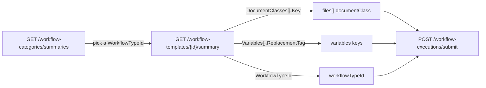

# Discovering Workflow Types & Document Classes

**On this page:** The discovery path · 1. List runnable workflow types · 2. Inspect a workflow type's inputs · Document categories (optional) · A note on `GET /workflow-templates` · You're done when · Related pages

Before you can [submit a workflow execution](submit-workflow-execution.md) you need three things the submit request asks for but does not explain: the **workflow type ID** to run, the **document class keys** to tag your files with, and the **variable replacement tags** to override. This page shows the read-only endpoints that surface those values and exactly how each one feeds into a submit call.

All endpoints here require only [authentication and tenant context](system-users.md) — a [system user](system-users.md) token plus `X-Tenant-Id`. None of them require an editor or admin role (the one exception is called out below).

## The discovery path



1. **List what you can run** — `GET /workflow-categories/summaries` returns the workflow types shown to the calling user, grouped by category, as lightweight `(Id, WorkflowTypeId, WorkflowTypeName, IsAvailable)` rows. That is every type the tenant has access to, minus any hidden by the caller's [workflow type visibility](../../features/user-management/workflow-type-visibility.md) selection — with no selection (the default) it is the full tenant list, and a selection only ever narrows it. A hidden type is still runnable; the filter changes what is listed, not what is allowed.
2. **Inspect one workflow type** — `GET /workflow-templates/{workflowTypeId}/summary` returns its required document classes and variables.
3. **Submit** — feed the IDs you discovered into [`POST /workflow-executions/submit`](submit-workflow-execution.md).

## 1. List runnable workflow types

### `GET /api/v1/workflow-categories/summaries`

Returns a lightweight, projection-optimized list of categories, each carrying its workflow types. This is the cheapest way to answer "what can I run?" — it omits variables and document classes (use step 2 for those).

**Request:**

```bash
curl -X GET "$BASE_URL/api/v1/workflow-categories/summaries" \
  -H "Authorization: Bearer $TOKEN" \
  -H "X-Tenant-Id: Default"
```

**Response (200 OK)** — `ListResponse<WorkflowCategorySummaryDto>`:

```json
{
  "value": [
    {
      "id": "asset-management",
      "name": "Asset Management",
      "description": "Hedge-fund, mutual-fund, and private-equity analysis.",
      "displayOrder": 1,
      "workflows": [
        {
          "id": "wf-7c1f...",
          "workflowTypeId": "CorporatesCreditReport",
          "workflowTypeName": "Corporates Credit Report",
          "isAvailable": true,
          "creditCost": null,
          "maxPages": null
        }
      ]
    }
  ]
}
```

The field you carry forward is **`workflowTypeId`** (e.g. `CorporatesCreditReport`). `isAvailable` is always `true` here: the handler sets it so, and leaves out the internal-only types (`WorkflowType.GENERIC`, `WorkflowType.TEST_WORKFLOW_TYPE`) entirely. When no category is visible to this user in this tenant, the response is `200 OK` with an empty `value` array — the controller never answers `204`, although its Swagger attributes declare one.

> Source: `WorkflowCategoriesController.GetWorkflowCategorySummaries` (`[HttpGet("summaries")]`), `WorkflowCategorySummaryDto`, `WorkflowSummaryDto`.

> [!TIP]
> **Need the full picture in one call?**
>
> `GET /api/v1/workflow-categories?includeWorkflows=true` returns the categories with each workflow's full `WorkflowDto` (variables and document classes inline), so you can skip step 2. Unlike `/summaries`, it is **not** narrowed by the per-user [visibility selection](../../features/user-management/workflow-type-visibility.md), and it does not leave out the internal types — it always lists the tenant's full set. Without `includeWorkflows=true` it returns the categories alone. It is also heavier — prefer `summaries` for a menu and the per-type `summary` endpoint (below) for the one type you are about to run.

## 2. Inspect a workflow type's inputs

### `GET /api/v1/workflow-templates/{workflowTypeId}/summary`

Given a `workflowTypeId` from step 1, this returns the form the submit endpoint expects you to fill: its **document classes** and **variables**.

**Request:**

```bash
curl -X GET "$BASE_URL/api/v1/workflow-templates/CorporatesCreditReport/summary" \
  -H "Authorization: Bearer $TOKEN" \
  -H "X-Tenant-Id: Default"
```

**Response (200 OK)** — `WorkflowDto` (trimmed to the fields that matter for submitting):

```json
{
  "id": "wf-7c1f...",
  "workflowTypeId": "CorporatesCreditReport",
  "workflowTypeName": "Corporates Credit Report",
  "isAvailable": true,
  "isCounterpartyRequired": false,
  "supportsPeerCompanies": true,
  "classifiesDocuments": false,
  "classesToChoose": [],
  "creditCost": null,
  "maxPages": null,
  "documentClassKeys": ["AnnualReport", "FinancialStatements"],
  "counterpartyTypeMappings": ["Corporation"],
  "documentClasses": [
    {
      "key": "AnnualReport",
      "displayName": "Annual Report",
      "description": "The company's latest annual report.",
      "requirement": "Required",
      "shouldBeSingular": true,
      "isOutputDocument": false,
      "documentCategoryId": "financials",
      "llmDescription": "The audited annual report of the company itself; not a subsidiary's, not an interim report."
    },
    {
      "key": "FinancialStatements",
      "displayName": "Financial Statements",
      "description": "Audited financial statements.",
      "requirement": "Suggested",
      "shouldBeSingular": false,
      "isOutputDocument": false,
      "documentCategoryId": "financials"
    }
  ],
  "variables": [
    {
      "id": "var-1",
      "replacementTag": "reportingPeriod",
      "displayName": "Reporting Period",
      "description": "The fiscal period to analyse.",
      "type": "String",
      "isRequired": true,
      "isHidden": false,
      "isConfidential": false,
      "defaultValue": null,
      "options": {}
    },
    {
      "id": "var-2",
      "replacementTag": "currency",
      "displayName": "Currency",
      "type": "Dropdown",
      "isRequired": true,
      "defaultValue": "USD",
      "options": { "USD": "US Dollar", "EUR": "Euro" }
    }
  ]
}
```

Two flags are derived from the template, never configured:

- `isCounterpartyRequired` is `true` when any block uses a `{Counterparty…}` placeholder.
- `supportsPeerCompanies` is `true` when any block is a Peer Financials block or uses a `{PeerCompanies…}` placeholder. Either one reads the `peerCompanyIds` of a [submit](submit-workflow-execution.md), so a client offers peer selection only when this is `true`. [Peer candidates](counterparties.md#list-peer-candidates) lists the counterparties to offer. Only this summary endpoint fills the flag: the category listings do not load blocks and always report `false`.

- `classifiesDocuments` is `true` when the platform reads each document a run is sent and decides its class. Then a file may come without a class, and `classesToChoose` lists the required classes the platform cannot recognise on its own, which a submit must still choose. `classesToChoose` is empty when `classifiesDocuments` is `false`.

- `creditCost` and `maxPages` are always `null` in the open build, where `IWorkflowCreditCost` and `IWorkflowPageLimit` keep their defaults. `WorkflowDto` (this summary and `/workflow-categories?includeWorkflows=true`) and `WorkflowSummaryDto` (`/workflow-categories/summaries`) both carry them.


A `404` with `code: "Workflow.NotFound"` and `title: "Workflow for type '{workflowTypeId}' was not found or is not accessible."` means the workflow type does not exist, the tenant has no access to it, or it is one of the internal types `Generic` and `TestWorkflowType`.

> Source: `WorkflowTemplatesController.GetSummary` (`[HttpGet("{workflowTypeId}/summary")]`), `WorkflowDto`, `DocumentClassDto`, `WorkflowVariableDto`.

### How these fields feed `submit`

The submit endpoint's metadata is keyed off the exact identifiers above:

| Submit metadata field | Source field from `/summary` | Rule |
|---|---|---|
| `workflowTypeId` | `workflowTypeId` | The type you chose in step 1. |
| `files[].documentClass` | `documentClasses[].key` | Use the **`key`**, not `displayName`. Every class whose `requirement` is `Required` must be present across your files — unless `/summary` reports `classifiesDocuments: true`: then a file may omit `documentClass` and the platform classifies it, and only the keys in `classesToChoose` must be chosen at submit. |
| `variables` (object keys) | `variables[].replacementTag` | The dictionary is keyed by **`replacementTag`**. Only supply variables that differ from `defaultValue`; a required variable with no default must be supplied. |

> Source: `SubmitWorkflowExecutionRequest` (`Variables` "key is the variable's ReplacementTag"; `Files` matched by index), `SubmitWorkflowExecutionCommandHandler` (`effective[variable.ReplacementTag]`), `WorkflowExecutionOrchestrator.ClassErrorsTheScreeningCannotSettle`.

So the workflow type above submits as:

```json
{
  "workflowTypeId": "CorporatesCreditReport",
  "files": [
    { "documentClass": "AnnualReport" }
  ],
  "variables": {
    "reportingPeriod": "2025-Q4"
  }
}
```

`AnnualReport` is required, so a file tagged with it must be present; `FinancialStatements` is only *suggested*, so it may be omitted. `currency` is omitted because its default `USD` is acceptable; `reportingPeriod` is required and has no default, so it must be supplied. See [Submit Workflow Execution](submit-workflow-execution.md#document-classes) for the multipart request that carries this metadata alongside the binary files.

`llmDescription` is the class description written for a model rather than a person, when the template author set one; it is `null` otherwise. A consumer building an upload UI shows `description`; `llmDescription` is what the platform's own models read ([document classes](../../guides/workflows/document-classes.md)).

## Document categories (optional)

Document classes reference a `documentCategoryId`. To resolve those IDs to human-readable category names — for example to group an upload UI — call:

### `GET /api/v1/document-categories`

```bash
curl -X GET "$BASE_URL/api/v1/document-categories" \
  -H "Authorization: Bearer $TOKEN" \
  -H "X-Tenant-Id: Default"
```

**Response (200 OK)** — `List<DocumentCategoryDto>`:

```json
[
  { "id": "financials", "name": "Financials", "displayOrder": 1, "createdAt": "2025-01-10T00:00:00Z" }
]
```

This is informational only; the submit endpoint matches on the document-class `key`, not on the category. Most integrations can skip it.

> Source: `DocumentCategoriesController.GetDocumentCategories` (`[HttpGet]`), `DocumentCategoryDto`.

## A note on `GET /workflow-templates`

There is also `GET /api/v1/workflow-templates`, which lists templates for the **template-authoring** UI. It is gated behind an editor role (`[Authorize(Roles = "WorkflowEditor,SuperAdmin")]`) and is **not** part of the integration discovery path — a plain system user will get `403`. Use `workflow-categories/summaries` (above) for discovery; reserve `workflow-templates` for [editing templates](../../features/workflow-template-versioning.md#saving-through-the-api) with an editor account.

> Source: `WorkflowTemplatesController.GetWorkflowTemplates` (`[HttpGet]`, `[Authorize(Roles = EDITOR_ROLES)]`).

## You're done when

You can name, for the workflow type you intend to run: its `workflowTypeId`, the `key` of every `Required` document class, and the `replacementTag` of every required variable that has no default. With those three in hand you have everything the [submit endpoint](submit-workflow-execution.md) needs — proceed to [API zero to result](../../guides/end-to-end/api-zero-to-result.md) for the full run-to-report walkthrough.

## Related pages

- [Provisioning a System User](system-users.md) — get the token these calls need.
- [Submit Workflow Execution](submit-workflow-execution.md) — where the discovered IDs are used.
- [Workflow Executions](workflow-executions.md) — the standard multi-step flow these endpoints also serve.
- [API zero to result](../../guides/end-to-end/api-zero-to-result.md) — the end-to-end integrator journey.
- [Key Terms](../glossary.md) — workflow type vs template vs execution, document class, and variable.
