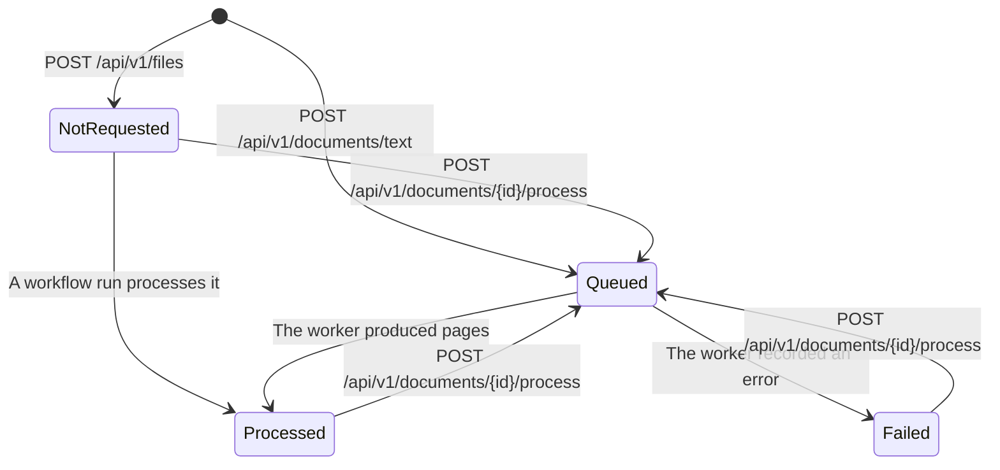
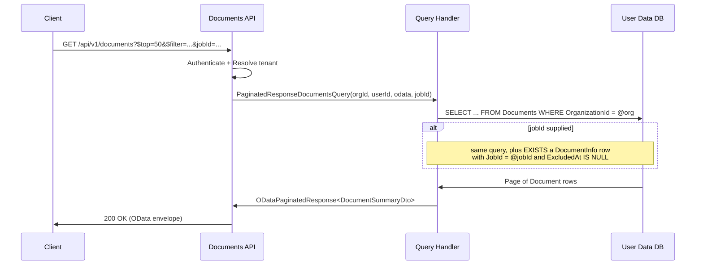

# Documents API

**On this page:** Base URL · Authentication · Document Lifecycle · Request Flow · Response Shapes · Endpoints · Error Responses · Behaviors Worth Knowing · Related APIs

The Documents API is the REST surface behind the web app's Documents pages — list,
view, metadata patch (including the static mark), soft-delete, bulk soft-delete,
paginated and searchable pages listing, and the text download — with server-side
pagination and filtering so clients do not need to load the full tenant corpus into memory.
It also owns the standalone path from a stored file to pages: a document
uploaded on its own, or created from pasted text, is processed into pages on
request — no workflow execution involved — and any page's full text reads back.

File bytes are uploaded and downloaded through the existing
[Files API](files.md); the Documents API manages the logical document record,
its metadata, and related pages.

## Base URL

`/api/v1/documents`

## Authentication

All endpoints require authentication and tenant context:

```http
Authorization: Bearer {access_token}
X-Tenant-Id: {organization_id}
Content-Type: application/json
```

The controller carries plain `[Authorize]`. Any authenticated member of the
target organization may list, read, patch, and process documents belonging to
that organization, and create text documents in it. The two delete endpoints
(`DELETE /documents/{id}` and `POST /documents/bulk-delete`) are gated to
`Roles.ADMIN_AND_OPERATOR_ROLES` (Admin, SuperAdmin, Operator). A `User` passes
only when the organization has the `delete-own-documents` capability, which a
closed module adds, and then deletes only the documents they uploaded; another
user's document answers as an unknown id. Any other caller gets `403 Forbidden`. A document of another organization answers
`404 Not Found` with `Document not found.`, exactly as an unknown id does, so a
caller cannot learn that the id exists elsewhere; the handler logs the attempt.

## Document Lifecycle

A document has no status column of its own: it is live until it is soft-deleted. What changes over its life is `processingState`, derived from three stamps on the row (`DocumentProcessingStates.Of`, see [Standalone processing](#standalone-processing)):



`DELETE /api/v1/documents/{id}` and `POST /api/v1/documents/bulk-delete` soft-delete the document in any state; it is then hidden from every read, and its blob is deleted best-effort in the same request ([Blob Cleanup](#blob-cleanup)).

## Request Flow



## Response Shapes

### `DocumentSummaryDto`

Returned in the list endpoint and as the base type for
`DocumentDetailDto`. Intentionally lean — the caller's own `organizationId`
is not included in each row because it is always the calling tenant.

| Field                | Type                  | Notes                                                      |
| -------------------- | --------------------- | ---------------------------------------------------------- |
| `id`                 | `string`              | Document id.                                               |
| `name`               | `string`              | Display name (max 250 chars).                              |
| `mediaType`          | `string`              | `MediaType` enum serialized by its member name (`ApplicationPdf`, `ImageJpeg`, `ImagePng`, `TextCsv`, `ApplicationVndMsExcel`, …), never a MIME string. |
| `sizeBytes`          | `long`                | Size of the underlying file.                               |
| `extension`          | `string`              | Leading dot included, e.g. `".pdf"`.                       |
| `userId`             | `string \| null`      | User who uploaded the document (may be null).              |
| `documentCategoryId` | `string \| null`      | Category id (global reference data).                       |
| `workflowTypeId`     | `string \| null`      | Non-null marks the doc as pinned to a static workflow.     |
| `class`              | `string \| null`      | Free-form classification tag.                              |
| `wasPasswordProtected` | `bool`              | The file arrived password-protected and is stored as a decrypted copy. |
| `processingState`    | `string`              | Where the document stands on the standalone processing path: `NotRequested`, `Queued`, `Processed`, `Failed` (see [Standalone processing](#standalone-processing)). Filterable. |
| `processingRequestedAt` | `DateTime?` (UTC ISO) | When standalone processing was last requested; null when it never was. |
| `processedAt`        | `DateTime?` (UTC ISO) | When the pipeline last finished producing pages, on any path; null on rows processed before the stamp existed. |
| `processingError`    | `string \| null`      | Why the last standalone attempt failed; cleared by the next request. |
| `createdAt`          | `DateTime` (UTC ISO)  | Creation timestamp.                                        |
| `updatedAt`          | `DateTime?` (UTC ISO) | Last update timestamp.                                     |

### `DocumentDetailDto`

Extends `DocumentSummaryDto` with descriptive fields and a page count.

| Field             | Type               | Notes                                                           |
| ----------------- | ------------------ | --------------------------------------------------------------- |
| `description`     | `string \| null`   | Free-form description (max 1000 chars).                         |
| `sources`         | `string[]`         | Provenance tags, e.g. `["User Upload"]`. Read-only through this API. |
| `topics`          | `string \| null`   | Topic metadata extracted during processing.                     |
| `tableOfContents` | `string \| null`   | Table-of-contents metadata extracted during processing.         |
| `pageCount`       | `int`              | Number of extracted pages (COUNT issued server-side).           |
| `fileMetadataId`  | `string`           | Id of the backing `FileMetadata` row. To download bytes, call [`GET /api/v1/files/{id}`](files.md) with the document `id` (the download endpoint resolves by document id, **not** `fileMetadataId`). |

### `PageSummaryDto`

Returned in the pages endpoint.

| Field            | Type               | Notes                                                           |
| ---------------- | ------------------ | --------------------------------------------------------------- |
| `id`             | `string`           | Page id.                                                        |
| `documentId`     | `string`           | Parent document id.                                             |
| `pageNumber`     | `int`              | Logical page number within the document.                        |
| `filePageNumber` | `int`              | Original page number in the source file (for multi-file merges).|
| `textPreview`    | `string \| null`   | First 200 chars of `Text`/`RawText`. Null if no text extracted. |
| `overview`       | `string \| null`   | AI-generated overview, when present.                            |
| `location`       | `string`           | `Page.Location` enum (`FullPage`, header variants, …).          |
| `status`         | `string`           | `Page.Status` enum (see below).                                 |
| `ocrNeedsReview` | `bool`             | `true` when the OCR fidelity check judged the page's transcription unreliable — the page carries no extracted text and is consumed as an image (see [OCR architecture](../../architecture/ocr/index.md)). |
| `hasEmbedding`   | `bool`             | `true` if an embedding vector has been generated for the page.  |
| `embeddingModel` | `string \| null`   | Model name when `hasEmbedding` is true; otherwise `null`.       |
| `sourceUrl`      | `string \| null`   | Source URL for pages derived from web content.                  |

`Page.Status` enum values (`platform/IniaAi.Domain/Enums/PageStatus.cs`): `Undefined` (0, status not set),
`NotProcessed`, `ProcessedSuccessfully`, `ExtractedWithErrors`, `OCRFallback`,
`OCRSuccessful`, `OCRFailed`, `OCRNeedsReview`.

### `PageDetailDto`

Returned by the single-page endpoint. Extends `PageSummaryDto` with the text itself.

| Field          | Type             | Notes                                                                 |
| -------------- | ---------------- | --------------------------------------------------------------------- |
| `text`         | `string \| null` | The page's full text; null when nothing was extracted.                |
| `readableText` | `string \| null` | What an extraction reads for the page: the text, or the overview when the page is image-only (`ocrNeedsReview`). |
| `embeddingDimensions` | `int \| null` | The number of dimensions of the page's embedding vector; null when the page has none. |
| `sectionTitles` | `string \| null` | The section titles the document's table of contents gives the page, comma-separated; null when the document has no table of contents or the page has no title. |

### OData Paginated Response Envelope

Both list endpoints (`GET /documents`, `GET /documents/{id}/pages`) return:

```json
{
  "value":           [ /* array of item DTOs */ ],
  "@odata.count":    123,
  "@odata.skip":     0,
  "@odata.top":      50
}
```

Paging, `$count` and the missing default page size work as on every OData list: see [OData list conventions](index.md#odata-list-conventions). Send `$top` explicitly.

## Endpoints

### List Documents

#### `GET /api/v1/documents`

Returns a paginated, OData-filterable list of documents in the caller's
organization. Supports an optional `jobId` shortcut that narrows the result to
documents processed under a specific workflow job (via `DocumentInfo.JobId`).

**Query Parameters:**

| Parameter  | Type   | Required | Description                                                                                      |
| ---------- | ------ | -------- | ------------------------------------------------------------------------------------------------ |
| `$filter`  | OData  | No       | e.g. `name eq 'Contract.pdf'`, `class eq 'legal-agreement'`, `contains(name, 'Invoice')`.        |
| `$orderby` | OData  | No       | e.g. `createdAt desc`, `name asc`.                                                               |
| `$top`     | int    | No       | Page size. Omitted means no limit (see the envelope notes above).                                |
| `$skip`    | int    | No       | Offset.                                                                                          |
| `$count`   | bool   | No       | When `true`, the response includes the total count in `@odata.count`.                            |
| `jobId`    | string | No       | Narrows the result to documents linked to that workflow job. Applied before OData filtering.     |

OData is only available on the fields present on `DocumentSummaryDto`.
`jobId` is a plain query parameter, not an OData path segment.

**Example Request:**

```bash
curl -X GET "https://api.example.com/api/v1/documents?\$top=20&\$orderby=createdAt%20desc&\$count=true" \
  -H "Authorization: Bearer {token}" \
  -H "X-Tenant-Id: org-123"
```

**Example — documents linked to a workflow job:**

```bash
curl -X GET "https://api.example.com/api/v1/documents?jobId=job-12345&\$top=100" \
  -H "Authorization: Bearer {token}" \
  -H "X-Tenant-Id: org-123"
```

**Response (200 OK):**

```json
{
  "value": [
    {
      "id": "doc-abc123",
      "name": "Q4 Financial Report.pdf",
      "mediaType": "ApplicationPdf",
      "sizeBytes": 2048576,
      "extension": ".pdf",
      "userId": "user-123",
      "documentCategoryId": "financial-reports",
      "workflowTypeId": null,
      "class": "Company Report",
      "wasPasswordProtected": false,
      "processingState": "Processed",
      "processingRequestedAt": null,
      "processedAt": "2025-01-15T10:31:40Z",
      "processingError": null,
      "createdAt": "2025-01-15T10:30:00Z",
      "updatedAt": "2025-01-15T10:32:00Z"
    }
  ],
  "@odata.count": 42,
  "@odata.skip": 0,
  "@odata.top": 20
}
```

**`jobId` resolution rules:**

- Tenant-safe. A `jobId` that matches only `DocumentInfo` rows in other orgs
  returns an empty page — the server never reveals that a matching execution
  exists in another tenant.
- Resolution is one query: the tenant-scoped document query gains a correlated
  subquery that keeps a document only when a `DocumentInfo` row links it to the
  job (`DocumentInfo.IsRunInputOf`). The document is only returned if it
  belongs to the caller's organization.
- Only run input counts: a `DocumentInfo` row a stage took out of the run
  (`ExcludedAt` set) does not match, so such a document is not returned.

### Get Document

#### `GET /api/v1/documents/{id}`

Returns the full detail projection for a single document.

**Path Parameters:**

| Parameter | Type   | Required | Description                              |
| --------- | ------ | -------- | ---------------------------------------- |
| `id`      | string | Yes      | Document id.                             |

**Example Request:**

```bash
curl -X GET "https://api.example.com/api/v1/documents/doc-abc123" \
  -H "Authorization: Bearer {token}" \
  -H "X-Tenant-Id: org-123"
```

**Response (200 OK):**

```json
{
  "id": "doc-abc123",
  "name": "Q4 Financial Report.pdf",
  "mediaType": "ApplicationPdf",
  "sizeBytes": 2048576,
  "extension": ".pdf",
  "userId": "user-123",
  "documentCategoryId": "financial-reports",
  "workflowTypeId": null,
  "class": "Company Report",
  "createdAt": "2025-01-15T10:30:00Z",
  "updatedAt": "2025-01-15T10:32:00Z",
  "description": "Quarterly investor report.",
  "sources": ["User Upload"],
  "topics": "Performance, AUM, Risk",
  "tableOfContents": "1. Summary\n2. Performance\n3. Risk",
  "pageCount": 18,
  "fileMetadataId": "file-abc123"
}
```

Pages are not included inline. Use the
[pages endpoint](#list-document-pages) to retrieve them.

### Update Document

#### `PATCH /api/v1/documents/{id}`

Applies a partial update to a document's editable metadata. Only fields with
a non-whitespace value are applied; fields left `null` or empty are ignored.
Clearing a previously-set field is **not** supported through this endpoint,
except the static mark: `isStatic: false` clears `workflowTypeId` and `class`.

A **static** document is one with a `workflowTypeId`: every run of that workflow
type in the document's organization reads it, under its `class`, without an upload.

**Path Parameters:**

| Parameter | Type   | Required | Description                              |
| --------- | ------ | -------- | ---------------------------------------- |
| `id`      | string | Yes      | Document id.                             |

**Request Body (`UpdateDocumentRequest`):**

All fields are optional.

| Field                | Type             | Notes                                      |
| -------------------- | ---------------- | ------------------------------------------ |
| `name`               | `string \| null` | Max 250 chars. A control character, such as a line break or a tab, is stored as a space. |
| `description`        | `string \| null` | Max 1000 chars.                            |
| `documentCategoryId` | `string \| null` | Stored as sent; not checked against existing categories. |
| `workflowTypeId`     | `string \| null` | Stored as sent; not checked against existing workflow types. |
| `class`              | `string \| null` | Free-form string.                          |
| `topics`             | `string \| null` | Free-form string.                          |
| `tableOfContents`    | `string \| null` | Free-form string.                          |
| `isStatic`           | `bool \| null`   | `false` clears `workflowTypeId` and `class`, and then needs neither in the body (400 otherwise). `true` needs both a `workflowTypeId` and a `class` (400 otherwise). `null` leaves the mark as the other fields set it. |

**Example Request:**

```bash
curl -X PATCH "https://api.example.com/api/v1/documents/doc-abc123" \
  -H "Authorization: Bearer {token}" \
  -H "X-Tenant-Id: org-123" \
  -H "Content-Type: application/json" \
  -d '{
        "description": "Updated quarterly investor report.",
        "class": "Company Report"
      }'
```

**Response (200 OK):**

Returns the refreshed `DocumentDetailDto` so the client can update its view
without a follow-up GET.

### Delete Document

#### `DELETE /api/v1/documents/{id}`

Soft-deletes a single document. The DB change commits first; the backing blob
is then deleted from storage best-effort. A blob-delete failure is logged but
does not roll back the DB delete — the `SoftDeleteCleanupService` reaps
orphan blobs later. Undelete is not supported through this API. Requires
Admin, SuperAdmin, or Operator (`Roles.ADMIN_AND_OPERATOR_ROLES`).

**Path Parameters:**

| Parameter | Type   | Required | Description                              |
| --------- | ------ | -------- | ---------------------------------------- |
| `id`      | string | Yes      | Document id.                             |

**Example Request:**

```bash
curl -X DELETE "https://api.example.com/api/v1/documents/doc-abc123" \
  -H "Authorization: Bearer {token}" \
  -H "X-Tenant-Id: org-123"
```

**Response (204 No Content):**

Empty body on success. A `204` is authoritative regardless of whether the
blob deletion succeeded.

### Bulk Delete Documents

#### `POST /api/v1/documents/bulk-delete`

Soft-deletes many documents in a single call. Each id is processed
independently so the client receives per-id outcomes rather than an
all-or-nothing failure. DB mutations are committed once after the loop; blob
deletions are attempted after the commit. Requires Admin, SuperAdmin, or
Operator (`Roles.ADMIN_AND_OPERATOR_ROLES`).

**Request Body (`BulkDeleteDocumentsRequest`):**

```json
{ "ids": ["doc-abc123", "doc-def456", "doc-ghi789"] }
```

Validation:

| Constraint                             | Limit  |
| -------------------------------------- | ------ |
| Minimum ids per request                | 1      |
| Maximum ids per request                | 500    |
| Empty or whitespace-only ids rejected  | 400    |

Duplicates in the list are de-duplicated server-side before processing.

**Example Request:**

```bash
curl -X POST "https://api.example.com/api/v1/documents/bulk-delete" \
  -H "Authorization: Bearer {token}" \
  -H "X-Tenant-Id: org-123" \
  -H "Content-Type: application/json" \
  -d '{ "ids": ["doc-abc123", "doc-def456", "doc-missing"] }'
```

**Response (200 OK) — `BulkDeleteDocumentsResultDto`:**

```json
{
  "deleted": ["doc-abc123"],
  "failed": {
    "doc-def456": "Document not found.",
    "doc-missing": "Document not found."
  }
}
```

- `deleted` — ids that were soft-deleted (DB committed).
- `failed` — map of id → human-readable reason. The reason is
  `"Document not found."`, for an unknown id and for another organization's
  document alike (`doc-def456` above belongs to another organization).

The status code is always `200 OK` once the command reaches the handler, even
if every id failed. Callers must inspect the body. `400` is returned only
when the request itself is invalid (empty list, more than 500 ids, whitespace
ids); `403` only when the caller lacks the role.

### List Document Pages

#### `GET /api/v1/documents/{id}/pages`

Paginated list of pages for a document. The parent document's tenant is
checked first — a missing parent and another organization's parent both return
`404`, before any pages are served.

**Path Parameters:**

| Parameter | Type   | Required | Description    |
| --------- | ------ | -------- | -------------- |
| `id`      | string | Yes      | Document id.   |

**Query Parameters:**

Same OData parameters as `/documents`: `$filter`, `$orderby`, `$top`, `$skip`,
`$count`, with the same no-limit behavior when `$top` is omitted. Pages are ordered by `PageNumber` ascending
by default; `$orderby` overrides that.

| Parameter | Type   | Required | Description |
| --------- | ------ | -------- | ----------- |
| `term`    | string | No       | Keeps the page with that number, and the pages whose full text or overview contains the term, ignoring case. It filters in the database, before OData, so it reads the whole text — a `$filter` on `textPreview` reads only the first 200 characters. |

**Example Request:**

```bash
curl -X GET "https://api.example.com/api/v1/documents/doc-abc123/pages?\$top=10&\$orderby=pageNumber%20asc" \
  -H "Authorization: Bearer {token}" \
  -H "X-Tenant-Id: org-123"
```

**Response (200 OK):**

```json
{
  "value": [
    {
      "id": "page-1",
      "documentId": "doc-abc123",
      "pageNumber": 1,
      "filePageNumber": 1,
      "textPreview": "Executive summary for Q4 ...",
      "overview": "Summarises AUM and performance for Q4.",
      "location": "FullPage",
      "status": "ProcessedSuccessfully",
      "ocrNeedsReview": false,
      "hasEmbedding": true,
      "embeddingModel": "cohere-embed-v4",
      "sourceUrl": null
    }
  ],
  "@odata.count": 18,
  "@odata.skip": 0,
  "@odata.top": 10
}
```

### Get Document Page

#### `GET /api/v1/documents/{id}/pages/{pageNumber}`

One page with its full text (`PageDetailDto`) — the read a workspace uses to show
what an extraction actually saw, where the list endpoint carries only a
200-character `textPreview`. The parent document's tenant is checked first: a
missing document and another organization's document both return `404`; a page number the
document does not have returns `404` (`Document.PageNotFound`, `The document has no page {pageNumber}.`).

```bash
curl -X GET "https://api.example.com/api/v1/documents/doc-abc123/pages/1" \
  -H "Authorization: Bearer {token}" \
  -H "X-Tenant-Id: org-123"
```

### Download Document Text

#### `GET /api/v1/documents/{id}/text`

Every page's text as one plain-text file (`text/plain`), in page order, each page
wrapped in a numbered tag:

```text
<page1>
Revenue grew.
</page1>

<page2>
…
</page2>
```

The file is named after the document with a `.txt` extension. A page with no
extracted text is an empty block. The document's tenant is checked first: a missing
document and another organization's document both return `404`.

```bash
curl -X GET "https://api.example.com/api/v1/documents/doc-abc123/text" \
  -H "Authorization: Bearer {token}" \
  -H "X-Tenant-Id: org-123" -o report.txt
```

### Process Document

#### `POST /api/v1/documents/{id}/process`

Queues a stored document for standalone processing into pages — the same
pipeline a workflow execution runs (page text, OCR of image pages), with no
document classes and no workflow type. Only a workflow carries an overview
prompt, so the pages get no new overviews; overviews and embeddings an earlier
workflow run wrote stay, and that workflow's next run reuses them. Returns `202` with
the document as it stands (`processingState: Queued`) and a `Location` of
`GET /documents/{id}`; poll it until `processingState` reads `Processed` or
`Failed` (`processingError` says why). No request body.

| Response | When |
| -------- | ---- |
| `202`    | Queued. |
| `400`    | `Document.NotProcessable` — the format is stored but never paged: `.eml`, `.msg`, legacy binary `.doc`. The title reads `Documents of type {mediaType} are stored but never processed into pages: emails and legacy binary Word files are not paged; only PDF, images, spreadsheets, CSV, .docx, plain text and markdown are.` |
| `404`    | Unknown document, or a document of another organization. |
| `409`    | `Document.ProcessingAlreadyQueued` (`Processing was already requested for this document and has not finished yet.`) — a request is queued and has not finished; a `Failed` document can be asked again at once. |

### Create Text Document

#### `POST /api/v1/documents/text`

Creates a document from pasted text or markdown and queues it for processing.
The text is stored as a `.txt` or `.md` file (`format`: `PlainText` — the
default — or `Markdown`; the extension is appended to `name` unless it already
ends with it) and, when processed, becomes page 1 as written — no format
extraction in between. Two pastes with the same name and length are two
documents; there is no dedup on this path. The document's `sources` reads
`["Pasted text"]`, and its `name` is the given name without the extension.
Returns `202` with the document (`processingState: Queued`) and the same
`Location` as above.

Both this endpoint and `POST /documents/{id}/process` need the `upload`
capability as well as `standalone-processing`
([Authorization](../../features/user-management/authorization.md)). The pasted text
counts against the organization's upload limits as an upload of its UTF-8
size: past the storage quota it answers `403` with `File.Refused.StorageFull`,
and past the hourly rate `429` with `File.Refused.TooManyUploads` and
`Retry-After`, the same as `POST /files` ([Files API](files.md)).
Nothing is stored for a refused paste. The platform sets no limit.


**Request Body:**

| Field    | Type     | Required | Notes |
| -------- | -------- | -------- | ----- |
| `name`   | `string` | Yes      | Max 250 characters. A control character, such as a line break or a tab, is stored as a space. |
| `text`   | `string` | Yes      | Max 2,000,000 characters. |
| `format` | `string` | No       | `PlainText` (default) or `Markdown`. |

```bash
curl -X POST "https://api.example.com/api/v1/documents/text" \
  -H "Authorization: Bearer {token}" \
  -H "X-Tenant-Id: org-123" \
  -H "Content-Type: application/json" \
  -d '{"name": "Q3 analyst notes", "text": "# Q3 notes\n\nRevenue was USD 1,234,567 thousand.", "format": "Markdown"}'
```

## Error Responses

All errors follow the standard ASP.NET Core `ProblemDetails` shape
(`application/problem+json`):

```json
{
  "type":   "https://tools.ietf.org/html/rfc9110#section-15.5.5",
  "title":  "Document not found.",
  "status": 404
}
```

Validation failures return `ValidationProblemDetails` with an `errors` map
keyed by field code.

| Status | When                                                                                  |
| ------ | ------------------------------------------------------------------------------------- |
| 400    | Validation failure (missing required field, payload too large, bad OData, …).         |
| 401    | Unauthenticated.                                                                      |
| 403    | A delete by a caller without the role, a request whose `X-Tenant-Id` names no organization the caller belongs to, an organization without the capability, or pasted text past the storage quota. |
| 404    | Requested id does not exist, or it belongs to another organization.                   |
| 409    | `Document.ProcessingAlreadyQueued` from `POST /documents/{id}/process`.               |
| 429    | `File.Refused.TooManyUploads` from `POST /documents/text`, past the hourly upload rate. |
| 500    | Unexpected server error.                                                              |

### Examples

**404 Not Found — unknown document id, or another organization's:**

```json
{
  "type":   "https://tools.ietf.org/html/rfc9110#section-15.5.5",
  "title":  "Document not found.",
  "status": 404
}
```

**400 Bad Request — validation error:**

```json
{
  "type":   "https://tools.ietf.org/html/rfc9110#section-15.5.1",
  "title":  "One or more validation errors occurred.",
  "status": 400,
  "errors": {
    "Name": [ "Name must not exceed 250 characters" ]
  }
}
```

## Behaviors Worth Knowing

### Soft Delete

`Document` rows are soft-deleted (`Entity<T>.IsDeleted = true`). Read
endpoints filter soft-deleted rows out through the EF Core global query
filter (`ApplySoftDeleteFilter`), so the
client never sees them after a successful delete. There is no undelete
endpoint.

### Blob Cleanup

The blob-delete step is synchronous and best-effort. If the storage call
fails, the DB delete is still authoritative and the orphan blob is reaped by
the periodic `SoftDeleteCleanupService`. Callers should treat a `204` (or a
`deleted` entry in the bulk-delete response) as final.

### Tenant Isolation

- `OrganizationId` is derived from the JWT / tenant middleware; clients never
  send it in the body or query string.
- Every handler re-asserts the tenant check after loading the entity, so
  a cross-tenant id answers `404 Not Found`, the same as an unknown id (or in
  the `jobId` filter case, an empty page), and the attempt is logged.

### Standalone processing

`POST /api/v1/files` stores a file and creates its `Document` row but produces
no pages; pages come from processing, which a workflow execution runs for its
input documents. `POST /documents/{id}/process` runs the same pipeline for a
document on its own, off the request path: the request stamps the document
(`processingRequestedAt`, `processingError` cleared) and commits, then hands it
to an in-process worker (`DocumentProcessingWorker`, two documents at a time),
which loads the document, calls the processing service under the requesting
user, and lets the pipeline stamp `processedAt`; a failure is written to
`processingError`. `processingState` is derived from those three stamps:
`Failed` when an error is set, `Queued` when a request is newer than the last
processing, `Processed` when pages were produced (by any path — an execution's
documents read `Processed` too), else `NotRequested`. The queue is not durable:
a service restart loses what was queued and the document stays `Queued` with
nothing behind it — ask again. A graceful stop records `not started` on
requests it never reached and `interrupted` on the one it was running, so those
read `Failed` and can be asked again at once.

Formats that produce pages: PDF, JPEG/PNG images, CSV, XLS/XLSX/XLSM, `.docx`,
plain text (`.txt`) and markdown (`.md`/`.markdown`). Legacy binary `.doc`
uploads but is never processed into pages: `POST /documents/{id}/process`
refuses it with `Document.NotProcessable`. The open build refuses an email
(`.eml`/`.msg`) at upload ([Files API](files.md#upload-file)).


### Relationship to Files API

- `POST /api/v1/files` creates both the `FileMetadata` row and the `Document`
  record. The returned `FileDto.id` is the document id. It creates no pages —
  see [Standalone processing](#standalone-processing).
- To fetch raw bytes, call `GET /api/v1/files/{id}` with the **document `id`**
  (the same value returned by upload). The download endpoint resolves files by
  document id, **not** by `fileMetadataId`. Add `?disposition=preview` for
  inline display or `?disposition=download` for attachment.
- Deleting a document via this API removes both the `Document` row and its
  `FileMetadata` row; there is no separate `/files/{id}` delete endpoint.

### OData Edge Cases

- `$filter` only operates on fields present in `DocumentSummaryDto`. Filtering
  by `description`, `topics`, or `tableOfContents` is not supported through
  the list endpoint — fetch the detail DTO if you need those fields.
- Combining `$filter` with `jobId` works as expected: the server applies the
  `jobId` pre-filter, then OData `$filter`/`$orderby`/`$top`/`$skip` on top.

## Related APIs

- [Files API](files.md) — upload and download the underlying bytes.
- [Executed Workflow Download](executed-workflow-download.md) — Operator, SuperAdmin
  endpoint for downloading the JSON snapshot of a workflow execution.

