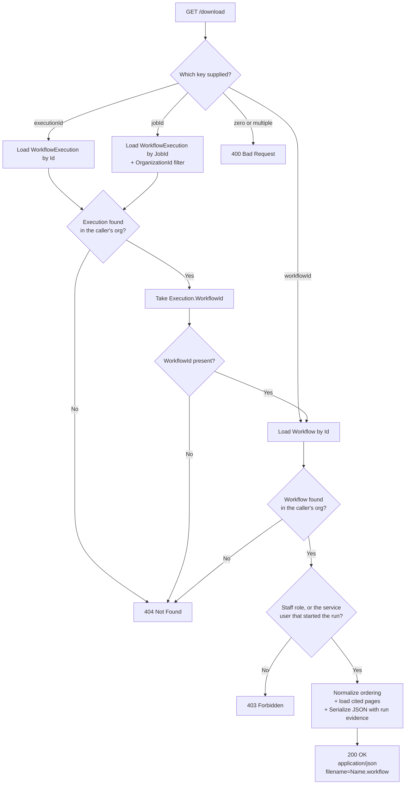

# Executed Workflow Download API

**On this page:** Base URL · Authentication · Resolution Flow · Endpoint · Resolution Rules · Error Responses · Behaviors Worth Knowing · Related APIs

Downloads a serialized JSON snapshot of a single executed workflow.
Intended for diagnostics and moving snapshots between
environments. Mirrors the operators' "Download" button in the WebApp
`Workflows` page, but exposed as a scriptable HTTP endpoint.

## Base URL

`/api/v1/executed-workflows`

## Authentication

All endpoints require authentication and tenant context, and the caller's organization must
hold the `run-evidence` [capability](../../features/user-management/authorization.md#capabilities)
(`[RequiresCapability]`): an organization without it gets `403` with the title `Not included`
before the request reaches the handler. The controller carries no role gate; the handler
decides, through `RunEvidenceAccess`:

- an `Operator` or `SuperAdmin` (`OPERATOR_ROLES`) downloads any run in the organization;
- the organization's service user (`User.IsSystem`, the `service_user_<org>` client) downloads
  a run it started itself (`WorkflowExecution.UserId` is the service user), so a scripted test
  run can read back its own snapshot;
- every other caller gets 403, because the snapshot carries the template's prompts.

```http
Authorization: Bearer {access_token}
X-Tenant-Id: {organization_id}
```

| Status | Meaning                                                                                           |
| ------ | ------------------------------------------------------------------------------------------------- |
| 401    | Missing or invalid token.                                                                         |
| 403    | Not an Operator or SuperAdmin and not the service user that started the run; or the organization lacks the `run-evidence` capability (`Not included`). |
| 404    | No such workflow or execution in the caller's organization. A run of another organization answers exactly as a run that does not exist. |

The download is always scoped to the caller's current organization. An
operator or super admin in org A cannot fetch a snapshot from org B without first
switching tenant in the token / header.

## Resolution Flow



## Endpoint

### Download Executed Workflow

#### `GET /api/v1/executed-workflows/download`

Resolves the target workflow snapshot from exactly one of three lookup keys
and returns its JSON as a downloadable file.

**Query Parameters:**

Exactly **one** of the following must be supplied. Zero or two+ → `400` (`Provide exactly one of executionId, workflowId, or jobId.`).

| Parameter     | Type   | Description                                                                              |
| ------------- | ------ | ---------------------------------------------------------------------------------------- |
| `executionId` | string | `WorkflowExecution.Id` — the ID of the execution row.                                    |
| `workflowId`  | string | `Workflow.Id` — the cloned workflow snapshot produced by the executor for an execution.  |
| `jobId`       | string | `WorkflowExecution.JobId`: the id of the background job that ran the execution ([Background Jobs](background-jobs.md)). Tenant-scoped on the server side. |

**Example Request — by workflow id:**

```bash
curl -X GET "https://api.example.com/api/v1/executed-workflows/download?workflowId=wf-abc123" \
  -H "Authorization: Bearer {token}" \
  -H "X-Tenant-Id: org-123" \
  --output workflow-snapshot.workflow
```

**Example Request — by job id:**

```bash
curl -X GET "https://api.example.com/api/v1/executed-workflows/download?jobId=job-12345" \
  -H "Authorization: Bearer {token}" \
  -H "X-Tenant-Id: org-123" \
  --output workflow-snapshot.workflow
```

**Response (200 OK):**

File content is returned with headers:

```http
HTTP/1.1 200 OK
Content-Type: application/json
Content-Disposition: attachment; filename="My Workflow Name.workflow"
Access-Control-Expose-Headers: Content-Disposition

{ "FormatVersion": 4, "Name": "My Workflow Name", "Sections": [ { "Blocks": [ … ], … } ], … }
```

- The payload is the pretty-printed JSON produced by `ExecutedWorkflowExport`
  (`Workflow.ToExportJson(includeRunTraces: true)`), stamped with the `.workflow` file-format version
  (`"FormatVersion": 4`, `Workflow.CURRENT_FORMAT_VERSION`). It is the same format the WebApp
  "Download" button produces and the upload path accepts — safe to round-trip.
- The snapshot carries the run's evidence: each Agent block's collected trace files
  (`AgentRunTraceFiles`), each block's citation trace (`CitationTrace`, its `Content` as
  nested JSON), and once per run the text of every page the citation traces point at
  (`CitationTracePages`, this organization's pages only). A block or a run without
  evidence serializes exactly as before. See
  [Citation traces](../../architecture/citations/index.md#citation-traces).
- The filename uses a `.workflow` extension (not `.json`) to match the WebApp
  convention.
- `Access-Control-Expose-Headers: Content-Disposition` comes from the global CORS
  policy (`WithExposedHeaders` in `CorsConfiguration.cs`), so cross-origin browser
  clients can read the suggested filename on every download endpoint. No endpoint
  sets it individually.

## Resolution Rules

| Key           | Behavior                                                                                                 |
| ------------- | -------------------------------------------------------------------------------------------------------- |
| `workflowId`  | Looked up **with tenant filter in the query**. 404 if it is not in the caller's organization.            |
| `executionId` | Loaded via `WorkflowExecutionByIdSpec` **with tenant filter in the query**. 404 if not found in the caller's organization; falls through to the execution's `WorkflowId` (404 if missing). |
| `jobId`       | Loaded via `WorkflowExecutionByJobIdSpec` **with tenant filter in the query**. A cross-tenant `jobId` collision returns `404` — the server never reveals that a matching execution exists in another org. Deterministic: ordered by `Id`, first match wins. |

## Error Responses

Errors the endpoint returns (400, 403, 404) follow the standard ASP.NET Core
`ProblemDetails` shape (`application/problem+json`). The 401 comes from the
authentication middleware before the endpoint runs, and carries no body. The caller's
access is checked before the snapshot is loaded.

| Status | When                                                                                  |
| ------ | ------------------------------------------------------------------------------------- |
| 400    | Zero or more than one of `executionId`/`workflowId`/`jobId` supplied.                 |
| 401    | Unauthenticated.                                                                      |
| 403    | Not an `Operator` or `SuperAdmin`, and not the service user that started the run. Also the organization lacks the `run-evidence` capability: title `Not included`, detail `Your account does not include this feature. Contact support if you need it.`, and a `capability` field. |
| 404    | Requested id not found in the caller's organization (a run of another organization included); or an execution row was found but has no `WorkflowId`. |
| 500    | Unexpected server error.                                                              |

### Examples

**400 Bad Request — no identifier supplied:**

```json
{
  "type":   "https://tools.ietf.org/html/rfc9110#section-15.5.1",
  "title":  "One or more validation errors occurred.",
  "status": 400,
  "errors": {
    "": [ "Provide exactly one of executionId, workflowId, or jobId." ]
  }
}
```

**404 Not Found: unknown id, or an id of another organization:**

```json
{
  "type":   "https://tools.ietf.org/html/rfc9110#section-15.5.5",
  "title":  "Executed workflow not found.",
  "status": 404
}
```

**403 Forbidden: no staff role, and the caller did not start the run as the service user:**

```json
{
  "type":   "https://tools.ietf.org/html/rfc9110#section-15.5.4",
  "title":  "Only a staff role or the service user that started this run can read its evidence.",
  "status": 403
}
```

## Behaviors Worth Knowing

- **Deterministic cross-tenant collisions.** A `jobId` that exists in multiple
  tenants (legitimate, because there is no DB uniqueness constraint) resolves
  to the caller's tenant only. No lookup reveals that an id exists in another
  organization.
- **Stable file format.** The JSON layout matches the one the WebApp already
  uses to download and re-upload workflows — round-tripping through the
  existing import path is supported. The `FormatVersion` stamp guards the
  reverse direction: an import path rejects files declaring a format version
  newer than the deployment supports, instead of mis-parsing them.
- **Not a bulk export.** Single-snapshot endpoint; there is no server-side
  pagination, batching, or rate limiting. Treat as an on-demand diagnostic.
- **Log sanitization.** Values of `executionId`/`workflowId`/`jobId` are
  stripped of control characters before being written to logs (prevents
  log-forging via injected newlines in client-supplied query params).

## Related APIs

- [Workflow Executions API](workflow-executions.md) — start, inspect, and
  monitor executions.
- [Documents API](documents.md) — the `jobId` used here is the same job id
  that links documents to workflow runs; use
  `GET /api/v1/documents?jobId=…` to list the documents processed under it.
