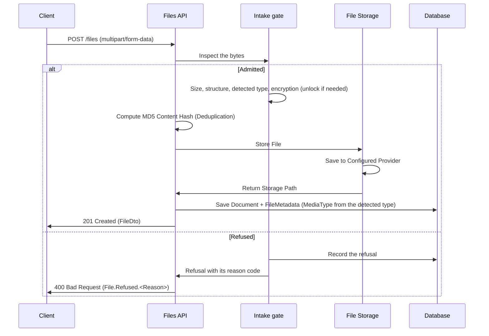
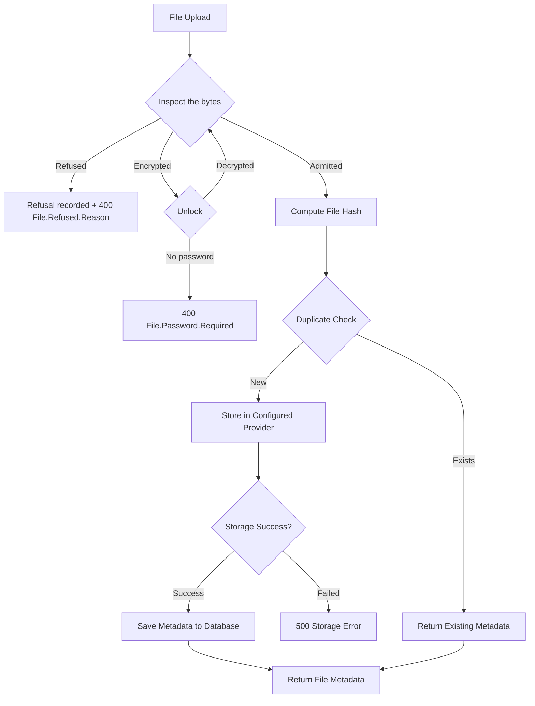
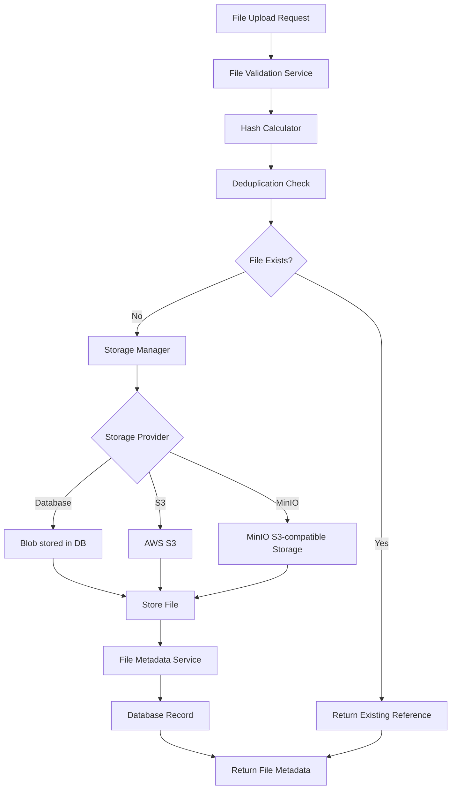

# Files API

**On this page:** Base URL · Authentication · File Upload Process Flow · Endpoints · File Storage Architecture · Error Responses · File Security Features · Document Categories · Best Practices

The Files API provides endpoints for uploading and downloading files in the IniaAi Platform. All uploaded files are automatically associated with the current tenant and stored securely.

## Base URL
`/api/v1/files`

## Authentication
All endpoints require authentication and tenant context:

```http
Authorization: Bearer {access_token}
X-Tenant-Id: {organization_id}
```

## File Upload Process Flow



## Endpoints

### Upload File

#### `POST /api/v1/files`

Uploads a new file to the system with content inspection and deduplication. The bytes decide
admission, never the file name: the [file content inspector](../../architecture/document-processing/file-content-inspector.md)
runs inside the handler before anything is stored, a valid PDF named `report.exe` is admitted
and stored as a PDF, a plain ZIP named `report.docx` is refused, and every refusal is recorded
(see [Refused by the intake gate](#400-bad-request--refused-by-the-intake-gate)).

**Content-Type**: `multipart/form-data`

**Form Parameters (`UploadFormRequest`):**

| Parameter | Type | Required | Description |
|-----------|------|----------|-------------|
| `file` | file | Yes | The file to upload. |
| `documentCategoryId` | string | No | Optional `DocumentCategory` id. When supplied it determines which prompt templates are used during document processing. |
| `password` | string | No | Password for an encrypted PDF, Excel, or Word file (max 256 characters). Used once to decrypt the file at ingest; the stored copy is the decrypted one and **the password is never persisted or logged**. See [the unlock gate](../../architecture/document-processing/index.md#password-protected-files-the-unlock-gate). |

**Supported File Formats** (by content; the extension is what these files usually carry):
- **Documents**: `.pdf`; `.docx` — Word text extracts natively to page text and embedded images are OCR'd, see [document processing](../../architecture/document-processing/index.md#word-platforminiaaifileformatsword)
- **Images**: `.jpg`, `.jpeg`, `.png`
- **Spreadsheets**: `.csv`, `.xlsx`, `.xlsm`; `.xls` in the full edition only
- **Text**: `.txt`, `.md`, `.markdown` — the whole file becomes page 1 as written when processed, with no format extraction; the same shape a paste through [`POST /documents/text`](documents.md#create-text-document) takes.


The open build refuses `.eml`, `.msg` and `.xls` with `400` and `File.Refused.FormatNotRead`, with a message that names the format and the next step ("The platform does not read email files (.eml). Save the email as a PDF, or upload its attachments instead. The full edition reads email files directly and extracts their attachments."), and stores nothing.

Upload stores the file and creates its document; it produces **no pages**. Pages come from
processing — inside the workflow execution that uses the file, or on the document's own
through [`POST /documents/{id}/process`](documents.md#process-document) (every
format above except emails).

**File Size Limits:**
- **Maximum file size**: configurable per deployment via `PlatformSettings.IniaAi.MaxFileSizeMb`; **default 100 MB** per file. The inspector refuses an oversized upload with `400` and `File.Refused.FileTooLarge`, and an empty one with `File.Refused.EmptyFile`; both write their record. The same setting bounds the request body itself (`[FileUploadSizeLimit]`: the file limit plus 64 KB for the form): a body over it is refused while it streams in, with `400` or `413`, before the server buffers it, and no record is written. An upload within that bound but over the file limit is refused from its declared size before a byte is read, so its record carries no content hash.

**Example Request:**

```bash
curl -X POST "https://api.example.com/api/v1/files" \
  -H "Authorization: Bearer {token}" \
  -H "X-Tenant-Id: org-123" \
  -F "file=@document.pdf" \
  -F "documentCategoryId=financial-reports"
```

**Response (201 Created):**

The upload creates both a `FileMetadata` row and a logical `Document` record,
and returns a lean `FileDto`. The `id` is the **document id** — pass it to the
[Documents API](documents.md) for metadata, and pass that **same document `id`**
to [`GET /api/v1/files/{id}`](#download-file) to fetch the bytes again (the
download endpoint resolves files by document id, not by `fileMetadataId`). The
`Location` response header is set to `/files/{id}`.

```json
{
  "id": "doc-abc123",
  "filename": "document",
  "mediaType": "ApplicationPdf",
  "warnings": null,
  "created": true,
  "producesPages": true,
  "countedPages": 12,
  "countedAttachmentPages": null
}
```

| Field       | Type               | Notes                                                                                 |
| ----------- | ------------------ | ------------------------------------------------------------------------------------- |
| `id`        | `string`           | Id of the created document.                                                            |
| `filename`  | `string`           | The document's name: the uploaded file name without its extension (`report.pdf` reads `report`, `note.eml` reads `note`). When the extension does not name the type the intake gate detected, the type's extension replaces it, so a PDF uploaded as `report.exe` also reads `report`. A control character in the name, such as a line break or a tab, is stored as a space. |
| `mediaType` | `string`           | The detected type, serialized as a `MediaType` member name (`ApplicationPdf`, `ImageJpeg`, `ImagePng`, `TextCsv`, `ApplicationVndMsExcel`, …), never a MIME string. |
| `warnings`  | `string[] \| null` | Non-fatal upload warnings; `null`/absent when there are none (see below).              |
| `created`   | `boolean`          | `true` when this upload created the document; `false` when the organization already held a document of the same name and size and the upload reused it (see [Deduplication](#deduplication)). |
| `producesPages` | `boolean`      | `true` when [processing](documents.md) reads this file into pages. `false` for an email or a legacy binary Word file, which is stored as a file only: `POST /documents/{id}/process` refuses it with `400` `Document.NotProcessable`. |
| `countedPages` | `integer \| null` | The pages the platform counts for this file, read from its bytes at upload with no model call ([how each format counts](../../architecture/document-processing/index.md#counted-pages)). For an email, the pages of its body. `null` when the file could not be read, or for a legacy binary Word file. A reused document that had no count gets one on this upload. |
| `countedAttachmentPages` | `integer \| null` | For an email, the counted pages of the files a run can extract from it. A run that extracts the attachments reads these pages as well as the body's. `null` for any other file, and when the email or one of those files could not be read. |

**`warnings` is populated when:**

- An uploaded PDF appears incomplete or damaged (missing `startxref`/`%%EOF`) — processing will attempt an automatic repair.
- A password-protected PDF that was decrypted at ingest contained a digital signature — removing the encryption invalidates the signature (the content is unchanged); the entry discloses this.

### File Processing Pipeline



### Download File

#### `GET /api/v1/files/{id}`

Downloads a document's file by the document ID (the `id` the upload returned). The document must belong to the current tenant.

**Path Parameters:**

| Parameter | Type | Required | Description |
|-----------|------|----------|-------------|
| `id` | string | Yes | Document ID |

**Query Parameters:**

| Parameter | Type | Description |
|-----------|------|-------------|
| `disposition` | string | `"preview"` for inline display, `"download"` (default) for an attachment. Any other value is treated as `download`. |

**Example Request:**

```bash
curl -X GET "https://api.example.com/api/v1/files/file-abc123" \
  -H "Authorization: Bearer {token}" \
  -H "X-Tenant-Id: org-123" \
  --output downloaded-file.pdf
```

**Response (200 OK):**

File content is returned with appropriate headers. `Content-Type` is the media type the intake gate detected when the file was stored, not the file's extension, so a PDF uploaded as `statement.dat` downloads as `application/pdf`, named `statement.pdf`. The file name is the stored name with the extension of the detected type. With `disposition=preview` the response carries `Content-Disposition: inline`, no file name and `Content-Security-Policy: sandbox; object-src 'none'; base-uri 'none'`: the API shares the web app's origin, so a file opened from it in a browser runs nothing there. Every file response carries `Cache-Control: no-store` and `X-Content-Type-Options: nosniff`. The content streams from its store with its `Content-Length`; a store that fails after the first byte breaks the response instead of answering an error status. A download's name is encoded per RFC 6266 (`filename*=UTF-8''…` beside an ASCII `filename`); intake has already turned any control character in the uploaded name into a space.

```http
HTTP/1.1 200 OK
Content-Type: application/pdf
Content-Length: 2048576
Content-Disposition: attachment; filename="Q4-2024-Report.pdf"; filename*=UTF-8''Q4-2024-Report.pdf
Cache-Control: no-store
X-Content-Type-Options: nosniff

[File content bytes]
```

> [!TIP]
> **Reading metadata**
>
> There is no `GET /files/{id}/metadata` endpoint. Document metadata is served by
> the [Documents API](documents.md) — `GET /api/v1/documents/{id}` returns the full
> `DocumentDetailDto`.

## File Storage Architecture



## Error Responses

Errors are returned via the framework's `ProblemDetails` /
`ValidationProblemDetails` shape (`ApiController.Problem`), not a custom error
envelope. A refusal by the intake gate comes back as `ValidationProblemDetails` with
an `errors` map keyed by error code. The key is written exactly as the server names it
(`File.Refused.FileTypeMismatch`, `File.Password.Required`; `VerbatimErrorKeysConverter`).
An older build lowercased the first letter (`file.Password.Required`), so a client that
must work with both matches keys case-insensitively, as the SPA's `useDocumentUpload` does.

### 400 Bad Request — Refused by the intake gate

The key is `File.Refused.` followed by the `IntakeRefusalReasons` code the inspector named
(`FileTypeMismatch`, `EmptyFile`, `FileTooLarge`, and the rest listed on the
[file content inspection](../../architecture/document-processing/file-content-inspector.md#reason-codes-a-refusal-can-carry) page);
the message is the inspector's detail sentence. The refusal is recorded before the response goes
out: the platform writes a warning line.
No document, file metadata or blob exists for a refused upload.


```json
{
  "type": "https://tools.ietf.org/html/rfc9110#section-15.5.1",
  "title": "One or more validation errors occurred.",
  "status": 400,
  "errors": {
    "File.Refused.FileTypeMismatch": [
      "The platform cannot tell what type of file this is. Upload a PDF, Word, Excel, CSV, PNG or JPEG file instead."
    ]
  }
}
```

| Error code (wire form) | When |
|---|---|
| `File.Refused.FileTypeMismatch` | The bytes are not a document type the platform reads, or the file name claims a format the bytes are not ([refused on the name](../../architecture/document-processing/file-content-inspector.md#refused-on-the-name)) |
| `File.Refused.EmptyFile` | The file has no bytes |
| `File.Refused.FileTooLarge` | The file is larger than `MaxFileSizeMb` |
| `File.Refused.StructuralLimit` | The file declares more than the platform will expand: archive entries, expanded size, compression ratio, image pixels |
| `File.Refused.MalformedFile` | The file is damaged and cannot be opened: a container that cannot be read, an image header that cannot be read, or a PDF with nothing behind its header |
| `File.Refused.FormatNotRead` | The build does not read the file's format: the open build refuses `.eml`, `.msg` and `.xls`, also from a sender who vouches for the file |

### 400 Bad Request — Password-protected file

Uploading an encrypted PDF, Excel, or Word file without a password (or with a wrong
one) fails with one of three error codes, keyed in the `errors` map. Clients
prompt for the password and re-send the same upload with the `password` form
field. `File.Password.Unsupported` is terminal — no password can remove
certificate/DRM protection.

The SPA's `useDocumentUpload` composable matches these codes case-insensitively
(see the note under [Error Responses](#error-responses)).

```json
{
  "type": "https://tools.ietf.org/html/rfc9110#section-15.5.1",
  "title": "One or more validation errors occurred.",
  "status": 400,
  "errors": {
    "File.Password.Required": [
      "The file is password-protected. Provide the file password to upload it."
    ]
  }
}
```

| Error code (wire form) | Message |
|---|---|
| `File.Password.Required` | The file is password-protected. Provide the file password to upload it. |
| `File.Password.Incorrect` | The supplied password does not open this file. Check the password and try again. |
| `File.Password.Unsupported` | The file is protected in a way that a password cannot remove, such as a certificate. Remove the protection in the program that made it, then upload it again. |

### 403 Forbidden and 429 Too Many Requests — Upload limits

A deployment can limit how much an organization stores and how many files it uploads in an
hour. The platform sets no limit.


The hourly rate is checked first, before the upload's bytes are read: a file whose name and
declared size match one the organization already holds skips the check. Both limits are checked
again after the intake gate admits the bytes and after the [deduplication](#deduplication)
lookup, and before anything is stored, in one transaction with the store under a lock on the
organization, so uploads that arrive together cannot pass a limit between them. A file the
organization already holds is reused at no cost, even when its storage is full. A refused upload leaves no
document, file metadata or blob, and is recorded on the same trail as a gate refusal, with the
reason `StorageFull` or `TooManyUploads`. When the limits cannot be read, the upload goes through
and the platform logs a warning.

**Storage full.** The quota counts every live file of the organization, its uploads and the
files its runs wrote, plus the new file. A deleted file stops counting at once. Run outputs
count toward the total but are never refused.

```json
{
  "type": "https://tools.ietf.org/html/rfc9110#section-15.5.4",
  "title": "Your account has reached its storage limit. Delete documents you no longer need, or contact support.",
  "status": 403,
  "code": "File.Refused.StorageFull"
}
```

**Too many uploads.** The rate counts the files people uploaded in the last hour, deleted ones
included, and leaves out the files runs wrote. The answer says when one more file fits, rounded
up to the minute, as `resetsAt` in UTC and as `Retry-After` in seconds. It carries the
[rate limit headers](https://datatracker.ietf.org/doc/draft-ietf-httpapi-ratelimit-headers/),
with the policy name `upload`:

```http
HTTP/1.1 429 Too Many Requests
Retry-After: 540
RateLimit-Policy: "upload";q=3;w=3600
RateLimit: "upload";r=0;t=540
```

```json
{
  "title": "Your organization has uploaded the most files allowed in an hour. You can upload more from 14:31 UTC.",
  "status": 429,
  "code": "File.Refused.TooManyUploads",
  "resetsAt": "2026-11-03T14:31:00Z"
}
```

The SPA shows both messages on the file's row, the second with the time in the reader's own
clock, and lets the row be retried. [`POST /workflow-executions/submit`](submit-workflow-execution.md)
runs each file through the same check; a refused file fails the whole submission with its
usual `400`, whose message for that file is the refusal's text. So the quota and the rate answer
`403` and `429` through `POST /files`, and through `POST /workflow-executions/submit` as the
`400` per-file error, with no `Retry-After`.

### Download errors

`GET /api/v1/files/{id}` answers these refusals (`GetFileQueryHandler`):

| Status | `title` | When |
|---|---|---|
| `404` | `Document not found.` | No document with this id, or the document belongs to another organization (the same answer, so the id's existence elsewhere stays hidden) |
| `404` | `File metadata not found.` | The document has no file row |
| `404` | `File storage path not found.` | The file row names no stored blob |
| `404` | `File content is empty.` | The stored blob is empty |
| `403` | the deployment's refusal | The file was produced by a report whose content the deployment hides (`IReportContentRule`), the same rule as the report reads in [Reports](reports.md). An upload is never refused this way. The platform's default, `EveryReportContent`, hides no report |
| `500` | `Error retrieving document content.` | The storage provider failed |

### 500 Internal Server Error — Storage Failure

An upload whose storage or database write fails answers `500` with `code: "File.Upload.Failed"`, and a document the upload had just created is removed again.

```json
{
  "type": "https://tools.ietf.org/html/rfc9110#section-15.6.1",
  "title": "The file could not be uploaded. Try again.",
  "status": 500,
  "code": "File.Upload.Failed"
}
```

## File Security Features

### Tenant Isolation
- All files are automatically scoped to the uploading tenant
- Files cannot be accessed across tenant boundaries
- File metadata includes `organizationId` for verification

### Deduplication
- Upload looks the file up first (`FindExistingDocumentAsync`): a file whose name (without its extension, and with control characters as spaces) and size match a document the organization already holds reuses that document record rather than storing the bytes twice, and the response reports the reuse with `created: false`. A reused file passes no [upload limit](#403-forbidden-and-429-too-many-requests--upload-limits). The content hash is logged, not compared.
- Each tenant maintains its own document/metadata records.

### Access Control
- Files require valid authentication and tenant context.
- Every read re-asserts the tenant check on the loaded entity; a cross-tenant id answers `404`, the same as an unknown id.

## Document Categories

`documentCategoryId` references a `DocumentCategory` (global reference data),
not a free-form string. When supplied at upload it influences which prompt
templates run during document processing. Categories are managed through the
document-category admin surface rather than created ad hoc per upload.

## Best Practices

1. **File Naming**: Use descriptive file names for better organization.
2. **Size Limits**: Check file sizes against the deployment's `MaxFileSizeMb` before upload to avoid `400`s.
3. **Error Handling**: Implement retry logic for transient storage failures.
4. **Bytes vs. metadata**: Treat the upload `id` as a document id — read metadata via the [Documents API](documents.md) and fetch bytes via `GET /api/v1/files/{id}`.

The storage provider of a tenant is one of `Database`, `S3` and `MinIO` (`StorageProvider`).
