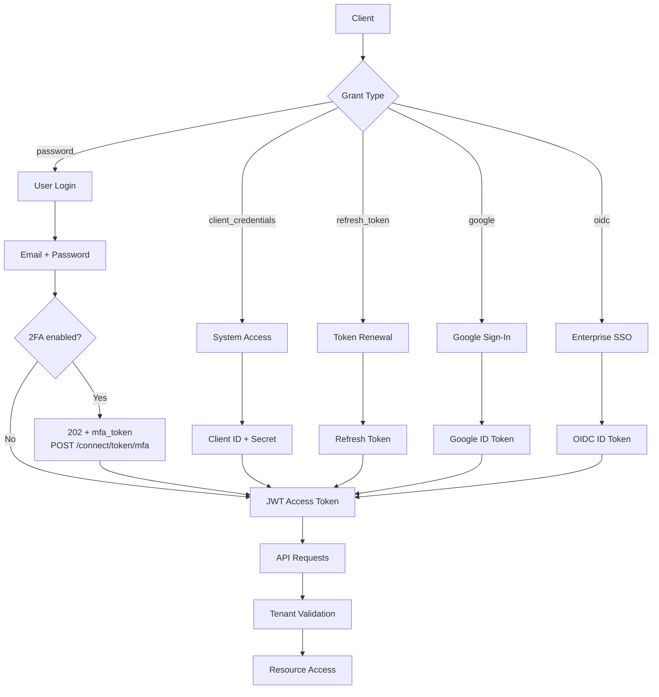
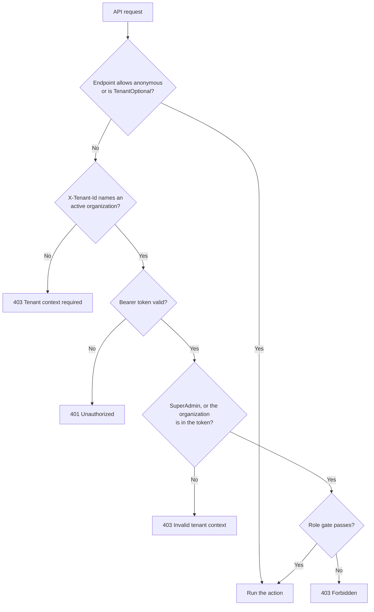

# IniaAi Platform API Reference

**On this page:** API Overview · Multi-Tenant API Flow · Authentication · Available Endpoints · Error Handling · Tenant Access Control · OpenAPI/Swagger Documentation · Next Steps

The IniaAi Platform provides a comprehensive REST API for integrating with the AI-powered workflow system. This API enables external applications to execute workflows, manage files, monitor jobs, and access all platform functionality.

## API Overview

### Base URL
```
Deployed:     https://api.example.com/api/v1
Development:  https://localhost:7557/api/v1
Docker stack: http://localhost:8080/api/v1
```

The Docker stack publishes no port for the API: the Vue app's web server on port 8080 passes `/api/` on to it ([The Docker Stack](../../getting-started/docker-stack.md)).

`https://api.example.com` is a placeholder. The platform is installed on-premises or in the customer's own cloud, so the base URL is per-deployment — there is no single hosted endpoint. All API reference examples use this same placeholder host.

### API Versioning
The API uses URL path versioning with the format `/api/v{version}`. Current version is `v1`.

### Content Type
All requests and responses use `application/json` content type unless otherwise specified.

### OData list conventions

Every list marked OData below takes `$filter`, `$orderby`, `$top`, `$skip` and `$count=true`, and answers with `value`, `@odata.count`, `@odata.skip` and `@odata.top` (`ODataQuery.ToODataPageAsync`). `$select` and `$expand` are switched off.

- **`$top`**: send it on every call. Without it a list returns every matching row. The OData options set a maximum of 100 (`SetMaxTop(100)`), but no list validates against it, so a larger `$top` is applied as sent. Without `$top`, `@odata.top` still reports 50.
- **`$count=true`**: without it, `@odata.count` is the number of rows on this page, not the total.
- **No `@odata.nextLink`**: no list emits one, so page with `$skip` and `$top` yourself.
- **`$orderby`**: a list has no default order, so pass it when order matters, for example `$orderby=createdAt desc`.


A date in `$filter` is read as UTC, and every timestamp the API stores and returns is UTC, so write the literal with its `Z`: `$filter=createdAt ge 2026-09-15T00:00:00Z and createdAt lt 2026-09-22T00:00:00Z`.

## Multi-Tenant API Flow

The IniaAi Platform is built with multi-tenancy at its core. Every request to a protected endpoint names its organization in the `X-Tenant-Id` header, and every query a controller runs carries an explicit `OrganizationId` predicate. The order of the checks a request passes, and the answer each one gives, are under [Tenant Access Control](#tenant-access-control).

### Required Headers

```http
Authorization: Bearer {access_token}
X-Tenant-Id: {organization_id}
Content-Type: application/json
```

## Authentication

The API uses **OAuth 2.0** with **OpenIddict** supporting five grant types — `password`, `client_credentials`, `refresh_token`, `google`, and `oidc` — all served from the single `POST /connect/token` endpoint:



## Available Endpoints

These tables are transcribed from the v1 controllers' `[Http*]`/`[Route]` attributes and are checked against them by the docs CI (`scripts/check-docs.mjs`) — if you add or remove an endpoint, update this page in the same change-set.

A row names its role gate when the endpoint has one; a row with none is open to any signed-in user of the organization. [Authorization](../../features/user-management/authorization.md) is the home of every gate and of the roles themselves.

### 🔐 Authentication
| Method | Endpoint | Description |
|--------|----------|-------------|
| `POST` | `/connect/token` | Obtain access tokens (`password`, `client_credentials`, `refresh_token`, `google`, `oidc`) |
| `POST` | `/connect/token/mfa` | Complete login when 2FA is required (exchange `mfa_token` + code for tokens) |
| `POST` | `/connect/token/mfa/email` | Send an email OTP for an in-progress MFA login |
| `GET` | `/auth/providers` | List enabled sign-in providers (password, Google, OIDC, and any a module adds, such as the self-serve `email-code`) and whether a password can be reset by mail |
| `POST` | `/passwords/forgot` | Initiate a password-reset email |
| `POST` | `/passwords/reset` | Set a new password with the token from a reset email |
| `POST` | `/profiles/change-password` | Change the authenticated user's password; needs no `X-Tenant-Id` (`[TenantOptional]`) |
| `GET` | `/auth/2fa/status` | Current user's 2FA status ([MFA](../../features/user-management/mfa.md)) |
| `POST` | `/auth/2fa/totp/setup` | Begin TOTP enrolment (returns secret + QR payload) |
| `POST` | `/auth/2fa/totp/enable` | Confirm TOTP enrolment with a code |
| `POST` | `/auth/2fa/totp/disable` | Disable TOTP |
| `POST` | `/auth/2fa/recovery-codes/regenerate` | Regenerate recovery codes |
| `GET` | `/auth/2fa/trusted-devices` | List trusted devices |
| `DELETE` | `/auth/2fa/trusted-devices` | Revoke all trusted devices |
| `DELETE` | `/auth/2fa/trusted-devices/{deviceId}` | Revoke one trusted device |

### 🔄 Workflow Executions
| Method | Endpoint | Description |
|--------|----------|-------------|
| `POST` | `/workflow-executions` | Start new workflow execution (requires pre-uploaded file IDs) |
| `POST` | `/workflow-executions/submit` | **Submit workflow with files in one call** (multipart, for integrations) |
| `GET` | `/workflow-executions/{id}/logs` | Get per-block execution logs |
| `GET` | `/workflow-executions/{id}/logs/{logId}` | Get one execution log entry |
| `GET` | `/workflow-executions/{id}/logs/{logId}/placeholders` | Resolved placeholder values for a log entry |
| `GET` | `/workflow-executions/{id}/rerun-inputs` | Check a run's inputs against the workflow's current template before a re-run: the values to submit, and the variables and document classes the user must fill in ([Check Re-run Inputs](workflow-executions.md#check-re-run-inputs)) |
| `PATCH` | `/workflow-executions/{id}/state` | Update an execution's state |
| `GET` | `/workflow-executions/{id}/blocks` | Executed block details (SuperAdmin/SignatureContributor) |
| `GET` | `/workflow-executions/{id}/agent-runs` | Every collected agent run file of the run (trace pack files and published artifacts), without bytes. Operator or SuperAdmin for any run in the organization, or the organization's service user for a run it started ([Run evidence](workflow-executions.md#run-evidence)) |
| `GET` | `/workflow-executions/{id}/agent-runs/{blockId}/trace` | An Agent block's `trace/trace.ndjson`; the most recently collected run unless `?runExecutionId=` names one. Same access as `agent-runs` |
| `GET` | `/workflow-executions/{id}/agent-runs/{blockId}/file` | One collected file of an Agent block's run by `?path=`. Same access as `agent-runs` |
| `GET` | `/workflow-executions/blocks/{blockId}/agent-activity` | Activity digest of an executed Agent block — the paced, client-facing feed projected from its persisted trace pack, never raw trace content; a block without a collected trace answers an empty digest. `?round=N` selects the run the full edition's verification group bought in that round (resolved through the block's run ledger; a round it bought nothing in answers an empty digest), `?runExecutionId=` selects one run and outranks the round; without either, the last-collected run answers |
| `POST` | `/workflow-executions/{id}/test-signature-prompt` | Test a signature prompt against an execution (SuperAdmin/SignatureContributor) |
| `POST` | `/workflow-executions/{runId}/graph/query` | Graph-RAG provenance query over an execution |
| `GET` | `/workflow-executions/{runId}/graph/validate/{targetTag}` | Validate a provenance target tag |
| `GET` | `/workflow-reports/{id}` | Read an execution's details and its `workflowState`; poll it after a submit (there is no `GET /workflow-executions/{id}`). The report tree is `GET /workflow-reports/{id}/elements` |


### 📁 File Management
| Method | Endpoint | Description |
|--------|----------|-------------|
| `POST` | `/files` | Upload files (multipart/form-data) |
| `GET` | `/files/{id}` | Download files |

There is **no** `GET /files/{id}/metadata` endpoint — `FilesController` has exactly the two actions above; file metadata comes from the [Documents API](documents.md).

### 📄 Document Management
| Method | Endpoint | Description |
|--------|----------|-------------|
| `GET` | `/documents` | List documents (OData paginated, optional `?jobId=` filter) |
| `GET` | `/documents/{id}` | Get document detail |
| `PATCH` | `/documents/{id}` | Update document metadata (partial, non-whitespace values only; `isStatic: false` clears the static mark) |
| `DELETE` | `/documents/{id}` | Soft-delete a document and remove its blob (best-effort) (Admin, SuperAdmin, Operator; a User with `delete-own-documents`, for their own uploads) |
| `POST` | `/documents/bulk-delete` | Bulk soft-delete up to 500 documents in one call (Admin, SuperAdmin, Operator; a User with `delete-own-documents`, for their own uploads) |
| `GET` | `/documents/{id}/pages` | List pages for a document (OData paginated; 200-character text previews; `?term=` matches a page number, or text or overview anywhere) |
| `GET` | `/documents/{id}/pages/{pageNumber}` | Read one page with its full text — what an extraction reads for that page |
| `GET` | `/documents/{id}/text` | Download every page's text as one `.txt` file, each page in a `<pageN>` tag |
| `POST` | `/documents/{id}/process` | Queue a stored document for standalone processing into pages (202; poll `GET /documents/{id}` for `processingState`; emails are refused) |
| `POST` | `/documents/text` | Create a document from pasted text or markdown and queue it for processing (202) |
| `GET` | `/pages/{pageId}/image` | Render a document page as an image ([Page Image API](page-image.md)) |
| `GET` | `/executed-workflows/download` | Download executed-workflow snapshot as JSON (Operator or SuperAdmin for any run in the organization, or the organization's service user for a run it started) |

### ⚙️ Background Jobs
| Method | Endpoint | Description |
|--------|----------|-------------|
| `GET` | `/jobs` | List background jobs for current tenant |
| `GET` | `/jobs/{id}` | Get job status and details |

There is **no** `GET /jobs/{id}/download` — `JobsController` has exactly the two actions above; execution outputs are read via the Workflow Reports endpoints (Reporting & Usage table below) and files via the [File Management API](files.md).

### 🏢 Counterparties Management
| Method | Endpoint | Description |
|--------|----------|-------------|
| `GET` | `/counterparties` | List counterparties for current tenant |
| `POST` | `/counterparties` | Create new counterparty |
| `GET` | `/counterparties/{id}` | Get counterparty details |
| `PUT` | `/counterparties/{id}` | Update counterparty |
| `DELETE` | `/counterparties/{id}` | Delete counterparty |
| `GET` | `/counterparties/peer-candidates` | List the counterparties that may be offered as peer companies, each marked with whether its stored financial analysis can contribute a peer column. An optional workflow type narrows the list to the counterparty types that workflow accepts; supports a name search and paging. Only the paid build judges the stored financials: a build without the PeerFinancials module marks every candidate eligible ([peer candidates](counterparties.md#list-peer-candidates)) |
| `GET` | `/counterparties/export` | Export every active counterparty of the organization as one JSON bundle: hierarchy, types by name, property bags and stored financial analysis, with the ids kept so an import on another instance lands the same ids. Admin and SuperAdmin only |
| `POST` | `/counterparties/import` | Import a counterparty bundle: each row matches by id, then by name, else is created with its source id; bundle values win; nothing is deleted; a row that cannot land is reported with its reason. `?dryRun=true` returns the same plan and writes nothing. Admin and SuperAdmin only |
| `GET` | `/counterparty-types` | List counterparty type definitions, each with its counterparty count and whether it is built in |
| `POST` | `/counterparty-types` | Create a counterparty type; names are unique ignoring case. WorkflowEditor and SuperAdmin only |
| `PUT` | `/counterparty-types/{id}` | Replace a type's name and description; a built-in type keeps its name. WorkflowEditor and SuperAdmin only |
| `DELETE` | `/counterparty-types/{id}` | Delete a type; its counterparties keep their other types; a built-in type cannot be deleted. WorkflowEditor and SuperAdmin only |

### 👥 User Management
| Method | Endpoint | Description |
|--------|----------|-------------|
| `GET` | `/users` | List users in current organization |
| `GET` | `/users/me/tenants` | Get current user's accessible tenants; needs no `X-Tenant-Id` (`[TenantOptional]`) |
| `POST` | `/users/resolve` | Resolve user names to full names; only a user name that started a run in the organization resolves |


### 📄 Specialized Services
| Method | Endpoint | Description |
|--------|----------|-------------|
| `POST` | `/ai/content-refinement` | AI content refinement (single real model call — used as the post-deploy smoke test) |
| `GET` | `/ai/content-refinement/presets` | List refinement presets |
| `POST` | `/ai/content-refinement/presets` | Create a refinement preset |
| `PUT` | `/ai/content-refinement/presets/{id}` | Update a refinement preset |
| `DELETE` | `/ai/content-refinement/presets/{id}` | Delete a refinement preset |

There is **no** `/document-generation` or `/ai/proofreading` endpoint — both were removed with the WebScraper feature family; `/ai/content-refinement` is the surviving single-call AI endpoint.

### 🧩 Templates & Categories

| Method | Endpoint | Description |
|--------|----------|-------------|
| `GET` | `/workflow-templates` | List workflow templates (WorkflowEditor/SuperAdmin) |
| `GET` | `/workflow-templates/{workflowTypeId}/content` | Read template JSON (WorkflowEditor/SuperAdmin) |
| `PUT` | `/workflow-templates/{workflowTypeId}/content` | Edit template JSON (WorkflowEditor/SuperAdmin) |
| `POST` | `/workflow-templates/{workflowTypeId}/content/validate` | Rehearse a template save: the save's own 400/409/200 verdicts, nothing written (WorkflowEditor/SuperAdmin) |
| `GET` | `/workflow-templates/{workflowTypeId}/versions` | List a template's saved version history, newest first, with author and stored narrative (WorkflowEditor/SuperAdmin) |
| `GET` | `/workflow-templates/{workflowTypeId}/versions/{versionId}/content` | Read one saved version's template JSON (WorkflowEditor/SuperAdmin) |
| `GET` | `/workflow-templates/{workflowTypeId}/versions/{versionId}/changes` | Diff one version against the version before it in the chain (WorkflowEditor/SuperAdmin) |
| `GET` | `/workflow-templates/{workflowTypeId}/versions/compare` | Diff any two versions of the type, `?from=&to=` (WorkflowEditor/SuperAdmin) |
| `GET` | `/workflow-templates/{workflowTypeId}/summary` | Lightweight template summary for the CreateWorkflow page — **any authenticated user** |
| `GET` | `/workflow-templates/agent-guide` | Agent-facing guide to programmatic template editing (WorkflowEditor/SuperAdmin) |
| `GET` | `/workflow-templates/{workflowTypeId}/document-classes` | List a template's document classes (WorkflowEditor/SuperAdmin, whole family) |
| `POST` | `/workflow-templates/{workflowTypeId}/document-classes` | Add a document class |
| `GET` | `/workflow-templates/{workflowTypeId}/document-classes/{key}` | Get one document class |
| `PATCH` | `/workflow-templates/{workflowTypeId}/document-classes/{key}` | Update a document class |
| `DELETE` | `/workflow-templates/{workflowTypeId}/document-classes/{key}` | Delete a document class |
| `POST` | `/workflow-templates/{workflowTypeId}/document-classes/{key}/rename` | Rename a document class key |
| `POST` | `/workflow-templates/{workflowTypeId}/duplicate` | Copy a template into a new workflow type, keeping Library links live (WorkflowEditor/SuperAdmin) |
| `DELETE` | `/workflow-templates/{workflowTypeId}` | Delete a workflow type only the caller's organization uses; the weekly cleanup purges it after the retention window (WorkflowEditor/SuperAdmin) |
| `POST` | `/workflow-templates/{workflowTypeId}/shared-components/promote` | Publish a template node to the shared-component Library (or attach it to an existing component) (WorkflowEditor/SuperAdmin) |
| `POST` | `/workflow-templates/{workflowTypeId}/shared-components/materialize` | Insert a Library component into the template as a linked copy (WorkflowEditor/SuperAdmin) |
| `GET` | `/workflow-templates/{workflowTypeId}/shared-components/reconcile` | Classify every Library-linked node in the template against the registry (WorkflowEditor/SuperAdmin) |
| `POST` | `/workflow-templates/{workflowTypeId}/shared-components/reconcile/apply` | Apply per-node reconcile decisions atomically, with every fan-out they trigger (WorkflowEditor/SuperAdmin) |
| `GET` | `/workflow-templates/{workflowTypeId}/export` | Export the template and every shared component it depends on as a portable transfer bundle (WorkflowEditor/SuperAdmin) |
| `POST` | `/workflow-templates/{workflowTypeId}/import-preview` | Preview importing a bundle: how the template and each component relate to this deployment's copies, read-only (WorkflowEditor/SuperAdmin) |
| `POST` | `/workflow-templates/{workflowTypeId}/import-apply` | Apply a bundle with per-element take-theirs / keep-mine decisions, atomically (WorkflowEditor/SuperAdmin) |
| `GET` | `/shared-components` | List shared components with head tokens and consumer counts (WorkflowEditor/SuperAdmin, whole family) |
| `POST` | `/shared-components` | Create a brand-new shared component with its first version from a Library-authored definition (WorkflowEditor/SuperAdmin) |
| `GET` | `/shared-components/suggestions` | Sweep every template for repeated content that is not in the Library yet, and for content matching an existing component (WorkflowEditor/SuperAdmin) |
| `GET` | `/shared-components/{id}` | Get one shared component's summary |
| `GET` | `/shared-components/{id}/consumers` | List the workflow types holding live linked copies of the component |
| `GET` | `/shared-components/{id}/consumer-matrix` | Consumers×entries grid for a section component: one row per linked copy, one column per definition entry |
| `GET` | `/shared-components/{id}/content` | Get a shared component's head definition JSON |
| `PUT` | `/shared-components/{id}/content` | Replace a component's definition — new head plus atomic rewrite of every linked copy |
| `GET` | `/shared-components/{id}/versions` | List a shared component's version history |
| `GET` | `/shared-components/{id}/versions/{versionId}/content` | Get one stored version's definition JSON |
| `POST` | `/shared-components/{id}/versions/{versionId}/restore` | Restore a stored version as the new head, fan-out included |
| `POST` | `/shared-components/{id}/reconcile-preview` | Preview the impact of a definition change (optional draft definition in the body) |
| `POST` | `/shared-components/{id}/retire` | Retire a component, breaking out every linked copy |
| `POST` | `/shared-components/{id}/unretire` | Reactivate a retired component (state-only) |
| `GET` | `/shared-components/categories` | List the Library's curated category vocabulary with per-category counts |
| `PUT` | `/shared-components/categories/{categoryId}` | Create or update a category vocabulary entry |
| `DELETE` | `/shared-components/categories/{categoryId}` | Delete a category vocabulary entry (refused while components reference it) |
| `PUT` | `/shared-components/{id}/category` | Re-file a component under a curated category |
| `GET` | `/document-categories` | List document categories |
| `POST` | `/document-categories` | Create a document category (WorkflowEditor/SuperAdmin) |
| `PUT` | `/document-categories/{id}` | Update a document category (WorkflowEditor/SuperAdmin) |
| `DELETE` | `/document-categories/{id}` | Delete a document category (WorkflowEditor/SuperAdmin) |
| `GET` | `/workflow-categories` | List workflow categories |
| `GET` | `/workflow-categories/summaries` | Workflow category summaries |
| `GET` | `/workflow-categories/{id}/validate-documents` | Check documents against a workflow's document classes; `{id}` is a workflow of a type the organization may use |


There is **no** `/block-templates` or `/template-categories` endpoint. Both were removed with the analyst app's Prompt Library, and the admin app's Prompt Library went later. Page overview prompts are part of a workflow template, so the template endpoints carry them.


### 📊 Reporting & Usage
| Method | Endpoint | Description |
|--------|----------|-------------|
| `GET` | `/workflow-reports` | List workflow reports |
| `GET` | `/workflow-reports/{id}` | Read an execution's details and its `workflowState` |
| `GET` | `/workflow-reports/{id}/elements` | Report output elements |
| `GET` | `/workflow-reports/{id}/data` | The JSON data outputs the run returned beside its report, each with the citations of its figures |
| `GET` | `/workflow-reports/{id}/cost` | What the run cost: the total and a line per block, from its stored usage rows (SuperAdmin, or the organization's service user for a run it started) |
| `PUT` | `/workflow-reports/{id}/sections/{sectionId}` | Edit a report section |
| `DELETE` | `/workflow-reports/{id}/sections/{sectionId}` | Delete a report section |
| `PUT` | `/workflow-reports/{id}/paragraphs/{paragraphId}` | Edit a report paragraph |
| `DELETE` | `/workflow-reports/{id}/paragraphs/{paragraphId}` | Delete a report paragraph |
| `DELETE` | `/workflow-reports/{id}` | Delete a report |
| `GET` | `/workflow-reports/{id}/export/{format}` | Export a report (e.g. DOCX) |
| `POST` | `/workflow-reports/{reportId}/feedback` | Leave feedback on a report (optionally quoting selected text) |
| `GET` | `/workflow-reports/{reportId}/feedback` | List a report's feedback (org-scoped) |
| `PATCH` | `/workflow-reports/{reportId}/feedback/{feedbackId}/status` | Set a feedback item's status (WorkflowEditor/SuperAdmin) |
| `DELETE` | `/workflow-reports/{reportId}/feedback/{feedbackId}` | Delete a feedback item for good, whatever its status (any reader; org-scoped) |
| `GET` | `/workflow-types/{workflowTypeId}/feedback` | Every organization's feedback on a workflow type, paged (SuperAdmin only; crosses the tenant boundary by design) |
| `GET` | `/token-usage` | Token consumption metrics (Admin, SuperAdmin, Operator) |
| `GET` | `/token-usage/me` | Current user's token usage |
| `GET` | `/token-usage/dashboard` | Usage dashboard aggregates (Admin, SuperAdmin, Operator) |
| `GET` | `/token-usage/workflow-type/{workflowTypeId}` | Usage for one workflow type (Admin, SuperAdmin, Operator) |
| `GET` | `/model-pricing` | List model pricing (Operator, SuperAdmin, whole family) |
| `GET` | `/model-pricing/{id}` | Get one pricing entry |
| `POST` | `/model-pricing` | Create a pricing entry |
| `PUT` | `/model-pricing/{id}` | Update a pricing entry |
| `DELETE` | `/model-pricing/{id}` | Delete a pricing entry |
| `GET` | `/tenant-model-settings` | List per-tenant model settings (Operator, SuperAdmin, whole family) |
| `GET` | `/tenant-model-settings/{id}` | Get one settings entry |
| `POST` | `/tenant-model-settings` | Create a settings entry |
| `PUT` | `/tenant-model-settings/{id}` | Update a settings entry |
| `DELETE` | `/tenant-model-settings/{id}` | Delete a settings entry |
| `GET` | `/workflow-types/{workflowTypeId}/signatures` | Current signature-override set (SuperAdmin/SignatureContributor, whole family) |
| `GET` | `/workflow-types/{workflowTypeId}/signatures/history` | Override decision history |
| `POST` | `/workflow-types/{workflowTypeId}/signatures/pending` | Propose an override |
| `POST` | `/workflow-types/{workflowTypeId}/signatures/pending/{pendingOverrideId}/votes` | Vote on a pending proposal |
| `DELETE` | `/workflow-types/{workflowTypeId}/signatures/pending/{pendingOverrideId}/votes/mine` | Withdraw own vote |
| `POST` | `/workflow-types/{workflowTypeId}/signatures/pending/{pendingOverrideId}/accept-suggestion` | Accept the AI-suggested value |
| `DELETE` | `/workflow-types/{workflowTypeId}/signatures/pending/{pendingOverrideId}` | Discard a pending proposal |


### 🛠️ System & Diagnostics
| Method | Endpoint | Description |
|--------|----------|-------------|
| `GET` | `/diagnostics/logs/download` | Download diagnostic logs (Operator, SuperAdmin) |
| `GET` | `/meta/version` | API version information (anonymous) |
| `GET` | `/meta/build` | Build metadata (anonymous) |
| `GET` | `/meta/uptime` | Process uptime (anonymous) |

Outside `/api/v1`, the API maps only `GET /health` and `GET /readiness` (health checks, anonymous; they also answer `HEAD` and refuse every other method with 405), and the Swagger UI in development (see [OpenAPI/Swagger Documentation](#openapiswagger-documentation)). There is no SignalR hub: `POST /hubs/execution/negotiate` answers `404`, and run progress is read by polling ([Realtime and polling](../../architecture/frontend/realtime-and-polling.md)).

## Error Handling

The API uses standard HTTP status codes and returns detailed error information:

### Error response format (RFC 7807 Problem Details)

Errors are returned as [RFC 7807](https://datatracker.ietf.org/doc/html/rfc7807) `application/problem+json`, produced by the controller base `Problem(...)` helper in `ApiController`. A general error carries `type`, `title`, `status`, the error's `code` and a `traceId`; the `title` is the error description, and any error metadata is merged in as extra members:

```json
{
  "type": "https://tools.ietf.org/html/rfc9110#section-15.5.5",
  "title": "Workflow execution not found.",
  "status": 404,
  "code": "General.NotFound",
  "traceId": "00-..."
}
```

When a handler returns several errors and any of them is not a validation error, the response carries only the first one.

Validation failures (HTTP 400) use the `ValidationProblemDetails` shape, with messages under `errors`:

```json
{
  "type": "https://tools.ietf.org/html/rfc9110#section-15.5.1",
  "title": "One or more validation errors occurred.",
  "status": 400,
  "errors": {
    "WorkflowVariable.Required": ["Required variable 'Note' (qa_required_note) is missing."]
  }
}
```

Every key of `errors` is written exactly as the server named it, whatever produced the refusal (`VerbatimErrorKeysConverter`):

- an error code, such as `General.Validation` or `WorkflowVariable.Required`, in the same casing as the `code` member of a non-validation refusal such as `General.NotFound`;
- a request property, such as `Name`;
- the JSON path of a value in a request body that fails to parse, such as `$.count`. The body parameter's "field is required" error that the failed parse would otherwise add is dropped, because the body was sent;
- an OData query option the parser rejects, `$filter`, `$orderby`, `$top`, `$skip` or `$count`, or `$search`, which no list supports (`$search is not supported. Narrow the list with $filter.`). A plain `search` parameter on an OData list is read as `$search` and refused the same way. So are a query option given in two spellings, such as `filter` and `$FILTER` (the error names the option, `$filter`), and an `$orderby` that orders by one property twice. Such a query answers 400, never 500 (`ODataQueryValidationFilter`).

Every response of a versioned endpoint carries the `api-supported-versions` header, including the refusals that never reach the action: the tenant rejection, 401, 403 and the model-state 400 (`ApiVersionReportingMiddleware`).

The token endpoints answer in the OAuth shape instead, `{ "error": "...", "error_description": "..." }`: see [Authentication → Error Responses](authentication.md#error-responses).

### Common HTTP Status Codes
- `200 OK` - Request successful
- `201 Created` - Resource created successfully
- `400 Bad Request` - Invalid request data
- `401 Unauthorized` - Missing or invalid authentication
- `403 Forbidden` - Insufficient permissions or invalid tenant access
- `404 Not Found` - Resource not found, or it belongs to another organization
- `409 Conflict` - The request conflicts with the stored state, such as a stale revision
- `413 Payload Too Large` - The request body is over the server's size limit, or over the cap of the endpoint that sets one. The body carries `title: "The request body is too large"`.
- `429 Too Many Requests` - Past the sign-in rate limit ([Authentication](authentication.md#429-too-many-requests))
- An unreadable request answers 400 or 413 (`WebApiExceptionHandlerFilter`). The sign-in validation reads a form body on every route before any endpoint runs, so a form the form reader refuses (a field name over 2,048 characters, too many fields, a value over its limit, or a multipart form with no boundary) answers `400` with `title: "The form in the request could not be read"`, and a body over the size limit answers `413`.
- `500 Internal Server Error` - Server error. The body carries `title: "An unhandled error occurred"`, a `traceId`, and `detail: "Something went wrong. Please contact support."`; the exception message, type and stack trace appear only when the environment is `LocalDevelopment`, and stay in the log everywhere else (`WebApiExceptionHandlerFilter`).

## Tenant Access Control

Every request to a protected endpoint passes these checks in this order (`Program.ConfigureMiddleware`):



### Tenant Validation Rules
- A missing `X-Tenant-Id`, or one that names no organization or a closed one, is rejected with `403` and `title: "Tenant context required"` (`detail: "A valid X-Tenant-Id header is required to access this endpoint."`) by `EarlyTenantRejectionMiddleware`, before the token is validated. A request with neither a header nor a token therefore answers 403, not 401.
- A valid token whose organizations do not include the requested one is rejected with `403` and `title: "Invalid tenant context"` (`detail: "You do not have access to this tenant."`) by `TenantUserContextMiddleware`.
- The token's organizations are its `tenant_ids` claim plus its `tenant_id` (or legacy `organization_id`) claim; [Authentication → Multi-Tenant Token Claims](authentication.md#multi-tenant-token-claims) says what goes into them.
- A SuperAdmin passes the membership check for any active organization named in `X-Tenant-Id`.
- `POST /profiles/change-password` and `GET /users/me/tenants` carry `[TenantOptional]` and skip both tenant checks; anonymous endpoints skip them too.
- Paths under `/health`, `/readiness` and `/swagger` skip the tenant checks (`MiddlewareConstants.ExcludedPaths`).

## OpenAPI/Swagger Documentation

`Program.cs` serves the Swagger UI and the OpenAPI document only when the environment name ends in `LocalDevelopment`, the name the launch profiles of a developer machine set (`ServesApiDocumentation`, then `UseSwagger` and `UseSwaggerUI`):
- **Local development**: the UI at `https://localhost:7557/swagger`, the document at `/swagger/v1/swagger.json`.
- **Every other environment, `Development` included**: neither exists. `GET /swagger/v1/swagger.json` answers `404`, as does `/swagger`. The Docker stack runs the API as `Production`.


## Next Steps

Explore the detailed API documentation for specific endpoints:

- [Authentication](authentication.md) - OAuth 2.0 token management
- [Provisioning a System User](system-users.md) - Where the `client_id` / `client_secret` an integrator authenticates with come from
- [Discovery](discovery.md) - Find the workflow types and document classes you can run
- [Workflow Executions](workflow-executions.md) - Execute and manage workflows
- [Submit Workflow Execution](submit-workflow-execution.md) - Single-call workflow start for integrations
- [File Management](files.md) - Upload and download files
- [Document Management](documents.md) - List, get, patch, delete, and paginate documents
- [Executed Workflow Download](executed-workflow-download.md) - Download executed-workflow JSON snapshots (Operator, SuperAdmin)
- [Background Jobs](background-jobs.md) - Monitor long-running operations
- [Counterparties](counterparties.md) - Business entity management
- [Key Terms](../glossary.md) - Plain-language definitions of counterparty, RAG, workflow type, execution, block, section, and tenant

