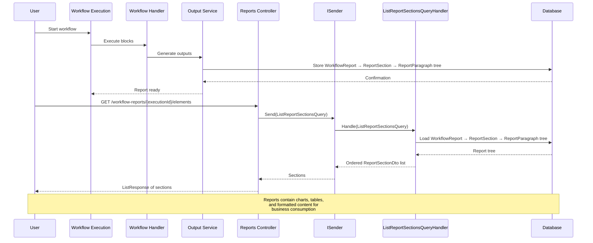

# Workflow Reports API

**On this page:** Base URL · Authentication · Report Generation Flow · Endpoints · Report Feedback · Report Model · Export Format · Report vs Workflow Execution Data · Error Handling · Related pages

The Workflow Reports API provides access to workflow execution reports — the business-facing presentation of a completed workflow execution. A report is stored as a tree of `WorkflowReport` → `ReportSection` → `ReportParagraph` nodes (UserData schema) and is keyed by the workflow **execution ID**. The endpoints let you read the execution and its report tree, edit the editable fields of sections and paragraphs, delete sections/paragraphs or the whole report, and export the report as a Word or Markdown file.

## Base URL

```
/api/v{version}/workflow-reports
```

## Authentication

All endpoints require authentication via Bearer token with appropriate tenant context. The controller inherits `ApiController`; organization and user identity are resolved by the tenant middleware from the request context, so every request is scoped to the caller's organization.

## Report Generation Flow



## Endpoints

### List Reports

Retrieves the organization's workflow executions, narrowed to the workflow types the calling user has a [visibility selection](../../features/user-management/workflow-type-visibility.md) for — with no selection (the default), the organization's full set. Paged and filterable via OData; returns `WorkflowExecutionSummaryDto` items wrapped in an `ODataPaginatedResponse`.

The narrowing is a display filter, not access control: it can only hide rows, two users in one organization may therefore see different lists, and `GET /workflow-reports/{id}` is **not** filtered — any execution in the organization remains readable by id. A filtered list is not a full inventory of the organization's executions; enumerate with an account that has no selection.

```http
GET /api/v{version}/workflow-reports
```

**Query Parameters**

| Parameter | Type | Description |
|-----------|------|-------------|
| `$filter` | string | OData filter expression (e.g. `workflowState eq 'Draft'`) |
| `$orderby` | string | OData ordering expression (e.g. `createdAt desc`) |
| `$top` | integer | Maximum number of results |
| `$skip` | integer | Number of results to skip |
| `$count` | boolean | Include total count in the response |

**Response**

- **200 OK**: Executions retrieved successfully
- **400 Bad Request**: An OData clause the parser rejects
- **401 Unauthorized**: Authentication required
- **500 Internal Server Error**: Any other failure, with no detail

**Response Body**
```json
{
  "value": [
    {
      "id": "exec-456",
      "workflowId": "wf-123",
      "createdAt": "2025-03-25T10:00:00Z",
      "workflowState": "Draft",
      "failureKind": null,
      "failureDetail": null,
      "warningKind": null,
      "warningDetail": null,
      "workflowTypeId": "type-789",
      "counterpartyId": "cp-12345",
      "counterpartyName": "Acme Corporation",
      "analystName": "Jane Analyst",
      "reviewDate": null,
      "userId": "user-123",
      "title": "Portfolio Analysis",
      "jobId": "job-001",
      "isBaseline": false,
      "baselineVerified": null,
      "freezeSourceExecutionId": null,
      "freezeReplayedCount": null,
      "freezeEligibleCount": null,
      "startedAt": "2025-03-25T10:00:05Z",
      "completedAt": "2025-03-25T10:02:20Z",
      "duration": "00:02:15"
    }
  ],
  "@odata.count": 1,
  "@odata.skip": 0,
  "@odata.top": 20
}
```

`failureKind` and `failureDetail` describe an execution that ended `Failed`: the kind is one of the failure kinds the [UserData reference](../database/user-data-database.md#workflowexecutions) lists, and the detail is the human-readable explanation naming the block and its error, or the unfilled document class, truncated to 2000 characters when written. Both are null on a run that did not fail, and the kind is null on a failure the engine could not classify. Filter for failures with `$filter=workflowState eq 'Failed'`, then read the kind to triage without opening the database.


`warningKind` and `warningDetail` describe a run that completed normally but with something the analyst should see. Both are null on a run with nothing to disclose. Only the full edition sets them: in the open build both are always null.


`baselineVerified` is null in the open build, where no execution is a baseline (`isBaseline` is always `false`).


`freezeSourceExecutionId` is set only on a frozen execution — one started with the [freeze option](workflow-executions.md#freezing-external-fetches), which replayed another execution's external fetches. Filter with `$filter=freezeSourceExecutionId ne null` to list only those. `freezeReplayedCount` and `freezeEligibleCount` are written when any replay run ends — a frozen execution, or in the full edition a regression rerun — and stay null on a non-replay execution.

### Get Report (Execution)

Retrieves a single workflow execution by its execution ID. The response is a `WorkflowExecutionDto` describing the execution itself (state, failure, type, counterparty, variables, documents, timing). The report tree of sections and paragraphs is fetched separately via the `/elements` endpoint below.

```http
GET /api/v{version}/workflow-reports/{id}
```

**Parameters**

| Parameter | Type | Description |
|-----------|------|-------------|
| `id` | string | The workflow execution ID |

**Response**

- **200 OK**: Execution retrieved successfully
- **400 Bad Request**: Invalid request format
- **401 Unauthorized**: Authentication required
- **403 Forbidden**: The `X-Tenant-Id` header is missing or names an organization the token does not carry
- **404 Not Found**: No execution with this ID in the caller's organization (`Workflow Execution not found.`); an execution of another organization answers the same way
- **500 Internal Server Error**: Server error

**Response Body**
```json
{
  "id": "exec-456",
  "workflowId": "wf-123",
  "createdAt": "2025-03-25T10:00:00Z",
  "workflowState": "Draft",
  "failureKind": null,
  "failureDetail": null,
  "workflowTypeId": "type-789",
  "workflowTypeName": "Financial Analysis",
  "counterpartyId": "cp-12345",
  "counterpartyName": "Acme Corporation",
  "analystName": "Jane Analyst",
  "reviewDate": null,
  "userId": "user-123",
  "title": "Portfolio Analysis",
  "variables": {},
  "jobId": "job-001",
  "workflowExecutionDocuments": [],
  "excludedDocuments": [
    {
      "fileId": "doc-889",
      "name": "holiday-photo",
      "extension": "jpg",
      "excludedAt": "2025-03-25T10:00:09Z",
      "exclusionReason": "NotExpectedDocument"
    }
  ],
  "variableValues": [],
  "isBaseline": false,
  "baselineVerified": null,
  "freezeSourceExecutionId": null,
  "freezeSourceCaseId": null,
  "freezeReplayedCount": null,
  "freezeEligibleCount": null,
  "startedAt": "2025-03-25T10:00:05Z",
  "completedAt": "2025-03-25T10:02:20Z",
  "duration": "00:02:15",
  "intakeSkippedFiles": null,
  "agentActivity": null,
  "workflowActivity": null
}
```

`failureKind` and `failureDetail` are the same values the list carries, so a caller polling one execution learns why it failed without listing. A run refused before its first block has no report tree; these two fields are the whole answer.

Fields only this endpoint fills (`WorkflowExecutionDto`):

- `agentActivity` is the live activity of the execution's Agent blocks, one entry per run the process's live feed holds; null once no entry is held. A settled block's record is the [agent-activity digest](workflow-executions.md#run-evidence).
- `workflowActivity` is the plain-language activity of a running classic workflow, from its version's cached activity script; null unless the execution is running and its template version carries a script.
- `intakeSkippedFiles` is filled only on the [submit](submit-workflow-execution.md) response; here it is null, and the durable record is the `Skipped` rows of the execution's logs.


`workflowExecutionDocuments` is the run's input. `excludedDocuments` holds the documents the caller sent that a stage took out of the run before processing them; the open build has no such stage, so the list stays empty. Each entry carries `excludedAt` and `exclusionReason`, one of `Unreadable`, `NotExpectedDocument` or `NotNeeded`; a document appears in exactly one of the two lists, so a caller can tell a document that was never sent from one that was sent and dropped. The same drop is a `Skipped` row in the execution's logs, under the section `Document intake`, with the document id in `replacementTag`. Both document fields are populated on this endpoint only.


> [!WARNING]
> **`variables` keys are re-cased by the serializer**
>
> `variables` is the raw tag → value dictionary the execution ran with, but the API's global `DictionaryKeyPolicy = JsonNamingPolicy.CamelCase` (`ControllerConfiguration.cs`) re-cases its **keys** on serialization — `NetLeverage` comes back as `netLeverage`, `EBITDA2` as `ebitdA2` — so they do not reliably equal the workflow definition's `replacementTag`s. `variableValues` entries (`replacementTag`, `displayName`, `description`, `type`, `displayValue`, `isConfidential`, `isHidden`, `isRequired`) are DTO property **values**, which the policy leaves untouched: `variableValues[].replacementTag` always carries the definition's original casing. Consumers matching `variables` back to variable definitions — e.g. the SPA's "Edit & Re-run" prefill (`restoreDefinitionCasedVariableKeys` in `frontend:src/lib/workflowReRun.ts`) — must recover key casing from it.

### Get Report Sections

Retrieves the report tree for an execution: the ordered `ReportSection` nodes, each containing its ordered `ReportParagraph` leaves. The response is a `ListResponse<ReportSectionDto>` (an OData-style `value` array). This endpoint takes no query parameters.

```http
GET /api/v{version}/workflow-reports/{id}/elements
```

This read, `.../data` and `.../export/{format}` read a report's content, so each answers `403` with the title `Report not available` when the deployment hides it (`IReportContentRule`). The platform's default, `EveryReportContent`, hides no report. The execution read above still answers with its state. The report page shows "Report not available" with the response's `detail`, not its not-found message.


**Parameters**

| Parameter | Type | Description |
|-----------|------|-------------|
| `id` | string | The workflow execution ID |

**Response**

- **200 OK**: Sections retrieved successfully. An execution with no report, or one of another organization, answers `200` with an empty `value` array, not `404` (`ListReportSectionsQueryHandler`)
- **401 Unauthorized**: Authentication required
- **500 Internal Server Error**: Server error

**Response Body**
```json
{
  "value": [
    {
      "id": "section-1",
      "order": 0,
      "title": "Executive Summary",
      "layout": null,
      "excludeFromWordExport": false,
      "paragraphs": [
        {
          "id": "para-1",
          "kind": "Paragraph",
          "order": 0,
          "title": "Overview",
          "subtitle": null,
          "confidence": 0.92,
          "content": "The portfolio demonstrates strong diversification, with net revenue of <fact id=\"c1\">$4.2B in FY2024</fact> and no single holding above <fact id=\"c2\">8.5%</fact> of assets.",
          "replacementTag": "{{summary}}",
          "chartPayload": null,
          "tablePayload": null,
          "sources": ["Annual Report 2024"],
          "citations": [
            {
              "id": "c1",
              "isNumerical": true,
              "sources": [
                {
                  "type": "Document",
                  "citedText": "Net revenue rose to $4.2B in FY2024.",
                  "pageId": "page-18-id",
                  "pageNumber": 18,
                  "documentName": "Annual Report 2024.pdf"
                }
              ]
            },
            {
              "id": "c2",
              "isNumerical": true,
              "sources": [
                {
                  "type": "Block",
                  "citedText": "Largest holding: 8.5% of NAV.",
                  "blockId": "block-holdings-table",
                  "blockTitle": "Top Holdings",
                  "upstreamSources": [
                    {
                      "type": "Document",
                      "citedText": "AAPL 8.5%",
                      "pageId": "page-3-id",
                      "pageNumber": 3,
                      "documentName": "Fund Factsheet.pdf"
                    }
                  ]
                }
              ]
            }
          ]
        }
      ]
    }
  ]
}
```

### Get Report Data Outputs

Retrieves the JSON data outputs of an execution: the JSON that each block marked **Send as data** in the [workflow editor](../../guides/workflows/editor-guide.md#7-configure-blocks) produced, returned beside the report rather than inside it. A run returns its report and its data outputs together; the response is a `ListResponse<ReportDataOutputDto>` ordered by name. This endpoint takes no query parameters.

```http
GET /api/v{version}/workflow-reports/{id}/data
```

**Parameters**

| Parameter | Type | Description |
|-----------|------|-------------|
| `id` | string | The workflow execution ID |

**Response**

- **200 OK**: Data outputs retrieved. An execution with no data outputs, with no report, or of another organization, answers `200` with an empty `value` array, not `404` (`ListReportDataOutputsQueryHandler`)
- **401 Unauthorized**: Authentication required
- **500 Internal Server Error**: Server error

**Response Body**

`data` is the block's JSON as a JSON value, not a string, exactly as the block produced it: no `<fact>` markers are written into it. Each entry of `citations` names the value that holds a cited figure by its JSON Pointer ([RFC 6901](https://www.rfc-editor.org/rfc/rfc6901)) in `path`, and the figure as that value writes it in `value`. A text value can hold several cited figures, and one citation `id` can back values on several paths.

```json
{
  "value": [
    {
      "name": "facilities",
      "data": {
        "currency": "NIS",
        "facilities": [
          { "bank": "Example Bank", "limit": 250000, "note": "Overdraft of 250,000 renewed" }
        ]
      },
      "citations": [
        {
          "id": "c0",
          "path": "/facilities/0/limit",
          "value": "250000",
          "isNumerical": true,
          "sources": [
            {
              "type": "Document",
              "citedText": "Overdraft limit 250,000",
              "pageId": "page-4-id",
              "pageNumber": 4,
              "documentName": "Approval letter.pdf"
            }
          ]
        },
        {
          "id": "c0",
          "path": "/facilities/0/note",
          "value": "250,000",
          "isNumerical": true,
          "sources": [ /* the same sources as above */ ]
        }
      ],
      "citedSourcesByBlock": []
    }
  ]
}
```

Data outputs are never edited: an analyst's edits change the report only. The Word and Markdown exports leave them out. How the platform finds the citations is on [Citations Architecture](../../architecture/citations/index.md#citations-in-a-data-output).

### Update Report Section

Updates the editable fields of a report section. Only the section title is editable.

```http
PUT /api/v{version}/workflow-reports/{id}/sections/{sectionId}
```

**Parameters**

| Parameter | Type | Description |
|-----------|------|-------------|
| `id` | string | The workflow execution ID |
| `sectionId` | string | The report section ID to update |

**Request Body**
```json
{
  "title": "Updated Executive Summary"
}
```

**Response**

- **204 No Content**: Section updated successfully
- **400 Bad Request**: Invalid update data
- **401 Unauthorized**: Authentication required
- **403 Forbidden**: Only from the [tenant checks](index.md#tenant-access-control); these endpoints carry no role gate
- **404 Not Found**: Report section not found
- **500 Internal Server Error**: Server error

### Update Report Paragraph

Updates the editable fields of a report paragraph.

```http
PUT /api/v{version}/workflow-reports/{id}/paragraphs/{paragraphId}
```

**Parameters**

| Parameter | Type | Description |
|-----------|------|-------------|
| `id` | string | The workflow execution ID |
| `paragraphId` | string | The report paragraph ID to update |

**Request Body**
```json
{
  "title": "Overview",
  "subtitle": "Q1 2025",
  "confidence": 0.95,
  "content": "Revised paragraph body."
}
```

**Response**

- **204 No Content**: Paragraph updated successfully
- **400 Bad Request**: Invalid update data
- **401 Unauthorized**: Authentication required
- **403 Forbidden**: Only from the [tenant checks](index.md#tenant-access-control); these endpoints carry no role gate
- **404 Not Found**: Report paragraph not found
- **500 Internal Server Error**: Server error

### Delete Report Section

Removes a section and all of its paragraphs from the report.

```http
DELETE /api/v{version}/workflow-reports/{id}/sections/{sectionId}
```

**Parameters**

| Parameter | Type | Description |
|-----------|------|-------------|
| `id` | string | The workflow execution ID |
| `sectionId` | string | The report section ID to delete |

**Response**

- **204 No Content**: Section deleted successfully
- **400 Bad Request**: Invalid request
- **401 Unauthorized**: Authentication required
- **403 Forbidden**: Only from the [tenant checks](index.md#tenant-access-control); these endpoints carry no role gate
- **404 Not Found**: Report section not found
- **500 Internal Server Error**: Server error

### Delete Report Paragraph

Removes a single paragraph from the report.

```http
DELETE /api/v{version}/workflow-reports/{id}/paragraphs/{paragraphId}
```

**Parameters**

| Parameter | Type | Description |
|-----------|------|-------------|
| `id` | string | The workflow execution ID |
| `paragraphId` | string | The report paragraph ID to delete |

**Response**

- **204 No Content**: Paragraph deleted successfully
- **400 Bad Request**: Invalid request
- **401 Unauthorized**: Authentication required
- **403 Forbidden**: Only from the [tenant checks](index.md#tenant-access-control); these endpoints carry no role gate
- **404 Not Found**: Report paragraph not found
- **500 Internal Server Error**: Server error

### Export Report

Exports a report as one file. The export is **synchronous** — the file is generated and streamed directly in the response body with a `Content-Disposition` attachment header. The route accepts the `ExportFormat` enum (`Word`, `Pdf`, `Markdown`, in any letter case). A format exports when the build registers a writer for it. Both builds register `Word` (`.docx`) and `Markdown` (`.md`): the open build writes Word with Open XML SDK, the paid build with Aspose. Any other format, such as `Pdf`, returns 400 with `There is no Pdf export.` There are no export query parameters.

```http
GET /api/v{version}/workflow-reports/{id}/export/{format}
```

**Parameters**

| Parameter | Type | Description |
|-----------|------|-------------|
| `id` | string | The workflow execution ID |
| `format` | string | Export format — `Word` (`.docx`) or `Markdown` (`.md`) |

**Response**

- **200 OK**: Export successful (the `.docx` or `.md` file is streamed)
- **400 Bad Request**: A `format` that is not an `ExportFormat` name, or one the build has no writer for (`There is no Pdf export.`)
- **401 Unauthorized**: Authentication required
- **404 Not Found**: No execution with this ID, or it belongs to another organization (`Workflow execution not found.`)
- **500 Internal Server Error**: `Error exporting workflow output: <the exception's message>` when the writer fails (the `ExportService.ExportByIdAsync` catch), or `An error occurred while exporting the workflow execution.` for any other failure in the handler

A successful export is served as `application/vnd.openxmlformats-officedocument.wordprocessingml.document` for Word or `text/markdown; charset=utf-8` for Markdown, with a `Content-Disposition: attachment` header that names the file, for example `Portfolio Analysis - Acme Corporation - 2025-03-25.docx`.

The file name joins the execution's title (else its workflow type's name, else `Report`), the counterparty's name when the run has one, and the export date in UTC, with ` - ` between them, and ends with the format's extension once (`ExportWorkflowExecutionCommandHandler.GenerateFileNameAsync`).

### Delete Report

Deletes the report for an execution, including all of its sections and paragraphs.

```http
DELETE /api/v{version}/workflow-reports/{id}
```

**Parameters**

| Parameter | Type | Description |
|-----------|------|-------------|
| `id` | string | The workflow execution ID |

**Response**

- **204 No Content**: Report deleted successfully
- **400 Bad Request**: Invalid request
- **401 Unauthorized**: Authentication required
- **403 Forbidden**: Only from the [tenant checks](index.md#tenant-access-control); these endpoints carry no role gate
- **404 Not Found**: `Workflow Report not found.`
- **500 Internal Server Error**: Server error

### Get Report Cost

#### `GET /api/v1/workflow-reports/{id}/cost`

What one run cost, read from its stored usage rows. A row belongs to the run when it carries the
execution id, or when it belongs to a block of the run's executed workflow (a row whose execution
stamp is missing still counts for its block). Rows of another organization never count.

Access is decided in the handler, not by a role attribute: a `SuperAdmin` reads any report in the
organization, and the organization's service user reads a report it started, so a scripted test
run can report its own cost. Every other caller, `Operator` and `Admin` included, gets 403. A
report in another organization answers 404.

Response (`ExecutionCostDto`):

| Field | Meaning |
|---|---|
| `executionId` | The execution the figures are for |
| `totalCost` | Sum of every row, in US dollars |
| `usageRecordCount` | Rows the figures come from |
| `unpricedRecordCount` | Rows that recorded $0 because no price matched; agent rows never count here |
| `blocks[]` | One line per block, most expensive first: `blockId`, `name`, `replacementTag`, `blockType`, `models[]`, `calls`, `inputTokens`, `outputTokens` (reasoning included), `cacheReadTokens`, `cacheWriteTokens`, `cost` |
| `other[]` | One line per usage type for rows that belong to no block, such as OCR transcription or page overviews, most expensive first; `name` is the usage type |

An Agent block's line sums its token rows, which carry the tokens at list price, and its spend row,
which carries only what no pricing row covered (a run from an earlier release carries its whole cost on
the spend row and zero on the token rows). Agent rows never count toward `unpricedRecordCount`. The report page shows this behind **Run cost** in the
Actions menu, to super admins only.

## Report Feedback

A reader leaves feedback on a report; the item is kept with the execution and belongs to the report as a whole, with no link to an output element, a block or a `StableBlockId`. The feature and its rules are on the [Report Feedback](../../features/report-feedback.md) page; this section is the wire contract. Every item is a `ReportFeedbackDto`:

| Field | Type | Description |
|-------|------|-------------|
| `id` | string | Item identifier |
| `workflowExecutionId` | string | The report (execution) the item belongs to |
| `workflowTypeId` | string? | The workflow type the execution ran |
| `quotedText` | string? | The text the reader had selected in the report, when any |
| `category` | enum | `WrongFigure`, `MissingInformation`, `WrongClassification`, `WordingOrStyle`, `NotRelevant` |
| `comment` | string | The reader's comment |
| `authorUserId` | string | Who recorded the item |
| `authorDisplayName` | string | The author's display name; the user id when no user row matches |
| `status` | enum | `Open`, `Addressed`, `Dismissed` |
| `dismissReason` | string? | Present only while `status` is `Dismissed` |
| `statusChangedByUserId` | string? | The editor who last set `status`; null while the item is as the reader left it |
| `addressedInVersionId` | string? | The workflow version whose save carried the [editor agent](../../features/editor-agent.md#saving)'s fix; null unless that save marked the item `Addressed` |
| `createdAt` | datetime | UTC |
| `updatedAt` | datetime? | UTC |
| `organizationId` | string? | Populated only on the cross-organization read below; null on the per-report reads |

### Leave Feedback

Any authenticated reader of the report. `quotedText` is the reader's own selection and is stored as plain text; nothing is validated against the report's content. `comment` is required and both texts hold at most 4000 characters (`ReportFeedbackItem`). A body without `category` deserializes to `WrongFigure`, the enum's first member; only an unknown category name is refused.

```http
POST /api/v{version}/workflow-reports/{reportId}/feedback
```

**Request Body**
```json
{
  "quotedText": "$4.2B in FY2024",
  "category": "WrongFigure",
  "comment": "The filing says $4.5B."
}
```

**Response**

- **201 Created**: The item, as a `ReportFeedbackDto`
- **400 Bad Request**: Unknown category, empty comment, or a field over its length limit
- **401 Unauthorized**: Authentication required
- **404 Not Found**: Execution not found in the caller's organization
- **500 Internal Server Error**: Server error

### List a Report's Feedback

Org-scoped: returns the caller's organization's items on the report, oldest first, as a `ListResponse<ReportFeedbackDto>` (`value` array). `organizationId` is null on every item.

```http
GET /api/v{version}/workflow-reports/{reportId}/feedback
```

**Response**

- **200 OK**: Items retrieved
- **400 Bad Request**: Invalid request
- **401 Unauthorized**: Authentication required
- **500 Internal Server Error**: Server error

### Set a Feedback Item's Status

`WorkflowEditor` or `SuperAdmin` only (`Roles.EDITOR_ROLES`). `dismissReason` (at most 500 characters) is required when `status` is `Dismissed` and ignored otherwise; moving an item out of `Dismissed` clears the stored reason. The item must belong to the named report in the caller's organization.

```http
PATCH /api/v{version}/workflow-reports/{reportId}/feedback/{feedbackId}/status
```

**Request Body**
```json
{
  "status": "Dismissed",
  "dismissReason": "Figure matches the filing."
}
```

**Response**

- **200 OK**: The updated item
- **400 Bad Request**: Unknown status, or a dismissal without a reason
- **401 Unauthorized**: Authentication required
- **403 Forbidden**: Caller does not hold an editor role
- **404 Not Found**: Item not found in the caller's organization
- **500 Internal Server Error**: Server error

### Delete a Feedback Item

Any authenticated reader of the report, whatever the item's status. The delete is permanent: the row is removed, not soft-deleted. It is org-scoped like the list: the item must belong to the named report in the caller's organization, so another organization's item answers 404 and stays. A SuperAdmin is scoped the same way here; the cross-organization read below has no delete beside it.

```http
DELETE /api/v{version}/workflow-reports/{reportId}/feedback/{feedbackId}
```

**Response**

- **204 No Content**: Item deleted
- **400 Bad Request**: Invalid request
- **401 Unauthorized**: Authentication required
- **404 Not Found**: Item not found on the report in the caller's organization
- **500 Internal Server Error**: Server error

### List a Workflow Type's Feedback Across Organizations

`SuperAdmin` only, checked twice: the controller carries `Roles.SUPER_ADMIN`, and `ListWorkflowTypeFeedbackQueryHandler` answers 403 unless the controller marked the caller as a SuperAdmin. `WorkflowEditor` is excluded because an organization Admin can grant it within its own organization. This is the one feedback read that crosses the tenant boundary, by design (see the [multi-tenant page](../../architecture/multi-tenant/index.md#shared-vs-tenant-isolated-data)): it returns every organization's items on the workflow type, newest first, and each item carries its `organizationId`. Paged by keyset cursor: pass the previous page's `nextCursor` back as `cursor`; a cursor the endpoint did not issue is refused.

```http
GET /api/v{version}/workflow-types/{workflowTypeId}/feedback
```

**Query Parameters**

| Parameter | Type | Description |
|-----------|------|-------------|
| `status` | string | Optional filter: `Open`, `Addressed` or `Dismissed` |
| `take` | integer | Page size, default 50, at most 200 |
| `cursor` | string | The previous page's `nextCursor`; omit for the first page |

**Response**

- **200 OK**: `{ "items": [ReportFeedbackDto], "hasMore": bool, "nextCursor": string? }`
- **400 Bad Request**: Invalid `take`, `status` or `cursor`
- **401 Unauthorized**: Authentication required
- **403 Forbidden**: Caller is not a SuperAdmin
- **500 Internal Server Error**: Server error

## Report Model

A report is a two-level tree. A `WorkflowReport` owns ordered **sections** (`ReportSectionDto`); each section owns ordered **paragraphs** (`ReportParagraphDto`). A paragraph carries a `kind` discriminator that selects which optional payload (chart or table) is populated.

### Report Section (`ReportSectionDto`)

| Field | Type | Description |
|-------|------|-------------|
| `id` | string | Section identifier |
| `order` | integer | Ordinal position within the report |
| `title` | string? | Section title (editable) |
| `layout` | object? | Optional grid layout (`GridLayoutOutputDto`) for the section's paragraphs |
| `excludeFromWordExport` | boolean | `true` when the Word and Markdown exports leave this section out; the app report still shows it. See [Leave out of exports](../../guides/workflows/editor-guide.md#5-configure-sections) |
| `paragraphs` | array | Ordered `ReportParagraphDto` leaves |

### Report Paragraph (`ReportParagraphDto`)

| Field | Type | Description |
|-------|------|-------------|
| `id` | string | Paragraph identifier |
| `kind` | enum | `Paragraph`, `DynamicChart`, `Divider`, or `Table` |
| `order` | integer | Ordinal position within the section |
| `title` | string? | Title (editable) |
| `subtitle` | string? | Subtitle (editable) |
| `confidence` | number? | Confidence score (editable) |
| `content` | string? | Body text (editable) |
| `replacementTag` | string? | Tag linking the paragraph back to its source block |
| `chartPayload` | object? | `ChartOutputDto`, populated when `kind` is `DynamicChart` |
| `tablePayload` | object? | `TableOutputDto`, populated when `kind` is `Table` |
| `sources` | array | Plain source labels (strings) shown for the paragraph |
| `citations` | array | Structured `CitationDto` entries linking facts to their provenance |

### `sources` vs `citations`

These two fields answer different questions and are **not** duplicates:

- **`sources`** is a flat list of human-readable strings (e.g. `"Annual Report 2024"`). It is a quick, display-oriented list of where the paragraph drew from, with no structure or link back into the text.
- **`citations`** is the structured provenance model. Each `CitationDto` is keyed by an `id` that matches a `<fact id="...">cited text</fact>` marker inside the paragraph's `content`, and carries one or more typed sources (document page, URL, or upstream block). Only **numerical** facts produce inline `<fact>` markers; broad (non-numerical) citations are still listed in the array but are not linked to a marker in the content.

For the full model — how citations are produced, deduplicated, and traced through block-to-block provenance — see [Citations Architecture](../../architecture/citations/index.md).

### Citation (`CitationDto`)

A single citation links a fact marker in `content` to the sources that support it.

| Field | Type | Description |
|-------|------|-------------|
| `id` | string | Citation identifier; matches the `id` of a `<fact id="...">` marker in `content`. |
| `sources` | array | One or more `CitationSourceDto` entries (see below). |
| `isNumerical` | boolean | `true` when the citation backs a numerical fact (and therefore is linked to an inline `<fact>` marker); `false` for broad citations that appear in the array but are not linked into the content. |

### Citation source (`CitationSourceDto`)

`CitationSourceDto` is polymorphic — the `type` discriminator selects the shape. All variants carry `citedText` (the exact quoted text).

| `type` | Additional fields | Description |
|--------|-------------------|-------------|
| `Document` | `pageId`, `pageNumber`, `documentName?` | A page of an uploaded document. |
| `Url` | `url` | A web source. |
| `Block` | `blockId`, `blockTitle?`, `upstreamSources[]` | A previous workflow block; `upstreamSources` carries the full provenance chain back to the original document/URL sources. |

```json
{
  "id": "c1",
  "isNumerical": true,
  "sources": [
    {
      "type": "Document",
      "citedText": "Net revenue rose to $4.2B in FY2024.",
      "pageId": "page-18-id",
      "pageNumber": 18,
      "documentName": "Annual Report 2024.pdf"
    }
  ]
}
```

### Chart payload (`ChartOutputDto`)

Populated on paragraphs whose `kind` is `DynamicChart`.

```json
{
  "outputType": "Chart",
  "chartData": [ /* ChartDataPointDto[] */ ],
  "chartConfig": { /* type, axes, series, display options */ }
}
```

### Table payload (`TableOutputDto`)

Populated on paragraphs whose `kind` is `Table`.

```json
{
  "outputType": "Table",
  "tableName": "Top Holdings",
  "tableConfig": [ /* TableConfigDto[]: column headers, types, formatting */ ],
  "tableData": [
    ["AAPL", "8.5%", "$1.2M"],
    ["MSFT", "7.2%", "$1.0M"]
  ]
}
```

### Data output (`ReportDataOutputDto`)

Returned by [Get Report Data Outputs](#get-report-data-outputs).

| Field | Type | Description |
|-------|------|-------------|
| `name` | string | The name the workflow gives the output, set on the block in the editor. A reading system keys on it |
| `data` | JSON value | The block's JSON as it produced it |
| `citations` | array | `DataOutputCitationDto` entries: the `CitationDto` fields (`id`, `sources`, `isNumerical`) plus `path`, the JSON Pointer of the value that holds the figure, and `value`, the figure as written there |
| `citedSourcesByBlock` | array | For each block a block citation reaches, every page and link that block or its upstream blocks cited, as on a report paragraph |

### Grid layout (`GridLayoutOutputDto`)

A section's optional `layout` arranges its paragraphs in a CSS-grid or sequential layout.

```json
{
  "outputType": "GridLayout",
  "mode": "grid",
  "columns": 2,
  "elements": [
    { "blockOrder": 0, "row": 1, "column": 1, "rowSpan": 1, "columnSpan": 1 },
    { "blockOrder": 1, "row": 1, "column": 2, "rowSpan": 1, "columnSpan": 1 }
  ]
}
```

`blockOrder` matches a paragraph's `order`. `elements` holds the positions of the paragraphs the section shows, so a position whose block put nothing in the report, or whose paragraph an analyst deleted, is not there. A paragraph or chart that shares no row with another shown element gets column 1 and the full width, also when the workflow placed it alone. Two elements share a row when their rows overlap, counting `rowSpan`. The Word export places the section by the same layout, and the stored layout keeps the positions the workflow defined.

## Export Format

Both exports read the same element tree, `WorkflowDocumentAdapter.ToDocumentElement`, so they carry the same sections in the same order, and both remove citation markup with `FactTags.Strip` and keep the cited figures.

### Word Export (`.docx`)

- Generated synchronously by `ExportService.ExportByIdAsync` with the Word writer and streamed directly in the response.
- Renders the report's sections and paragraphs, including chart and table payloads, with Word document formatting.
- Skips every section whose `excludeFromWordExport` is `true`: no heading, no paragraphs, no table-of-contents entry.
- Keeps a link whose address opens on its own: `http`, `https` or `mailto`. A link that could run code, and a relative link such as `/reports/42`, show only their text. A downloaded file has no page of the platform to resolve a relative link against. The Markdown export keeps a relative link.
- Shows Markdown strikethrough (`~~text~~`) as struck-through text.
- Written by `OpenXmlWordReportWriter` in the open build and `AsposeWordReportWriter` in the paid build. `WordReportWriterContract` holds both to the same sections, values, look and schema; each draws a chart as the picture the chart renderer gives, and the open writer draws a table of the chart's data when there is none.


### Markdown Export (`.md`)

- The report's sections in order as Markdown: the report title, a heading per section, and each paragraph's text, lists, links and tables. A table keeps every cell value.
- Each chart as a table of its data (`ChartDataTable`), the table the Word export draws when it cannot draw the chart.
- No pictures and no citations.
- A section left out of exports (`excludeFromWordExport`) is left out.
- Written by the open [Markdown report writer](../../architecture/document-processing/index.md#the-markdown-report-writer).

### The notice at the foot of an export

Before it writes a file, the export asks the open seam `IReportNotice` for the run's organization: a line the file carries at its foot, or none. The platform's default, `NoReportNotice`, gives none, so the file is the one described above.


The seam gives one line of plain text, and the writers carry it through `ReportFileOptions.FooterNotice`:

- **Word**: in the page footer of every page, on its own line above "Page X of Y". The body does not change.
- **Markdown**: at the end, below a `---` rule.

The organization is the run's, which the handler has already checked against the caller's, so a report stored without its organization still gets the line.


Other files a run generates carry no notice: a workbook and a filled Word template are the template author's files, which a later block may read and whose cells, sheets and footers the author owns. A spreadsheet's print footer would show only when it is printed, so it is left out too.

## Report vs Workflow Execution Data

| Aspect | Report (`WorkflowReport` → `ReportSection` → `ReportParagraph`) | Workflow Execution (UserData.Workflow) |
|--------|-------------------------------|----------------------------------------|
| **Purpose** | Business presentation | Technical execution data |
| **Content** | Sections, paragraphs, charts, tables, formatted text | Raw block responses, execution states |
| **Audience** | Business users | Developers, system admins |
| **Format** | Structured section/paragraph tree | Raw JSON data |
| **Storage** | `WorkflowReports` / `ReportSections` / `ReportParagraphs` tables (UserData schema) | Workflows table |
| **API** | Reports API | Workflow Executions API |

## Error Handling

Errors are returned as RFC 7807 problem details via the controller's `Problem()` helper, in the shape every API uses ([Error Handling](index.md#error-handling)). For example, an export of an execution that does not exist:

```json
{
  "type": "https://tools.ietf.org/html/rfc9110#section-15.5.5",
  "title": "Workflow execution not found.",
  "status": 404,
  "code": "General.NotFound",
  "traceId": "00-..."
}
```

`GET /workflow-reports` pages through results with the OData `$top`/`$skip` parameters ([OData list conventions](index.md#odata-list-conventions)); there is no separate rate-limiting or response-caching layer on these endpoints.

## Related pages

- [Workflow Executions](workflow-executions.md) — the execution that produces a report; lifecycle and logs.
- [Citations Architecture](../../architecture/citations/index.md) — how `citations[]` provenance is built, deduplicated, and traced across blocks.
- [Submit Workflow Execution](submit-workflow-execution.md) — start an execution that yields a report.
- [Key Terms](../glossary.md) — workflow execution, report, section, and block definitions.
