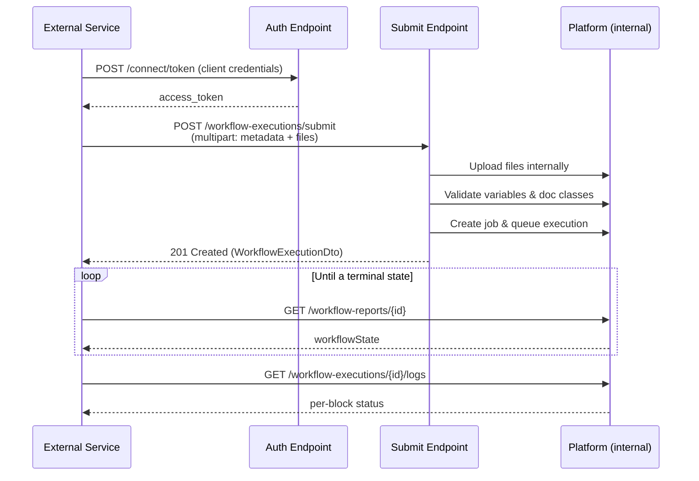

# Submit Workflow Execution API

**On this page:** Overview · Authentication · Endpoint · Request Format · Request limits · After the submit: poll, read, download · Response · Idempotency · Variable Defaults · Document Classes · Email expansion · Examples · Related pages

Start a workflow execution in a single API call. One multipart request carries the files and all metadata. You do not need to upload files or look up workflow details first.

## Overview

The standard workflow execution flow needs several API calls: load categories, load the workflow template, upload each file, then start the execution. The submit endpoint does all of this in one call, for service-to-service integrations.



| | Standard Flow (Frontend) | Submit Endpoint |
|---|---|---|
| Load categories | `GET /workflow-categories/summaries` | Not needed |
| Load workflow details | `GET /workflow-templates/{workflowTypeId}/summary` | Not needed |
| Load counterparties | `GET /counterparties` | Not needed |
| Upload files | `POST /files` (per file) | Included in request |
| Start execution | `POST /workflow-executions` | **`POST /workflow-executions/submit`** |
| **Total calls** | **4 + N** (N = file count) | **1** (+ 1 for auth) |

You still need to know the workflow type ID, the document class keys and the variable replacement tags. [Discovery](discovery.md) shows the read-only calls that list them.

## Authentication

Uses OAuth2 client credentials, the same as all other platform APIs. See [Authentication API](authentication.md) for full details.

### Quick Reference

```http
POST /api/v1/connect/token
Content-Type: application/x-www-form-urlencoded

grant_type=client_credentials
&client_id={client_id}
&client_secret={client_secret}
&scope=api
```

The token endpoint is `[AllowAnonymous]` and does not take an `X-Tenant-Id` header. The organizations a token can act on come from the system user's active organization memberships, and the token carries them in its `tenant_ids` claim. You send the `X-Tenant-Id` header on every **later** API call. It selects which of those organizations the request runs against.

**Response:**
```json
{
  "access_token": "eyJ...",
  "token_type": "Bearer",
  "expires_in": 28800
}
```

`expires_in` is the token lifetime in seconds. It is `Jwt:TokenValidityInMinutes` times 60, so the value depends on the deployment: `appsettings.json` sets 1000 minutes, and a deployment can override it (the response above came from a deployment set to 480 minutes). See [Authentication](authentication.md#token-lifecycle-management).

All later requests require:
```http
Authorization: Bearer {access_token}
X-Tenant-Id: {tenant}
```

The tenant check runs before the token check, so a request with a bad tenant header gets the 403 even when its token is also missing.

| Header problem | Status | `title` |
|---|---|---|
| No `X-Tenant-Id`, or one that names no active organization | 403 | `Tenant context required` |
| An active organization the token does not carry | 403 | `Invalid tenant context` |
| No token, or an invalid one, with a valid `X-Tenant-Id` | 401 | (no body) |

### System User Requirements

The calling service authenticates as a **system user** (`User.IsSystem = true`), whose client id is `service_user_<organization id in lower case>`. This user must:

1. Exist in the `AspNetUsers` table with `IsSystem = true`
2. Have an active membership in the target organization, so its token carries that organization in `tenant_ids` and the `X-Tenant-Id` it sends passes the [tenant check](index.md#tenant-access-control)

Submitting an execution needs only authentication and that tenant access. `POST /workflow-executions/submit` carries no role restriction, so the system user does **not** need `Admin` or any other role to run a workflow. An ordinary signed-in user of the organization can call it too. Some other endpoints do check roles, for example signature-prompt testing. See [System Users](system-users.md) for how roles are granted.

The endpoint checks the organization's access list for the workflow type (`WorkflowTypeOrganizationAccess`, granted on Manage Tenants or when a template save or Add Workflow Type creates the type). A type the organization has no access to answers `404` with `Workflow not found.`, the same answer as an unknown id, so the response does not tell whether the type exists elsewhere. No execution row and no file is stored. The check holds whether `workflowTypeId` names the type or the id of its workflow record.

System users authenticate only with client credentials. They cannot perform interactive login.

### Configuration

| Setting | Description | Example |
|---|---|---|
| Base URL | Platform API base URL | `https://api.example.com` |
| Client ID | System user username | `service_user_acmecorp` |
| Client Secret | System user secret | (stored securely) |
| Tenant ID | Organization identifier | `AcmeCorp` |

### Token Refresh

A client-credentials token lives for the lifetime that `expires_in` states. It comes without a refresh token ([Authentication → Refresh Token Usage](authentication.md#refresh-token-usage)). When the token nears expiry, request a new one with the same client-credentials call:

```python
REFRESH_MARGIN_SECONDS = 300

if time.time() >= token_obtained_at + token_expires_in - REFRESH_MARGIN_SECONDS:
    token, token_expires_in = get_new_token()
    token_obtained_at = time.time()
```

## Endpoint

### `POST /api/v1/workflow-executions/submit`

**Content-Type**: `multipart/form-data`

**Headers:**

| Header | Required | Description |
|---|---|---|
| `Authorization` | Yes | `Bearer {access_token}` |
| `X-Tenant-Id` | Yes | Organization identifier |
| `Idempotency-Key` | No | Unique key to prevent duplicate submissions on retry |

## Request Format

The request is `multipart/form-data` with two types of parts:

1. **`metadata`** is a form field that holds a JSON string with the workflow configuration
2. **`files`** is one or more binary file parts

### Metadata JSON Schema

```json
{
  "workflowTypeId": "CorporatesCreditReport",
  "counterpartyId": "cp-123",
  "peerCompanyIds": ["peer-1", "peer-2"],
  "files": [
    { "documentClass": "AnnualReport" },
    { "documentClass": "FinancialStatements" },
    {}
  ],
  "variables": {
    "currency": "USD",
    "reportingPeriod": "2025-Q4"
  },
  "freezeSourceExecutionId": null
}
```

Property names are matched without regard to case.

| Field | Type | Required | Description |
|---|---|---|---|
| `workflowTypeId` | string | Yes | Workflow type ID (e.g., `CorporatesCreditReport`), max 100 chars. The endpoint also accepts a workflow record ID. |
| `counterpartyId` | string | No | Counterparty to associate with the execution. It must not also appear in `peerCompanyIds`. |
| `peerCompanyIds` | string[] | No | Up to 3 peer company IDs for comparative analysis. |
| `files` | object[] | No | Per-file metadata array. Matched to uploaded files **by index**. It may have fewer entries than there are files, never more. |
| `files[n].documentClass` | string | No | Document class key for the file at this index (max 100 chars). Use a key the workflow defines: the endpoint does not reject a key the workflow does not know, and the file then fills no class. |
| `files[n].password` | string | No | Password for the encrypted PDF, Excel, or Word file at this index. Used once to decrypt it at ingest; the stored copy is the decrypted one and the password is never persisted. Same behavior as the [Files API `password` parameter](files.md#upload-file). A password error is reported under `files[<index>]` with the Files API message, not under the Files API code. |
| `variables` | object | No | Workflow variable values (key = `ReplacementTag`). Defaults from the workflow are used for variables you leave out. |
| `freezeSourceExecutionId` | string | No | The freeze option: a completed execution of the organization whose external-fetch outputs this execution replays instead of fetching live. The submission must match it on workflow type, counterparty and variable values. Same guard, error codes and response fields as [`POST /workflow-executions`](workflow-executions.md#freezing-external-fetches). |
| `freezeSourceCaseId` | string | No | The freeze option served through a validation case: an imported case replays the captures its bundle carried, a native case replays its baseline execution. The submission must match the case's re-run recipe on workflow type, counterparty and variable values. Mutually exclusive with `freezeSourceExecutionId`. A build without the validation module refuses it with 400 `WorkflowExecution.FreezeSourceCaseNotInBuild` ("Replay from a validation case is not part of this build.") before any upload, and starts nothing. |


### File Parts

Upload files as standard multipart file parts. The order matters: files are matched to `metadata.files` entries by array index. Every request must carry at least one file, even when the workflow declares no document classes.

**Supported file types:** the platform decides the type from the bytes, not the file name. The accepted formats are listed once, under [Files API → Supported File Formats](files.md#upload-file).

## Request limits

A `/submit` request is limited at several layers. The effective ceiling for a deployment is the **smallest** limit on the path the request takes.

| Limit | Value | Where it is enforced | Configurable? |
|---|---|---|---|
| **Max file size (per file)** | **100 MB** (default) | Each uploaded file is checked on its own before it is stored. | Yes: `PlatformSettings.IniaAi.MaxFileSizeMb` (default `100`), set per deployment. |
| **Max total request body (API)** | **200,000,000 bytes** | The submit endpoint caps the whole request (`[RequestSizeLimit]`). | Fixed in the endpoint. |
| **Multipart form body (API default)** | **128 MB** | ASP.NET Core's default multipart body length applies when the form is read. The submit endpoint does not raise it. | Per deployment, if overridden. |
| **Reverse-proxy upload cap** | **100 MB** | The bundled nginx front door (`client_max_body_size 100m`) when a request passes through it on the way to the API. | Yes: operator-set in the deployment's nginx config. |
| **Parts per request** | **At least 1 file; at most 1024 parts** | The request must carry one or more files. ASP.NET Core's default form value count limit (1024) counts every part, the `metadata` field included; above it the request answers 400 `Failed to read the request form. Form value count limit 1024 exceeded.` | Per deployment, if overridden. |
| **Peer companies per request** | **3** | `metadata.peerCompanyIds` is rejected above three entries. | Fixed. |

Practical guidance:

- **Plan for about 100 MB as the safe working ceiling.** The per-file limit and the bundled reverse proxy both default to 100 MB, so a request under 100 MB in total clears every layer above without special configuration. Larger payloads work only where an operator has raised both the per-file limit and the proxy cap.
- **A failed file is reported per file.** The response is the standard validation `errors` map keyed `files[<index>]`, one entry per file the intake gate refused or that waits for a password, each naming the file and the reason. The request as a whole fails, and every document it created is deleted again. See [Per-file errors](#per-file-errors).
- Whoever operates your deployment sets the exact values (per-file limit, proxy cap). Sending documents larger than the defaults allow is an operator change.


## After the submit: poll, read, download

`POST /submit` returns **`201 Created` at once** with `workflowState: "Queued"`. It does **not** wait for the workflow to finish. The execution runs on the platform's background job queue. The `id` in the response is the execution ID that every call below takes.

There is no `GET /api/v1/workflow-executions/{id}`; that request answers 404. Read the execution's state from the report endpoint, which is also the URL in the `Location` header of the `201`.

### 1. Poll the state

```http
GET /api/v1/workflow-reports/{id}
```

The response is the same `WorkflowExecutionDto` that the submit returned, with the current `workflowState`. See [Workflow Reports → Get Report](reports.md#get-report-execution) for every field.

`workflowState` is one of the `WorkflowState` values:

| State | Meaning | Stop polling? |
|---|---|---|
| `Queued` | Waiting for a worker. | No |
| `ProcessingDocuments` | Reading the input documents. | No |
| `Running` | Running the sections. | No |
| `Draft` | The run finished and its results are saved. The report is a draft an analyst can review. | Yes |
| `Confirmed` | An analyst confirmed the draft. A submitted run does not reach it without that step. | Yes |
| `Failed` | The run stopped on an error. `failureKind` and `failureDetail` say why. | Yes |
| `Cancelled` | Someone cancelled the run (see [Cancel](#5-cancel-a-run)). | Yes |
| `Undefined` | The creation default, held only by legacy rows. | No |

There is no `Completed` state. An integration that waits for `Completed` waits for ever.

Guidance for a polling loop:

- **A run takes minutes, not seconds.** The time grows with the number and size of documents and the number of model-backed blocks. A small run of a few blocks can finish in seconds; a large multi-document credit report runs much longer. Do not assume a fixed time.
- **Poll every few seconds to every few tens of seconds.** Polling faster gives no benefit and only adds load.
- **Use a generous overall timeout** (tens of minutes) before you treat a run as stuck. Log the execution `id` so a person can inspect it instead of submitting again. A new submit with the **same `Idempotency-Key`** returns the original execution and starts nothing (see [Idempotency](#idempotency)).
- The submit call itself (the upload and the `201`) is a normal request. The deployment's proxy read timeout limits it (the bundled nginx default is 300 s). That timeout limits the **upload**, not the run that follows.

### 2. Read the status of each block

`Draft` means the run finished. It does **not** mean every block succeeded. A block that fails marks itself `Failed` and the run continues. Only a block marked critical (an Agent block is critical unless its author turns that off) or a run-level error, such as results that could not be saved, ends the run `Failed`. Read the per-block list to know whether the report is complete:

```http
GET /api/v1/workflow-executions/{id}/logs
```

The response is `{ "value": [ ... ] }`, one entry per block run, each with a `status` of `NotExecuted`, `Running`, `Completed`, `Failed` or `Skipped` and an `error` text when it failed. A report is complete when no entry is `Failed`. `GET /api/v1/workflow-executions/{id}/logs/{logId}` returns one block's inputs and output. See [Workflow Executions → Get Execution Logs](workflow-executions.md#get-execution-logs).

### 3. Download the outputs

| What | Call |
|---|---|
| The report as Word | `GET /api/v1/workflow-reports/{id}/export/Word` ([Export Report](reports.md#export-report)) |
| The report tree as JSON | `GET /api/v1/workflow-reports/{id}/elements` |
| A generated file, such as a spreadsheet | Find its entry in `workflowExecutionDocuments` of `GET /api/v1/workflow-reports/{id}` where `isOutputDocument` is `true`, then `GET /api/v1/files/{fileId}` ([Files API](files.md)). `isOutputDocument` is `true` only for a file stored under one of the workflow's output document classes; a block that writes a file with no class leaves it `false`. |

`workflowExecutionDocuments` lists the input documents too, with `isOutputDocument: false`.

### 4. Read back what the run did

These calls return the run's evidence. They answer only to an `Operator` or `SuperAdmin` (any run in the organization) or to the organization's service user (a run it started). Every other caller gets 403, the ordinary user who started the run included. A run in another organization answers 404.

| What | Call |
|---|---|
| The executed workflow as a `.workflow` JSON file | `GET /api/v1/executed-workflows/download?executionId={id}` ([Executed Workflow Download](executed-workflow-download.md)). With no id it answers 400. |
| The files each Agent block's runs collected | `GET /api/v1/workflow-executions/{id}/agent-runs`, then `.../agent-runs/{blockId}/trace` or `.../agent-runs/{blockId}/file?path=...` ([Run evidence](workflow-executions.md#run-evidence)) |

`GET /api/v1/workflow-reports/{id}/cost` returns what the run cost. It answers only to a `SuperAdmin` or to the service user that started the run; an `Operator` gets 403. See [Get Report Cost](reports.md#get-report-cost).

### 5. Cancel a run

```http
PATCH /api/v1/workflow-executions/{id}/state
Content-Type: application/json

{ "state": "Cancelled" }
```

A run in `Queued`, `ProcessingDocuments`, `Running` or `Undefined` is cancelled and the call answers `204 No Content`. A run in any other state answers 400 with `WorkflowExecution.NotCancellable`, and a target other than `Cancelled` answers 400. See [Update Execution State](workflow-executions.md#update-execution-state).

## Response

### 201 Created

The workflow execution is created and queued.

```http
HTTP/1.1 201 Created
Location: https://api.example.com/api/v1/workflow-reports/exec-abc123
Content-Type: application/json; charset=utf-8
```

```json
{
  "id": "exec-abc123",
  "workflowId": "exec-abc123",
  "createdAt": "2026-03-26T14:30:00.125272Z",
  "workflowState": "Queued",
  "failureKind": null,
  "failureDetail": null,
  "workflowTypeId": "CorporatesCreditReport",
  "workflowTypeName": null,
  "counterpartyId": "cp-123",
  "counterpartyName": null,
  "analystName": "service_user_acmecorp",
  "reviewDate": "2026-03-26T14:30:00.124692Z",
  "userId": "user-system-1",
  "title": "Corporates Credit Report",
  "variables": {
    "currency": "USD",
    "reportingPeriod": "2025-Q4"
  },
  "jobId": "job-xyz789",
  "workflowExecutionDocuments": null,
  "excludedDocuments": null,
  "variableValues": null,
  "isBaseline": false,
  "baselineVerified": null,
  "freezeSourceExecutionId": null,
  "freezeSourceCaseId": null,
  "freezeReplayedCount": null,
  "freezeEligibleCount": null,
  "startedAt": null,
  "completedAt": null,
  "duration": null,
  "intakeSkippedFiles": null,
  "agentActivity": null,
  "workflowActivity": null
}
```

`workflowTypeName`, the document lists and `variableValues` are null in this response; `GET /api/v1/workflow-reports/{id}` fills them. The `variables` keys come back in camel case (`Country` reads `country`), see [the `variables` warning](reports.md#get-report-execution).

`intakeSkippedFiles` lists the parts of an expanded email that could not be ingested, so it is null in the open build, which expands no email.


### Error Responses

Validation errors use the standard `errors` map: the key is the error code, the value the messages.

| Status | Cause |
|---|---|
| 400 | `General.Validation`: the `metadata` field is missing, its JSON is invalid, or it is the JSON `null` |
| 400 | `Metadata.FreezeSourceCaseId`: both `freezeSourceExecutionId` and `freezeSourceCaseId` are set |
| 400 | `Files`: no file was sent (`At least one file must be provided.`), or `metadata.files` has more entries than there are files |
| 400 | `Metadata.PeerCompanyIds` (more than 3 peers), `Metadata.CounterpartyId` (the counterparty is also a peer) |
| 400 | `WorkflowVariable.Required`, `WorkflowVariable.InvalidOption`, `WorkflowVariable.InvalidType`, `WorkflowVariable.InvalidDateTime`, `WorkflowVariable.InvalidList`: a required variable is empty, or a value is not one of the variable's options or not of its type. A workflow default counts as a value, so a default that is not a valid option fails too. |
| 400 | `DocumentClasses`: a required document class has no file (`Required document class 'Annual Report' is missing`), a class that allows one file has several, or a file names a class the workflow produces. See [Document Classes](#document-classes). |
| 400 | `files[<index>]`: the file at that index was refused by the [intake gate](files.md#400-bad-request--refused-by-the-intake-gate), or is password-protected; one entry per failed file, each naming the file and the reason. Every document the request created is deleted; see [Per-file errors](#per-file-errors) |
| 400 | `General.Validation`: `These output-document blocks need a document class selected: ...`, a problem in the workflow definition, not in the request |
| 400 | `IdempotencyKey`: the `Idempotency-Key` header is longer than 64 characters |
| 400 | `WorkflowExecution.AgentRuntimeDisabled`, `WorkflowExecution.AgentModelNotAllowed`: the workflow has an Agent block this deployment cannot run, so the request is refused before any spend |
| 400 / 404 | `WorkflowExecution.FreezeSource*`: the freeze source is missing, has not finished (`Draft` and `Confirmed` count as finished), or does not match the submission on workflow type, counterparty or variables; see [Freezing external fetches](workflow-executions.md#freezing-external-fetches) |
| 401 | Missing or invalid Bearer token |
| 403 | Missing or unknown `X-Tenant-Id`, or an organization the token does not carry; see [Authentication](#authentication) |
| 404 | `Workflow not found.`: no workflow matches `workflowTypeId`, or the organization has no access to its workflow type |
| 415 | The request is not `multipart/form-data` |


```json
{
  "type": "https://tools.ietf.org/html/rfc9110#section-15.5.1",
  "title": "One or more validation errors occurred.",
  "status": 400,
  "errors": {
    "WorkflowVariable.Required": [
      "Required dropdown variable 'Cost Inflation Stress (%)' (cost_inflation_percent) is missing or empty."
    ]
  },
  "traceId": "00-..."
}
```

### What a refused submission leaves behind

The files are uploaded before the variables, the document classes, the freeze source and the Agent block guard are checked. A submission refused by one of those checks keeps the documents its upload created; they belong to no run. Only a per-file upload error deletes the documents the request created.


### Per-file errors

A file the platform cannot accept fails the whole submission, and the response names every such file under its index in the `files` array. The message is the file name, a colon, and the reason the [intake gate](files.md#400-bad-request--refused-by-the-intake-gate) gave. Documents the request created before the failure are deleted again, so a retry with the bad file fixed starts clean. A document the upload reused, because the organization already held a file of that name and size, is left in place: it belongs to an earlier run.

```json
{
  "type": "https://tools.ietf.org/html/rfc9110#section-15.5.1",
  "title": "One or more validation errors occurred.",
  "status": 400,
  "errors": {
    "files[0]": [
      "notes.pdf: The file is named as a PDF, but its content is plain text. Check that it is the right file, or rename it to match its content."
    ]
  },
  "traceId": "00-..."
}
```


## Idempotency

Include an `Idempotency-Key` header (max 64 characters) to prevent duplicate executions on retry:

```http
Idempotency-Key: unique-request-id-123
```

If the same key is sent again for the same organization, the endpoint answers `201` with the original execution, in its current state, and starts no new run. The key is checked after the files are uploaded: a retry uploads its files again (a file the organization already holds with the same name and size is reused), and a file that now fails the upload answers 400 instead. Use a UUID generated before the first attempt and reuse it for retries.


## Variable Defaults

The endpoint fills in the variable defaults from the workflow definition. Supply only the variables that differ from the defaults. Keys are matched to the workflow's replacement tags without regard to case.

**Example:** If a workflow defines:

| Variable | Required | Default |
|---|---|---|
| `currency` | Yes | `USD` |
| `reportingPeriod` | Yes | *(none)* |
| `includeCharts` | No | `Yes` |

Then this metadata is sufficient:

```json
{
  "variables": {
    "reportingPeriod": "2025-Q4"
  }
}
```

`currency` defaults to `"USD"` and `includeCharts` defaults to `"Yes"`. Only `reportingPeriod` must be supplied, because it has no default.

A default is validated like a value you send. For a dropdown variable the value must be one of the option keys that `GET /workflow-templates/{workflowTypeId}/summary` lists; when a workflow's default is not one of them, the submit answers 400 `WorkflowVariable.InvalidOption` until you send a valid value.

## Document Classes

Each workflow defines document classes as required, suggested, or optional. The endpoint checks that every **required** class has a file.

Assign classes with the `files` array in metadata, matched by index:

```json
{
  "files": [
    { "documentClass": "AnnualReport" },
    { "documentClass": "FinancialStatements" }
  ]
}
```

Files without a matching metadata entry (or with `documentClass` omitted) are uploaded without classification.


## Email expansion

Email expansion is the full edition's. The open build reads no email, so it uploads an entry with `expandEmail: true` as it is, and the [intake gate](files.md#400-bad-request--refused-by-the-intake-gate) refuses it like any upload: the error is keyed `files[<index>]`, and its message names the format, such as "The platform does not read Outlook email files (.msg). Save the email as a PDF, or upload its attachments instead. The full edition reads Outlook email files directly and extracts their attachments."


## Examples

### curl: the whole flow

Set these first. The secret stays in your environment and never goes into a script. Then save the second block as a file and run it with `bash`; it stops with `exit 1` when a call fails.

```bash
export BASE_URL="https://api.example.com"
export TENANT="AcmeCorp"
export CLIENT_ID="service_user_acmecorp"
export CLIENT_SECRET="..."   # from your secret store
```

```bash
# 1. Authenticate (the token endpoint takes no X-Tenant-Id header)
TOKEN=$(curl -s -X POST "$BASE_URL/api/v1/connect/token" \
  -H "Content-Type: application/x-www-form-urlencoded" \
  -d "grant_type=client_credentials&client_id=$CLIENT_ID&client_secret=$CLIENT_SECRET&scope=api" \
  | jq -r '.access_token')

# 2. Submit the workflow execution and keep its id
EXECUTION_ID=$(curl -s -X POST "$BASE_URL/api/v1/workflow-executions/submit" \
  -H "Authorization: Bearer $TOKEN" \
  -H "X-Tenant-Id: $TENANT" \
  -H "Idempotency-Key: $(uuidgen)" \
  -F 'metadata={"workflowTypeId":"CorporatesCreditReport","files":[{"documentClass":"AnnualReport"}],"variables":{"reportingPeriod":"2025-Q4"}};type=application/json' \
  -F "files=@/path/to/annual-report.pdf;type=application/pdf" \
  | jq -r '.id // empty')
[ -n "$EXECUTION_ID" ] || { echo "submit refused"; exit 1; }

# 3. Poll the state until it is terminal (stop on any error response)
while true; do
  REPORT=$(curl -sf "$BASE_URL/api/v1/workflow-reports/$EXECUTION_ID" \
    -H "Authorization: Bearer $TOKEN" -H "X-Tenant-Id: $TENANT") \
    || { echo "poll failed"; exit 1; }
  STATE=$(echo "$REPORT" | jq -r '.workflowState')
  echo "$STATE"
  case "$STATE" in Draft|Confirmed|Failed|Cancelled) break ;; esac
  sleep 10
done

# 4. List the blocks that failed (an empty list means the report is complete)
curl -s "$BASE_URL/api/v1/workflow-executions/$EXECUTION_ID/logs" \
  -H "Authorization: Bearer $TOKEN" -H "X-Tenant-Id: $TENANT" \
  | jq '[.value[] | select(.status == "Failed") | {blockName, error}]'

# 5. Download the report as Word, and each generated file
curl -s -o report.docx "$BASE_URL/api/v1/workflow-reports/$EXECUTION_ID/export/Word" \
  -H "Authorization: Bearer $TOKEN" -H "X-Tenant-Id: $TENANT"
curl -s "$BASE_URL/api/v1/workflow-reports/$EXECUTION_ID" \
  -H "Authorization: Bearer $TOKEN" -H "X-Tenant-Id: $TENANT" \
  | jq -r '.workflowExecutionDocuments[] | select(.isOutputDocument) | .fileId' \
  | while read -r FILE_ID; do
      curl -s -OJ "$BASE_URL/api/v1/files/$FILE_ID" \
        -H "Authorization: Bearer $TOKEN" -H "X-Tenant-Id: $TENANT"
    done

# 6. Download the executed workflow (the service user that started the run, or an Operator)
curl -s -o run.workflow "$BASE_URL/api/v1/executed-workflows/download?executionId=$EXECUTION_ID" \
  -H "Authorization: Bearer $TOKEN" -H "X-Tenant-Id: $TENANT"
```

To cancel a run that is still in flight:

```bash
curl -s -o /dev/null -w "%{http_code}\n" -X PATCH "$BASE_URL/api/v1/workflow-executions/$EXECUTION_ID/state" \
  -H "Authorization: Bearer $TOKEN" -H "X-Tenant-Id: $TENANT" \
  -H "Content-Type: application/json" -d '{"state":"Cancelled"}'
```

It prints `204` when the run was cancelled and `400` when the run had already ended.

### Python

```python
import json
import os
import time
import uuid

import requests

BASE_URL = "https://api.example.com"
TENANT = "AcmeCorp"
TERMINAL_STATES = {"Draft", "Confirmed", "Failed", "Cancelled"}

# 1. Authenticate (the token endpoint takes no X-Tenant-Id header)
token_resp = requests.post(
    f"{BASE_URL}/api/v1/connect/token",
    data={
        "grant_type": "client_credentials",
        "client_id": os.environ["CLIENT_ID"],
        "client_secret": os.environ["CLIENT_SECRET"],
        "scope": "api",
    },
)
token_resp.raise_for_status()
headers = {"Authorization": f"Bearer {token_resp.json()['access_token']}", "X-Tenant-Id": TENANT}

# 2. Submit workflow execution
metadata = {
    "workflowTypeId": "CorporatesCreditReport",
    "files": [
        {"documentClass": "AnnualReport"},
        {"documentClass": "FinancialStatements"},
    ],
    "variables": {
        "reportingPeriod": "2025-Q4",
    },
}

with open("report.pdf", "rb") as report, open("financials.xlsx", "rb") as financials:
    response = requests.post(
        f"{BASE_URL}/api/v1/workflow-executions/submit",
        headers={**headers, "Idempotency-Key": str(uuid.uuid4())},
        files=[
            ("metadata", (None, json.dumps(metadata), "application/json")),
            ("files", ("report.pdf", report, "application/pdf")),
            ("files", ("financials.xlsx", financials,
                "application/vnd.openxmlformats-officedocument.spreadsheetml.sheet")),
        ],
    )
response.raise_for_status()
execution = response.json()
print(f"Execution ID: {execution['id']}, Job: {execution['jobId']}")

# 3. Poll until the run ends
while True:
    state = requests.get(
        f"{BASE_URL}/api/v1/workflow-reports/{execution['id']}", headers=headers
    ).json()["workflowState"]
    if state in TERMINAL_STATES:
        break
    time.sleep(10)

# 4. Check every block
logs = requests.get(
    f"{BASE_URL}/api/v1/workflow-executions/{execution['id']}/logs", headers=headers
).json()["value"]
failed = [entry for entry in logs if entry["status"] == "Failed"]
print(state, f"{len(failed)} failed block(s)")
```

## Related pages

- [Authentication](authentication.md): OAuth 2.0 grant types and token lifetime.
- [Discovery](discovery.md): how to find the workflow type ID, document class keys and variable tags a submit needs.
- [Workflow Executions](workflow-executions.md): execution lifecycle, state transitions, per-block logs and run evidence.
- [Workflow Reports](reports.md): the execution details, the report tree, export and cost.
- [Executed Workflow Download](executed-workflow-download.md): the executed workflow snapshot and who may read it.
- [Key Terms](../glossary.md): plain-language definitions of workflow type, execution, counterparty, and tenant.
