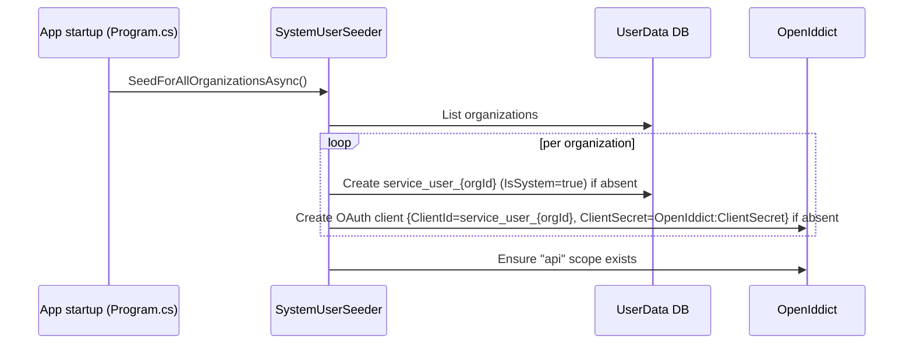

# Provisioning a System User (API Credentials)

**On this page:** What a system user is · How system users are created · What the integrator needs · Roles: when a system user needs more than authentication · Rotating the secret · Related pages

Every external integration authenticates as a **system user** — a non-interactive account that obtains tokens through the OAuth2 `client_credentials` grant. This page explains where those credentials come from, so that the `client_id` / `client_secret` / `X-Tenant-Id` referenced throughout the API reference are values you can actually obtain, not placeholders you have to guess.

If you only need to *use* an existing system user, jump to [What the integrator needs](#what-the-integrator-needs). If you are standing up a new deployment or adding an organization, read [How system users are created](#how-system-users-are-created) first.

## What a system user is

A system user is an ordinary [ASP.NET Identity](authentication.md) user with `IsSystem = true`. Two things make it different from a person's account:

- It is created **automatically, one per organization**, the first time the API starts against a database — you do not register it through a sign-up form.
- It authenticates **only** through `grant_type=client_credentials`. It has no usable interactive password and never logs in through the UI.

The matching OAuth client (the `client_id` / `client_secret` pair) is the credential an integrator presents to [`POST /connect/token`](authentication.md#2-client-credentials-grant-system-authentication). The token that comes back carries the system user's organizations in its `tenant_ids` claim, and the integrator then selects one of those organizations per request with the `X-Tenant-Id` header.

> Source: `platform/IniaAi.Domain/Entities/UserManagement/User.cs` (`IsSystem`), `platform/IniaAi.Infrastructure/Persistence/Seed/SystemUserSeeder.cs`.

## How system users are created

System users are **seeded at application startup** — there is no admin button and no API call to create one. `platform/IniaAi.WebApi/Program.cs` calls `SystemUserSeeder.SeedForAllOrganizationsAsync(...)` on every boot. An `ISystemUserPolicy` decides which organizations get one: the default, `SystemUserForEveryOrganization`, names every organization.


For each organization the policy names, the seeder:

1. Ensures a user `service_user_{organizationId}@inia.ai` exists with `IsSystem = true` and `EmailConfirmed = true` (`SystemUserSeeder.CreateSystemUserAsync`).
2. Ensures a matching **OpenIddict application** exists whose `ClientId` is `service_user_{organizationId}` (lower-cased) and whose `ClientSecret` is the configured `OpenIddict:ClientSecret` value (`SystemUserSeeder.SeedOrganizationAsync`).
3. Ensures the `api` scope exists (`SystemUserSeeder.EnsureApiScopeAsync`).



Because seeding is idempotent and runs on every boot, a newly added organization gets its system user the next time the API restarts.

### The derived credential values

| Credential | Value | Where it comes from |
|---|---|---|
| `client_id` | `service_user_{organizationId}` (lower-cased) | Derived from the organization ID. For the customer org `Default`, the client ID is `service_user_default`. |
| `client_secret` | The deployment's `OpenIddict:ClientSecret` | A **deployment secret**, supplied per environment. The same value is shared by every system user in that deployment. See [Application Configuration](../../operations/application-configuration.md#oidc--sso). |
| `X-Tenant-Id` | The organization ID | One of the organizations the token can act on (its `tenant_ids` claim). |

`{organizationId}` is the customer organization's ID. On a single-customer deployment this is the `PlatformSettings:CustomerOrgId` value (defaults to `Default` in `appsettings.json` and in code); the seeder also always provisions a system user for the built-in `IniaAI` org. The customer organization ID is a **deployment value — get it from whoever ran the deploy**.

> Source: `SystemUserSeeder.GetClientId` and `SystemUserSeeder.SeedOrganizationAsync` (`userName`/`email` construction), `SystemUserClientSecret.Resolve` (reads `OpenIddict:ClientSecret`), `IniaAi.Configuration` `PlatformSettings.CustomerOrgId`, `platform/IniaAi.Infrastructure/Persistence/UserData/Contexts/UserDataDbInitializer.cs` (organization seeding).

> [!WARNING]
> **The shared client secret must be set per deployment**
>
> The source carries no client secret. With `OpenIddict:ClientSecret` absent, empty or whitespace (`SystemUserClientSecret.Resolve`), the seeder still creates the system users but creates or updates **no** OAuth client, so `client_credentials` sign-in stays off until a secret is set. A real deployment injects a strong secret through the deploy pipeline — never commit the real value. The system users have no password: they sign in with the client secret only.
>
>

## What the integrator needs

Hand an external integrator exactly three values:

| Value | Example (placeholder) | Who provides it |
|---|---|---|
| Base URL | `https://api.<customer-domain>` | DevOps / whoever owns the deployment. The platform is self-hosted, so there is no shared host — see [API Reference](index.md#base-url). |
| `client_id` | `service_user_default` | Derived from the org ID (above). |
| `client_secret` | `<openiddict-client-secret>` | DevOps / secrets store — the deployment's `OpenIddict:ClientSecret`. |
| `X-Tenant-Id` | `Default` | The organization ID the calls should run against. |

With those, the integrator runs the standard client-credentials exchange:

```bash
curl -X POST "$BASE_URL/api/v1/connect/token" \
  -H "Content-Type: application/x-www-form-urlencoded" \
  -d "grant_type=client_credentials&client_id=service_user_default&client_secret=$CLIENT_SECRET&scope=api"
```

The response is a bearer token (see [Authentication → Client Credentials Grant](authentication.md#2-client-credentials-grant-system-authentication)). Every subsequent call adds `Authorization: Bearer {token}` and `X-Tenant-Id: {org}`.

**You're done when** that `curl` returns a JSON body containing `access_token`, and a follow-up call such as `GET /api/v1/workflow-categories/summaries` (see [Discovery](discovery.md)) returns `200` instead of `401`/`403`. At that point the integrator can authenticate and is scoped to the right organization.

## Roles: when a system user needs more than authentication

Most integration endpoints — [submit an execution](submit-workflow-execution.md), [discovery](discovery.md), [files](files.md), [documents](documents.md), [counterparties](counterparties.md) — require only **authentication plus tenant access**. The base `ApiController` carries a plain `[Authorize]` (no role), so a freshly seeded system user can call them as soon as its token validates. Some of them also require an organization [capability](../../features/user-management/authorization.md#capabilities) (submit needs `run`, file upload `upload`), which the platform's default grants every organization.

One exception reads a run's evidence without a role: the organization's own service user may read the [executed-workflow snapshot](executed-workflow-download.md), the agent run files and the cost of a run it started itself, so a scripted test run can read back its own result (`RunEvidenceAccess`). Any other run's evidence answers `403` with `Only a staff role or the service user that started this run can read its evidence.`

A minority of endpoints are role-gated with `[Authorize(Roles = ...)]` — for example the [counterparty export and import](counterparties.md) (`Admin`/`SuperAdmin`) and the signature-review endpoints. The seeder does **not** assign any role to a system user, and the admin Role-Management UI lists only non-system users (`Administration.razor` filters `u => !u.IsSystem`). So if an integration must reach a role-gated endpoint, an operator has to grant the role to the system user **directly in the database** (insert the `AspNetUserRoles` row linking the `service_user_{org}` user to the role). Treat this as an exception, not the normal path, and coordinate it with whoever administers the deployment.

> Source: `platform/IniaAi.WebApi/Controllers/v1/Base/ApiController.cs` (`[Authorize]`), `RunEvidenceAccess.AuthorizeAsync`, `CounterpartiesController.cs` (`[Authorize(Roles = Roles.ADMIN_ROLES)]` on `export` and `import`), `platform/IniaAi.WebApp/Components/Admin/Pages/Administration.razor` (`!u.IsSystem` filter), `Roles.cs`.

## Rotating the secret

Because `OpenIddict:ClientSecret` is read from configuration and applied on every boot, rotating it is a configuration change plus a restart: update the secret in the deploy pipeline / secrets store, redeploy, and the seeder updates the existing OAuth clients to the new secret on startup (`SystemUserSeeder` updates the descriptor when the client already exists). Integrators must then re-fetch tokens with the new secret. Coordinate the cutover with the integrator so in-flight credentials are swapped together.

## Related pages

- [Authentication API](authentication.md) — the `client_credentials` grant and token lifecycle.
- [Discovery](discovery.md) — first calls to make once you hold a token.
- [Submit Workflow Execution](submit-workflow-execution.md) — single-call integration flow.
- [API zero to result](../../guides/end-to-end/api-zero-to-result.md) — the end-to-end integrator journey that starts here.
- [Application Configuration](../../operations/application-configuration.md#oidc--sso) — where `OpenIddict:ClientSecret` is set.

