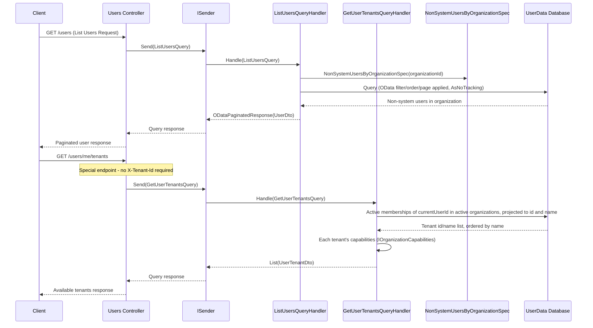
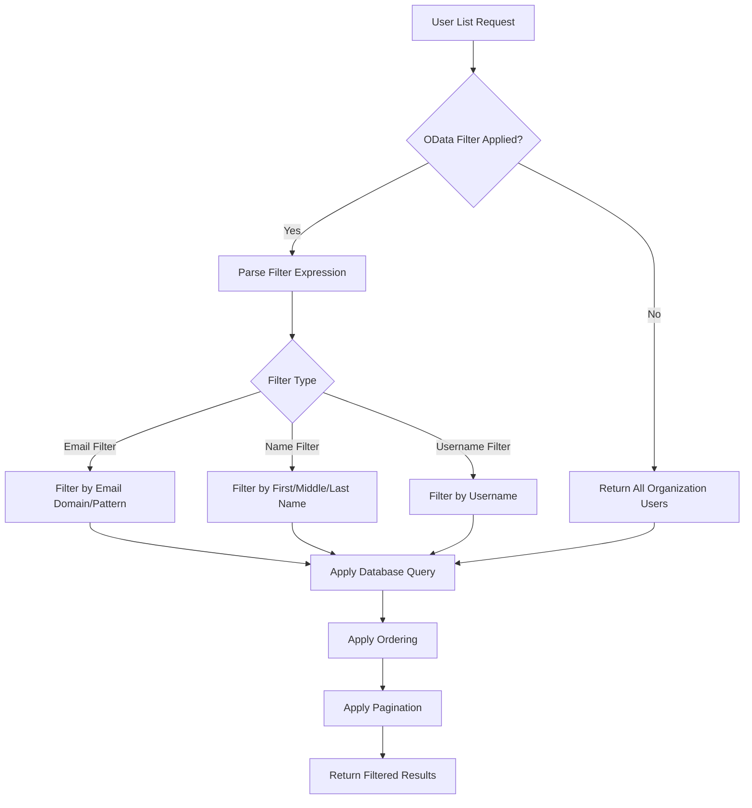
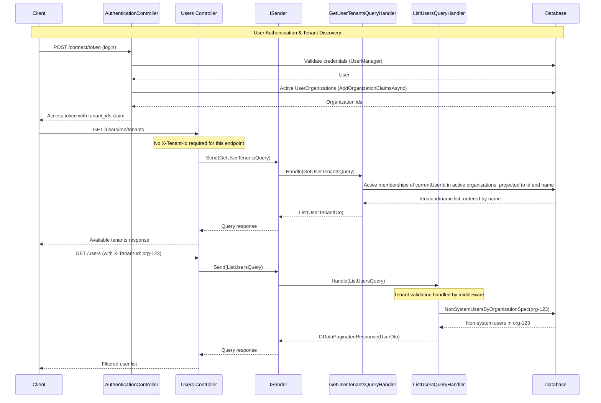

# Users API

**On this page:** Base URL · Authentication · User Management Flow · Endpoints · Multi-Tenant User Access Pattern · JWT Token Integration · Error Responses · User Roles · OData Query Examples · Integration notes

The Users API provides endpoints for managing user information and tenant access within the IniaAi Platform's multi-tenant architecture. This API enables user listing, tenant discovery, and username resolution for authenticated users.

## Base URL
`/api/v1/users`

## Authentication
All endpoints require authentication and tenant context:

```http
Authorization: Bearer {access_token}
X-Tenant-Id: {organization_id}
Content-Type: application/json
```

## User Management Flow



## Endpoints

### List Users

#### `GET /api/v1/users`

Retrieves a paginated list of non-system users within the current organization with OData query support. System (service) accounts are excluded by `NonSystemUsersByOrganizationSpec`. The endpoint requires the organization's `team-view` [capability](../../features/user-management/authorization.md#capabilities): an organization without it gets `403` with the title `Not included`.

The list holds the users whose home organization (`User.OrganizationId`) is the current one, not the members of the organization: a member whose home is another organization is missing, and a user whose membership was deactivated stays while the home organization is unchanged. Disabled (locked-out) users are listed too; the response carries no status to tell them apart.

**Query Parameters:**

| Parameter | Type | Description |
|-----------|------|-------------|
| `$filter` | string | OData filter expression over the `UserDto` properties the database holds (`email`, `firstName`, `lastName`, `middleName`, `username`). `fullName` is computed after the row returns (`User.GetFullName` in `UserProjections`), so a filter on it cannot run |
| `$orderby` | string | OData ordering expression over the same properties (e.g., `lastName asc`, `email desc`); not `fullName` |
| `$top` | integer | Maximum number of results to return. When omitted, every matching user is returned (no page size is applied); the response's `@odata.top` still reports 50 |
| `$skip` | integer | Number of results to skip for pagination |
| `$count` | boolean | Include total count in response metadata |

**Example Request:**

```bash
curl -X GET "https://{your-instance}/api/v1/users?$top=20&$orderby=lastName asc&$filter=contains(email,'@company.com')" \
  -H "Authorization: Bearer {token}" \
  -H "X-Tenant-Id: org-123"
```

**Response (200 OK):**

The body is an `ODataPaginatedResponse<UserDto>`. Each `UserDto` carries only identity and name fields — there are no role, status, login, or organization fields on this DTO.

```json
{
  "value": [
    {
      "id": "user-12345",
      "email": "john.doe@company.com",
      "username": "john.doe",
      "firstName": "John",
      "lastName": "Doe",
      "middleName": null,
      "fullName": "John Doe"
    },
    {
      "id": "user-67890",
      "email": "jane.smith@company.com",
      "username": "jane.smith",
      "firstName": "Jane",
      "lastName": "Smith",
      "middleName": null,
      "fullName": "Jane Smith"
    }
  ],
  "@odata.count": 2,
  "@odata.skip": 0,
  "@odata.top": 20
}
```

Paging works as on every OData list, with no `@odata.nextLink` ([OData list conventions](index.md#odata-list-conventions)).

### User Query Filtering



### Get Current User's Tenants

#### `GET /api/v1/users/me/tenants`

Retrieves all organizations/tenants that the authenticated user has access to. This endpoint is special as it does not require the `X-Tenant-Id` header since it's used to discover available tenants.

**Note:** This endpoint bypasses the normal tenant validation since users need to discover which tenants they can access.

**Example Request:**

```bash
curl -X GET "https://{your-instance}/api/v1/users/me/tenants" \
  -H "Authorization: Bearer {token}"
```

**Response (200 OK):**

The body is a `ListResponse<UserTenantDto>`. Each `UserTenantDto` carries the tenant `id`, its `name` and its `capabilities`: what that organization may use, as capability names in ordinal order ([Capabilities](../../features/user-management/authorization.md#capabilities)). An endpoint behind a missing capability answers `403` on top of its role gate, so a client hides it. The platform grants every capability; a closed module can take some away from an organization. The list is ordered alphabetically by name. There are no role, permission, default, or membership-date fields.

```json
{
  "value": [
    {
      "id": "org-123",
      "name": "Acme Corporation",
      "capabilities": ["admin-app", "baselines", "explore", "monitoring", "refine", "report-templates", "run", "run-evidence", "run-logs", "signatures", "standalone-processing", "team-view", "upload", "usage-cost", "validation"]
    }
  ]
}
```

**Response (204 No Content):**

Returned when the user has no tenant memberships.

The list is read from the database at the time of the call, not from the token: an organization joined or left since the sign-in shows here before the token's `tenant_ids` claim catches up ([Authentication](authentication.md#3-refresh-token-grant)). A failure answers `500` with `An error occurred while retrieving tenants`.

### Resolve Usernames

#### `POST /api/v1/users/resolve`

Resolves a list of usernames to their display names (`fullName`). Only usernames belonging to users who have created workflow reports in the current tenant are resolved — this scoping prevents arbitrary user lookups. Usernames that cannot be resolved are simply omitted from the response. A match is a `WorkflowExecution.AnalystName` in the tenant; `fullName` is `null` for a user with neither a first nor a last name.

**Example Request:**

```bash
curl -X POST "https://{your-instance}/api/v1/users/resolve" \
  -H "Authorization: Bearer {token}" \
  -H "X-Tenant-Id: org-123" \
  -H "Content-Type: application/json" \
  -d '{ "usernames": ["john.doe", "jane.smith"] }'
```

**Response (200 OK):**

The body is a `ListResponse<ResolvedUserDto>`.

```json
{
  "value": [
    { "username": "john.doe", "fullName": "John Doe" },
    { "username": "jane.smith", "fullName": "Jane Smith" }
  ]
}
```

## Multi-Tenant User Access Pattern



## JWT Token Integration

The claims a token carries, and how `tenant_ids`, `tenant_id` and `organization_id` are filled, are on [Authentication → Multi-Tenant Token Claims](authentication.md#multi-tenant-token-claims). The Users endpoints require only authentication plus tenant context, and `GET /users` the `team-view` capability; none carries a role gate.

## Error Responses

Tenant errors come from the middleware as `application/problem+json` `ProblemDetails` bodies, not from the controller. `/users/me/tenants` is `[TenantOptional]` and skips both tenant checks.

### 401 Unauthorized

User is not authenticated or token is invalid (the authentication challenge, raised by `[Authorize]` on `ApiController`).

### 403 Forbidden

A missing or unknown `X-Tenant-Id` is rejected by `EarlyTenantRejectionMiddleware` before the token is validated:

```json
{
  "status": 403,
  "title": "Tenant context required",
  "detail": "A valid X-Tenant-Id header is required to access this endpoint.",
  "instance": "/api/v1/users"
}
```

A tenant the token does not grant is rejected by `TenantUserContextMiddleware`:

```json
{
  "status": 403,
  "title": "Invalid tenant context",
  "detail": "You do not have access to this tenant.",
  "instance": "/api/v1/users"
}
```

There is no 400 for a missing organization context: that case is a 403 as above.

## User Roles

The Users API does not return a user's roles: `UserDto` carries identity and name fields only. The roles, and the endpoints each one opens, are on [Authorization](../../features/user-management/authorization.md).

## OData Query Examples

OData filters and ordering apply only to the `UserDto` fields the database holds (`email`, `firstName`, `lastName`, `middleName`, `username`). `fullName` is computed after the row returns, so a list cannot filter or sort by it.

### Filter by Email Domain

```
GET /api/v1/users?$filter=contains(email,'@acme.com')
```

### Filter by Name

```
GET /api/v1/users?$filter=contains(lastName,'Smith')
```

### Filter by Username

```
GET /api/v1/users?$filter=username eq 'john.doe'
```

### Order by Last Name

```
GET /api/v1/users?$orderby=lastName asc,firstName asc
```

### Pagination with Count

```
GET /api/v1/users?$top=10&$skip=20&$count=true
```

## Integration notes

- Call `/users/me/tenants` **first** to discover the organizations a token can act in, then send `X-Tenant-Id` on every other request.
- There is no user CRUD on this API — user administration happens in the Blazor admin UI (see [Authorization](../../features/user-management/authorization.md#the-canonical-role-gate-matrix-v1-api)).
